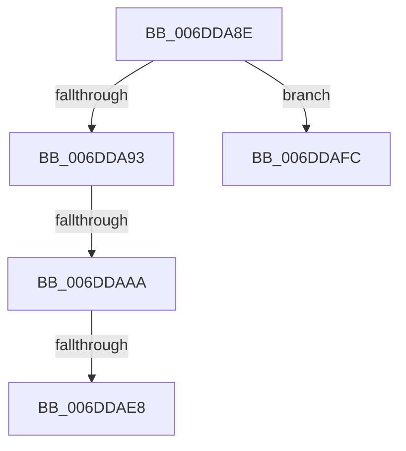

# sub_006DDA8E

- RVA: `0x006DDA8E`–`0x006DDB06` (길이 `120` bytes)
- VA: `0x00000001406DDA8E`
- 실행 섹션: `.text`
- PDB 이름 있음: `아니요`; PDB Function 태그: `아니요`
- unwind 정보 RVA: `0x0006FB74`
- 디코드: `31`개 명령, `120/120` bytes 표시
- 미해석 바이트: `0` (있으면 어셈블리에 `.byte`로 보존)

> 이 문서는 커널 이미지의 기계어와 PDB 기호를 분석해 생성했습니다. 4번과 5번은 함수 원형과 자료형을 바이너리 사용 방식에서 추정한 C 해석이며 원본 소스 복구 결과는 아닙니다.

## 1. Dependencies

- 직접 호출 지점: **4**; 고유 호출 대상: **4**
- 직접 호출자로 확인된 함수: **0**
- RIP 상대 이미지 참조: **1**

### Outgoing calls
- `0x006DDA9B` → [KeGetProcessorNumberFromIndex](../2D/KeGetProcessorNumberFromIndex_function_002DD320.md) (function, `0x002DD320`)
- `0x006DDAAF` → [KeRemoveQueueDpcEx](../46/KeRemoveQueueDpcEx_function_0046CDC0.md) (function, `0x0046CDC0`)
- `0x006DDAD9` → [KeSetTargetProcessorDpcEx](../2D/KeSetTargetProcessorDpcEx_function_002DD280.md) (function, `0x002DD280`)
- `0x006DDAF1` → [KeInsertQueueDpc](../20/KeInsertQueueDpc_function_00207C50.md) (function, `0x00207C50`)

### Direct callers
- 이 함수 시작 RVA로 연결되는 직접 call은 확인되지 않았습니다. 간접 호출은 완전히 역산할 수 없습니다.

### Static image references
- `0x006DDAB4` → RVA `0x005BE4B0` (`KiMaskInterruptDpc`; read)

## 2. Other-region calls and transfers

- 다른 실행 섹션으로 향하는 call: **0**
- call이 아닌 외부 분기/꼬리 이동: **4**
  - `0x006DDAA4` → [KeMaskInterrupt + 0xB7](../2D/KeMaskInterrupt_function_002D42FC.md) (`tail-transfer`)
  - `0x006DDAE2` → [KeMaskInterrupt + 0xB7](../2D/KeMaskInterrupt_function_002D42FC.md) (`tail-transfer`)
  - `0x006DDAF7` → [KeMaskInterrupt + 0xB7](../2D/KeMaskInterrupt_function_002D42FC.md) (`tail-transfer`)
  - `0x006DDB01` → [KeMaskInterrupt + 0xB7](../2D/KeMaskInterrupt_function_002D42FC.md) (`tail-transfer`)

## 3. Assembly (complete function range)

```asm
006DDA8E  48 85 F6                        test rsi, rsi
006DDA91  74 69                           je 0x1406ddafc
006DDA93  8B 4D 60                        mov ecx, dword ptr [rbp + 0x60]
006DDA96  48 8D 54 24 24                  lea rdx, [rsp + 0x24]
006DDA9B  E8 80 F8 BF FF                  call 0x1402dd320
006DDAA0  8B F8                           mov edi, eax
006DDAA2  85 C0                           test eax, eax
006DDAA4  0F 88 09 69 BF FF               js 0x1402d43b3
006DDAAA  33 D2                           xor edx, edx
006DDAAC  48 8B CE                        mov rcx, rsi
006DDAAF  E8 0C F3 D8 FF                  call 0x14046cdc0
006DDAB4  48 8D 05 F5 09 EE FF            lea rax, [rip - 0x11f60b]
006DDABB  C7 06 13 01 00 00               mov dword ptr [rsi], 0x113
006DDAC1  48 8D 54 24 24                  lea rdx, [rsp + 0x24]
006DDAC6  48 89 46 18                     mov qword ptr [rsi + 0x18], rax
006DDACA  48 8B CE                        mov rcx, rsi
006DDACD  48 89 5E 20                     mov qword ptr [rsi + 0x20], rbx
006DDAD1  48 89 5E 38                     mov qword ptr [rsi + 0x38], rbx
006DDAD5  48 89 5E 10                     mov qword ptr [rsi + 0x10], rbx
006DDAD9  E8 A2 F7 BF FF                  call 0x1402dd280
006DDADE  8B F8                           mov edi, eax
006DDAE0  85 C0                           test eax, eax
006DDAE2  0F 88 CB 68 BF FF               js 0x1402d43b3
006DDAE8  8B 55 58                        mov edx, dword ptr [rbp + 0x58]
006DDAEB  4D 8B C6                        mov r8, r14
006DDAEE  48 8B CE                        mov rcx, rsi
006DDAF1  E8 5A A1 B2 FF                  call 0x140207c50
006DDAF6  90                              nop
006DDAF7  E9 B7 68 BF FF                  jmp 0x1402d43b3
006DDAFC  BF 0D 00 00 C0                  mov edi, 0xc000000d
006DDB01  E9 AD 68 BF FF                  jmp 0x1402d43b3
```

## 4. C-style interpretation (structured pseudocode)

```c
__int64 __fastcall sub_006DDA8E(void)
{
    __int64 result;
    unsigned __int64 v_stack_p24;

    if (v_rsi == 0) goto loc_006DDAFC;
    result = KeGetProcessorNumberFromIndex((unsigned int)(*(unsigned int *)(v_rbp + 96)), v_stack_p24, a3, a4);
    a2 = 0;
    result = KeRemoveQueueDpcEx(v_rsi, a2, a3, a4);
    *(unsigned int *)(v_rsi) = 275;
    *(unsigned __int64 *)(v_rsi + 24) = v_rip - 1177099;
    *(unsigned __int64 *)(v_rsi + 32) = v_rbx;
    *(unsigned __int64 *)(v_rsi + 56) = v_rbx;
    *(unsigned __int64 *)(v_rsi + 16) = v_rbx;
    result = KeSetTargetProcessorDpcEx(v_rsi, v_stack_p24, a3, a4);
    result = KeInsertQueueDpc(v_rsi, (unsigned int)(*(unsigned int *)(v_rbp + 88)), v_r14, a4);
loc_006DDAFC:
}
```

## 5. (Beta) C Style

```c
void sub_006DDA8E(void)
{
    int64_t result;
    uint64_t v_stack_p24;

    if (local_rsi == 0) goto loc_006DDAFC;
    result = KeGetProcessorNumberFromIndex((uint32_t)(*(uint32_t *)(local_rbp + 0x60)), v_stack_p24, a3, a4);
    a2 = 0;
    result = KeRemoveQueueDpcEx(local_rsi, a2, a3, a4);
    *(uint32_t *)(local_rsi) = 275;
    *(uint64_t *)(local_rsi + 0x18) = v_rip - 1177099;
    *(uint64_t *)(local_rsi + 0x20) = local_rbx;
    *(uint64_t *)(local_rsi + 0x38) = local_rbx;
    *(uint64_t *)(local_rsi + 0x10) = local_rbx;
    result = KeSetTargetProcessorDpcEx(local_rsi, v_stack_p24, a3, a4);
    result = KeInsertQueueDpc(local_rsi, (uint32_t)(*(uint32_t *)(local_rbp + 0x58)), local_r14, a4);
loc_006DDAFC:
}
```

## 6. Execution-region graph

[열기: 2D/3D 그래프와 함수 탐색 컨트롤 패널](../../../control-panel.html?section=text&rva=0x006DDA8E&view=graph)

- 2D 그래프는 위에서 아래로 흐르고, 3D 그래프는 빈 공간을 드래그해 회전합니다. Shift+드래그는 이동, 휠은 확대·축소, 함수 노드 선택은 대상 보고서 이동입니다.

### Static fallback


