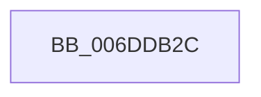

# sub_006DDB2C

- RVA: `0x006DDB2C`–`0x006DDBE2` (길이 `182` bytes)
- VA: `0x00000001406DDB2C`
- 실행 섹션: `.text`
- PDB 이름 있음: `아니요`; PDB Function 태그: `아니요`
- unwind 정보 RVA: `0x0006FCC8`
- 디코드: `39`개 명령, `182/182` bytes 표시
- 미해석 바이트: `0` (있으면 어셈블리에 `.byte`로 보존)

> 이 문서는 커널 이미지의 기계어와 PDB 기호를 분석해 생성했습니다. 4번과 5번은 함수 원형과 자료형을 바이너리 사용 방식에서 추정한 C 해석이며 원본 소스 복구 결과는 아닙니다.

## 1. Dependencies

- 직접 호출 지점: **1**; 고유 호출 대상: **1**
- 직접 호출자로 확인된 함수: **0**
- RIP 상대 이미지 참조: **1**

### Outgoing calls
- `0x006DDBD7` → [EtwWriteEx](../25/EtwWriteEx_function_0025F0D0.md) (function, `0x0025F0D0`)

### Direct callers
- 이 함수 시작 RVA로 연결되는 직접 call은 확인되지 않았습니다. 간접 호출은 완전히 역산할 수 없습니다.

### Static image references
- `0x006DDBA5` → RVA `0x00E66948` (`.data`; read)

## 2. Other-region calls and transfers

- 다른 실행 섹션으로 향하는 call: **0**
- call이 아닌 외부 분기/꼬리 이동: **1**
  - `0x006DDBDD` → [KiIntSteerLogState + 0x39](../2D/KiIntSteerLogState_function_002D57BC.md) (`tail-transfer`)

## 3. Assembly (complete function range)

```asm
006DDB2C  49 8B 53 10                     mov rdx, qword ptr [r11 + 0x10]
006DDB30  41 B8 08 00 00 00               mov r8d, 8
006DDB36  4C 89 45 EF                     mov qword ptr [rbp - 0x11], r8
006DDB3A  4C 89 45 FF                     mov qword ptr [rbp - 1], r8
006DDB3E  48 C7 45 CF 04 00 00 00         mov qword ptr [rbp - 0x31], 4
006DDB46  48 8D 42 20                     lea rax, [rdx + 0x20]
006DDB4A  48 C7 45 DF 02 00 00 00         mov qword ptr [rbp - 0x21], 2
006DDB52  48 89 45 C7                     mov qword ptr [rbp - 0x39], rax
006DDB56  48 8D 82 A8 00 00 00            lea rax, [rdx + 0xa8]
006DDB5D  48 89 45 D7                     mov qword ptr [rbp - 0x29], rax
006DDB61  48 8D 82 B0 00 00 00            lea rax, [rdx + 0xb0]
006DDB68  48 89 45 E7                     mov qword ptr [rbp - 0x19], rax
006DDB6C  48 8D 82 A0 00 00 00            lea rax, [rdx + 0xa0]
006DDB73  48 89 45 F7                     mov qword ptr [rbp - 9], rax
006DDB77  48 8B D3                        mov rdx, rbx
006DDB7A  49 8D 43 44                     lea rax, [r11 + 0x44]
006DDB7E  48 C7 45 0F 04 00 00 00         mov qword ptr [rbp + 0xf], 4
006DDB86  48 89 45 07                     mov qword ptr [rbp + 7], rax
006DDB8A  49 8B 43 20                     mov rax, qword ptr [r11 + 0x20]
006DDB8E  48 8B 08                        mov rcx, qword ptr [rax]
006DDB91  49 8D 43 28                     lea rax, [r11 + 0x28]
006DDB95  48 89 45 27                     mov qword ptr [rbp + 0x27], rax
006DDB99  48 83 C1 18                     add rcx, 0x18
006DDB9D  49 8D 43 30                     lea rax, [r11 + 0x30]
006DDBA1  48 89 4D 17                     mov qword ptr [rbp + 0x17], rcx
006DDBA5  48 8B 0D 9C 8D 78 00            mov rcx, qword ptr [rip + 0x788d9c]
006DDBAC  48 89 45 37                     mov qword ptr [rbp + 0x37], rax
006DDBB0  48 8D 45 C7                     lea rax, [rbp - 0x39]
006DDBB4  48 89 44 24 38                  mov qword ptr [rsp + 0x38], rax
006DDBB9  44 89 44 24 30                  mov dword ptr [rsp + 0x30], r8d
006DDBBE  4C 89 45 1F                     mov qword ptr [rbp + 0x1f], r8
006DDBC2  4C 89 45 2F                     mov qword ptr [rbp + 0x2f], r8
006DDBC6  4C 89 45 3F                     mov qword ptr [rbp + 0x3f], r8
006DDBCA  45 33 C0                        xor r8d, r8d
006DDBCD  4C 89 4C 24 28                  mov qword ptr [rsp + 0x28], r9
006DDBD2  4C 89 4C 24 20                  mov qword ptr [rsp + 0x20], r9
006DDBD7  E8 F4 14 B8 FF                  call 0x14025f0d0
006DDBDC  90                              nop
006DDBDD  E9 13 7C BF FF                  jmp 0x1402d57f5
```

## 4. C-style interpretation (structured pseudocode)

```c
__int64 __fastcall sub_006DDB2C(__int64 a1, __int64 a2, __int64 a3, __int64 a4)
{
    __int64 result;
    unsigned __int64 v_stack_p20;
    unsigned __int64 v_stack_p28;
    unsigned int v_stack_p30;
    unsigned __int64 v_stack_p38;

    *(unsigned __int64 *)(v_rbp - 17) = 8;
    *(unsigned __int64 *)(v_rbp - 1) = 8;
    *(unsigned __int64 *)(v_rbp - 49) = 4;
    *(unsigned __int64 *)(v_rbp - 33) = 2;
    *(unsigned __int64 *)(v_rbp - 57) = *(unsigned __int64 *)(v_r11 + 16) + 32;
    *(unsigned __int64 *)(v_rbp - 41) = *(unsigned __int64 *)(v_r11 + 16) + 168;
    *(unsigned __int64 *)(v_rbp - 25) = *(unsigned __int64 *)(v_r11 + 16) + 176;
    *(unsigned __int64 *)(v_rbp - 9) = *(unsigned __int64 *)(v_r11 + 16) + 160;
    *(unsigned __int64 *)(v_rbp + 15) = 4;
    *(unsigned __int64 *)(v_rbp + 7) = v_r11 + 68;
    *(unsigned __int64 *)(v_rbp + 39) = v_r11 + 40;
    a1 = (*(unsigned __int64 *)(*(unsigned __int64 *)(v_r11 + 32))) + (24);
    *(unsigned __int64 *)(v_rbp + 23) = a1;
    *(unsigned __int64 *)(v_rbp + 55) = v_r11 + 48;
    v_stack_p38 = v_rbp - 57;
    v_stack_p30 = 8;
    *(unsigned __int64 *)(v_rbp + 31) = 8;
    *(unsigned __int64 *)(v_rbp + 47) = 8;
    *(unsigned __int64 *)(v_rbp + 63) = 8;
    a3 = 0;
    v_stack_p28 = a4;
    v_stack_p20 = a4;
    result = EtwWriteEx(*(unsigned __int64 *)(v_rip + 7900572), v_rbx, a3, a4);
}
```

## 5. (Beta) C Style

```c
int64_t sub_006DDB2C(int64_t Arg1, int64_t Arg2, int64_t Arg3, int64_t Arg4)
{
    int64_t result;
    uint64_t v_stack_p20;
    uint64_t v_stack_p28;
    uint32_t v_stack_p30;
    uint64_t v_stack_p38;

    *(uint64_t *)(local_rbp - 0x11) = 8;
    *(uint64_t *)(local_rbp - 0x1) = 8;
    *(uint64_t *)(local_rbp - 0x31) = 4;
    *(uint64_t *)(local_rbp - 0x21) = 2;
    *(uint64_t *)(local_rbp - 0x39) = *(uint64_t *)(local_r11 + 0x10) + 32;
    *(uint64_t *)(local_rbp - 0x29) = *(uint64_t *)(local_r11 + 0x10) + 168;
    *(uint64_t *)(local_rbp - 0x19) = *(uint64_t *)(local_r11 + 0x10) + 176;
    *(uint64_t *)(local_rbp - 0x9) = *(uint64_t *)(local_r11 + 0x10) + 160;
    *(uint64_t *)(local_rbp + 0xF) = 4;
    *(uint64_t *)(local_rbp + 0x7) = local_r11 + 68;
    *(uint64_t *)(local_rbp + 0x27) = local_r11 + 40;
    Arg1 = (*(uint64_t *)(*(uint64_t *)(local_r11 + 0x20))) + (24);
    *(uint64_t *)(local_rbp + 0x17) = Arg1;
    *(uint64_t *)(local_rbp + 0x37) = local_r11 + 48;
    v_stack_p38 = local_rbp - 57;
    v_stack_p30 = 8;
    *(uint64_t *)(local_rbp + 0x1F) = 8;
    *(uint64_t *)(local_rbp + 0x2F) = 8;
    *(uint64_t *)(local_rbp + 0x3F) = 8;
    Arg3 = 0;
    v_stack_p28 = Arg4;
    v_stack_p20 = Arg4;
    result = EtwWriteEx(*(uint64_t *)(v_rip + 0x788D9C), local_rbx, Arg3, Arg4);
}
```

## 6. Execution-region graph

[열기: 2D/3D 그래프와 함수 탐색 컨트롤 패널](../../../control-panel.html?section=text&rva=0x006DDB2C&view=graph)

- 2D 그래프는 위에서 아래로 흐르고, 3D 그래프는 빈 공간을 드래그해 회전합니다. Shift+드래그는 이동, 휠은 확대·축소, 함수 노드 선택은 대상 보고서 이동입니다.

### Static fallback


