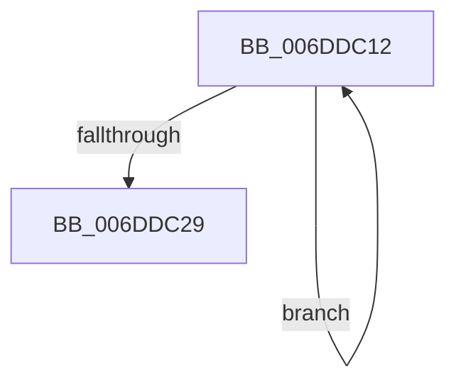

# sub_006DDC12

- RVA: `0x006DDC12`–`0x006DDC2E` (길이 `28` bytes)
- VA: `0x00000001406DDC12`
- 실행 섹션: `.text`
- PDB 이름 있음: `아니요`; PDB Function 태그: `아니요`
- unwind 정보 RVA: `0x0006FEC4`
- 디코드: `7`개 명령, `28/28` bytes 표시
- 미해석 바이트: `0` (있으면 어셈블리에 `.byte`로 보존)

> 이 문서는 커널 이미지의 기계어와 PDB 기호를 분석해 생성했습니다. 4번과 5번은 함수 원형과 자료형을 바이너리 사용 방식에서 추정한 C 해석이며 원본 소스 복구 결과는 아닙니다.

## 1. Dependencies

- 직접 호출 지점: **1**; 고유 호출 대상: **1**
- 직접 호출자로 확인된 함수: **0**
- RIP 상대 이미지 참조: **1**

### Outgoing calls
- `0x006DDC1C` → [KiIntSteerLogState](../2D/KiIntSteerLogState_function_002D57BC.md) (function, `0x002D57BC`)

### Direct callers
- 이 함수 시작 RVA로 연결되는 직접 call은 확인되지 않았습니다. 간접 호출은 완전히 역산할 수 없습니다.

### Static image references
- `0x006DDC12` → RVA `0x00010AD8` (`.rdata`; read)

## 2. Other-region calls and transfers

- 다른 실행 섹션으로 향하는 call: **0**
- call이 아닌 외부 분기/꼬리 이동: **1**
  - `0x006DDC29` → [KeIntSteerPeriodic + 0x1F6](../2D/KeIntSteerPeriodic_function_002D6D04.md) (`tail-transfer`)

## 3. Assembly (complete function range)

```asm
006DDC12  48 8D 15 BF 2E 93 FF            lea rdx, [rip - 0x6cd141]
006DDC19  48 8B CF                        mov rcx, rdi
006DDC1C  E8 9B 7B BF FF                  call 0x1402d57bc
006DDC21  48 8B 3F                        mov rdi, qword ptr [rdi]
006DDC24  48 3B FE                        cmp rdi, rsi
006DDC27  75 E9                           jne 0x1406ddc12
006DDC29  E9 CC 92 BF FF                  jmp 0x1402d6efa
```

## 4. C-style interpretation (structured pseudocode)

```c
__int64 __fastcall sub_006DDC12(void)
{
    __int64 result;

    result = KiIntSteerLogState(v_rdi, v_rip - 7131457, a3, a4);
    if ((*(unsigned __int64 *)(v_rdi)) != v_rsi) goto loc_006DDC12;
}
```

## 5. (Beta) C Style

```c
void sub_006DDC12(void)
{
    int64_t result;

    result = KiIntSteerLogState(local_rdi, v_rip - 7131457, a3, a4);
    if ((*(uint64_t *)(local_rdi)) != local_rsi) goto loc_006DDC12;
}
```

## 6. Execution-region graph

[열기: 2D/3D 그래프와 함수 탐색 컨트롤 패널](../../../control-panel.html?section=text&rva=0x006DDC12&view=graph)

- 2D 그래프는 위에서 아래로 흐르고, 3D 그래프는 빈 공간을 드래그해 회전합니다. Shift+드래그는 이동, 휠은 확대·축소, 함수 노드 선택은 대상 보고서 이동입니다.

### Static fallback


