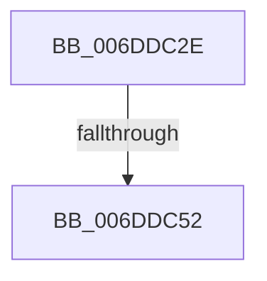

# sub_006DDC2E

- RVA: `0x006DDC2E`–`0x006DDC62` (길이 `52` bytes)
- VA: `0x00000001406DDC2E`
- 실행 섹션: `.text`
- PDB 이름 있음: `아니요`; PDB Function 태그: `아니요`
- unwind 정보 RVA: `0x000700F4`
- 디코드: `14`개 명령, `52/52` bytes 표시
- 미해석 바이트: `0` (있으면 어셈블리에 `.byte`로 보존)

> 이 문서는 커널 이미지의 기계어와 PDB 기호를 분석해 생성했습니다. 4번과 5번은 함수 원형과 자료형을 바이너리 사용 방식에서 추정한 C 해석이며 원본 소스 복구 결과는 아닙니다.

## 1. Dependencies

- 직접 호출 지점: **2**; 고유 호출 대상: **2**
- 직접 호출자로 확인된 함수: **0**
- RIP 상대 이미지 참조: **0**

### Outgoing calls
- `0x006DDC3D` → [PpmPerfSnapDeliveredPerformance](../2D/PpmPerfSnapDeliveredPerformance_function_002D7F30.md) (function, `0x002D7F30`)
- `0x006DDC55` → [HvlUpdatePerformanceStateCountersForLp](../44/HvlUpdatePerformanceStateCountersForLp_function_0044D5B0.md) (function, `0x0044D5B0`)

### Direct callers
- 이 함수 시작 RVA로 연결되는 직접 call은 확인되지 않았습니다. 간접 호출은 완전히 역산할 수 없습니다.

### Static image references
- 디코드된 RIP-relative 메모리 참조가 없습니다.

## 2. Other-region calls and transfers

- 다른 실행 섹션으로 향하는 call: **0**
- call이 아닌 외부 분기/꼬리 이동: **2**
  - `0x006DDC4C` → [sub_002D7ADD + 0x6D](../2D/Unknown_function_002D7ADD.md) (`tail-transfer`)
  - `0x006DDC5D` → [sub_002D7ADD + 0x6D](../2D/Unknown_function_002D7ADD.md) (`tail-transfer`)

## 3. Assembly (complete function range)

```asm
006DDC2E  48 8B 3E                        mov rdi, qword ptr [rsi]
006DDC31  4D 8D 85 B0 3C FF FF            lea r8, [r13 - 0xc350]
006DDC38  48 8B CF                        mov rcx, rdi
006DDC3B  33 D2                           xor edx, edx
006DDC3D  E8 EE A2 BF FF                  call 0x1402d7f30
006DDC42  84 C0                           test al, al
006DDC44  0F 94 C2                        sete dl
006DDC47  88 57 48                        mov byte ptr [rdi + 0x48], dl
006DDC4A  84 C0                           test al, al
006DDC4C  0F 85 F8 9E BF FF               jne 0x1402d7b4a
006DDC52  8B 4E 14                        mov ecx, dword ptr [rsi + 0x14]
006DDC55  E8 56 F9 D6 FF                  call 0x14044d5b0
006DDC5A  41 B7 01                        mov r15b, 1
006DDC5D  E9 E8 9E BF FF                  jmp 0x1402d7b4a
```

## 4. C-style interpretation (structured pseudocode)

```c
__int64 __fastcall sub_006DDC2E(__int64 a1, int a2)
{
    __int64 result;

    a2 = 0;
    result = PpmPerfSnapDeliveredPerformance(*(unsigned __int64 *)(v_rsi), a2, v_r13 - 50000, a4);
    a2 = ((unsigned __int8)(result) == 0) ? 1 : 0;
    *(unsigned __int8 *)(*(unsigned __int64 *)(v_rsi) + 72) = (unsigned __int8)(a2);
    result = HvlUpdatePerformanceStateCountersForLp((unsigned int)(*(unsigned int *)(v_rsi + 20)), a2, v_r13 - 50000, a4);
}
```

## 5. (Beta) C Style

```c
int64_t sub_006DDC2E(int64_t Arg1, int32_t Arg2)
{
    int64_t result;

    Arg2 = 0;
    result = PpmPerfSnapDeliveredPerformance(*(uint64_t *)(local_rsi), Arg2, local_r13 - 50000, a4);
    Arg2 = ((uint8_t)(result) == 0) ? 1 : 0;
    *(uint8_t *)(*(uint64_t *)(local_rsi) + 0x48) = (uint8_t)(Arg2);
    result = HvlUpdatePerformanceStateCountersForLp((uint32_t)(*(uint32_t *)(local_rsi + 0x14)), Arg2, local_r13 - 50000, a4);
}
```

## 6. Execution-region graph

[열기: 2D/3D 그래프와 함수 탐색 컨트롤 패널](../../../control-panel.html?section=text&rva=0x006DDC2E&view=graph)

- 2D 그래프는 위에서 아래로 흐르고, 3D 그래프는 빈 공간을 드래그해 회전합니다. Shift+드래그는 이동, 휠은 확대·축소, 함수 노드 선택은 대상 보고서 이동입니다.

### Static fallback


