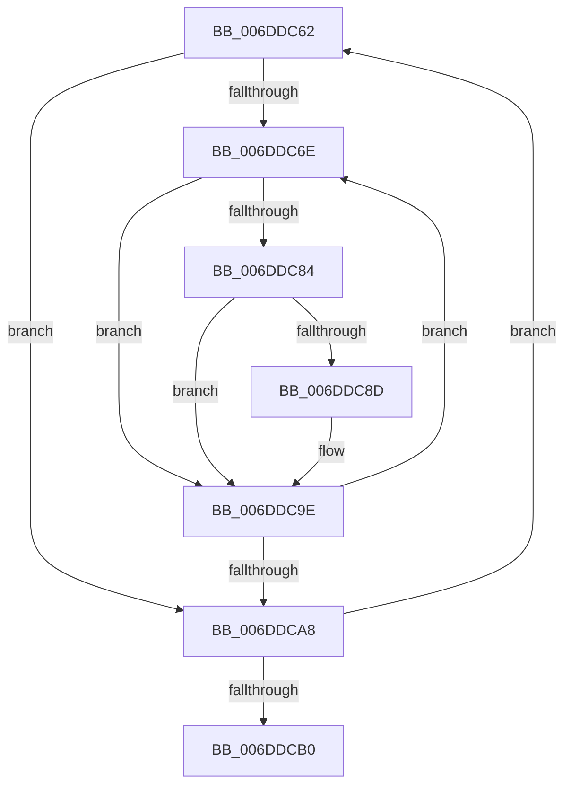

# sub_006DDC62

- RVA: `0x006DDC62`–`0x006DDCB5` (길이 `83` bytes)
- VA: `0x00000001406DDC62`
- 실행 섹션: `.text`
- PDB 이름 있음: `아니요`; PDB Function 태그: `아니요`
- unwind 정보 RVA: `0x0007011C`
- 디코드: `23`개 명령, `83/83` bytes 표시
- 미해석 바이트: `0` (있으면 어셈블리에 `.byte`로 보존)

> 이 문서는 커널 이미지의 기계어와 PDB 기호를 분석해 생성했습니다. 4번과 5번은 함수 원형과 자료형을 바이너리 사용 방식에서 추정한 C 해석이며 원본 소스 복구 결과는 아닙니다.

## 1. Dependencies

- 직접 호출 지점: **1**; 고유 호출 대상: **1**
- 직접 호출자로 확인된 함수: **0**
- RIP 상대 이미지 참조: **0**

### Outgoing calls
- `0x006DDC99` → [PpmPerfSnapDeliveredPerformance](../2D/PpmPerfSnapDeliveredPerformance_function_002D7F30.md) (function, `0x002D7F30`)

### Direct callers
- 이 함수 시작 RVA로 연결되는 직접 call은 확인되지 않았습니다. 간접 호출은 완전히 역산할 수 없습니다.

### Static image references
- 디코드된 RIP-relative 메모리 참조가 없습니다.

## 2. Other-region calls and transfers

- 다른 실행 섹션으로 향하는 call: **0**
- call이 아닌 외부 분기/꼬리 이동: **1**
  - `0x006DDCB0` → [sub_002D7CF9](../2D/Unknown_function_002D7CF9.md) (`tail-transfer`)

## 3. Assembly (complete function range)

```asm
006DDC62  41 8B FC                        mov edi, r12d
006DDC65  44 39 A3 28 01 00 00            cmp dword ptr [rbx + 0x128], r12d
006DDC6C  76 3A                           jbe 0x1406ddca8
006DDC6E  8B C7                           mov eax, edi
006DDC70  48 69 C8 A8 04 00 00            imul rcx, rax, 0x4a8
006DDC77  48 03 8B 38 01 00 00            add rcx, qword ptr [rbx + 0x138]
006DDC7E  83 79 10 01                     cmp dword ptr [rcx + 0x10], 1
006DDC82  75 1A                           jne 0x1406ddc9e
006DDC84  48 8B 01                        mov rax, qword ptr [rcx]
006DDC87  44 38 60 48                     cmp byte ptr [rax + 0x48], r12b
006DDC8B  74 11                           je 0x1406ddc9e
006DDC8D  44 88 60 48                     mov byte ptr [rax + 0x48], r12b
006DDC91  4D 8B C5                        mov r8, r13
006DDC94  48 8B 09                        mov rcx, qword ptr [rcx]
006DDC97  B2 01                           mov dl, 1
006DDC99  E8 92 A2 BF FF                  call 0x1402d7f30
006DDC9E  FF C7                           inc edi
006DDCA0  3B BB 28 01 00 00               cmp edi, dword ptr [rbx + 0x128]
006DDCA6  72 C6                           jb 0x1406ddc6e
006DDCA8  48 8B 1B                        mov rbx, qword ptr [rbx]
006DDCAB  48 3B DE                        cmp rbx, rsi
006DDCAE  75 B2                           jne 0x1406ddc62
006DDCB0  E9 44 A0 BF FF                  jmp 0x1402d7cf9
```

## 4. C-style interpretation (structured pseudocode)

```c
__int64 __fastcall sub_006DDC62(void)
{
    __int64 result;
    __int64 v_rdi;

    if ((*(unsigned int *)(v_rbx + 296)) <= ((unsigned int)(v_r12))) goto loc_006DDCA8;
loc_006DDC6E:
    a1 = (a1) * ((unsigned int)((unsigned int)((unsigned int)((unsigned int)(v_r12)))));
    a1 = (a1) + (*(unsigned __int64 *)(v_rbx + 312));
    if ((*(unsigned int *)(a1 + 16)) != 1) goto loc_006DDC9E;
    result = *(unsigned __int64 *)(a1);
    if ((*(unsigned __int8 *)(*(unsigned __int64 *)(a1) + 72)) != ((unsigned __int8)(v_r12))) {
        *(unsigned __int8 *)(*(unsigned __int64 *)(a1) + 72) = (unsigned __int8)(v_r12);
        a3 = v_r13;
        a1 = *(unsigned __int64 *)(a1);
        a2 = 1;
        result = PpmPerfSnapDeliveredPerformance(a1, a2, a3, a4);
    }
    v_rdi = (unsigned int)(((unsigned int)((unsigned int)(v_r12))) + 1);
    if (((unsigned int)(v_rdi)) < (*(unsigned int *)(v_rbx + 296))) goto loc_006DDC6E;
loc_006DDCA8:
    if ((*(unsigned __int64 *)(v_rbx)) != v_rsi) goto loc_006DDC62;
}
```

## 5. (Beta) C Style

```c
void sub_006DDC62(void)
{
    int64_t result;
    int64_t local_rdi;

    if ((*(uint32_t *)(local_rbx + 0x128)) <= ((uint32_t)(local_r12))) goto loc_006DDCA8;
loc_006DDC6E:
    a1 = (a1) * ((uint32_t)((uint32_t)((uint32_t)((uint32_t)(local_r12)))));
    a1 = (a1) + (*(uint64_t *)(local_rbx + 0x138));
    if ((*(uint32_t *)(a1 + 0x10)) != 1) goto loc_006DDC9E;
    result = *(uint64_t *)(a1);
    if ((*(uint8_t *)(*(uint64_t *)(a1) + 0x48)) != ((uint8_t)(local_r12))) {
        *(uint8_t *)(*(uint64_t *)(a1) + 0x48) = (uint8_t)(local_r12);
        a3 = local_r13;
        a1 = *(uint64_t *)(a1);
        a2 = 1;
        result = PpmPerfSnapDeliveredPerformance(a1, a2, a3, a4);
    }
    local_rdi = (uint32_t)(((uint32_t)((uint32_t)(local_r12))) + 1);
    if (((uint32_t)(local_rdi)) < (*(uint32_t *)(local_rbx + 0x128))) goto loc_006DDC6E;
loc_006DDCA8:
    if ((*(uint64_t *)(local_rbx)) != local_rsi) goto loc_006DDC62;
}
```

## 6. Execution-region graph

[열기: 2D/3D 그래프와 함수 탐색 컨트롤 패널](../../../control-panel.html?section=text&rva=0x006DDC62&view=graph)

- 2D 그래프는 위에서 아래로 흐르고, 3D 그래프는 빈 공간을 드래그해 회전합니다. Shift+드래그는 이동, 휠은 확대·축소, 함수 노드 선택은 대상 보고서 이동입니다.

### Static fallback


