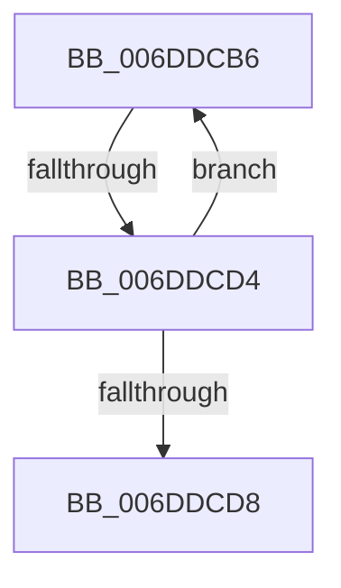

# sub_006DDCB6

- RVA: `0x006DDCB6`–`0x006DDCDD` (길이 `39` bytes)
- VA: `0x00000001406DDCB6`
- 실행 섹션: `.text`
- PDB 이름 있음: `아니요`; PDB Function 태그: `아니요`
- unwind 정보 RVA: `0x00070168`
- 디코드: `11`개 명령, `39/39` bytes 표시
- 미해석 바이트: `0` (있으면 어셈블리에 `.byte`로 보존)

> 이 문서는 커널 이미지의 기계어와 PDB 기호를 분석해 생성했습니다. 4번과 5번은 함수 원형과 자료형을 바이너리 사용 방식에서 추정한 C 해석이며 원본 소스 복구 결과는 아닙니다.

## 1. Dependencies

- 직접 호출 지점: **1**; 고유 호출 대상: **1**
- 직접 호출자로 확인된 함수: **0**
- RIP 상대 이미지 참조: **0**

### Outgoing calls
- `0x006DDCC6` → [PpmHvSnapPerformanceAccumulation](../44/PpmHvSnapPerformanceAccumulation_function_0044FA34.md) (function, `0x0044FA34`)

### Direct callers
- 이 함수 시작 RVA로 연결되는 직접 call은 확인되지 않았습니다. 간접 호출은 완전히 역산할 수 없습니다.

### Static image references
- 디코드된 RIP-relative 메모리 참조가 없습니다.

## 2. Other-region calls and transfers

- 다른 실행 섹션으로 향하는 call: **0**
- call이 아닌 외부 분기/꼬리 이동: **2**
  - `0x006DDCCE` → [PpmPerfSnapDeliveredPerformance + 0x84](../2D/PpmPerfSnapDeliveredPerformance_function_002D7F30.md) (`tail-transfer`)
  - `0x006DDCD8` → [PpmPerfSnapDeliveredPerformance + 0x8C](../2D/PpmPerfSnapDeliveredPerformance_function_002D7F30.md) (`tail-transfer`)

## 3. Assembly (complete function range)

```asm
006DDCB6  4D 8B CC                        mov r9, r12
006DDCB9  4C 89 6C 24 20                  mov qword ptr [rsp + 0x20], r13
006DDCBE  4C 8B C6                        mov r8, rsi
006DDCC1  33 D2                           xor edx, edx
006DDCC3  48 8B CF                        mov rcx, rdi
006DDCC6  E8 69 1D D7 FF                  call 0x14044fa34
006DDCCB  45 84 F6                        test r14b, r14b
006DDCCE  0F 84 E0 A2 BF FF               je 0x1402d7fb4
006DDCD4  84 C0                           test al, al
006DDCD6  74 DE                           je 0x1406ddcb6
006DDCD8  E9 DF A2 BF FF                  jmp 0x1402d7fbc
```

## 4. C-style interpretation (structured pseudocode)

```c
__int64 __fastcall sub_006DDCB6(__int64 a1, int a2)
{
    __int64 result;
    unsigned __int64 v_stack_p20;

    v_stack_p20 = v_r13;
    a2 = 0;
    result = PpmHvSnapPerformanceAccumulation(v_rdi, a2, v_rsi, v_r12);
    if ((unsigned __int8)(result) == 0) goto loc_006DDCB6;
}
```

## 5. (Beta) C Style

```c
int64_t sub_006DDCB6(int64_t Arg1, int32_t Arg2)
{
    int64_t result;
    uint64_t v_stack_p20;

    v_stack_p20 = local_r13;
    Arg2 = 0;
    result = PpmHvSnapPerformanceAccumulation(local_rdi, Arg2, local_rsi, local_r12);
    if ((uint8_t)(result) == 0) goto loc_006DDCB6;
}
```

## 6. Execution-region graph

[열기: 2D/3D 그래프와 함수 탐색 컨트롤 패널](../../../control-panel.html?section=text&rva=0x006DDCB6&view=graph)

- 2D 그래프는 위에서 아래로 흐르고, 3D 그래프는 빈 공간을 드래그해 회전합니다. Shift+드래그는 이동, 휠은 확대·축소, 함수 노드 선택은 대상 보고서 이동입니다.

### Static fallback


