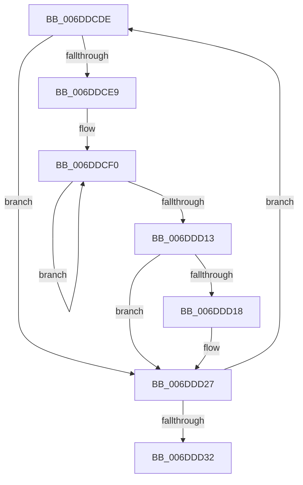

# sub_006DDCDE

- RVA: `0x006DDCDE`–`0x006DDD37` (길이 `89` bytes)
- VA: `0x00000001406DDCDE`
- 실행 섹션: `.text`
- PDB 이름 있음: `아니요`; PDB Function 태그: `아니요`
- unwind 정보 RVA: `0x000701C4`
- 디코드: `25`개 명령, `89/89` bytes 표시
- 미해석 바이트: `0` (있으면 어셈블리에 `.byte`로 보존)

> 이 문서는 커널 이미지의 기계어와 PDB 기호를 분석해 생성했습니다. 4번과 5번은 함수 원형과 자료형을 바이너리 사용 방식에서 추정한 C 해석이며 원본 소스 복구 결과는 아닙니다.

## 1. Dependencies

- 직접 호출 지점: **1**; 고유 호출 대상: **1**
- 직접 호출자로 확인된 함수: **0**
- RIP 상대 이미지 참조: **2**

### Outgoing calls
- `0x006DDD22` → [KeAddGroupAffinityEx](../25/KeAddGroupAffinityEx_function_0025B6C0.md) (function, `0x0025B6C0`)

### Direct callers
- 이 함수 시작 RVA로 연결되는 직접 call은 확인되지 않았습니다. 간접 호출은 완전히 역산할 수 없습니다.

### Static image references
- `0x006DDCF0` → RVA `0x00FC6E18` (`ALMOSTRO`; read)
- `0x006DDD1B` → RVA `0x00F07100` (`.data`; read)

## 2. Other-region calls and transfers

- 다른 실행 섹션으로 향하는 call: **0**
- call이 아닌 외부 분기/꼬리 이동: **1**
  - `0x006DDD32` → [KeQuerySystemAllowedCpuSetAffinity + 0x8F](../2D/KeQuerySystemAllowedCpuSetAffinity_function_002D85F4.md) (`tail-transfer`)

## 3. Assembly (complete function range)

```asm
006DDCDE  4C 8B 0E                        mov r9, qword ptr [rsi]
006DDCE1  45 33 C0                        xor r8d, r8d
006DDCE4  4D 85 C9                        test r9, r9
006DDCE7  74 3E                           je 0x1406ddd27
006DDCE9  44 8B D7                        mov r10d, edi
006DDCEC  41 C1 E2 06                     shl r10d, 6
006DDCF0  48 8B 05 21 91 8E 00            mov rax, qword ptr [rip + 0x8e9121]
006DDCF7  83 64 24 48 00                  and dword ptr [rsp + 0x48], 0
006DDCFC  49 0F BC D1                     bsf rdx, r9
006DDD00  41 8D 0C 12                     lea ecx, [r10 + rdx]
006DDD04  4C 0B 04 C8                     or r8, qword ptr [rax + rcx*8]
006DDD08  8B C2                           mov eax, edx
006DDD0A  49 0F B3 C1                     btr r9, rax
006DDD0E  4D 85 C9                        test r9, r9
006DDD11  75 DD                           jne 0x1406ddcf0
006DDD13  4D 85 C0                        test r8, r8
006DDD16  74 0F                           je 0x1406ddd27
006DDD18  0F B7 D7                        movzx edx, di
006DDD1B  48 8D 0D DE 93 82 00            lea rcx, [rip + 0x8293de]
006DDD22  E8 99 D9 B7 FF                  call 0x14025b6c0
006DDD27  41 03 FE                        add edi, r14d
006DDD2A  48 83 C6 10                     add rsi, 0x10
006DDD2E  3B FD                           cmp edi, ebp
006DDD30  72 AC                           jb 0x1406ddcde
006DDD32  E9 4C A9 BF FF                  jmp 0x1402d8683
```

## 4. C-style interpretation (structured pseudocode)

```c
__int64 __fastcall sub_006DDCDE(__int64 a1, __int64 a2, int a3, __int64 a4, __int64 a5, __int64 a6, __int64 a7, __int64 a8, unsigned int a9)
{
    __int64 result;
    __int64 v_r10;
    __int64 v_rdi;
    __int64 v_rsi;

    a3 = 0;
    if (*(unsigned __int64 *)(v_rsi) == 0) goto loc_006DDD27;
    v_r10 = (unsigned int)(((unsigned int)((unsigned int)(v_rdi))) << (6));
loc_006DDCF0:
    a3 = (a3) | (*(unsigned __int64 *)(*(unsigned __int64 *)(v_rip + 9343265) + v_r10 + a2 * 1 * 8));
    if (*(unsigned __int64 *)(v_rsi) != 0) goto loc_006DDCF0;
    result = (unsigned int)((unsigned int)(a2));
    if (a3 != 0) {
        a2 = (unsigned __int16)(v_rdi);
        a1 = v_rip + 8557534;
        result = KeAddGroupAffinityEx(a1, a2, a3, *(unsigned __int64 *)(v_rsi));
    }
    v_rdi = (unsigned int)((v_rdi) + ((unsigned int)(v_r14)));
    v_rsi = (v_rsi) + (16);
    if (((unsigned int)(v_rdi)) < ((unsigned int)(v_rbp))) goto loc_006DDCDE;
}
```

## 5. (Beta) C Style

```c
int64_t sub_006DDCDE(int64_t Arg1, int64_t Arg2, int32_t Arg3, int64_t Arg4, uint64_t Arg5, uint64_t Arg6, uint64_t Arg7, uint64_t Arg8, uint32_t Arg9)
{
    int64_t result;
    int64_t local_r10;
    int64_t local_rdi;
    int64_t local_rsi;

    Arg3 = 0;
    if (*(uint64_t *)(local_rsi) == 0) goto loc_006DDD27;
    local_r10 = (uint32_t)(((uint32_t)((uint32_t)(local_rdi))) << (6));
loc_006DDCF0:
    Arg3 = (Arg3) | (*(uint64_t *)(*(uint64_t *)(v_rip + 0x8E9121) + local_r10 + Arg2 * 1 * 8));
    if (*(uint64_t *)(local_rsi) != 0) goto loc_006DDCF0;
    result = (uint32_t)((uint32_t)(Arg2));
    if (Arg3 != 0) {
        Arg2 = (uint16_t)(local_rdi);
        Arg1 = v_rip + 8557534;
        result = KeAddGroupAffinityEx(Arg1, Arg2, Arg3, *(uint64_t *)(local_rsi));
    }
    local_rdi = (uint32_t)((local_rdi) + ((uint32_t)(local_r14)));
    local_rsi = (local_rsi) + (16);
    if (((uint32_t)(local_rdi)) < ((uint32_t)(local_rbp))) goto loc_006DDCDE;
}
```

## 6. Execution-region graph

[열기: 2D/3D 그래프와 함수 탐색 컨트롤 패널](../../../control-panel.html?section=text&rva=0x006DDCDE&view=graph)

- 2D 그래프는 위에서 아래로 흐르고, 3D 그래프는 빈 공간을 드래그해 회전합니다. Shift+드래그는 이동, 휠은 확대·축소, 함수 노드 선택은 대상 보고서 이동입니다.

### Static fallback


