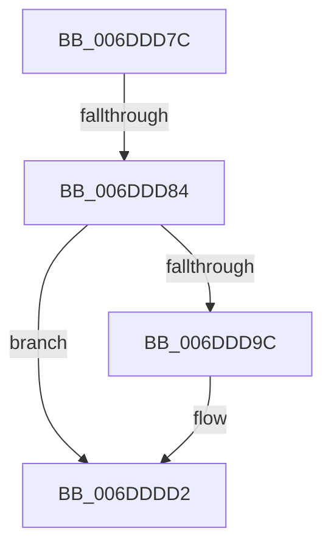

# sub_006DDD7C

- RVA: `0x006DDD7C`–`0x006DDDE7` (길이 `107` bytes)
- VA: `0x00000001406DDD7C`
- 실행 섹션: `.text`
- PDB 이름 있음: `아니요`; PDB Function 태그: `아니요`
- unwind 정보 RVA: `0x00070590`
- 디코드: `20`개 명령, `107/107` bytes 표시
- 미해석 바이트: `0` (있으면 어셈블리에 `.byte`로 보존)

> 이 문서는 커널 이미지의 기계어와 PDB 기호를 분석해 생성했습니다. 4번과 5번은 함수 원형과 자료형을 바이너리 사용 방식에서 추정한 C 해석이며 원본 소스 복구 결과는 아닙니다.

## 1. Dependencies

- 직접 호출 지점: **3**; 고유 호출 대상: **3**
- 직접 호출자로 확인된 함수: **0**
- RIP 상대 이미지 참조: **8**

### Outgoing calls
- `0x006DDD8B` → [ExAcquireSpinLockExclusive](../24/ExAcquireSpinLockExclusive_function_00248690.md) (function, `0x00248690`)
- `0x006DDDCD` → [ExQueueWorkItem](../2F/ExQueueWorkItem_function_002F9520.md) (function, `0x002F9520`)
- `0x006DDDDC` → [MiReleaseSpinLockExclusive](../24/MiReleaseSpinLockExclusive_function_002482C0.md) (function, `0x002482C0`)

### Direct callers
- 이 함수 시작 RVA로 연결되는 직접 call은 확인되지 않았습니다. 간접 호출은 완전히 역산할 수 없습니다.

### Static image references
- `0x006DDD84` → RVA `0x00E3A8A0` (`.data`; read)
- `0x006DDD90` → RVA `0x00E30252` (`.data`; read)
- `0x006DDD9C` → RVA `0x00E30298` (`.data`; read/write)
- `0x006DDDA4` → RVA `0x006794C0` (`MiBadPageSignaler`; read)
- `0x006DDDAB` → RVA `0x00E30280` (`.data`; read/write)
- `0x006DDDB3` → RVA `0x00E30280` (`.data`; read)
- `0x006DDDBF` → RVA `0x00E30290` (`.data`; write)
- `0x006DDDC6` → RVA `0x00E30252` (`.data`; write)

## 2. Other-region calls and transfers

- 다른 실행 섹션으로 향하는 call: **0**
- call이 아닌 외부 분기/꼬리 이동: **2**
  - `0x006DDD7E` → [MiWorkingSetManager + 0x108](../2D/MiWorkingSetManager_function_002DA7E0.md) (`tail-transfer`)
  - `0x006DDDE2` → [MiWorkingSetManager + 0x108](../2D/MiWorkingSetManager_function_002DA7E0.md) (`tail-transfer`)

## 3. Assembly (complete function range)

```asm
006DDD7C  3C 20                           cmp al, 0x20
006DDD7E  0F 82 64 CB BF FF               jb 0x1402da8e8
006DDD84  48 8D 0D 15 CB 75 00            lea rcx, [rip + 0x75cb15]
006DDD8B  E8 00 A9 B6 FF                  call 0x140248690
006DDD90  80 3D BB 24 75 00 01            cmp byte ptr [rip + 0x7524bb], 1
006DDD97  40 8A F8                        mov dil, al
006DDD9A  75 36                           jne 0x1406dddd2
006DDD9C  48 83 25 F4 24 75 00 00         and qword ptr [rip + 0x7524f4], 0
006DDDA4  48 8D 05 15 B7 F9 FF            lea rax, [rip - 0x648eb]
006DDDAB  48 83 25 CD 24 75 00 00         and qword ptr [rip + 0x7524cd], 0
006DDDB3  48 8D 0D C6 24 75 00            lea rcx, [rip + 0x7524c6]
006DDDBA  BA 01 00 00 00                  mov edx, 1
006DDDBF  48 89 05 CA 24 75 00            mov qword ptr [rip + 0x7524ca], rax
006DDDC6  C6 05 85 24 75 00 02            mov byte ptr [rip + 0x752485], 2
006DDDCD  E8 4E B7 C1 FF                  call 0x1402f9520
006DDDD2  40 8A D7                        mov dl, dil
006DDDD5  48 8D 0D C4 CA 75 00            lea rcx, [rip + 0x75cac4]
006DDDDC  E8 DF A4 B6 FF                  call 0x1402482c0
006DDDE1  90                              nop
006DDDE2  E9 01 CB BF FF                  jmp 0x1402da8e8
```

## 4. C-style interpretation (structured pseudocode)

```c
__int64 __fastcall sub_006DDD7C(void)
{
    __int64 result;

    result = ExAcquireSpinLockExclusive(v_rip + 7719701, a2, a3, a4);
    if ((*(unsigned __int8 *)(v_rip + 7677115)) == 1) {
        result = v_rip - 411883;
        a1 = v_rip + 7677126;
        a2 = 1;
        *(unsigned __int64 *)(v_rip + 7677130) = result;
        *(unsigned __int8 *)(v_rip + 7677061) = 2;
        result = ExQueueWorkItem(a1, a2, a3, a4);
    }
    result = MiReleaseSpinLockExclusive(v_rip + 7719620, (unsigned __int8)((unsigned __int8)(result)), a3, a4);
}
```

## 5. (Beta) C Style

```c
void sub_006DDD7C(void)
{
    int64_t result;

    result = ExAcquireSpinLockExclusive(v_rip + 7719701, a2, a3, a4);
    if ((*(uint8_t *)(v_rip + 0x7524BB)) == 1) {
        result = v_rip - 411883;
        a1 = v_rip + 7677126;
        a2 = 1;
        *(uint64_t *)(v_rip + 0x7524CA) = result;
        *(uint8_t *)(v_rip + 0x752485) = 2;
        result = ExQueueWorkItem(a1, a2, a3, a4);
    }
    result = MiReleaseSpinLockExclusive(v_rip + 7719620, (uint8_t)((uint8_t)(result)), a3, a4);
}
```

## 6. Execution-region graph

[열기: 2D/3D 그래프와 함수 탐색 컨트롤 패널](../../../control-panel.html?section=text&rva=0x006DDD7C&view=graph)

- 2D 그래프는 위에서 아래로 흐르고, 3D 그래프는 빈 공간을 드래그해 회전합니다. Shift+드래그는 이동, 휠은 확대·축소, 함수 노드 선택은 대상 보고서 이동입니다.

### Static fallback


