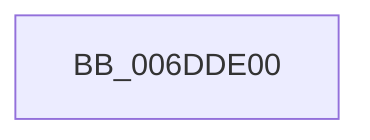

# sub_006DDE00

- RVA: `0x006DDE00`–`0x006DDE58` (길이 `88` bytes)
- VA: `0x00000001406DDE00`
- 실행 섹션: `.text`
- PDB 이름 있음: `아니요`; PDB Function 태그: `아니요`
- unwind 정보 RVA: `0x000705F8`
- 디코드: `18`개 명령, `88/88` bytes 표시
- 미해석 바이트: `0` (있으면 어셈블리에 `.byte`로 보존)

> 이 문서는 커널 이미지의 기계어와 PDB 기호를 분석해 생성했습니다. 4번과 5번은 함수 원형과 자료형을 바이너리 사용 방식에서 추정한 C 해석이며 원본 소스 복구 결과는 아닙니다.

## 1. Dependencies

- 직접 호출 지점: **4**; 고유 호출 대상: **4**
- 직접 호출자로 확인된 함수: **0**
- RIP 상대 이미지 참조: **1**

### Outgoing calls
- `0x006DDE0B` → [memset](../6C/memset_function_006C6C40.md) (function, `0x006C6C40`)
- `0x006DDE2F` → [KeGenericCallDpcEx](../2C/KeGenericCallDpcEx_function_002C99F4.md) (function, `0x002C99F4`)
- `0x006DDE34` → [MiGetSlabCurrentTime](../3B/MiGetSlabCurrentTime_function_003BCBCC.md) (function, `0x003BCBCC`)
- `0x006DDE4D` → [MiLogSlabEntriesDemote](../68/MiLogSlabEntriesDemote_function_0068EE4C.md) (function, `0x0068EE4C`)

### Direct callers
- 이 함수 시작 RVA로 연결되는 직접 call은 확인되지 않았습니다. 간접 호출은 완전히 역산할 수 없습니다.

### Static image references
- `0x006DDE1E` → RVA `0x0044C3C0` (`MiDemoteSlabEntriesDpc`; read)

## 2. Other-region calls and transfers

- 다른 실행 섹션으로 향하는 call: **0**
- call이 아닌 외부 분기/꼬리 이동: **1**
  - `0x006DDE53` → [MiFreeUnusedSlabPages + 0x9A](../2D/MiFreeUnusedSlabPages_function_002DAE48.md) (`tail-transfer`)

## 3. Assembly (complete function range)

```asm
006DDE00  33 D2                           xor edx, edx
006DDE02  48 8D 4C 24 28                  lea rcx, [rsp + 0x28]
006DDE07  44 8D 42 50                     lea r8d, [rdx + 0x50]
006DDE0B  E8 30 8E FE FF                  call 0x1406c6c40
006DDE10  48 83 8C 24 80 00 00 00 FF      or qword ptr [rsp + 0x80], 0xffffffffffffffff
006DDE19  48 8D 54 24 20                  lea rdx, [rsp + 0x20]
006DDE1E  48 8D 0D 9B E5 D6 FF            lea rcx, [rip - 0x291a65]
006DDE25  48 89 7C 24 20                  mov qword ptr [rsp + 0x20], rdi
006DDE2A  48 89 6C 24 78                  mov qword ptr [rsp + 0x78], rbp
006DDE2F  E8 C0 BB BE FF                  call 0x1402c99f4
006DDE34  E8 93 ED CD FF                  call 0x1403bcbcc
006DDE39  48 8B 4F 10                     mov rcx, qword ptr [rdi + 0x10]
006DDE3D  41 8B D6                        mov edx, r14d
006DDE40  48 89 84 31 B8 DE 00 00         mov qword ptr [rcx + rsi + 0xdeb8], rax
006DDE48  48 8D 4C 24 20                  lea rcx, [rsp + 0x20]
006DDE4D  E8 FA 0F FB FF                  call 0x14068ee4c
006DDE52  90                              nop
006DDE53  E9 8A D0 BF FF                  jmp 0x1402daee2
```

## 4. C-style interpretation (structured pseudocode)

```c
__int64 __fastcall sub_006DDE00(__int64 a1, int a2, __int64 a3, __int64 a4, __int64 a5, __int64 a6, __int64 a7, __int64 a8, __int64 a9, __int64 a10, __int64 a11, __int64 a12, __int64 a13, __int64 a14, __int64 a15, __int64 a16)
{
    __int64 result;
    unsigned __int64 v_stack_p20;
    unsigned __int64 v_stack_p78;

    a2 = 0;
    result = memset(a5, a2, a2 + 80, a4);
    v_stack_p20 = v_rdi;
    v_stack_p78 = v_rbp;
    result = KeGenericCallDpcEx(v_rip - 2693733, v_stack_p20, a2 + 80, a4);
    result = MiGetSlabCurrentTime(v_rip - 2693733, v_stack_p20, a2 + 80, a4);
    *(unsigned __int64 *)(*(unsigned __int64 *)(v_rdi + 16) + v_rsi * 1 + 57016) = result;
    result = MiLogSlabEntriesDemote(v_stack_p20, (unsigned int)((unsigned int)(v_r14)), a2 + 80, a4);
}
```

## 5. (Beta) C Style

```c
int64_t sub_006DDE00(int64_t Arg1, int32_t Arg2, int64_t Arg3, int64_t Arg4, int64_t Arg5, uint64_t Arg6, uint64_t Arg7, uint64_t Arg8, uint64_t Arg9, uint64_t Arg10, uint64_t Arg11, uint64_t Arg12, uint64_t Arg13, uint64_t Arg14, uint64_t Arg15, int64_t Arg16)
{
    int64_t result;
    uint64_t v_stack_p20;
    uint64_t v_stack_p78;

    Arg2 = 0;
    result = memset(Arg5, Arg2, Arg2 + 80, Arg4);
    v_stack_p20 = local_rdi;
    v_stack_p78 = local_rbp;
    result = KeGenericCallDpcEx(v_rip - 2693733, v_stack_p20, Arg2 + 80, Arg4);
    result = MiGetSlabCurrentTime(v_rip - 2693733, v_stack_p20, Arg2 + 80, Arg4);
    *(uint64_t *)(*(uint64_t *)(local_rdi + 0x10) + local_rsi * 1 + 0xDEB8) = result;
    result = MiLogSlabEntriesDemote(v_stack_p20, (uint32_t)((uint32_t)(local_r14)), Arg2 + 80, Arg4);
}
```

## 6. Execution-region graph

[열기: 2D/3D 그래프와 함수 탐색 컨트롤 패널](../../../control-panel.html?section=text&rva=0x006DDE00&view=graph)

- 2D 그래프는 위에서 아래로 흐르고, 3D 그래프는 빈 공간을 드래그해 회전합니다. Shift+드래그는 이동, 휠은 확대·축소, 함수 노드 선택은 대상 보고서 이동입니다.

### Static fallback


