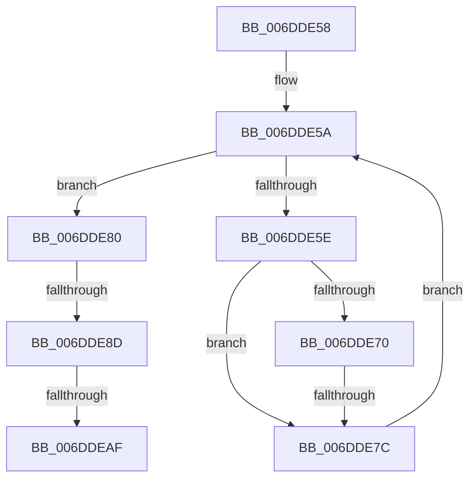

# sub_006DDE58

- RVA: `0x006DDE58`–`0x006DDEE4` (길이 `140` bytes)
- VA: `0x00000001406DDE58`
- 실행 섹션: `.text`
- PDB 이름 있음: `아니요`; PDB Function 태그: `아니요`
- unwind 정보 RVA: `0x000706B8`
- 디코드: `30`개 명령, `140/140` bytes 표시
- 미해석 바이트: `0` (있으면 어셈블리에 `.byte`로 보존)

> 이 문서는 커널 이미지의 기계어와 PDB 기호를 분석해 생성했습니다. 4번과 5번은 함수 원형과 자료형을 바이너리 사용 방식에서 추정한 C 해석이며 원본 소스 복구 결과는 아닙니다.

## 1. Dependencies

- 직접 호출 지점: **2**; 고유 호출 대상: **2**
- 직접 호출자로 확인된 함수: **0**
- RIP 상대 이미지 참조: **1**

### Outgoing calls
- `0x006DDEA2` → [PsReferencePartitionSafe](../3B/PsReferencePartitionSafe_function_003BA6C0.md) (function, `0x003BA6C0`)
- `0x006DDED9` → [ExQueueWorkItemToPartition](../35/ExQueueWorkItemToPartition_function_00356E2C.md) (function, `0x00356E2C`)

### Direct callers
- 이 함수 시작 RVA로 연결되는 직접 call은 확인되지 않았습니다. 간접 호출은 완전히 역산할 수 없습니다.

### Static image references
- `0x006DDEBE` → RVA `0x00800440` (`MiScanPagefileSpace`; read)

## 2. Other-region calls and transfers

- 다른 실행 섹션으로 향하는 call: **0**
- call이 아닌 외부 분기/꼬리 이동: **4**
  - `0x006DDE76` → [MiScanPagefiles + 0x48](../2D/MiScanPagefiles_function_002DBE60.md) (`tail-transfer`)
  - `0x006DDE87` → [MiScanPagefiles + 0x48](../2D/MiScanPagefiles_function_002DBE60.md) (`tail-transfer`)
  - `0x006DDEA9` → [MiScanPagefiles + 0x48](../2D/MiScanPagefiles_function_002DBE60.md) (`tail-transfer`)
  - `0x006DDEDF` → [MiScanPagefiles + 0x48](../2D/MiScanPagefiles_function_002DBE60.md) (`tail-transfer`)

## 3. Assembly (complete function range)

```asm
006DDE58  33 C9                           xor ecx, ecx
006DDE5A  3B CA                           cmp ecx, edx
006DDE5C  73 22                           jae 0x1406dde80
006DDE5E  4C 8B 84 CB 60 48 00 00         mov r8, qword ptr [rbx + rcx*8 + 0x4860]
006DDE66  41 F6 80 AC 00 00 00 50         test byte ptr [r8 + 0xac], 0x50
006DDE6E  75 0C                           jne 0x1406dde7c
006DDE70  41 8B 40 0C                     mov eax, dword ptr [r8 + 0xc]
006DDE74  85 C0                           test eax, eax
006DDE76  0F 85 2C E0 BF FF               jne 0x1402dbea8
006DDE7C  FF C1                           inc ecx
006DDE7E  EB DA                           jmp 0x1406dde5a
006DDE80  80 BB D3 02 00 00 00            cmp byte ptr [rbx + 0x2d3], 0
006DDE87  0F 84 1B E0 BF FF               je 0x1402dbea8
006DDE8D  48 8B 8B B8 00 00 00            mov rcx, qword ptr [rbx + 0xb8]
006DDE94  83 A3 10 04 00 00 00            and dword ptr [rbx + 0x410], 0
006DDE9B  C6 83 D3 02 00 00 00            mov byte ptr [rbx + 0x2d3], 0
006DDEA2  E8 19 C8 CD FF                  call 0x1403ba6c0
006DDEA7  84 C0                           test al, al
006DDEA9  0F 84 F9 DF BF FF               je 0x1402dbea8
006DDEAF  48 8D 8B F0 03 00 00            lea rcx, [rbx + 0x3f0]
006DDEB6  41 83 C8 FF                     or r8d, 0xffffffff
006DDEBA  48 83 21 00                     and qword ptr [rcx], 0
006DDEBE  48 8D 05 7B 25 12 00            lea rax, [rip + 0x12257b]
006DDEC5  48 89 41 10                     mov qword ptr [rcx + 0x10], rax
006DDEC9  BA 02 00 00 00                  mov edx, 2
006DDECE  48 89 59 18                     mov qword ptr [rcx + 0x18], rbx
006DDED2  4C 8B 8B B8 00 00 00            mov r9, qword ptr [rbx + 0xb8]
006DDED9  E8 4E 8F C7 FF                  call 0x140356e2c
006DDEDE  90                              nop
006DDEDF  E9 C4 DF BF FF                  jmp 0x1402dbea8
```

## 4. C-style interpretation (structured pseudocode)

```c
__int64 __fastcall sub_006DDE58(int a1, int a2)
{
    __int64 result;

    a1 = 0;
loc_006DDE5A:
    if (0 >= a2) goto loc_006DDE80;
    if (((*(unsigned __int8 *)(*(unsigned __int64 *)(v_rbx + a1 * 8 + 18528) + 172)) & (80)) != 0) goto loc_006DDE7C;
loc_006DDE7C:
    a1 = (unsigned int)((a1) + 1);
    goto loc_006DDE5A;
loc_006DDE80:
    *(unsigned __int8 *)(v_rbx + 723) = 0;
    result = PsReferencePartitionSafe(*(unsigned __int64 *)(v_rbx + 184), a2, *(unsigned __int64 *)(v_rbx + a1 * 8 + 18528), a4);
    a3 = (unsigned int)((*(unsigned __int64 *)(v_rbx + a1 * 8 + 18528)) | (0xFFFFFFFFULL));
    *(unsigned __int64 *)(v_rbx + 1008 + 16) = v_rip + 1189243;
    *(unsigned __int64 *)(v_rbx + 1008 + 24) = v_rbx;
    result = ExQueueWorkItemToPartition(v_rbx + 1008, 2, a3, *(unsigned __int64 *)(v_rbx + 184));
}
```

## 5. (Beta) C Style

```c
int64_t sub_006DDE58(int32_t Arg1, int32_t Arg2)
{
    int64_t result;

    Arg1 = 0;
loc_006DDE5A:
    if (0 >= Arg2) goto loc_006DDE80;
    if (((*(uint8_t *)(*(uint64_t *)(local_rbx + Arg1 * 8 + 0x4860) + 0xAC)) & (80)) != 0) goto loc_006DDE7C;
loc_006DDE7C:
    Arg1 = (uint32_t)((Arg1) + 1);
    goto loc_006DDE5A;
loc_006DDE80:
    *(uint8_t *)(local_rbx + 0x2D3) = 0;
    result = PsReferencePartitionSafe(*(uint64_t *)(local_rbx + 0xB8), Arg2, *(uint64_t *)(local_rbx + Arg1 * 8 + 0x4860), a4);
    a3 = (uint32_t)((*(uint64_t *)(local_rbx + Arg1 * 8 + 0x4860)) | (0xFFFFFFFFULL));
    *(uint64_t *)(local_rbx + 0x3F0 + 0x10) = v_rip + 1189243;
    *(uint64_t *)(local_rbx + 0x3F0 + 0x18) = local_rbx;
    result = ExQueueWorkItemToPartition(local_rbx + 1008, 2, a3, *(uint64_t *)(local_rbx + 0xB8));
}
```

## 6. Execution-region graph

[열기: 2D/3D 그래프와 함수 탐색 컨트롤 패널](../../../control-panel.html?section=text&rva=0x006DDE58&view=graph)

- 2D 그래프는 위에서 아래로 흐르고, 3D 그래프는 빈 공간을 드래그해 회전합니다. Shift+드래그는 이동, 휠은 확대·축소, 함수 노드 선택은 대상 보고서 이동입니다.

### Static fallback


