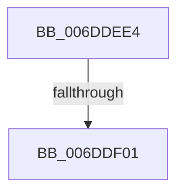

# sub_006DDEE4

- RVA: `0x006DDEE4`–`0x006DDF0F` (길이 `43` bytes)
- VA: `0x00000001406DDEE4`
- 실행 섹션: `.text`
- PDB 이름 있음: `아니요`; PDB Function 태그: `아니요`
- unwind 정보 RVA: `0x000706E4`
- 디코드: `10`개 명령, `43/43` bytes 표시
- 미해석 바이트: `0` (있으면 어셈블리에 `.byte`로 보존)

> 이 문서는 커널 이미지의 기계어와 PDB 기호를 분석해 생성했습니다. 4번과 5번은 함수 원형과 자료형을 바이너리 사용 방식에서 추정한 C 해석이며 원본 소스 복구 결과는 아닙니다.

## 1. Dependencies

- 직접 호출 지점: **1**; 고유 호출 대상: **1**
- 직접 호출자로 확인된 함수: **0**
- RIP 상대 이미지 참조: **1**

### Outgoing calls
- `0x006DDF04` → [KiRaiseIrqlProcessIrqlFlags](../4F/KiRaiseIrqlProcessIrqlFlags_function_004F56FC.md) (function, `0x004F56FC`)

### Direct callers
- 이 함수 시작 RVA로 연결되는 직접 call은 확인되지 않았습니다. 간접 호출은 완전히 역산할 수 없습니다.

### Static image references
- `0x006DDEF4` → RVA `0x00FC6D20` (`ALMOSTRO`; read)

## 2. Other-region calls and transfers

- 다른 실행 섹션으로 향하는 call: **0**
- call이 아닌 외부 분기/꼬리 이동: **2**
  - `0x006DDEFB` → [MiFreePageFileHashPfns + 0x57](../2D/MiFreePageFileHashPfns_function_002DBEF8.md) (`tail-transfer`)
  - `0x006DDF0A` → [MiFreePageFileHashPfns + 0x57](../2D/MiFreePageFileHashPfns_function_002DBEF8.md) (`tail-transfer`)

## 3. Assembly (complete function range)

```asm
006DDEE4  40 0F B6 C6                     movzx eax, sil
006DDEE8  44 0F 22 C0                     mov cr8, rax
006DDEEC  44 0F 20 C1                     mov rcx, cr8
006DDEF0  45 0F 22 C4                     mov cr8, r12
006DDEF4  83 3D 25 8E 8E 00 00            cmp dword ptr [rip + 0x8e8e25], 0
006DDEFB  0F 84 4E E0 BF FF               je 0x1402dbf4f
006DDF01  41 8A D4                        mov dl, r12b
006DDF04  E8 F3 77 E1 FF                  call 0x1404f56fc
006DDF09  90                              nop
006DDF0A  E9 40 E0 BF FF                  jmp 0x1402dbf4f
```

## 4. C-style interpretation (structured pseudocode)

```c
__int64 __fastcall sub_006DDEE4(void)
{
    __int64 result;

    result = KiRaiseIrqlProcessIrqlFlags((unsigned __int8)(v_rsi), (unsigned __int8)(v_r12), a3, a4);
}
```

## 5. (Beta) C Style

```c
void sub_006DDEE4(void)
{
    int64_t result;

    result = KiRaiseIrqlProcessIrqlFlags((uint8_t)(local_rsi), (uint8_t)(local_r12), a3, a4);
}
```

## 6. Execution-region graph

[열기: 2D/3D 그래프와 함수 탐색 컨트롤 패널](../../../control-panel.html?section=text&rva=0x006DDEE4&view=graph)

- 2D 그래프는 위에서 아래로 흐르고, 3D 그래프는 빈 공간을 드래그해 회전합니다. Shift+드래그는 이동, 휠은 확대·축소, 함수 노드 선택은 대상 보고서 이동입니다.

### Static fallback


