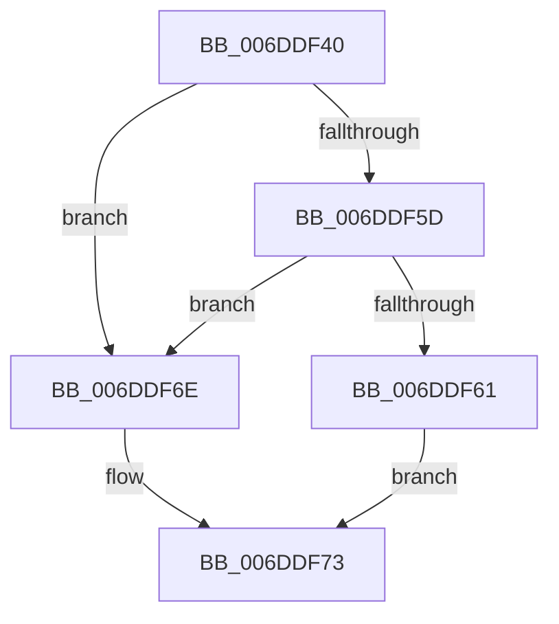

# sub_006DDF40

- RVA: `0x006DDF40`–`0x006DDF7C` (길이 `60` bytes)
- VA: `0x00000001406DDF40`
- 실행 섹션: `.text`
- PDB 이름 있음: `아니요`; PDB Function 태그: `아니요`
- unwind 정보 RVA: `0x00070B74`
- 디코드: `16`개 명령, `60/60` bytes 표시
- 미해석 바이트: `0` (있으면 어셈블리에 `.byte`로 보존)

> 이 문서는 커널 이미지의 기계어와 PDB 기호를 분석해 생성했습니다. 4번과 5번은 함수 원형과 자료형을 바이너리 사용 방식에서 추정한 C 해석이며 원본 소스 복구 결과는 아닙니다.

## 1. Dependencies

- 직접 호출 지점: **1**; 고유 호출 대상: **1**
- 직접 호출자로 확인된 함수: **0**
- RIP 상대 이미지 참조: **0**

### Outgoing calls
- `0x006DDF4F` → [B_TREE<_SM_PAGE_KEY,SMKM_STORE_MGR<SM_TRAITS>::SMKM_FRONTEND_ENTRY,4096,B_TREE_DUMMY_NODE_POOL,B_TREE_KEY_COMPARATOR<_SM_PAGE_KEY> >::BTreeSearchKey](../26/B_TREE__SM_PAGE_KEY_SMKM_STORE_MGR_SM_TRAITS_SMKM_FRONTEND_ENTRY_4096_B_TREE_DUMMY_NODE_POOL_B_TREE__function_00266E10.md) (function, `0x00266E10`)

### Direct callers
- 이 함수 시작 RVA로 연결되는 직접 call은 확인되지 않았습니다. 간접 호출은 완전히 역산할 수 없습니다.

### Static image references
- 디코드된 RIP-relative 메모리 참조가 없습니다.

## 2. Other-region calls and transfers

- 다른 실행 섹션으로 향하는 call: **0**
- call이 아닌 외부 분기/꼬리 이동: **1**
  - `0x006DDF77` → [SMKM_STORE_MGR<SM_TRAITS>::SmFeAddComplete + 0x36C](../2D/SMKM_STORE_MGR_SM_TRAITS_SmFeAddComplete_function_002DFEE0.md) (`tail-transfer`)

## 3. Assembly (complete function range)

```asm
006DDF40  8B 56 10                        mov edx, dword ptr [rsi + 0x10]
006DDF43  4C 8D 44 24 40                  lea r8, [rsp + 0x40]
006DDF48  49 8D 8F C0 01 00 00            lea rcx, [r15 + 0x1c0]
006DDF4F  E8 BC 8E B8 FF                  call 0x140266e10
006DDF54  8B 44 24 58                     mov eax, dword ptr [rsp + 0x58]
006DDF58  83 F8 FF                        cmp eax, -1
006DDF5B  74 11                           je 0x1406ddf6e
006DDF5D  85 C0                           test eax, eax
006DDF5F  74 0D                           je 0x1406ddf6e
006DDF61  FF C8                           dec eax
006DDF63  48 C1 E0 04                     shl rax, 4
006DDF67  48 03 44 24 40                  add rax, qword ptr [rsp + 0x40]
006DDF6C  EB 05                           jmp 0x1406ddf73
006DDF6E  48 8D 44 24 48                  lea rax, [rsp + 0x48]
006DDF73  48 89 78 08                     mov qword ptr [rax + 8], rdi
006DDF77  E9 D0 22 C0 FF                  jmp 0x1402e024c
```

## 4. C-style interpretation (structured pseudocode)

```c
__int64 __fastcall sub_006DDF40(__int64 a1, __int64 a2, __int64 a3, __int64 a4, __int64 a5, __int64 a6, __int64 a7, __int64 a8, __int64 a9, __int64 a10, unsigned int a11)
{
    __int64 result;

    result = B_TREE__SM_PAGE_KEY_SMKM_STORE_MGR_SM_TRAITS___SMKM_FRONTEND_ENTRY_4096_B_TREE_DUMMY_NODE_POOL_B_TRE(v_r15 + 448, (unsigned int)(*(unsigned int *)(v_rsi + 16)), a8, a4);
    if (((unsigned int)((unsigned int)(a11))) == -1) goto loc_006DDF6E;
    if ((unsigned int)((unsigned int)(a11)) == 0) goto loc_006DDF6E;
    result = (unsigned int)(((unsigned int)(a11)) - 1);
    result = (result) << (4);
    result = (result) + (a8);
    goto loc_006DDF73;
loc_006DDF6E:
loc_006DDF73:
    *(unsigned __int64 *)(a9 + 8) = v_rdi;
}
```

## 5. (Beta) C Style

```c
int64_t sub_006DDF40(int64_t Arg1, int64_t Arg2, int64_t Arg3, int64_t Arg4, uint64_t Arg5, uint64_t Arg6, uint64_t Arg7, int64_t Arg8, int64_t Arg9, uint64_t Arg10, uint32_t Arg11)
{
    int64_t result;

    result = B_TREE__SM_PAGE_KEY_SMKM_STORE_MGR_SM_TRAITS___SMKM_FRONTEND_ENTRY_4096_B_TREE_DUMMY_NODE_POOL_B_TRE(local_r15 + 448, (uint32_t)(*(uint32_t *)(local_rsi + 0x10)), Arg8, Arg4);
    if (((uint32_t)((uint32_t)(Arg11))) == -1) goto loc_006DDF6E;
    if ((uint32_t)((uint32_t)(Arg11)) == 0) goto loc_006DDF6E;
    result = (uint32_t)(((uint32_t)(Arg11)) - 1);
    result = (result) << (4);
    result = (result) + (Arg8);
    goto loc_006DDF73;
loc_006DDF6E:
loc_006DDF73:
    *(uint64_t *)(Arg9 + 0x8) = local_rdi;
}
```

## 6. Execution-region graph

[열기: 2D/3D 그래프와 함수 탐색 컨트롤 패널](../../../control-panel.html?section=text&rva=0x006DDF40&view=graph)

- 2D 그래프는 위에서 아래로 흐르고, 3D 그래프는 빈 공간을 드래그해 회전합니다. Shift+드래그는 이동, 휠은 확대·축소, 함수 노드 선택은 대상 보고서 이동입니다.

### Static fallback


