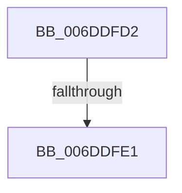

# sub_006DDFD2

- RVA: `0x006DDFD2`–`0x006DE03F` (길이 `109` bytes)
- VA: `0x00000001406DDFD2`
- 실행 섹션: `.text`
- PDB 이름 있음: `아니요`; PDB Function 태그: `아니요`
- unwind 정보 RVA: `0x0007135C`
- 디코드: `24`개 명령, `109/109` bytes 표시
- 미해석 바이트: `0` (있으면 어셈블리에 `.byte`로 보존)

> 이 문서는 커널 이미지의 기계어와 PDB 기호를 분석해 생성했습니다. 4번과 5번은 함수 원형과 자료형을 바이너리 사용 방식에서 추정한 C 해석이며 원본 소스 복구 결과는 아닙니다.

## 1. Dependencies

- 직접 호출 지점: **0**; 고유 호출 대상: **0**
- 직접 호출자로 확인된 함수: **0**
- RIP 상대 이미지 참조: **0**

### Outgoing calls
- 직접 디코드된 call 명령이 없습니다.

### Direct callers
- 이 함수 시작 RVA로 연결되는 직접 call은 확인되지 않았습니다. 간접 호출은 완전히 역산할 수 없습니다.

### Static image references
- 디코드된 RIP-relative 메모리 참조가 없습니다.

## 2. Other-region calls and transfers

- 다른 실행 섹션으로 향하는 call: **0**
- call이 아닌 외부 분기/꼬리 이동: **2**
  - `0x006DDFDB` → [RtlpHpLfhHeatMapQuery + 0x98](../2E/RtlpHpLfhHeatMapQuery_function_002E7790.md) (`tail-transfer`)
  - `0x006DE03A` → [RtlpHpLfhHeatMapQuery + 0x98](../2E/RtlpHpLfhHeatMapQuery_function_002E7790.md) (`tail-transfer`)

## 3. Assembly (complete function range)

```asm
006DDFD2  41 B8 01 00 00 00               mov r8d, 1
006DDFD8  41 3B C8                        cmp ecx, r8d
006DDFDB  0F 84 47 98 C0 FF               je 0x1402e7828
006DDFE1  65 4C 8B 0C 25 88 01 00 00      mov r9, qword ptr gs:[0x188]
006DDFEA  49 8B 89 60 07 00 00            mov rcx, qword ptr [r9 + 0x760]
006DDFF1  49 8B 91 68 07 00 00            mov rdx, qword ptr [r9 + 0x768]
006DDFF8  4C 8D 04 0A                     lea r8, [rdx + rcx]
006DDFFC  48 33 D1                        xor rdx, rcx
006DDFFF  48 8B C2                        mov rax, rdx
006DE002  48 C1 C1 18                     rol rcx, 0x18
006DE006  48 C1 E0 10                     shl rax, 0x10
006DE00A  48 33 C8                        xor rcx, rax
006DE00D  49 C1 E8 20                     shr r8, 0x20
006DE011  48 33 CA                        xor rcx, rdx
006DE014  45 0F B6 C0                     movzx r8d, r8b
006DE018  48 C1 C2 25                     rol rdx, 0x25
006DE01C  B8 AB AA AA AA                  mov eax, 0xaaaaaaab
006DE021  49 89 91 68 07 00 00            mov qword ptr [r9 + 0x768], rdx
006DE028  41 F7 E0                        mul r8d
006DE02B  49 89 89 60 07 00 00            mov qword ptr [r9 + 0x760], rcx
006DE032  D1 EA                           shr edx, 1
006DE034  8D 04 52                        lea eax, [rdx + rdx*2]
006DE037  44 2B C0                        sub r8d, eax
006DE03A  E9 E9 97 C0 FF                  jmp 0x1402e7828
```

## 4. C-style interpretation (structured pseudocode)

```c
__int64 __fastcall sub_006DDFD2(int a1)
{
    __int64 result;

    a2 = (*(unsigned __int64 *)(*(unsigned __int64 *)(gs_base + (0 + 392)) + 1896)) ^ (*(unsigned __int64 *)(*(unsigned __int64 *)(gs_base + (0 + 392)) + 1888));
    result = (a2) << (16);
    a1 = (*(unsigned __int64 *)(*(unsigned __int64 *)(gs_base + (0 + 392)) + 1888)) ^ (result);
    a3 = (*(unsigned __int64 *)(*(unsigned __int64 *)(gs_base + (0 + 392)) + 1896) + *(unsigned __int64 *)(*(unsigned __int64 *)(gs_base + (0 + 392)) + 1888) * 1) >> (32);
    a1 = (a1) ^ (a2);
    *(unsigned __int64 *)(*(unsigned __int64 *)(gs_base + (0 + 392)) + 1896) = a2;
    *(unsigned __int64 *)(*(unsigned __int64 *)(gs_base + (0 + 392)) + 1888) = a1;
    a2 = (unsigned int)((a2) >> (1));
    a3 = (unsigned int)(((unsigned __int8)(a3)) - ((unsigned int)(a2 + a2 * 2)));
}
```

## 5. (Beta) C Style

```c
int64_t sub_006DDFD2(int32_t Arg1)
{
    int64_t result;

    a2 = (*(uint64_t *)(*(uint64_t *)(gs_base + (0 + 0x188)) + 0x768)) ^ (*(uint64_t *)(*(uint64_t *)(gs_base + (0 + 0x188)) + 0x760));
    result = (a2) << (16);
    Arg1 = (*(uint64_t *)(*(uint64_t *)(gs_base + (0 + 0x188)) + 0x760)) ^ (result);
    a3 = (*(uint64_t *)(*(uint64_t *)(gs_base + (0 + 0x188)) + 0x768) + *(uint64_t *)(*(uint64_t *)(gs_base + (0 + 0x188)) + 0x760) * 1) >> (32);
    Arg1 = (Arg1) ^ (a2);
    *(uint64_t *)(*(uint64_t *)(gs_base + (0 + 0x188)) + 0x768) = a2;
    *(uint64_t *)(*(uint64_t *)(gs_base + (0 + 0x188)) + 0x760) = Arg1;
    a2 = (uint32_t)((a2) >> (1));
    a3 = (uint32_t)(((uint8_t)(a3)) - ((uint32_t)(a2 + a2 * 2)));
}
```

## 6. Execution-region graph

[열기: 2D/3D 그래프와 함수 탐색 컨트롤 패널](../../../control-panel.html?section=text&rva=0x006DDFD2&view=graph)

- 2D 그래프는 위에서 아래로 흐르고, 3D 그래프는 빈 공간을 드래그해 회전합니다. Shift+드래그는 이동, 휠은 확대·축소, 함수 노드 선택은 대상 보고서 이동입니다.

### Static fallback


