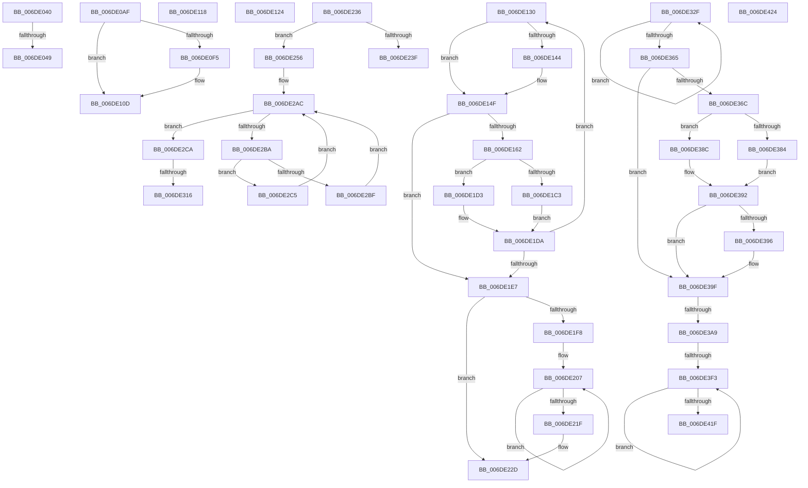

# sub_006DE040

- RVA: `0x006DE040`–`0x006DE42F` (길이 `1,007` bytes)
- VA: `0x00000001406DE040`
- 실행 섹션: `.text`
- PDB 이름 있음: `아니요`; PDB Function 태그: `아니요`
- unwind 정보 RVA: `0x000714D8`
- 디코드: `256`개 명령, `1,007/1,007` bytes 표시
- 미해석 바이트: `0` (있으면 어셈블리에 `.byte`로 보존)

> 이 문서는 커널 이미지의 기계어와 PDB 기호를 분석해 생성했습니다. 4번과 5번은 함수 원형과 자료형을 바이너리 사용 방식에서 추정한 C 해석이며 원본 소스 복구 결과는 아닙니다.

## 1. Dependencies

- 직접 호출 지점: **14**; 고유 호출 대상: **11**
- 직접 호출자로 확인된 함수: **0**
- RIP 상대 이미지 참조: **2**

### Outgoing calls
- `0x006DE0BA` → [memset](../6C/memset_function_006C6C40.md) (function, `0x006C6C40`)
- `0x006DE0EC` → [RtlpHpEnvTlsSetValue](../4F/RtlpHpEnvTlsSetValue_function_004F63AC.md) (function, `0x004F63AC`)
- `0x006DE108` → [RtlpHpLfhContextMetadataFree](../60/RtlpHpLfhContextMetadataFree_function_00604B04.md) (function, `0x00604B04`)
- `0x006DE133` → [RtlpHpLfhContextLockExtension](../60/RtlpHpLfhContextLockExtension_function_00604A50.md) (function, `0x00604A50`)
- `0x006DE154` → [RtlpHpLfhContextUnlockExtension](../60/RtlpHpLfhContextUnlockExtension_function_00604C1C.md) (function, `0x00604C1C`)
- `0x006DE17E` → [RtlpHpLfhOwnerFreeListProcess](../2E/RtlpHpLfhOwnerFreeListProcess_function_002E8BA0.md) (function, `0x002E8BA0`)
- `0x006DE190` → [RtlpHpLfhHeatMapQuery](../2E/RtlpHpLfhHeatMapQuery_function_002E7790.md) (function, `0x002E7790`)
- `0x006DE1B0` → [RtlpHpLfhBucketAddSubsegment](../2E/RtlpHpLfhBucketAddSubsegment_function_002E8CD8.md) (function, `0x002E8CD8`)
- `0x006DE1CC` → [RtlpHpLfhContextMetadataFree](../60/RtlpHpLfhContextMetadataFree_function_00604B04.md) (function, `0x00604B04`)
- `0x006DE1FB` → [RtlpHpLfhContextLockExtension](../60/RtlpHpLfhContextLockExtension_function_00604A50.md) (function, `0x00604A50`)
- `0x006DE224` → [RtlpHpLfhContextUnlockExtension](../60/RtlpHpLfhContextUnlockExtension_function_00604C1C.md) (function, `0x00604C1C`)
- `0x006DE324` → [RtlHeapZero](../6B/RtlHeapZero_function_006BBC10.md) (function, `0x006BBC10`)
- `0x006DE39A` → [RtlpHpEnvCompactionSchedule](../32/RtlpHpEnvCompactionSchedule_function_003264A0.md) (function, `0x003264A0`)
- `0x006DE424` → [RtlpHpReleaseLockShared](../32/RtlpHpReleaseLockShared_function_003245B0.md) (function, `0x003245B0`)

### Direct callers
- 이 함수 시작 RVA로 연결되는 직접 call은 확인되지 않았습니다. 간접 호출은 완전히 역산할 수 없습니다.

### Static image references
- `0x006DE384` → RVA `0x00EFA7BC` (`.data`; read)
- `0x006DE38C` → RVA `0x00EFA7C0` (`.data`; read)

## 2. Other-region calls and transfers

- 다른 실행 섹션으로 향하는 call: **0**
- call이 아닌 외부 분기/꼬리 이동: **13**
  - `0x006DE043` → [RtlpHpLfhSlotAllocateSlow + 0x492](../2E/RtlpHpLfhSlotAllocateSlow_function_002E8FBC.md) (`tail-transfer`)
  - `0x006DE0AA` → [RtlpHpLfhSlotAllocateSlow + 0x120](../2E/RtlpHpLfhSlotAllocateSlow_function_002E8FBC.md) (`tail-transfer`)
  - `0x006DE113` → [RtlpHpLfhSlotAllocateSlow + 0x148](../2E/RtlpHpLfhSlotAllocateSlow_function_002E8FBC.md) (`tail-transfer`)
  - `0x006DE11F` → [RtlpHpLfhSlotAllocateSlow + 0x764](../2E/RtlpHpLfhSlotAllocateSlow_function_002E8FBC.md) (`tail-transfer`)
  - `0x006DE12B` → [RtlpHpLfhSlotAllocateSlow + 0x764](../2E/RtlpHpLfhSlotAllocateSlow_function_002E8FBC.md) (`tail-transfer`)
  - `0x006DE231` → [RtlpHpLfhSlotAllocateSlow + 0x5BB](../2E/RtlpHpLfhSlotAllocateSlow_function_002E8FBC.md) (`tail-transfer`)
  - `0x006DE251` → [RtlpHpLfhSlotAllocateSlow + 0x197](../2E/RtlpHpLfhSlotAllocateSlow_function_002E8FBC.md) (`tail-transfer`)
  - `0x006DE310` → [RtlpHpLfhSlotAllocateSlow + 0x40C](../2E/RtlpHpLfhSlotAllocateSlow_function_002E8FBC.md) (`tail-transfer`)
  - `0x006DE32A` → [RtlpHpLfhSlotAllocateSlow + 0x40C](../2E/RtlpHpLfhSlotAllocateSlow_function_002E8FBC.md) (`tail-transfer`)
  - `0x006DE3A3` → [RtlpHpLfhSlotAllocateSlow + 0x714](../2E/RtlpHpLfhSlotAllocateSlow_function_002E8FBC.md) (`tail-transfer`)
  - `0x006DE3ED` → [RtlpHpLfhSlotAllocateSlow + 0x714](../2E/RtlpHpLfhSlotAllocateSlow_function_002E8FBC.md) (`tail-transfer`)
  - `0x006DE41F` → [RtlpHpLfhSlotAllocateSlow + 0x714](../2E/RtlpHpLfhSlotAllocateSlow_function_002E8FBC.md) (`tail-transfer`)
  - `0x006DE42A` → [RtlpHpLfhSlotAllocateSlow + 0x415](../2E/RtlpHpLfhSlotAllocateSlow_function_002E8FBC.md) (`tail-transfer`)

## 3. Assembly (complete function range)

```asm
006DE040  41 3B C8                        cmp ecx, r8d
006DE043  0F 84 05 B4 C0 FF               je 0x1402e944e
006DE049  65 4C 8B 0C 25 88 01 00 00      mov r9, qword ptr gs:[0x188]
006DE052  49 8B 89 60 07 00 00            mov rcx, qword ptr [r9 + 0x760]
006DE059  49 8B 91 68 07 00 00            mov rdx, qword ptr [r9 + 0x768]
006DE060  4C 8D 04 0A                     lea r8, [rdx + rcx]
006DE064  48 33 D1                        xor rdx, rcx
006DE067  48 8B C2                        mov rax, rdx
006DE06A  48 C1 C1 18                     rol rcx, 0x18
006DE06E  48 C1 E0 10                     shl rax, 0x10
006DE072  48 33 C8                        xor rcx, rax
006DE075  49 C1 E8 20                     shr r8, 0x20
006DE079  48 33 CA                        xor rcx, rdx
006DE07C  41 0F B6 F8                     movzx edi, r8b
006DE080  48 C1 C2 25                     rol rdx, 0x25
006DE084  B8 AB AA AA AA                  mov eax, 0xaaaaaaab
006DE089  49 89 91 68 07 00 00            mov qword ptr [r9 + 0x768], rdx
006DE090  41 B8 01 00 00 00               mov r8d, 1
006DE096  F7 E7                           mul edi
006DE098  49 89 89 60 07 00 00            mov qword ptr [r9 + 0x760], rcx
006DE09F  45 8D 48 01                     lea r9d, [r8 + 1]
006DE0A3  D1 EA                           shr edx, 1
006DE0A5  8D 04 52                        lea eax, [rdx + rdx*2]
006DE0A8  2B F8                           sub edi, eax
006DE0AA  E9 2D B0 C0 FF                  jmp 0x1402e90dc
006DE0AF  33 D2                           xor edx, edx
006DE0B1  41 B8 00 01 00 00               mov r8d, 0x100
006DE0B7  49 8B CE                        mov rcx, r14
006DE0BA  E8 81 8B FE FF                  call 0x1406c6c40
006DE0BF  48 B8 08 00 00 00 80 F7 FF FF   movabs rax, 0xfffff78000000008
006DE0C9  48 8B 00                        mov rax, qword ptr [rax]
006DE0CC  48 C1 E8 14                     shr rax, 0x14
006DE0D0  41 89 86 FC 00 00 00            mov dword ptr [r14 + 0xfc], eax
006DE0D7  49 8B C6                        mov rax, r14
006DE0DA  8B 4E 4C                        mov ecx, dword ptr [rsi + 0x4c]
006DE0DD  48 2B C6                        sub rax, rsi
006DE0E0  48 C1 E8 06                     shr rax, 6
006DE0E4  66 89 45 69                     mov word ptr [rbp + 0x69], ax
006DE0E8  48 8B 55 67                     mov rdx, qword ptr [rbp + 0x67]
006DE0EC  E8 BB 82 E1 FF                  call 0x1404f63ac
006DE0F1  85 C0                           test eax, eax
006DE0F3  79 18                           jns 0x1406de10d
006DE0F5  41 B8 01 00 00 00               mov r8d, 1
006DE0FB  4C 89 65 EF                     mov qword ptr [rbp - 0x11], r12
006DE0FF  48 8B D7                        mov rdx, rdi
006DE102  48 8B CE                        mov rcx, rsi
006DE105  4D 8B F4                        mov r14, r12
006DE108  E8 F7 69 F2 FF                  call 0x140604b04
006DE10D  41 B8 01 00 00 00               mov r8d, 1
006DE113  E9 EC AF C0 FF                  jmp 0x1402e9104
006DE118  C7 45 CB 01 00 00 00            mov dword ptr [rbp - 0x35], 1
006DE11F  E9 FC B5 C0 FF                  jmp 0x1402e9720
006DE124  48 89 45 6F                     mov qword ptr [rbp + 0x6f], rax
006DE128  4C 8B F8                        mov r15, rax
006DE12B  E9 F0 B5 C0 FF                  jmp 0x1402e9720
006DE130  48 8B CE                        mov rcx, rsi
006DE133  E8 18 69 F2 FF                  call 0x140604a50
006DE138  4C 8B A6 A0 00 00 00            mov r12, qword ptr [rsi + 0xa0]
006DE13F  4D 85 E4                        test r12, r12
006DE142  74 0B                           je 0x1406de14f
006DE144  49 8B 0C 24                     mov rcx, qword ptr [r12]
006DE148  48 89 8E A0 00 00 00            mov qword ptr [rsi + 0xa0], rcx
006DE14F  8A D0                           mov dl, al
006DE151  48 8B CE                        mov rcx, rsi
006DE154  E8 C3 6A F2 FF                  call 0x140604c1c
006DE159  4D 85 E4                        test r12, r12
006DE15C  0F 84 85 00 00 00               je 0x1406de1e7
006DE162  41 0F B7 7C 24 F2               movzx edi, word ptr [r12 - 0xe]
006DE168  4C 8D 45 FF                     lea r8, [rbp - 1]
006DE16C  48 C1 E7 06                     shl rdi, 6
006DE170  49 8D 54 24 F0                  lea rdx, [r12 - 0x10]
006DE175  45 33 C9                        xor r9d, r9d
006DE178  48 8B CE                        mov rcx, rsi
006DE17B  48 03 FE                        add rdi, rsi
006DE17E  E8 1D AA C0 FF                  call 0x1402e8ba0
006DE183  4C 8B C7                        mov r8, rdi
006DE186  48 8D 96 C0 00 00 00            lea rdx, [rsi + 0xc0]
006DE18D  48 8B CE                        mov rcx, rsi
006DE190  E8 FB 95 C0 FF                  call 0x1402e7790
006DE195  41 B9 08 00 00 00               mov r9d, 8
006DE19B  4C 8D 45 FF                     lea r8, [rbp - 1]
006DE19F  41 3B C6                        cmp eax, r14d
006DE1A2  48 8B D7                        mov rdx, rdi
006DE1A5  48 8B CE                        mov rcx, rsi
006DE1A8  41 8D 41 FC                     lea eax, [r9 - 4]
006DE1AC  44 0F 4C C8                     cmovl r9d, eax
006DE1B0  E8 23 AB C0 FF                  call 0x1402e8cd8
006DE1B5  49 8D 54 24 F0                  lea rdx, [r12 - 0x10]
006DE1BA  48 8D 42 28                     lea rax, [rdx + 0x28]
006DE1BE  48 39 00                        cmp qword ptr [rax], rax
006DE1C1  75 10                           jne 0x1406de1d3
006DE1C3  41 B8 02 00 00 00               mov r8d, 2
006DE1C9  48 8B CE                        mov rcx, rsi
006DE1CC  E8 33 69 F2 FF                  call 0x140604b04
006DE1D1  EB 07                           jmp 0x1406de1da
006DE1D3  49 89 1C 24                     mov qword ptr [r12], rbx
006DE1D7  49 8B DC                        mov rbx, r12
006DE1DA  4C 39 AE A0 00 00 00            cmp qword ptr [rsi + 0xa0], r13
006DE1E1  0F 85 49 FF FF FF               jne 0x1406de130
006DE1E7  4C 8B 75 EF                     mov r14, qword ptr [rbp - 0x11]
006DE1EB  4C 8B 7D 6F                     mov r15, qword ptr [rbp + 0x6f]
006DE1EF  44 8B 6D C7                     mov r13d, dword ptr [rbp - 0x39]
006DE1F3  48 85 DB                        test rbx, rbx
006DE1F6  74 35                           je 0x1406de22d
006DE1F8  48 8B CE                        mov rcx, rsi
006DE1FB  E8 50 68 F2 FF                  call 0x140604a50
006DE200  48 8B 96 A0 00 00 00            mov rdx, qword ptr [rsi + 0xa0]
006DE207  48 8B CB                        mov rcx, rbx
006DE20A  48 8B 1B                        mov rbx, qword ptr [rbx]
006DE20D  48 89 11                        mov qword ptr [rcx], rdx
006DE210  48 8B D1                        mov rdx, rcx
006DE213  48 89 8E A0 00 00 00            mov qword ptr [rsi + 0xa0], rcx
006DE21A  48 85 DB                        test rbx, rbx
006DE21D  75 E8                           jne 0x1406de207
006DE21F  8A D0                           mov dl, al
006DE221  48 8B CE                        mov rcx, rsi
006DE224  E8 F3 69 F2 FF                  call 0x140604c1c
006DE229  4C 89 75 EF                     mov qword ptr [rbp - 0x11], r14
006DE22D  4C 8B 65 D7                     mov r12, qword ptr [rbp - 0x29]
006DE231  E9 41 B3 C0 FF                  jmp 0x1402e9577
006DE236  48 8B 45 E7                     mov rax, qword ptr [rbp - 0x19]
006DE23A  48 39 08                        cmp qword ptr [rax], rcx
006DE23D  75 17                           jne 0x1406de256
006DE23F  48 89 43 08                     mov qword ptr [rbx + 8], rax
006DE243  48 8D 4D DF                     lea rcx, [rbp - 0x21]
006DE247  48 89 0B                        mov qword ptr [rbx], rcx
006DE24A  48 89 18                        mov qword ptr [rax], rbx
006DE24D  48 89 5D E7                     mov qword ptr [rbp - 0x19], rbx
006DE251  E9 FD AE C0 FF                  jmp 0x1402e9153
006DE256  B9 03 00 00 00                  mov ecx, 3
006DE25B  CD 29                           int 0x29
006DE25D  48 33 D1                        xor rdx, rcx
006DE260  89 45 6F                        mov dword ptr [rbp + 0x6f], eax
006DE263  44 0F B7 D8                     movzx r11d, ax
006DE267  41 83 EA 08                     sub r10d, 8
006DE26B  48 8B C2                        mov rax, rdx
006DE26E  48 C1 C1 18                     rol rcx, 0x18
006DE272  48 C1 E0 10                     shl rax, 0x10
006DE276  49 FF CA                        dec r10
006DE279  48 33 C8                        xor rcx, rax
006DE27C  49 C1 E8 20                     shr r8, 0x20
006DE280  48 33 CA                        xor rcx, rdx
006DE283  41 0F B6 F8                     movzx edi, r8b
006DE287  48 C1 C2 25                     rol rdx, 0x25
006DE28B  49 89 91 68 07 00 00            mov qword ptr [r9 + 0x768], rdx
006DE292  45 33 E4                        xor r12d, r12d
006DE295  49 89 89 60 07 00 00            mov qword ptr [r9 + 0x760], rcx
006DE29C  4C 8D 4B 40                     lea r9, [rbx + 0x40]
006DE2A0  0F B6 43 24                     movzx eax, byte ptr [rbx + 0x24]
006DE2A4  4F 8D 14 D1                     lea r10, [r9 + r10*8]
006DE2A8  49 8D 14 C1                     lea rdx, [r9 + rax*8]
006DE2AC  4C 8B 02                        mov r8, qword ptr [rdx]
006DE2AF  49 8B C8                        mov rcx, r8
006DE2B2  48 F7 D1                        not rcx
006DE2B5  48 85 C9                        test rcx, rcx
006DE2B8  75 10                           jne 0x1406de2ca
006DE2BA  49 3B D2                        cmp rdx, r10
006DE2BD  74 06                           je 0x1406de2c5
006DE2BF  48 83 C2 08                     add rdx, 8
006DE2C3  EB E7                           jmp 0x1406de2ac
006DE2C5  49 8B D1                        mov rdx, r9
006DE2C8  EB E2                           jmp 0x1406de2ac
006DE2CA  F3 48 0F B8 C1                  popcnt rax, rcx
006DE2CF  0F AF C7                        imul eax, edi
006DE2D2  41 BA 01 00 00 00               mov r10d, 1
006DE2D8  0F B7 7D 71                     movzx edi, word ptr [rbp + 0x71]
006DE2DC  C1 E8 08                        shr eax, 8
006DE2DF  C4 C2 F9 F7 C2                  shlx rax, r10, rax
006DE2E4  C4 E2 FB F5 C9                  pdep rcx, rax, rcx
006DE2E9  4C 0B C1                        or r8, rcx
006DE2EC  F3 48 0F BC C1                  tzcnt rax, rcx
006DE2F1  4C 89 02                        mov qword ptr [rdx], r8
006DE2F4  41 2B D1                        sub edx, r9d
006DE2F7  8D 0C D0                        lea ecx, [rax + rdx*8]
006DE2FA  44 0F AF D9                     imul r11d, ecx
006DE2FE  8B C1                           mov eax, ecx
006DE300  C1 E8 06                        shr eax, 6
006DE303  88 43 24                        mov byte ptr [rbx + 0x24], al
006DE306  41 03 FB                        add edi, r11d
006DE309  48 03 FB                        add rdi, rbx
006DE30C  44 84 75 7F                     test byte ptr [rbp + 0x7f], r14b
006DE310  0F 84 B2 B0 C0 FF               je 0x1402e93c8
006DE316  8B 55 77                        mov edx, dword ptr [rbp + 0x77]
006DE319  48 8B CF                        mov rcx, rdi
006DE31C  48 83 C2 0F                     add rdx, 0xf
006DE320  48 83 E2 F0                     and rdx, 0xfffffffffffffff0
006DE324  E8 E7 D8 FD FF                  call 0x1406bbc10
006DE329  90                              nop
006DE32A  E9 99 B0 C0 FF                  jmp 0x1402e93c8
006DE32F  48 89 45 6F                     mov qword ptr [rbp + 0x6f], rax
006DE333  48 8B C8                        mov rcx, rax
006DE336  0F B6 55 75                     movzx edx, byte ptr [rbp + 0x75]
006DE33A  48 C1 E9 30                     shr rcx, 0x30
006DE33E  41 3A CE                        cmp cl, r14b
006DE341  48 89 45 D7                     mov qword ptr [rbp - 0x29], rax
006DE345  41 0F 44 D0                     cmove edx, r8d
006DE349  66 44 01 75 71                  add word ptr [rbp + 0x71], r14w
006DE34E  88 55 75                        mov byte ptr [rbp + 0x75], dl
006DE351  0F B7 53 2C                     movzx edx, word ptr [rbx + 0x2c]
006DE355  48 8B 4D 6F                     mov rcx, qword ptr [rbp + 0x6f]
006DE359  48 C1 E2 06                     shl rdx, 6
006DE35D  F0 48 0F B1 4B 10               lock cmpxchg qword ptr [rbx + 0x10], rcx
006DE363  75 CA                           jne 0x1406de32f
006DE365  44 38 64 32 5C                  cmp byte ptr [rdx + rsi + 0x5c], r12b
006DE36A  75 33                           jne 0x1406de39f
006DE36C  44 88 74 32 5C                  mov byte ptr [rdx + rsi + 0x5c], r14b
006DE371  48 8B 0E                        mov rcx, qword ptr [rsi]
006DE374  48 8B 41 38                     mov rax, qword ptr [rcx + 0x38]
006DE378  48 8B 00                        mov rax, qword ptr [rax]
006DE37B  48 C1 E8 08                     shr rax, 8
006DE37F  41 3A C6                        cmp al, r14b
006DE382  75 08                           jne 0x1406de38c
006DE384  8B 05 32 C4 81 00               mov eax, dword ptr [rip + 0x81c432]
006DE38A  EB 06                           jmp 0x1406de392
006DE38C  8B 05 2E C4 81 00               mov eax, dword ptr [rip + 0x81c42e]
006DE392  85 C0                           test eax, eax
006DE394  75 09                           jne 0x1406de39f
006DE396  48 8B 49 38                     mov rcx, qword ptr [rcx + 0x38]
006DE39A  E8 01 81 C4 FF                  call 0x1403264a0
006DE39F  44 38 75 DD                     cmp byte ptr [rbp - 0x23], r14b
006DE3A3  0F 85 27 B3 C0 FF               jne 0x1402e96d0
006DE3A9  0F B7 45 DB                     movzx eax, word ptr [rbp - 0x25]
006DE3AD  C1 E0 06                        shl eax, 6
006DE3B0  44 8B C8                        mov r9d, eax
006DE3B3  0F 0D 4C 30 08                  prefetchw byte ptr [rax + rsi + 8]
006DE3B8  48 8B 44 30 08                  mov rax, qword ptr [rax + rsi + 8]
006DE3BD  41 BE FF 0F 00 00               mov r14d, 0xfff
006DE3C3  4C 8B 53 18                     mov r10, qword ptr [rbx + 0x18]
006DE3C7  48 8B D0                        mov rdx, rax
006DE3CA  49 23 D6                        and rdx, r14
006DE3CD  4D 8B C2                        mov r8, r10
006DE3D0  4D 23 C6                        and r8, r14
006DE3D3  48 8B C8                        mov rcx, rax
006DE3D6  48 2B CA                        sub rcx, rdx
006DE3D9  49 0B C8                        or rcx, r8
006DE3DC  48 89 4B 18                     mov qword ptr [rbx + 0x18], rcx
006DE3E0  48 8B CB                        mov rcx, rbx
006DE3E3  48 0B CA                        or rcx, rdx
006DE3E6  F0 49 0F B1 4C 31 08            lock cmpxchg qword ptr [r9 + rsi + 8], rcx
006DE3ED  0F 84 DD B2 C0 FF               je 0x1402e96d0
006DE3F3  48 8B C8                        mov rcx, rax
006DE3F6  48 8B D0                        mov rdx, rax
006DE3F9  49 33 CA                        xor rcx, r10
006DE3FC  49 23 D6                        and rdx, r14
006DE3FF  48 81 E1 00 F0 FF FF            and rcx, 0xfffffffffffff000
006DE406  4C 8B C0                        mov r8, rax
006DE409  49 33 CA                        xor rcx, r10
006DE40C  48 89 4B 18                     mov qword ptr [rbx + 0x18], rcx
006DE410  48 0B D3                        or rdx, rbx
006DE413  F0 49 0F B1 54 31 08            lock cmpxchg qword ptr [r9 + rsi + 8], rdx
006DE41A  49 3B C0                        cmp rax, r8
006DE41D  75 D4                           jne 0x1406de3f3
006DE41F  E9 AC B2 C0 FF                  jmp 0x1402e96d0
006DE424  E8 87 61 C4 FF                  call 0x1403245b0
006DE429  90                              nop
006DE42A  E9 A2 AF C0 FF                  jmp 0x1402e93d1
```

## 4. C-style interpretation (structured pseudocode)

```c
__int64 __fastcall sub_006DE040(int a1, __int64 a2, int a3)
{
    __int64 result;
    __int64 v_rdi;

    a2 = (*(unsigned __int64 *)(*(unsigned __int64 *)(gs_base + (0 + 392)) + 1896)) ^ (*(unsigned __int64 *)(*(unsigned __int64 *)(gs_base + (0 + 392)) + 1888));
    result = (a2) << (16);
    a1 = (*(unsigned __int64 *)(*(unsigned __int64 *)(gs_base + (0 + 392)) + 1888)) ^ (result);
    a3 = (*(unsigned __int64 *)(*(unsigned __int64 *)(gs_base + (0 + 392)) + 1896) + *(unsigned __int64 *)(*(unsigned __int64 *)(gs_base + (0 + 392)) + 1888) * 1) >> (32);
    a1 = (a1) ^ (a2);
    *(unsigned __int64 *)(*(unsigned __int64 *)(gs_base + (0 + 392)) + 1896) = a2;
    *(unsigned __int64 *)(*(unsigned __int64 *)(gs_base + (0 + 392)) + 1888) = a1;
    a2 = (unsigned int)((a2) >> (1));
    v_rdi = (unsigned int)(((unsigned __int8)(a3)) - ((unsigned int)(a2 + a2 * 2)));
}
```

## 5. (Beta) C Style

```c
int64_t sub_006DE040(int32_t Arg1, int64_t Arg2, int32_t Arg3)
{
    int64_t result;
    int64_t local_rdi;

    Arg2 = (*(uint64_t *)(*(uint64_t *)(gs_base + (0 + 0x188)) + 0x768)) ^ (*(uint64_t *)(*(uint64_t *)(gs_base + (0 + 0x188)) + 0x760));
    result = (Arg2) << (16);
    Arg1 = (*(uint64_t *)(*(uint64_t *)(gs_base + (0 + 0x188)) + 0x760)) ^ (result);
    Arg3 = (*(uint64_t *)(*(uint64_t *)(gs_base + (0 + 0x188)) + 0x768) + *(uint64_t *)(*(uint64_t *)(gs_base + (0 + 0x188)) + 0x760) * 1) >> (32);
    Arg1 = (Arg1) ^ (Arg2);
    *(uint64_t *)(*(uint64_t *)(gs_base + (0 + 0x188)) + 0x768) = Arg2;
    *(uint64_t *)(*(uint64_t *)(gs_base + (0 + 0x188)) + 0x760) = Arg1;
    Arg2 = (uint32_t)((Arg2) >> (1));
    local_rdi = (uint32_t)(((uint8_t)(Arg3)) - ((uint32_t)(Arg2 + Arg2 * 2)));
}
```

## 6. Execution-region graph

[열기: 2D/3D 그래프와 함수 탐색 컨트롤 패널](../../../control-panel.html?section=text&rva=0x006DE040&view=graph)

- 2D 그래프는 위에서 아래로 흐르고, 3D 그래프는 빈 공간을 드래그해 회전합니다. Shift+드래그는 이동, 휠은 확대·축소, 함수 노드 선택은 대상 보고서 이동입니다.

### Static fallback


