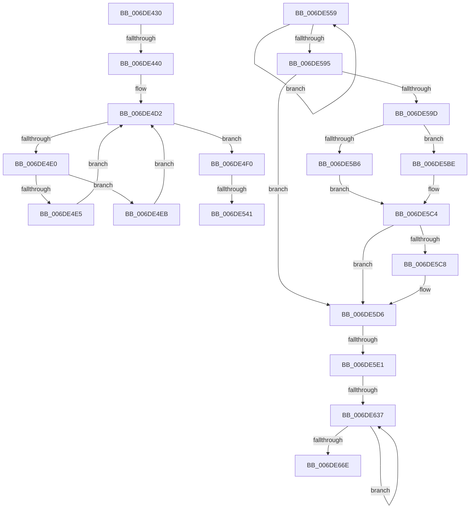

# sub_006DE430

- RVA: `0x006DE430`–`0x006DE673` (길이 `579` bytes)
- VA: `0x00000001406DE430`
- 실행 섹션: `.text`
- PDB 이름 있음: `아니요`; PDB Function 태그: `아니요`
- unwind 정보 RVA: `0x00071554`
- 디코드: `142`개 명령, `579/579` bytes 표시
- 미해석 바이트: `0` (있으면 어셈블리에 `.byte`로 보존)

> 이 문서는 커널 이미지의 기계어와 PDB 기호를 분석해 생성했습니다. 4번과 5번은 함수 원형과 자료형을 바이너리 사용 방식에서 추정한 C 해석이며 원본 소스 복구 결과는 아닙니다.

## 1. Dependencies

- 직접 호출 지점: **2**; 고유 호출 대상: **2**
- 직접 호출자로 확인된 함수: **0**
- RIP 상대 이미지 참조: **3**

### Outgoing calls
- `0x006DE54E` → [RtlHeapZero](../6B/RtlHeapZero_function_006BBC10.md) (function, `0x006BBC10`)
- `0x006DE5CC` → [RtlpHpEnvCompactionSchedule](../32/RtlpHpEnvCompactionSchedule_function_003264A0.md) (function, `0x003264A0`)

### Direct callers
- 이 함수 시작 RVA로 연결되는 직접 call은 확인되지 않았습니다. 간접 호출은 완전히 역산할 수 없습니다.

### Static image references
- `0x006DE46E` → RVA `0x00E28308` (`.data`; read)
- `0x006DE5B6` → RVA `0x00EFA7BC` (`.data`; read)
- `0x006DE5BE` → RVA `0x00EFA7C0` (`.data`; read)

## 2. Other-region calls and transfers

- 다른 실행 섹션으로 향하는 call: **0**
- call이 아닌 외부 분기/꼬리 이동: **6**
  - `0x006DE43A` → [sub_002E9C01 + 0x103](../2E/Unknown_function_002E9C01.md) (`tail-transfer`)
  - `0x006DE53B` → [sub_002E98D9 + 0x2DC](../2E/Unknown_function_002E98D9.md) (`tail-transfer`)
  - `0x006DE554` → [sub_002E98D9 + 0x2DE](../2E/Unknown_function_002E98D9.md) (`tail-transfer`)
  - `0x006DE5DB` → [sub_002E98D9 + 0x2D1](../2E/Unknown_function_002E98D9.md) (`tail-transfer`)
  - `0x006DE631` → [sub_002E98D9 + 0x2D1](../2E/Unknown_function_002E98D9.md) (`tail-transfer`)
  - `0x006DE66E` → [sub_002E98D9 + 0x2D1](../2E/Unknown_function_002E98D9.md) (`tail-transfer`)

## 3. Assembly (complete function range)

```asm
006DE430  48 8B 45 38                     mov rax, qword ptr [rbp + 0x38]
006DE434  48 A9 FF 0F 00 00               test rax, 0xfff
006DE43A  0F 84 C4 B8 C0 FF               je 0x1402e9d04
006DE440  4C 8B D8                        mov r11, rax
006DE443  49 81 E3 00 F0 FF FF            and r11, 0xfffffffffffff000
006DE44A  48 FF C8                        dec rax
006DE44D  48 89 45 38                     mov qword ptr [rbp + 0x38], rax
006DE451  49 8B C3                        mov rax, r11
006DE454  65 4C 8B 0C 25 88 01 00 00      mov r9, qword ptr gs:[0x188]
006DE45D  45 0F B6 53 18                  movzx r10d, byte ptr [r11 + 0x18]
006DE462  48 C1 E8 0C                     shr rax, 0xc
006DE466  41 83 C2 F8                     add r10d, -8
006DE46A  41 33 43 28                     xor eax, dword ptr [r11 + 0x28]
006DE46E  33 05 94 9E 74 00               xor eax, dword ptr [rip + 0x749e94]
006DE474  49 8B 89 60 07 00 00            mov rcx, qword ptr [r9 + 0x760]
006DE47B  49 8B 91 68 07 00 00            mov rdx, qword ptr [r9 + 0x768]
006DE482  89 84 24 B0 00 00 00            mov dword ptr [rsp + 0xb0], eax
006DE489  0F B7 D8                        movzx ebx, ax
006DE48C  4C 8D 04 0A                     lea r8, [rdx + rcx]
006DE490  48 33 D1                        xor rdx, rcx
006DE493  48 8B C2                        mov rax, rdx
006DE496  48 C1 C1 18                     rol rcx, 0x18
006DE49A  48 C1 E0 10                     shl rax, 0x10
006DE49E  48 33 C8                        xor rcx, rax
006DE4A1  49 C1 E8 20                     shr r8, 0x20
006DE4A5  48 33 CA                        xor rcx, rdx
006DE4A8  41 0F B6 E8                     movzx ebp, r8b
006DE4AC  48 C1 C2 25                     rol rdx, 0x25
006DE4B0  49 89 91 68 07 00 00            mov qword ptr [r9 + 0x768], rdx
006DE4B7  49 FF CA                        dec r10
006DE4BA  49 89 89 60 07 00 00            mov qword ptr [r9 + 0x760], rcx
006DE4C1  4D 8D 4B 40                     lea r9, [r11 + 0x40]
006DE4C5  41 0F B6 43 24                  movzx eax, byte ptr [r11 + 0x24]
006DE4CA  4F 8D 14 D1                     lea r10, [r9 + r10*8]
006DE4CE  49 8D 14 C1                     lea rdx, [r9 + rax*8]
006DE4D2  4C 8B 02                        mov r8, qword ptr [rdx]
006DE4D5  49 8B C8                        mov rcx, r8
006DE4D8  48 F7 D1                        not rcx
006DE4DB  48 85 C9                        test rcx, rcx
006DE4DE  75 10                           jne 0x1406de4f0
006DE4E0  49 3B D2                        cmp rdx, r10
006DE4E3  74 06                           je 0x1406de4eb
006DE4E5  48 83 C2 08                     add rdx, 8
006DE4E9  EB E7                           jmp 0x1406de4d2
006DE4EB  49 8B D1                        mov rdx, r9
006DE4EE  EB E2                           jmp 0x1406de4d2
006DE4F0  44 0F B7 A4 24 B2 00 00 00      movzx r12d, word ptr [rsp + 0xb2]
006DE4F9  41 BA 01 00 00 00               mov r10d, 1
006DE4FF  F3 48 0F B8 C1                  popcnt rax, rcx
006DE504  0F AF C5                        imul eax, ebp
006DE507  C1 E8 08                        shr eax, 8
006DE50A  C4 C2 F9 F7 C2                  shlx rax, r10, rax
006DE50F  C4 E2 FB F5 C9                  pdep rcx, rax, rcx
006DE514  4C 0B C1                        or r8, rcx
006DE517  F3 48 0F BC C1                  tzcnt rax, rcx
006DE51C  4C 89 02                        mov qword ptr [rdx], r8
006DE51F  41 2B D1                        sub edx, r9d
006DE522  8D 0C D0                        lea ecx, [rax + rdx*8]
006DE525  0F AF D9                        imul ebx, ecx
006DE528  8B C1                           mov eax, ecx
006DE52A  C1 E8 06                        shr eax, 6
006DE52D  41 88 43 24                     mov byte ptr [r11 + 0x24], al
006DE531  44 03 E3                        add r12d, ebx
006DE534  4D 03 E3                        add r12, r11
006DE537  40 F6 C7 02                     test dil, 2
006DE53B  0F 84 74 B6 C0 FF               je 0x1402e9bb5
006DE541  8B DE                           mov ebx, esi
006DE543  49 8B CC                        mov rcx, r12
006DE546  48 8D 53 0F                     lea rdx, [rbx + 0xf]
006DE54A  48 83 E2 F0                     and rdx, 0xfffffffffffffff0
006DE54E  E8 BD D6 FD FF                  call 0x1406bbc10
006DE553  90                              nop
006DE554  E9 5E B6 C0 FF                  jmp 0x1402e9bb7
006DE559  48 89 44 24 28                  mov qword ptr [rsp + 0x28], rax
006DE55E  48 8B C8                        mov rcx, rax
006DE561  0F B6 54 24 2E                  movzx edx, byte ptr [rsp + 0x2e]
006DE566  48 C1 E9 30                     shr rcx, 0x30
006DE56A  80 F9 01                        cmp cl, 1
006DE56D  48 89 44 24 40                  mov qword ptr [rsp + 0x40], rax
006DE572  41 0F 44 D0                     cmove edx, r8d
006DE576  66 FF 44 24 2A                  inc word ptr [rsp + 0x2a]
006DE57B  88 54 24 2E                     mov byte ptr [rsp + 0x2e], dl
006DE57F  41 0F B7 53 2C                  movzx edx, word ptr [r11 + 0x2c]
006DE584  48 8B 4C 24 28                  mov rcx, qword ptr [rsp + 0x28]
006DE589  48 C1 E2 06                     shl rdx, 6
006DE58D  F0 49 0F B1 4B 10               lock cmpxchg qword ptr [r11 + 0x10], rcx
006DE593  75 C4                           jne 0x1406de559
006DE595  42 80 7C 2A 5C 00               cmp byte ptr [rdx + r13 + 0x5c], 0
006DE59B  75 39                           jne 0x1406de5d6
006DE59D  42 C6 44 2A 5C 01               mov byte ptr [rdx + r13 + 0x5c], 1
006DE5A3  49 8B 4D 00                     mov rcx, qword ptr [r13]
006DE5A7  48 8B 41 38                     mov rax, qword ptr [rcx + 0x38]
006DE5AB  48 8B 00                        mov rax, qword ptr [rax]
006DE5AE  48 C1 E8 08                     shr rax, 8
006DE5B2  3C 01                           cmp al, 1
006DE5B4  75 08                           jne 0x1406de5be
006DE5B6  8B 05 00 C2 81 00               mov eax, dword ptr [rip + 0x81c200]
006DE5BC  EB 06                           jmp 0x1406de5c4
006DE5BE  8B 05 FC C1 81 00               mov eax, dword ptr [rip + 0x81c1fc]
006DE5C4  85 C0                           test eax, eax
006DE5C6  75 0E                           jne 0x1406de5d6
006DE5C8  48 8B 49 38                     mov rcx, qword ptr [rcx + 0x38]
006DE5CC  E8 CF 7E C4 FF                  call 0x1403264a0
006DE5D1  4C 8B 5C 24 30                  mov r11, qword ptr [rsp + 0x30]
006DE5D6  80 7C 24 46 01                  cmp byte ptr [rsp + 0x46], 1
006DE5DB  0F 85 C9 B5 C0 FF               jne 0x1402e9baa
006DE5E1  44 0F B7 4C 24 44               movzx r9d, word ptr [rsp + 0x44]
006DE5E7  41 C1 E1 06                     shl r9d, 6
006DE5EB  4D 03 CD                        add r9, r13
006DE5EE  41 0F 0D 49 08                  prefetchw byte ptr [r9 + 8]
006DE5F3  49 8B 41 08                     mov rax, qword ptr [r9 + 8]
006DE5F7  45 8B 53 18                     mov r10d, dword ptr [r11 + 0x18]
006DE5FB  48 8B C8                        mov rcx, rax
006DE5FE  81 E1 FF 0F 00 00               and ecx, 0xfff
006DE604  41 81 E2 FF 0F 00 00            and r10d, 0xfff
006DE60B  48 8B D0                        mov rdx, rax
006DE60E  48 2B D1                        sub rdx, rcx
006DE611  41 8B CA                        mov ecx, r10d
006DE614  48 0B CA                        or rcx, rdx
006DE617  49 89 4B 18                     mov qword ptr [r11 + 0x18], rcx
006DE61B  48 8B C8                        mov rcx, rax
006DE61E  48 33 CB                        xor rcx, rbx
006DE621  48 81 E1 00 F0 FF FF            and rcx, 0xfffffffffffff000
006DE628  48 33 C8                        xor rcx, rax
006DE62B  F0 49 0F B1 49 08               lock cmpxchg qword ptr [r9 + 8], rcx
006DE631  0F 84 73 B5 C0 FF               je 0x1402e9baa
006DE637  48 8B C8                        mov rcx, rax
006DE63A  48 8B D0                        mov rdx, rax
006DE63D  81 E1 FF 0F 00 00               and ecx, 0xfff
006DE643  4C 8B C0                        mov r8, rax
006DE646  48 2B D1                        sub rdx, rcx
006DE649  49 8B CA                        mov rcx, r10
006DE64C  48 0B CA                        or rcx, rdx
006DE64F  49 89 4B 18                     mov qword ptr [r11 + 0x18], rcx
006DE653  48 8B C8                        mov rcx, rax
006DE656  48 33 CB                        xor rcx, rbx
006DE659  48 81 E1 00 F0 FF FF            and rcx, 0xfffffffffffff000
006DE660  48 33 C8                        xor rcx, rax
006DE663  F0 49 0F B1 49 08               lock cmpxchg qword ptr [r9 + 8], rcx
006DE669  49 3B C0                        cmp rax, r8
006DE66C  75 C9                           jne 0x1406de637
006DE66E  E9 37 B5 C0 FF                  jmp 0x1402e9baa
```

## 4. C-style interpretation (structured pseudocode)

```c
__int64 __fastcall sub_006DE430(void)
{
    __int64 result;
    __int64 v_r10;
    __int64 v_r11;
    __int64 v_r12;
    __int64 v_rbx;
    unsigned __int64 v_stack_p28;
    unsigned __int16 v_stack_p2A;
    unsigned __int8 v_stack_p2E;
    unsigned __int64 v_stack_p30;
    unsigned __int64 v_stack_p40;
    unsigned __int16 v_stack_p44;
    unsigned __int8 v_stack_p46;
    unsigned int v_stack_pB0;
    unsigned __int16 v_stack_pB2;

    v_r11 = (*(unsigned __int64 *)(v_rbp + 56)) & (0xFFFFFFFFFFFFF000ULL);
    result = (*(unsigned __int64 *)(v_rbp + 56)) - 1;
    *(unsigned __int64 *)(v_rbp + 56) = result;
    result = (v_r11) >> (12);
    v_r10 = (unsigned int)((*(unsigned __int8 *)(v_r11 + 24)) + (-8));
    result = (unsigned int)((result) ^ (*(unsigned int *)(v_r11 + 40)));
    result = (unsigned int)((result) ^ (*(unsigned int *)(v_rip + 7642772)));
    v_stack_pB0 = (unsigned int)(result);
    a2 = (*(unsigned __int64 *)(*(unsigned __int64 *)(gs_base + (0 + 392)) + 1896)) ^ (*(unsigned __int64 *)(*(unsigned __int64 *)(gs_base + (0 + 392)) + 1888));
    result = (a2) << (16);
    a1 = (*(unsigned __int64 *)(*(unsigned __int64 *)(gs_base + (0 + 392)) + 1888)) ^ (result);
    a3 = (*(unsigned __int64 *)(*(unsigned __int64 *)(gs_base + (0 + 392)) + 1896) + *(unsigned __int64 *)(*(unsigned __int64 *)(gs_base + (0 + 392)) + 1888) * 1) >> (32);
    a1 = (a1) ^ (a2);
    *(unsigned __int64 *)(*(unsigned __int64 *)(gs_base + (0 + 392)) + 1896) = a2;
    v_r10 = (v_r10) - 1;
    *(unsigned __int64 *)(*(unsigned __int64 *)(gs_base + (0 + 392)) + 1888) = a1;
loc_006DE4D2:
    a1 = ~(*(unsigned __int64 *)(v_r11 + 64 + *(unsigned __int8 *)(v_r11 + 36) * 8));
    if (a1 != 0) goto loc_006DE4F0;
    if ((v_r11 + 64 + *(unsigned __int8 *)(v_r11 + 36) * 8) == (v_r11 + 64 + v_r10 * 8)) goto loc_006DE4EB;
    a2 = (v_r11 + 64 + *(unsigned __int8 *)(v_r11 + 36) * 8) + (8);
    goto loc_006DE4D2;
loc_006DE4EB:
    goto loc_006DE4D2;
loc_006DE4F0:
    result = (unsigned int)((*(unsigned __int8 *)(v_r11 + 36)) * ((unsigned int)((unsigned __int8)(a3))));
    result = (unsigned int)((result) >> (8));
    a3 = (*(unsigned __int64 *)(v_r11 + 64 + *(unsigned __int8 *)(v_r11 + 36) * 8)) | (a1);
    *(unsigned __int64 *)(v_r11 + 64) = a3;
    a2 = (unsigned int)((v_r11 + 64) - ((unsigned int)(v_r11 + 64)));
    v_rbx = (unsigned int)(((unsigned __int16)(result)) * ((unsigned int)(result + a2 * 8)));
    result = (unsigned int)(((unsigned int)((unsigned int)(result + a2 * 8))) >> (6));
    *(unsigned __int8 *)(v_r11 + 36) = (unsigned __int8)(result);
    v_r12 = (unsigned int)((v_stack_pB2) + ((unsigned int)(v_rbx)));
    v_r12 = (v_r12) + (v_r11);
    a2 = ((unsigned int)((unsigned int)(v_rsi)) + 15) & (-16);
    result = RtlHeapZero(v_r12, a2, a3, v_r11 + 64);
}
```

## 5. (Beta) C Style

```c
void sub_006DE430(void)
{
    int64_t result;
    int64_t local_r10;
    int64_t local_r11;
    int64_t local_r12;
    int64_t local_rbx;
    uint64_t v_stack_p28;
    uint16_t v_stack_p2A;
    uint8_t v_stack_p2E;
    uint64_t v_stack_p30;
    uint64_t v_stack_p40;
    uint16_t v_stack_p44;
    uint8_t v_stack_p46;
    uint32_t v_stack_pB0;
    uint16_t v_stack_pB2;

    local_r11 = (*(uint64_t *)(local_rbp + 0x38)) & (0xFFFFFFFFFFFFF000ULL);
    result = (*(uint64_t *)(local_rbp + 0x38)) - 1;
    *(uint64_t *)(local_rbp + 0x38) = result;
    result = (local_r11) >> (12);
    local_r10 = (uint32_t)((*(uint8_t *)(local_r11 + 0x18)) + (-8));
    result = (uint32_t)((result) ^ (*(uint32_t *)(local_r11 + 0x28)));
    result = (uint32_t)((result) ^ (*(uint32_t *)(v_rip + 0x749E94)));
    v_stack_pB0 = (uint32_t)(result);
    a2 = (*(uint64_t *)(*(uint64_t *)(gs_base + (0 + 0x188)) + 0x768)) ^ (*(uint64_t *)(*(uint64_t *)(gs_base + (0 + 0x188)) + 0x760));
    result = (a2) << (16);
    a1 = (*(uint64_t *)(*(uint64_t *)(gs_base + (0 + 0x188)) + 0x760)) ^ (result);
    a3 = (*(uint64_t *)(*(uint64_t *)(gs_base + (0 + 0x188)) + 0x768) + *(uint64_t *)(*(uint64_t *)(gs_base + (0 + 0x188)) + 0x760) * 1) >> (32);
    a1 = (a1) ^ (a2);
    *(uint64_t *)(*(uint64_t *)(gs_base + (0 + 0x188)) + 0x768) = a2;
    local_r10 = (local_r10) - 1;
    *(uint64_t *)(*(uint64_t *)(gs_base + (0 + 0x188)) + 0x760) = a1;
loc_006DE4D2:
    a1 = ~(*(uint64_t *)(local_r11 + 0x40 + *(uint8_t *)(local_r11 + 0x24) * 8));
    if (a1 != 0) goto loc_006DE4F0;
    if ((local_r11 + 64 + *(uint8_t *)(local_r11 + 0x24) * 8) == (local_r11 + 64 + local_r10 * 8)) goto loc_006DE4EB;
    a2 = (local_r11 + 64 + *(uint8_t *)(local_r11 + 0x24) * 8) + (8);
    goto loc_006DE4D2;
loc_006DE4EB:
    goto loc_006DE4D2;
loc_006DE4F0:
    result = (uint32_t)((*(uint8_t *)(local_r11 + 0x24)) * ((uint32_t)((uint8_t)(a3))));
    result = (uint32_t)((result) >> (8));
    a3 = (*(uint64_t *)(local_r11 + 0x40 + *(uint8_t *)(local_r11 + 0x24) * 8)) | (a1);
    *(uint64_t *)(local_r11 + 0x40) = a3;
    a2 = (uint32_t)((local_r11 + 64) - ((uint32_t)(local_r11 + 64)));
    local_rbx = (uint32_t)(((uint16_t)(result)) * ((uint32_t)(result + a2 * 8)));
    result = (uint32_t)(((uint32_t)((uint32_t)(result + a2 * 8))) >> (6));
    *(uint8_t *)(local_r11 + 0x24) = (uint8_t)(result);
    local_r12 = (uint32_t)((v_stack_pB2) + ((uint32_t)(local_rbx)));
    local_r12 = (local_r12) + (local_r11);
    a2 = ((uint32_t)((uint32_t)(local_rsi)) + 15) & (-16);
    result = RtlHeapZero(local_r12, a2, a3, local_r11 + 64);
}
```

## 6. Execution-region graph

[열기: 2D/3D 그래프와 함수 탐색 컨트롤 패널](../../../control-panel.html?section=text&rva=0x006DE430&view=graph)

- 2D 그래프는 위에서 아래로 흐르고, 3D 그래프는 빈 공간을 드래그해 회전합니다. Shift+드래그는 이동, 휠은 확대·축소, 함수 노드 선택은 대상 보고서 이동입니다.

### Static fallback


