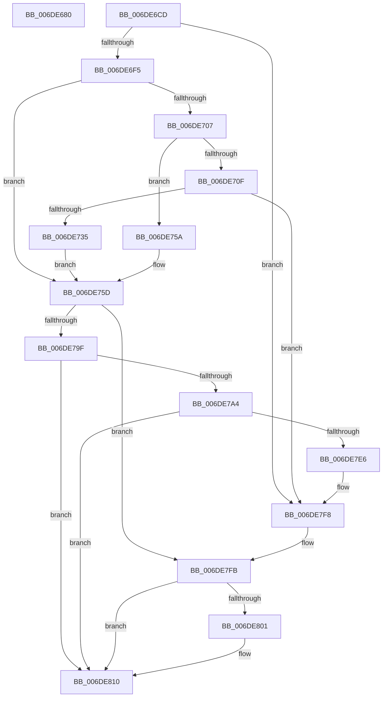

# sub_006DE680

- RVA: `0x006DE680`–`0x006DE818` (길이 `408` bytes)
- VA: `0x00000001406DE680`
- 실행 섹션: `.text`
- PDB 이름 있음: `아니요`; PDB Function 태그: `아니요`
- unwind 정보 RVA: `0x0007170C`
- 디코드: `105`개 명령, `408/408` bytes 표시
- 미해석 바이트: `0` (있으면 어셈블리에 `.byte`로 보존)

> 이 문서는 커널 이미지의 기계어와 PDB 기호를 분석해 생성했습니다. 4번과 5번은 함수 원형과 자료형을 바이너리 사용 방식에서 추정한 C 해석이며 원본 소스 복구 결과는 아닙니다.

## 1. Dependencies

- 직접 호출 지점: **6**; 고유 호출 대상: **5**
- 직접 호출자로 확인된 함수: **0**
- RIP 상대 이미지 참조: **0**

### Outgoing calls
- `0x006DE728` → [RtlpCallInterceptRoutine](../47/RtlpCallInterceptRoutine_function_00479594.md) (function, `0x00479594`)
- `0x006DE792` → [RtlpAllocateHeap](../5E/RtlpAllocateHeap_function_005E8B1C.md) (function, `0x005E8B1C`)
- `0x006DE7C4` → [RtlpSetupExtendedBlock](../5E/RtlpSetupExtendedBlock_function_005EB940.md) (function, `0x005EB940`)
- `0x006DE7DD` → [RtlpCallInterceptRoutine](../47/RtlpCallInterceptRoutine_function_00479594.md) (function, `0x00479594`)
- `0x006DE7EE` → [RtlFreeHeap](../48/RtlFreeHeap_function_00487F60.md) (function, `0x00487F60`)
- `0x006DE80B` → [RtlpAllocateHeapRaiseException](../5E/RtlpAllocateHeapRaiseException_function_005E94A4.md) (function, `0x005E94A4`)

### Direct callers
- 이 함수 시작 RVA로 연결되는 직접 call은 확인되지 않았습니다. 간접 호출은 완전히 역산할 수 없습니다.

### Static image references
- 디코드된 RIP-relative 메모리 참조가 없습니다.

## 2. Other-region calls and transfers

- 다른 실행 섹션으로 향하는 call: **0**
- call이 아닌 외부 분기/꼬리 이동: **2**
  - `0x006DE6C8` → [RtlpAllocateNTHeapInternal + 0x34](../2E/RtlpAllocateNTHeapInternal_function_002EB94C.md) (`tail-transfer`)
  - `0x006DE813` → [RtlpAllocateNTHeapInternal + 0x58](../2E/RtlpAllocateNTHeapInternal_function_002EB94C.md) (`tail-transfer`)

## 3. Assembly (complete function range)

```asm
006DE680  8B CD                           mov ecx, ebp
006DE682  8B C5                           mov eax, ebp
006DE684  C1 E9 02                        shr ecx, 2
006DE687  83 E1 02                        and ecx, 2
006DE68A  8B D1                           mov edx, ecx
006DE68C  0F BA EA 1F                     bts edx, 0x1f
006DE690  40 F6 C5 04                     test bpl, 4
006DE694  0F 44 D1                        cmove edx, ecx
006DE697  B9 00 01 00 00                  mov ecx, 0x100
006DE69C  44 8B C2                        mov r8d, edx
006DE69F  44 0B C1                        or r8d, ecx
006DE6A2  85 E9                           test ecx, ebp
006DE6A4  44 0F 44 C2                     cmove r8d, edx
006DE6A8  25 00 0E 00 00                  and eax, 0xe00
006DE6AD  41 8B C8                        mov ecx, r8d
006DE6B0  0B C8                           or ecx, eax
006DE6B2  85 C0                           test eax, eax
006DE6B4  41 0F 44 C8                     cmove ecx, r8d
006DE6B8  44 8B E1                        mov r12d, ecx
006DE6BB  41 0F BA EC 1C                  bts r12d, 0x1c
006DE6C0  40 80 E5 10                     and bpl, 0x10
006DE6C4  44 0F 44 E1                     cmove r12d, ecx
006DE6C8  E9 B3 D2 C0 FF                  jmp 0x1402eb980
006DE6CD  0B 69 74                        or ebp, dword ptr [rcx + 0x74]
006DE6D0  48 B8 FF FF FF FF FF FF FF 7F   movabs rax, 0x7fffffffffffffff
006DE6DA  89 BC 24 80 00 00 00            mov dword ptr [rsp + 0x80], edi
006DE6E1  48 8B DF                        mov rbx, rdi
006DE6E4  48 89 BC 24 98 00 00 00         mov qword ptr [rsp + 0x98], rdi
006DE6EC  48 3B F0                        cmp rsi, rax
006DE6EF  0F 87 03 01 00 00               ja 0x1406de7f8
006DE6F5  44 8B A9 90 00 00 00            mov r13d, dword ptr [rcx + 0x90]
006DE6FC  41 BF 01 00 00 00               mov r15d, 1
006DE702  45 85 ED                        test r13d, r13d
006DE705  74 56                           je 0x1406de75d
006DE707  F7 C5 02 01 00 3C               test ebp, 0x3c000102
006DE70D  75 4B                           jne 0x1406de75a
006DE70F  48 8D 84 24 98 00 00 00         lea rax, [rsp + 0x98]
006DE717  45 8B CF                        mov r9d, r15d
006DE71A  45 33 C0                        xor r8d, r8d
006DE71D  48 89 44 24 20                  mov qword ptr [rsp + 0x20], rax
006DE722  49 8B D6                        mov rdx, r14
006DE725  41 8B CD                        mov ecx, r13d
006DE728  E8 67 AE D9 FF                  call 0x140479594
006DE72D  85 C0                           test eax, eax
006DE72F  0F 88 C3 00 00 00               js 0x1406de7f8
006DE735  48 8B 8C 24 98 00 00 00         mov rcx, qword ptr [rsp + 0x98]
006DE73D  48 83 C6 10                     add rsi, 0x10
006DE741  48 83 C1 0F                     add rcx, 0xf
006DE745  48 83 E1 F0                     and rcx, 0xfffffffffffffff0
006DE749  48 03 F1                        add rsi, rcx
006DE74C  48 8D 41 10                     lea rax, [rcx + 0x10]
006DE750  48 89 84 24 98 00 00 00         mov qword ptr [rsp + 0x98], rax
006DE758  EB 03                           jmp 0x1406de75d
006DE75A  44 8B EF                        mov r13d, edi
006DE75D  48 85 F6                        test rsi, rsi
006DE760  48 8D 84 24 80 00 00 00         lea rax, [rsp + 0x80]
006DE768  8B D5                           mov edx, ebp
006DE76A  48 89 44 24 28                  mov qword ptr [rsp + 0x28], rax
006DE76F  4C 0F 45 FE                     cmovne r15, rsi
006DE773  41 BC 02 00 00 00               mov r12d, 2
006DE779  41 0B D4                        or edx, r12d
006DE77C  4C 8B C6                        mov r8, rsi
006DE77F  49 8B CE                        mov rcx, r14
006DE782  49 8D 5F 17                     lea rbx, [r15 + 0x17]
006DE786  48 83 E3 F0                     and rbx, 0xfffffffffffffff0
006DE78A  4C 8B CB                        mov r9, rbx
006DE78D  48 89 5C 24 30                  mov qword ptr [rsp + 0x30], rbx
006DE792  E8 85 A3 F0 FF                  call 0x1405e8b1c
006DE797  4C 8B F8                        mov r15, rax
006DE79A  48 85 C0                        test rax, rax
006DE79D  74 5C                           je 0x1406de7fb
006DE79F  45 85 ED                        test r13d, r13d
006DE7A2  74 6C                           je 0x1406de810
006DE7A4  48 8B 94 24 98 00 00 00         mov rdx, qword ptr [rsp + 0x98]
006DE7AC  4C 8B C0                        mov r8, rax
006DE7AF  48 2B F2                        sub rsi, rdx
006DE7B2  44 89 6C 24 28                  mov dword ptr [rsp + 0x28], r13d
006DE7B7  66 89 54 24 20                  mov word ptr [rsp + 0x20], dx
006DE7BC  49 8B CE                        mov rcx, r14
006DE7BF  8B D5                           mov edx, ebp
006DE7C1  48 8B D8                        mov rbx, rax
006DE7C4  E8 77 D1 F0 FF                  call 0x1405eb940
006DE7C9  45 8B CC                        mov r9d, r12d
006DE7CC  48 89 5C 24 20                  mov qword ptr [rsp + 0x20], rbx
006DE7D1  4C 8B C0                        mov r8, rax
006DE7D4  49 8B D6                        mov rdx, r14
006DE7D7  41 8B CD                        mov ecx, r13d
006DE7DA  4C 8B F8                        mov r15, rax
006DE7DD  E8 B2 AD D9 FF                  call 0x140479594
006DE7E2  85 C0                           test eax, eax
006DE7E4  79 2A                           jns 0x1406de810
006DE7E6  4D 8B C7                        mov r8, r15
006DE7E9  33 D2                           xor edx, edx
006DE7EB  49 8B CE                        mov rcx, r14
006DE7EE  E8 6D 97 DA FF                  call 0x140487f60
006DE7F3  48 8B 5C 24 30                  mov rbx, qword ptr [rsp + 0x30]
006DE7F8  4C 8B FF                        mov r15, rdi
006DE7FB  40 F6 C5 04                     test bpl, 4
006DE7FF  74 0F                           je 0x1406de810
006DE801  48 85 DB                        test rbx, rbx
006DE804  48 0F 45 F3                     cmovne rsi, rbx
006DE808  48 8B CE                        mov rcx, rsi
006DE80B  E8 94 AC F0 FF                  call 0x1405e94a4
006DE810  49 8B C7                        mov rax, r15
006DE813  E9 8C D1 C0 FF                  jmp 0x1402eb9a4
```

## 4. C-style interpretation (structured pseudocode)

```c
__int64 __fastcall sub_006DE680(void)
{
    __int64 result;
    __int64 v_r12;
    __int64 v_rbp;
    unsigned __int64 v_stack_p20;
    unsigned __int64 v_stack_p28;
    unsigned __int64 v_stack_p30;
    unsigned int v_stack_p80;
    unsigned __int64 v_stack_p98;

    a1 = (unsigned int)(((unsigned int)((unsigned int)(v_rbp))) >> (2));
    a1 = (unsigned int)((a1) & (2));
    a2 = (unsigned int)((unsigned int)(a1));
    if ((((unsigned __int8)(v_rbp)) & (4)) == 0) { a2 = (unsigned int)(a1); }
    a3 = (unsigned int)(((unsigned int)((unsigned int)(a2))) | (256));
    if (((256) & ((unsigned int)(v_rbp))) == 0) { a3 = (unsigned int)(a2); }
    result = (unsigned int)(((unsigned int)((unsigned int)(v_rbp))) & (0xE00ULL));
    a1 = (unsigned int)(((unsigned int)((unsigned int)(a3))) | ((unsigned int)(result)));
    if ((unsigned int)(result) == 0) { a1 = (unsigned int)(a3); }
    v_rbp = (unsigned __int8)((v_rbp) & (16));
    v_r12 = (unsigned int)((unsigned int)(a1));
    if (condition_is_equal) { v_r12 = (unsigned int)(a1); }
}
```

## 5. (Beta) C Style

```c
void sub_006DE680(void)
{
    int64_t result;
    int64_t local_r12;
    int64_t local_rbp;
    uint64_t v_stack_p20;
    uint64_t v_stack_p28;
    uint64_t v_stack_p30;
    uint32_t v_stack_p80;
    uint64_t v_stack_p98;

    a1 = (uint32_t)(((uint32_t)((uint32_t)(local_rbp))) >> (2));
    a1 = (uint32_t)((a1) & (2));
    a2 = (uint32_t)((uint32_t)(a1));
    if ((((uint8_t)(local_rbp)) & (4)) == 0) { a2 = (uint32_t)(a1); }
    a3 = (uint32_t)(((uint32_t)((uint32_t)(a2))) | (256));
    if (((256) & ((uint32_t)(local_rbp))) == 0) { a3 = (uint32_t)(a2); }
    result = (uint32_t)(((uint32_t)((uint32_t)(local_rbp))) & (0xE00ULL));
    a1 = (uint32_t)(((uint32_t)((uint32_t)(a3))) | ((uint32_t)(result)));
    if ((uint32_t)(result) == 0) { a1 = (uint32_t)(a3); }
    local_rbp = (uint8_t)((local_rbp) & (16));
    local_r12 = (uint32_t)((uint32_t)(a1));
    if (condition_is_equal) { local_r12 = (uint32_t)(a1); }
}
```

## 6. Execution-region graph

[열기: 2D/3D 그래프와 함수 탐색 컨트롤 패널](../../../control-panel.html?section=text&rva=0x006DE680&view=graph)

- 2D 그래프는 위에서 아래로 흐르고, 3D 그래프는 빈 공간을 드래그해 회전합니다. Shift+드래그는 이동, 휠은 확대·축소, 함수 노드 선택은 대상 보고서 이동입니다.

### Static fallback


