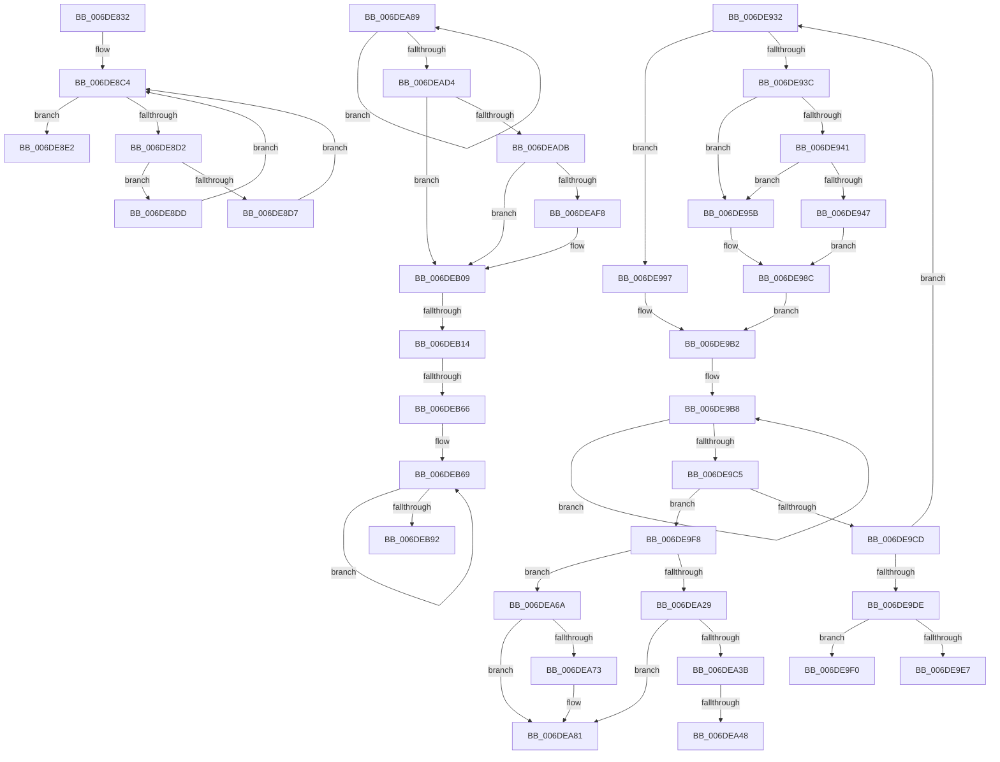

# sub_006DE832

- RVA: `0x006DE832`–`0x006DEB9E` (길이 `876` bytes)
- VA: `0x00000001406DE832`
- 실행 섹션: `.text`
- PDB 이름 있음: `아니요`; PDB Function 태그: `아니요`
- unwind 정보 RVA: `0x000717B4`
- 디코드: `223`개 명령, `876/876` bytes 표시
- 미해석 바이트: `0` (있으면 어셈블리에 `.byte`로 보존)

> 이 문서는 커널 이미지의 기계어와 PDB 기호를 분석해 생성했습니다. 4번과 5번은 함수 원형과 자료형을 바이너리 사용 방식에서 추정한 C 해석이며 원본 소스 복구 결과는 아닙니다.

## 1. Dependencies

- 직접 호출 지점: **4**; 고유 호출 대상: **4**
- 직접 호출자로 확인된 함수: **0**
- RIP 상대 이미지 참조: **2**

### Outgoing calls
- `0x006DEA32` → [RtlpHpLfhSubsegmentCommitBlock](../2E/RtlpHpLfhSubsegmentCommitBlock_function_002EA630.md) (function, `0x002EA630`)
- `0x006DEA7C` → [RtlpHpLfhSubsegmentPrefetch](../2E/RtlpHpLfhSubsegmentPrefetch_function_002EBB18.md) (function, `0x002EBB18`)
- `0x006DEAEF` → [RtlpHpEnvCompactionIsScheduled](../48/RtlpHpEnvCompactionIsScheduled_function_0048E7E0.md) (function, `0x0048E7E0`)
- `0x006DEB04` → [RtlpHpEnvCompactionSchedule](../32/RtlpHpEnvCompactionSchedule_function_003264A0.md) (function, `0x003264A0`)

### Direct callers
- 이 함수 시작 RVA로 연결되는 직접 call은 확인되지 않았습니다. 간접 호출은 완전히 역산할 수 없습니다.

### Static image references
- `0x006DE860` → RVA `0x00E28308` (`.data`; read)
- `0x006DE932` → RVA `0x00E28328` (`.data`; read)

## 2. Other-region calls and transfers

- 다른 실행 섹션으로 향하는 call: **0**
- call이 아닌 외부 분기/꼬리 이동: **9**
  - `0x006DE92D` → [RtlpHpMetadataAlloc + 0x276](../2E/RtlpHpMetadataAlloc_function_002EC180.md) (`tail-transfer`)
  - `0x006DE9EB` → [RtlpHpMetadataAlloc + 0x22A](../2E/RtlpHpMetadataAlloc_function_002EC180.md) (`tail-transfer`)
  - `0x006DE9F3` → [RtlpHpMetadataAlloc + 0x22A](../2E/RtlpHpMetadataAlloc_function_002EC180.md) (`tail-transfer`)
  - `0x006DEA42` → [RtlpHpMetadataAlloc + 0x254](../2E/RtlpHpMetadataAlloc_function_002EC180.md) (`tail-transfer`)
  - `0x006DEA65` → [RtlpHpMetadataAlloc + 0x3C5](../2E/RtlpHpMetadataAlloc_function_002EC180.md) (`tail-transfer`)
  - `0x006DEA84` → [RtlpHpMetadataAlloc + 0x254](../2E/RtlpHpMetadataAlloc_function_002EC180.md) (`tail-transfer`)
  - `0x006DEB0E` → [RtlpHpMetadataAlloc + 0x25D](../2E/RtlpHpMetadataAlloc_function_002EC180.md) (`tail-transfer`)
  - `0x006DEB60` → [RtlpHpMetadataAlloc + 0x25D](../2E/RtlpHpMetadataAlloc_function_002EC180.md) (`tail-transfer`)
  - `0x006DEB99` → [RtlpHpMetadataAlloc + 0x25D](../2E/RtlpHpMetadataAlloc_function_002EC180.md) (`tail-transfer`)

## 3. Assembly (complete function range)

```asm
006DE832  4C 8B D8                        mov r11, rax
006DE835  49 81 E3 00 F0 FF FF            and r11, 0xfffffffffffff000
006DE83C  48 FF C8                        dec rax
006DE83F  48 89 45 38                     mov qword ptr [rbp + 0x38], rax
006DE843  49 8B C3                        mov rax, r11
006DE846  65 4C 8B 0C 25 88 01 00 00      mov r9, qword ptr gs:[0x188]
006DE84F  45 0F B6 53 18                  movzx r10d, byte ptr [r11 + 0x18]
006DE854  48 C1 E8 0C                     shr rax, 0xc
006DE858  41 83 C2 F8                     add r10d, -8
006DE85C  41 33 43 28                     xor eax, dword ptr [r11 + 0x28]
006DE860  33 05 A2 9A 74 00               xor eax, dword ptr [rip + 0x749aa2]
006DE866  49 8B 89 60 07 00 00            mov rcx, qword ptr [r9 + 0x760]
006DE86D  49 8B 91 68 07 00 00            mov rdx, qword ptr [r9 + 0x768]
006DE874  89 84 24 B8 00 00 00            mov dword ptr [rsp + 0xb8], eax
006DE87B  0F B7 F0                        movzx esi, ax
006DE87E  4C 8D 04 0A                     lea r8, [rdx + rcx]
006DE882  48 33 D1                        xor rdx, rcx
006DE885  48 8B C2                        mov rax, rdx
006DE888  48 C1 C1 18                     rol rcx, 0x18
006DE88C  48 C1 E0 10                     shl rax, 0x10
006DE890  48 33 C8                        xor rcx, rax
006DE893  49 C1 E8 20                     shr r8, 0x20
006DE897  48 33 CA                        xor rcx, rdx
006DE89A  41 0F B6 E8                     movzx ebp, r8b
006DE89E  48 C1 C2 25                     rol rdx, 0x25
006DE8A2  49 89 91 68 07 00 00            mov qword ptr [r9 + 0x768], rdx
006DE8A9  49 FF CA                        dec r10
006DE8AC  49 89 89 60 07 00 00            mov qword ptr [r9 + 0x760], rcx
006DE8B3  4D 8D 4B 40                     lea r9, [r11 + 0x40]
006DE8B7  41 0F B6 43 24                  movzx eax, byte ptr [r11 + 0x24]
006DE8BC  4F 8D 14 D1                     lea r10, [r9 + r10*8]
006DE8C0  49 8D 14 C1                     lea rdx, [r9 + rax*8]
006DE8C4  4C 8B 02                        mov r8, qword ptr [rdx]
006DE8C7  49 8B C8                        mov rcx, r8
006DE8CA  48 F7 D1                        not rcx
006DE8CD  48 85 C9                        test rcx, rcx
006DE8D0  75 10                           jne 0x1406de8e2
006DE8D2  49 3B D2                        cmp rdx, r10
006DE8D5  74 06                           je 0x1406de8dd
006DE8D7  48 83 C2 08                     add rdx, 8
006DE8DB  EB E7                           jmp 0x1406de8c4
006DE8DD  49 8B D1                        mov rdx, r9
006DE8E0  EB E2                           jmp 0x1406de8c4
006DE8E2  0F B7 9C 24 BA 00 00 00         movzx ebx, word ptr [rsp + 0xba]
006DE8EA  41 BD 01 00 00 00               mov r13d, 1
006DE8F0  F3 48 0F B8 C1                  popcnt rax, rcx
006DE8F5  0F AF C5                        imul eax, ebp
006DE8F8  C1 E8 08                        shr eax, 8
006DE8FB  C4 C2 F9 F7 C5                  shlx rax, r13, rax
006DE900  C4 E2 FB F5 C9                  pdep rcx, rax, rcx
006DE905  4C 0B C1                        or r8, rcx
006DE908  F3 48 0F BC C1                  tzcnt rax, rcx
006DE90D  4C 89 02                        mov qword ptr [rdx], r8
006DE910  41 2B D1                        sub edx, r9d
006DE913  8D 0C D0                        lea ecx, [rax + rdx*8]
006DE916  0F AF F1                        imul esi, ecx
006DE919  8B C1                           mov eax, ecx
006DE91B  C1 E8 06                        shr eax, 6
006DE91E  41 88 43 24                     mov byte ptr [r11 + 0x24], al
006DE922  03 DE                           add ebx, esi
006DE924  49 03 DB                        add rbx, r11
006DE927  41 BD 03 00 00 00               mov r13d, 3
006DE92D  E9 C4 DA C0 FF                  jmp 0x1402ec3f6
006DE932  8B 05 F0 99 74 00               mov eax, dword ptr [rip + 0x7499f0]
006DE938  A8 04                           test al, 4
006DE93A  75 5B                           jne 0x1406de997
006DE93C  49 3B D5                        cmp rdx, r13
006DE93F  74 1A                           je 0x1406de95b
006DE941  41 83 F9 40                     cmp r9d, 0x40
006DE945  75 14                           jne 0x1406de95b
006DE947  41 8B CC                        mov ecx, r12d
006DE94A  49 D3 C8                        ror r8, cl
006DE94D  F3 4D 0F BC C8                  tzcnt r9, r8
006DE952  45 03 CC                        add r9d, r12d
006DE955  41 83 E1 3F                     and r9d, 0x3f
006DE959  EB 31                           jmp 0x1406de98c
006DE95B  F3 49 0F BC C8                  tzcnt rcx, r8
006DE960  49 0F BD C0                     bsr rax, r8
006DE964  89 44 24 40                     mov dword ptr [rsp + 0x40], eax
006DE968  2B C1                           sub eax, ecx
006DE96A  FF C0                           inc eax
006DE96C  44 3B C8                        cmp r9d, eax
006DE96F  41 0F 42 C1                     cmovb eax, r9d
006DE973  44 0F AF E0                     imul r12d, eax
006DE977  41 C1 EC 08                     shr r12d, 8
006DE97B  44 03 E1                        add r12d, ecx
006DE97E  41 8B CC                        mov ecx, r12d
006DE981  49 D3 C8                        ror r8, cl
006DE984  F3 4D 0F BC C8                  tzcnt r9, r8
006DE989  45 03 CC                        add r9d, r12d
006DE98C  41 8B C9                        mov ecx, r9d
006DE98F  4D 8B D3                        mov r10, r11
006DE992  49 D3 E2                        shl r10, cl
006DE995  EB 1B                           jmp 0x1406de9b2
006DE997  F3 49 0F B8 C0                  popcnt rax, r8
006DE99C  41 0F AF C4                     imul eax, r12d
006DE9A0  C1 E8 08                        shr eax, 8
006DE9A3  C4 C2 F9 F7 C3                  shlx rax, r11, rax
006DE9A8  C4 42 FB F5 D0                  pdep r10, rax, r8
006DE9AD  F3 4D 0F BC CA                  tzcnt r9, r10
006DE9B2  0F 0D 0A                        prefetchw byte ptr [rdx]
006DE9B5  48 8B 02                        mov rax, qword ptr [rdx]
006DE9B8  48 8B C8                        mov rcx, rax
006DE9BB  49 0B CA                        or rcx, r10
006DE9BE  F0 48 0F B1 0A                  lock cmpxchg qword ptr [rdx], rcx
006DE9C3  75 F3                           jne 0x1406de9b8
006DE9C5  4C 8B C0                        mov r8, rax
006DE9C8  4C 85 D0                        test rax, r10
006DE9CB  74 2B                           je 0x1406de9f8
006DE9CD  44 8B 4C 24 30                  mov r9d, dword ptr [rsp + 0x30]
006DE9D2  49 F7 D0                        not r8
006DE9D5  4D 85 C0                        test r8, r8
006DE9D8  0F 85 54 FF FF FF               jne 0x1406de932
006DE9DE  48 8D 4E 40                     lea rcx, [rsi + 0x40]
006DE9E2  49 3B D5                        cmp rdx, r13
006DE9E5  74 09                           je 0x1406de9f0
006DE9E7  48 83 C2 08                     add rdx, 8
006DE9EB  E9 BA D9 C0 FF                  jmp 0x1402ec3aa
006DE9F0  48 8B D1                        mov rdx, rcx
006DE9F3  E9 B2 D9 C0 FF                  jmp 0x1402ec3aa
006DE9F8  48 8D 46 40                     lea rax, [rsi + 0x40]
006DE9FC  2B D0                           sub edx, eax
006DE9FE  45 8D 2C D1                     lea r13d, [r9 + rdx*8]
006DEA02  44 8B 4C 24 44                  mov r9d, dword ptr [rsp + 0x44]
006DEA07  45 8B E1                        mov r12d, r9d
006DEA0A  41 8B C5                        mov eax, r13d
006DEA0D  C1 E8 06                        shr eax, 6
006DEA10  45 0F AF E5                     imul r12d, r13d
006DEA14  88 46 24                        mov byte ptr [rsi + 0x24], al
006DEA17  0F B7 44 24 3A                  movzx eax, word ptr [rsp + 0x3a]
006DEA1C  44 03 E0                        add r12d, eax
006DEA1F  44 38 9C 24 B8 00 00 00         cmp byte ptr [rsp + 0xb8], r11b
006DEA27  76 41                           jbe 0x1406dea6a
006DEA29  45 8B C4                        mov r8d, r12d
006DEA2C  48 8B D6                        mov rdx, rsi
006DEA2F  49 8B CE                        mov rcx, r14
006DEA32  E8 F9 BB C0 FF                  call 0x1402ea630
006DEA37  85 C0                           test eax, eax
006DEA39  79 46                           jns 0x1406dea81
006DEA3B  4C 8B E3                        mov r12, rbx
006DEA3E  41 83 FD FF                     cmp r13d, -1
006DEA42  0F 84 8C D9 C0 FF               je 0x1402ec3d4
006DEA48  41 8B C5                        mov eax, r13d
006DEA4B  48 C7 C2 FE FF FF FF            mov rdx, 0xfffffffffffffffe
006DEA52  41 83 E5 3F                     and r13d, 0x3f
006DEA56  C1 E8 06                        shr eax, 6
006DEA59  41 8B CD                        mov ecx, r13d
006DEA5C  48 D3 C2                        rol rdx, cl
006DEA5F  F0 48 21 54 C6 40               lock and qword ptr [rsi + rax*8 + 0x40], rdx
006DEA65  E9 DB DA C0 FF                  jmp 0x1402ec545
006DEA6A  0F B7 46 30                     movzx eax, word ptr [rsi + 0x30]
006DEA6E  44 3B E8                        cmp r13d, eax
006DEA71  76 0E                           jbe 0x1406dea81
006DEA73  45 8B C4                        mov r8d, r12d
006DEA76  48 8B D6                        mov rdx, rsi
006DEA79  49 8B CE                        mov rcx, r14
006DEA7C  E8 97 D0 C0 FF                  call 0x1402ebb18
006DEA81  4C 03 E6                        add r12, rsi
006DEA84  E9 4B D9 C0 FF                  jmp 0x1402ec3d4
006DEA89  48 89 84 24 B8 00 00 00         mov qword ptr [rsp + 0xb8], rax
006DEA91  48 8B C8                        mov rcx, rax
006DEA94  0F B6 94 24 BE 00 00 00         movzx edx, byte ptr [rsp + 0xbe]
006DEA9C  48 C1 E9 30                     shr rcx, 0x30
006DEAA0  41 3A CD                        cmp cl, r13b
006DEAA3  48 89 44 24 38                  mov qword ptr [rsp + 0x38], rax
006DEAA8  41 0F 44 D2                     cmove edx, r10d
006DEAAC  66 44 01 AC 24 BA 00 00 00      add word ptr [rsp + 0xba], r13w
006DEAB5  88 94 24 BE 00 00 00            mov byte ptr [rsp + 0xbe], dl
006DEABC  0F B7 56 2C                     movzx edx, word ptr [rsi + 0x2c]
006DEAC0  48 8B 8C 24 B8 00 00 00         mov rcx, qword ptr [rsp + 0xb8]
006DEAC8  48 C1 E2 06                     shl rdx, 6
006DEACC  F0 48 0F B1 4E 10               lock cmpxchg qword ptr [rsi + 0x10], rcx
006DEAD2  75 B5                           jne 0x1406dea89
006DEAD4  42 38 5C 32 5C                  cmp byte ptr [rdx + r14 + 0x5c], bl
006DEAD9  75 2E                           jne 0x1406deb09
006DEADB  46 88 6C 32 5C                  mov byte ptr [rdx + r14 + 0x5c], r13b
006DEAE0  49 8B 06                        mov rax, qword ptr [r14]
006DEAE3  48 89 84 24 B8 00 00 00         mov qword ptr [rsp + 0xb8], rax
006DEAEB  48 8B 48 38                     mov rcx, qword ptr [rax + 0x38]
006DEAEF  E8 EC FC DA FF                  call 0x14048e7e0
006DEAF4  85 C0                           test eax, eax
006DEAF6  75 11                           jne 0x1406deb09
006DEAF8  48 8B 8C 24 B8 00 00 00         mov rcx, qword ptr [rsp + 0xb8]
006DEB00  48 8B 49 38                     mov rcx, qword ptr [rcx + 0x38]
006DEB04  E8 97 79 C4 FF                  call 0x1403264a0
006DEB09  44 38 6C 24 3E                  cmp byte ptr [rsp + 0x3e], r13b
006DEB0E  0F 85 C9 D8 C0 FF               jne 0x1402ec3dd
006DEB14  44 0F B7 4C 24 3C               movzx r9d, word ptr [rsp + 0x3c]
006DEB1A  41 C1 E1 06                     shl r9d, 6
006DEB1E  4D 03 CE                        add r9, r14
006DEB21  41 0F 0D 49 08                  prefetchw byte ptr [r9 + 8]
006DEB26  49 8B 41 08                     mov rax, qword ptr [r9 + 8]
006DEB2A  49 C7 C5 00 F0 FF FF            mov r13, 0xfffffffffffff000
006DEB31  4C 8B 44 24 48                  mov r8, qword ptr [rsp + 0x48]
006DEB36  48 8B D0                        mov rdx, rax
006DEB39  41 BB FF 0F 00 00               mov r11d, 0xfff
006DEB3F  49 23 D3                        and rdx, r11
006DEB42  4D 8B 10                        mov r10, qword ptr [r8]
006DEB45  49 8B CA                        mov rcx, r10
006DEB48  48 33 C8                        xor rcx, rax
006DEB4B  49 23 CD                        and rcx, r13
006DEB4E  49 33 CA                        xor rcx, r10
006DEB51  49 89 08                        mov qword ptr [r8], rcx
006DEB54  48 8B CE                        mov rcx, rsi
006DEB57  48 0B CA                        or rcx, rdx
006DEB5A  F0 49 0F B1 49 08               lock cmpxchg qword ptr [r9 + 8], rcx
006DEB60  0F 84 77 D8 C0 FF               je 0x1402ec3dd
006DEB66  4D 8B F0                        mov r14, r8
006DEB69  49 8B CA                        mov rcx, r10
006DEB6C  48 8B D0                        mov rdx, rax
006DEB6F  48 33 C8                        xor rcx, rax
006DEB72  49 23 D3                        and rdx, r11
006DEB75  49 23 CD                        and rcx, r13
006DEB78  4C 8B C0                        mov r8, rax
006DEB7B  49 33 CA                        xor rcx, r10
006DEB7E  49 89 0E                        mov qword ptr [r14], rcx
006DEB81  48 8B CE                        mov rcx, rsi
006DEB84  48 0B CA                        or rcx, rdx
006DEB87  F0 49 0F B1 49 08               lock cmpxchg qword ptr [r9 + 8], rcx
006DEB8D  49 3B C0                        cmp rax, r8
006DEB90  75 D7                           jne 0x1406deb69
006DEB92  4D 8D B7 40 03 00 00            lea r14, [r15 + 0x340]
006DEB99  E9 3F D8 C0 FF                  jmp 0x1402ec3dd
```

## 4. C-style interpretation (structured pseudocode)

```c
__int64 __fastcall sub_006DE832(void)
{
    __int64 result;
    __int64 v_r10;
    __int64 v_r11;
    __int64 v_rbx;
    __int64 v_rsi;
    unsigned int v_stack_p30;
    unsigned __int64 v_stack_p38;
    unsigned __int16 v_stack_p3A;
    unsigned __int16 v_stack_p3C;
    unsigned __int8 v_stack_p3E;
    unsigned int v_stack_p40;
    unsigned int v_stack_p44;
    unsigned __int64 v_stack_p48;
    unsigned int v_stack_pB8;
    unsigned __int16 v_stack_pBA;
    unsigned __int8 v_stack_pBE;

    v_r11 = (result) & (0xFFFFFFFFFFFFF000ULL);
    result = (result) - 1;
    *(unsigned __int64 *)(v_rbp + 56) = result;
    result = (v_r11) >> (12);
    v_r10 = (unsigned int)((*(unsigned __int8 *)(v_r11 + 24)) + (-8));
    result = (unsigned int)((result) ^ (*(unsigned int *)(v_r11 + 40)));
    result = (unsigned int)((result) ^ (*(unsigned int *)(v_rip + 7641762)));
    v_stack_pB8 = (unsigned int)(result);
    a2 = (*(unsigned __int64 *)(*(unsigned __int64 *)(gs_base + (0 + 392)) + 1896)) ^ (*(unsigned __int64 *)(*(unsigned __int64 *)(gs_base + (0 + 392)) + 1888));
    result = (a2) << (16);
    a1 = (*(unsigned __int64 *)(*(unsigned __int64 *)(gs_base + (0 + 392)) + 1888)) ^ (result);
    a3 = (*(unsigned __int64 *)(*(unsigned __int64 *)(gs_base + (0 + 392)) + 1896) + *(unsigned __int64 *)(*(unsigned __int64 *)(gs_base + (0 + 392)) + 1888) * 1) >> (32);
    a1 = (a1) ^ (a2);
    *(unsigned __int64 *)(*(unsigned __int64 *)(gs_base + (0 + 392)) + 1896) = a2;
    v_r10 = (v_r10) - 1;
    *(unsigned __int64 *)(*(unsigned __int64 *)(gs_base + (0 + 392)) + 1888) = a1;
loc_006DE8C4:
    a1 = ~(*(unsigned __int64 *)(v_r11 + 64 + *(unsigned __int8 *)(v_r11 + 36) * 8));
    if (a1 != 0) goto loc_006DE8E2;
    if ((v_r11 + 64 + *(unsigned __int8 *)(v_r11 + 36) * 8) == (v_r11 + 64 + v_r10 * 8)) goto loc_006DE8DD;
    a2 = (v_r11 + 64 + *(unsigned __int8 *)(v_r11 + 36) * 8) + (8);
    goto loc_006DE8C4;
loc_006DE8DD:
    goto loc_006DE8C4;
loc_006DE8E2:
    result = (unsigned int)((*(unsigned __int8 *)(v_r11 + 36)) * ((unsigned int)((unsigned __int8)(a3))));
    result = (unsigned int)((result) >> (8));
    a3 = (*(unsigned __int64 *)(v_r11 + 64 + *(unsigned __int8 *)(v_r11 + 36) * 8)) | (a1);
    *(unsigned __int64 *)(v_r11 + 64) = a3;
    a2 = (unsigned int)((v_r11 + 64) - ((unsigned int)(v_r11 + 64)));
    v_rsi = (unsigned int)(((unsigned __int16)(result)) * ((unsigned int)(result + a2 * 8)));
    result = (unsigned int)(((unsigned int)((unsigned int)(result + a2 * 8))) >> (6));
    *(unsigned __int8 *)(v_r11 + 36) = (unsigned __int8)(result);
    v_rbx = (unsigned int)((v_stack_pBA) + ((unsigned int)(v_rsi)));
    v_rbx = (v_rbx) + (v_r11);
}
```

## 5. (Beta) C Style

```c
void sub_006DE832(void)
{
    int64_t result;
    int64_t local_r10;
    int64_t local_r11;
    int64_t local_rbx;
    int64_t local_rsi;
    uint32_t v_stack_p30;
    uint64_t v_stack_p38;
    uint16_t v_stack_p3A;
    uint16_t v_stack_p3C;
    uint8_t v_stack_p3E;
    uint32_t v_stack_p40;
    uint32_t v_stack_p44;
    uint64_t v_stack_p48;
    uint32_t v_stack_pB8;
    uint16_t v_stack_pBA;
    uint8_t v_stack_pBE;

    local_r11 = (result) & (0xFFFFFFFFFFFFF000ULL);
    result = (result) - 1;
    *(uint64_t *)(local_rbp + 0x38) = result;
    result = (local_r11) >> (12);
    local_r10 = (uint32_t)((*(uint8_t *)(local_r11 + 0x18)) + (-8));
    result = (uint32_t)((result) ^ (*(uint32_t *)(local_r11 + 0x28)));
    result = (uint32_t)((result) ^ (*(uint32_t *)(v_rip + 0x749AA2)));
    v_stack_pB8 = (uint32_t)(result);
    a2 = (*(uint64_t *)(*(uint64_t *)(gs_base + (0 + 0x188)) + 0x768)) ^ (*(uint64_t *)(*(uint64_t *)(gs_base + (0 + 0x188)) + 0x760));
    result = (a2) << (16);
    a1 = (*(uint64_t *)(*(uint64_t *)(gs_base + (0 + 0x188)) + 0x760)) ^ (result);
    a3 = (*(uint64_t *)(*(uint64_t *)(gs_base + (0 + 0x188)) + 0x768) + *(uint64_t *)(*(uint64_t *)(gs_base + (0 + 0x188)) + 0x760) * 1) >> (32);
    a1 = (a1) ^ (a2);
    *(uint64_t *)(*(uint64_t *)(gs_base + (0 + 0x188)) + 0x768) = a2;
    local_r10 = (local_r10) - 1;
    *(uint64_t *)(*(uint64_t *)(gs_base + (0 + 0x188)) + 0x760) = a1;
loc_006DE8C4:
    a1 = ~(*(uint64_t *)(local_r11 + 0x40 + *(uint8_t *)(local_r11 + 0x24) * 8));
    if (a1 != 0) goto loc_006DE8E2;
    if ((local_r11 + 64 + *(uint8_t *)(local_r11 + 0x24) * 8) == (local_r11 + 64 + local_r10 * 8)) goto loc_006DE8DD;
    a2 = (local_r11 + 64 + *(uint8_t *)(local_r11 + 0x24) * 8) + (8);
    goto loc_006DE8C4;
loc_006DE8DD:
    goto loc_006DE8C4;
loc_006DE8E2:
    result = (uint32_t)((*(uint8_t *)(local_r11 + 0x24)) * ((uint32_t)((uint8_t)(a3))));
    result = (uint32_t)((result) >> (8));
    a3 = (*(uint64_t *)(local_r11 + 0x40 + *(uint8_t *)(local_r11 + 0x24) * 8)) | (a1);
    *(uint64_t *)(local_r11 + 0x40) = a3;
    a2 = (uint32_t)((local_r11 + 64) - ((uint32_t)(local_r11 + 64)));
    local_rsi = (uint32_t)(((uint16_t)(result)) * ((uint32_t)(result + a2 * 8)));
    result = (uint32_t)(((uint32_t)((uint32_t)(result + a2 * 8))) >> (6));
    *(uint8_t *)(local_r11 + 0x24) = (uint8_t)(result);
    local_rbx = (uint32_t)((v_stack_pBA) + ((uint32_t)(local_rsi)));
    local_rbx = (local_rbx) + (local_r11);
}
```

## 6. Execution-region graph

[열기: 2D/3D 그래프와 함수 탐색 컨트롤 패널](../../../control-panel.html?section=text&rva=0x006DE832&view=graph)

- 2D 그래프는 위에서 아래로 흐르고, 3D 그래프는 빈 공간을 드래그해 회전합니다. Shift+드래그는 이동, 휠은 확대·축소, 함수 노드 선택은 대상 보고서 이동입니다.

### Static fallback


