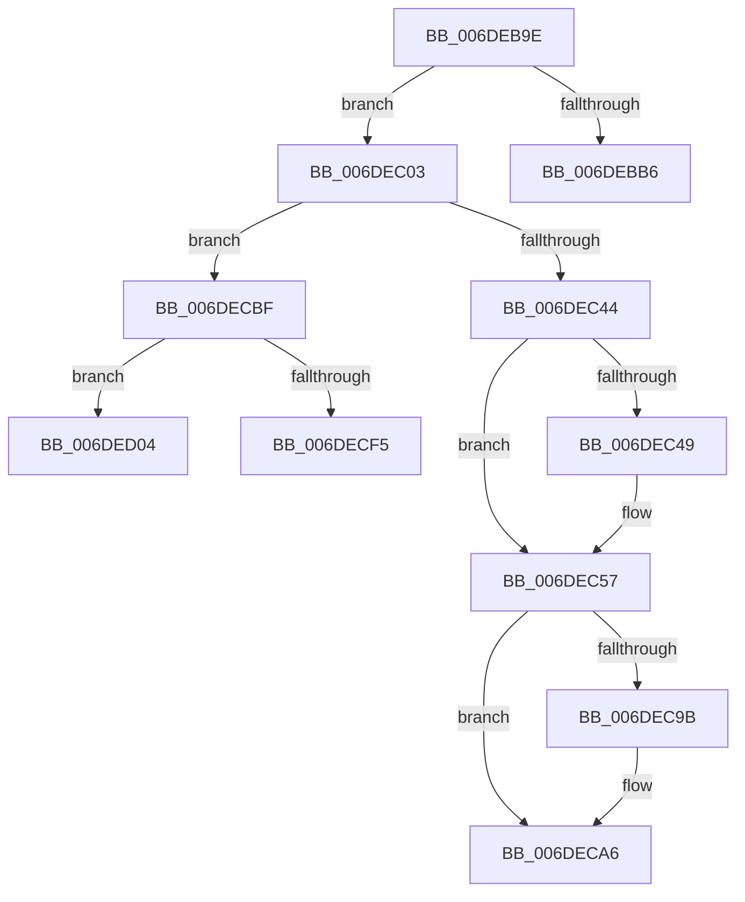

# sub_006DEB9E

- RVA: `0x006DEB9E`–`0x006DED13` (길이 `373` bytes)
- VA: `0x00000001406DEB9E`
- 실행 섹션: `.text`
- PDB 이름 있음: `아니요`; PDB Function 태그: `아니요`
- unwind 정보 RVA: `0x00071828`
- 디코드: `85`개 명령, `373/373` bytes 표시
- 미해석 바이트: `0` (있으면 어셈블리에 `.byte`로 보존)

> 이 문서는 커널 이미지의 기계어와 PDB 기호를 분석해 생성했습니다. 4번과 5번은 함수 원형과 자료형을 바이너리 사용 방식에서 추정한 C 해석이며 원본 소스 복구 결과는 아닙니다.

## 1. Dependencies

- 직접 호출 지점: **9**; 고유 호출 대상: **7**
- 직접 호출자로 확인된 함수: **0**
- RIP 상대 이미지 참조: **2**

### Outgoing calls
- `0x006DEBBB` → [KeReleaseInStackQueuedSpinLock](../34/KeReleaseInStackQueuedSpinLock_function_00342CE0.md) (function, `0x00342CE0`)
- `0x006DEC37` → [ExAllocateHeapPages](../44/ExAllocateHeapPages_function_00446BB4.md) (function, `0x00446BB4`)
- `0x006DEC52` → [memcpy](../6C/memcpy_function_006C6840.md) (function, `0x006C6840`)
- `0x006DEC63` → [memset](../6C/memset_function_006C6C40.md) (function, `0x006C6C40`)
- `0x006DEC87` → [ExpInsertPoolTracker](../2E/ExpInsertPoolTracker_function_002EEFAC.md) (function, `0x002EEFAC`)
- `0x006DEC91` → [KeReleaseInStackQueuedSpinLock](../34/KeReleaseInStackQueuedSpinLock_function_00342CE0.md) (function, `0x00342CE0`)
- `0x006DECA1` → [ExPoolCleanupExpansionTable](../65/ExPoolCleanupExpansionTable_function_00656164.md) (function, `0x00656164`)
- `0x006DECB4` → [ExpInsertPoolTrackerExpansion](../2E/ExpInsertPoolTrackerExpansion_function_002ECCC0.md) (function, `0x002ECCC0`)
- `0x006DECE1` → [KeReleaseInStackQueuedSpinLock](../34/KeReleaseInStackQueuedSpinLock_function_00342CE0.md) (function, `0x00342CE0`)

### Direct callers
- 이 함수 시작 RVA로 연결되는 직접 call은 확인되지 않았습니다. 간접 호출은 완전히 역산할 수 없습니다.

### Static image references
- `0x006DEC6B` → RVA `0x00EFED40` (`.data`; write)
- `0x006DEC78` → RVA `0x00EFED48` (`.data`; write)

## 2. Other-region calls and transfers

- 다른 실행 섹션으로 향하는 call: **0**
- call이 아닌 외부 분기/꼬리 이동: **4**
  - `0x006DEBFE` → [ExpInsertPoolTrackerExpansion + 0x10B](../2E/ExpInsertPoolTrackerExpansion_function_002ECCC0.md) (`tail-transfer`)
  - `0x006DECBA` → [ExpInsertPoolTrackerExpansion + 0x10B](../2E/ExpInsertPoolTrackerExpansion_function_002ECCC0.md) (`tail-transfer`)
  - `0x006DECFF` → [ExpInsertPoolTrackerExpansion + 0x10B](../2E/ExpInsertPoolTrackerExpansion_function_002ECCC0.md) (`tail-transfer`)
  - `0x006DED0E` → [ExpInsertPoolTrackerExpansion + 0x10B](../2E/ExpInsertPoolTrackerExpansion_function_002ECCC0.md) (`tail-transfer`)

## 3. Assembly (complete function range)

```asm
006DEB9E  48 8B B4 24 98 00 00 00         mov rsi, qword ptr [rsp + 0x98]
006DEBA6  48 8D 04 B6                     lea rax, [rsi + rsi*4]
006DEBAA  48 03 C0                        add rax, rax
006DEBAD  41 8B 44 C4 B0                  mov eax, dword ptr [r12 + rax*8 - 0x50]
006DEBB2  85 C0                           test eax, eax
006DEBB4  74 4D                           je 0x1406dec03
006DEBB6  48 8D 4C 24 28                  lea rcx, [rsp + 0x28]
006DEBBB  E8 20 41 C6 FF                  call 0x140342ce0
006DEBC0  8D 46 FF                        lea eax, [rsi - 1]
006DEBC3  41 81 E5 00 01 00 00            and r13d, 0x100
006DEBCA  B9 08 00 00 00                  mov ecx, 8
006DEBCF  41 B8 28 00 00 00               mov r8d, 0x28
006DEBD5  48 8D 14 80                     lea rdx, [rax + rax*4]
006DEBD9  B8 20 00 00 00                  mov eax, 0x20
006DEBDE  48 C1 E2 04                     shl rdx, 4
006DEBE2  49 03 D4                        add rdx, r12
006DEBE5  4D 85 ED                        test r13, r13
006DEBE8  0F 45 C8                        cmovne ecx, eax
006DEBEB  B8 10 00 00 00                  mov eax, 0x10
006DEBF0  41 0F 45 C0                     cmovne eax, r8d
006DEBF4  F0 48 FF 04 10                  lock inc qword ptr [rax + rdx]
006DEBF9  F0 4C 01 3C 11                  lock add qword ptr [rcx + rdx], r15
006DEBFE  E9 C8 E1 C0 FF                  jmp 0x1402ecdcb
006DEC03  48 8D 34 92                     lea rsi, [rdx + rdx*4]
006DEC07  48 B8 CD CC CC CC CC CC CC CC   movabs rax, 0xcccccccccccccccd
006DEC11  48 C1 E6 04                     shl rsi, 4
006DEC15  48 8D 9E FF 0F 00 00            lea rbx, [rsi + 0xfff]
006DEC1C  48 81 E3 00 F0 FF FF            and rbx, 0xfffffffffffff000
006DEC23  4C 8D BB 00 10 00 00            lea r15, [rbx + 0x1000]
006DEC2A  49 F7 E7                        mul r15
006DEC2D  4C 8B E2                        mov r12, rdx
006DEC30  49 8B D7                        mov rdx, r15
006DEC33  49 C1 EC 06                     shr r12, 6
006DEC37  E8 78 7F D6 FF                  call 0x140446bb4
006DEC3C  48 8B F8                        mov rdi, rax
006DEC3F  48 85 C0                        test rax, rax
006DEC42  74 7B                           je 0x1406decbf
006DEC44  48 85 ED                        test rbp, rbp
006DEC47  74 0E                           je 0x1406dec57
006DEC49  4C 8B C3                        mov r8, rbx
006DEC4C  48 8B D5                        mov rdx, rbp
006DEC4F  48 8B C8                        mov rcx, rax
006DEC52  E8 E9 7B FE FF                  call 0x1406c6840
006DEC57  4D 8B C7                        mov r8, r15
006DEC5A  48 8D 0C 3E                     lea rcx, [rsi + rdi]
006DEC5E  4C 2B C6                        sub r8, rsi
006DEC61  33 D2                           xor edx, edx
006DEC63  E8 D8 7F FE FF                  call 0x1406c6c40
006DEC68  4C 8B CF                        mov r9, rdi
006DEC6B  48 89 3D CE 00 82 00            mov qword ptr [rip + 0x8200ce], rdi
006DEC72  41 B8 40 00 00 00               mov r8d, 0x40
006DEC78  4C 89 25 C9 00 82 00            mov qword ptr [rip + 0x8200c9], r12
006DEC7F  49 8B D7                        mov rdx, r15
006DEC82  B9 50 6F 6F 6C                  mov ecx, 0x6c6f6f50
006DEC87  E8 20 03 C1 FF                  call 0x1402eefac
006DEC8C  48 8D 4C 24 28                  lea rcx, [rsp + 0x28]
006DEC91  E8 4A 40 C6 FF                  call 0x140342ce0
006DEC96  48 85 ED                        test rbp, rbp
006DEC99  74 0B                           je 0x1406deca6
006DEC9B  48 8B D3                        mov rdx, rbx
006DEC9E  48 8B CD                        mov rcx, rbp
006DECA1  E8 BE 74 F7 FF                  call 0x140656164
006DECA6  48 8B 94 24 88 00 00 00         mov rdx, qword ptr [rsp + 0x88]
006DECAE  4D 8B C5                        mov r8, r13
006DECB1  41 8B CE                        mov ecx, r14d
006DECB4  E8 07 E0 C0 FF                  call 0x1402eccc0
006DECB9  90                              nop
006DECBA  E9 0C E1 C0 FF                  jmp 0x1402ecdcb
006DECBF  48 8B 84 24 98 00 00 00         mov rax, qword ptr [rsp + 0x98]
006DECC7  48 8D 4C 24 28                  lea rcx, [rsp + 0x28]
006DECCC  FF C8                           dec eax
006DECCE  48 8D 1C 80                     lea rbx, [rax + rax*4]
006DECD2  48 C1 E3 04                     shl rbx, 4
006DECD6  48 03 5C 24 20                  add rbx, qword ptr [rsp + 0x20]
006DECDB  C7 03 4F 76 66 6C               mov dword ptr [rbx], 0x6c66764f
006DECE1  E8 FA 3F C6 FF                  call 0x140342ce0
006DECE6  48 8B 84 24 88 00 00 00         mov rax, qword ptr [rsp + 0x88]
006DECEE  49 0F BA E5 08                  bt r13, 8
006DECF3  72 0F                           jb 0x1406ded04
006DECF5  F0 48 FF 43 10                  lock inc qword ptr [rbx + 0x10]
006DECFA  F0 48 01 43 08                  lock add qword ptr [rbx + 8], rax
006DECFF  E9 C7 E0 C0 FF                  jmp 0x1402ecdcb
006DED04  F0 48 FF 43 28                  lock inc qword ptr [rbx + 0x28]
006DED09  F0 48 01 43 20                  lock add qword ptr [rbx + 0x20], rax
006DED0E  E9 B8 E0 C0 FF                  jmp 0x1402ecdcb
```

## 4. C-style interpretation (structured pseudocode)

```c
__int64 __fastcall sub_006DEB9E(__int64 a1, __int64 a2, __int64 a3, __int64 a4, __int64 a5, __int64 a6, __int64 a7, __int64 a8, __int64 a9, __int64 a10, __int64 a11, __int64 a12, __int64 a13, __int64 a14, __int64 a15, __int64 a16, __int64 a17, __int64 a18, __int64 a19)
{
    __int64 result;
    __int64 v_r12;
    __int64 v_r13;
    __int64 v_rbx;
    __int64 v_rsi;
    unsigned __int64 v_stack_p20;

    result = (a19 + a19 * 4) + (a19 + a19 * 4);
    if ((unsigned int)((unsigned int)(*(unsigned int *)(v_r12 + result * 8 - 80))) == 0) goto loc_006DEC03;
    result = KeReleaseInStackQueuedSpinLock(a5, a2, a3, a4);
    v_r13 = (unsigned int)((v_r13) & (256));
    a2 = (a19 - 1 + a19 - 1 * 4) << (4);
    a2 = (a2) + (v_r12);
    a1 = 8;
    if (v_r13 != 0) { a1 = 32; }
    result = 16;
    if (v_r13 != 0) { result = 40; }
loc_006DEC03:
    v_rsi = (a2 + a2 * 4) << (4);
    v_rbx = (v_rsi + 4095) & (0xFFFFFFFFFFFFF000ULL);
    v_r12 = (a2) >> (6);
    result = ExAllocateHeapPages(a1, v_rbx + 4096, 40, a4);
    if (result == 0) goto loc_006DECBF;
    if (v_rbp != 0) {
        a3 = v_rbx;
        a2 = v_rbp;
        a1 = result;
        result = memcpy(a1, a2, a3, a4);
    }
    a3 = (v_rbx + 4096) - (v_rsi);
    a2 = 0;
    result = memset(v_rsi + result * 1, a2, a3, a4);
    *(unsigned __int64 *)(v_rip + 8519886) = result;
    *(unsigned __int64 *)(v_rip + 8519881) = v_r12;
    result = ExpInsertPoolTracker((unsigned int)(0x6C6F6F50ULL), v_rbx + 4096, 64, result);
    result = KeReleaseInStackQueuedSpinLock(a5, v_rbx + 4096, 64, result);
    if (v_rbp != 0) {
        a2 = v_rbx;
        a1 = v_rbp;
        result = ExPoolCleanupExpansionTable(a1, a2, 64, result);
    }
    result = ExpInsertPoolTrackerExpansion((unsigned int)((unsigned int)(v_r14)), a17, v_r13, result);
loc_006DECBF:
    result = (unsigned int)((a19) - 1);
    v_rbx = (result + result * 4) << (4);
    v_rbx = (v_rbx) + (v_stack_p20);
    *(unsigned int *)(v_rbx) = 0x6C66764FULL;
    result = KeReleaseInStackQueuedSpinLock(a5, a17, v_r13, result);
    if (condition_is_below) goto loc_006DED04;
loc_006DED04:
}
```

## 5. (Beta) C Style

```c
int64_t sub_006DEB9E(int64_t Arg1, void *Arg2, int64_t Arg3, int64_t Arg4, int64_t Arg5, uint64_t Arg6, uint64_t Arg7, uint64_t Arg8, uint64_t Arg9, uint64_t Arg10, uint64_t Arg11, uint64_t Arg12, uint64_t Arg13, uint64_t Arg14, uint64_t Arg15, uint64_t Arg16, int64_t Arg17, uint64_t Arg18, void *Arg19)
{
    uint8_t *arg2 = (uint8_t *)Arg2;
    uint8_t *arg19 = (uint8_t *)Arg19;

    int64_t result;
    int64_t local_r12;
    int64_t local_r13;
    int64_t local_rbx;
    int64_t local_rsi;
    uint64_t v_stack_p20;

    result = (Arg19 + Arg19 * 4) + (Arg19 + Arg19 * 4);
    if ((uint32_t)((uint32_t)(*(uint32_t *)(local_r12 + result * 8 - 0x50))) == 0) goto loc_006DEC03;
    result = KeReleaseInStackQueuedSpinLock(Arg5, Arg2, Arg3, Arg4);
    local_r13 = (uint32_t)((local_r13) & (256));
    Arg2 = (Arg19 - 1 + Arg19 - 1 * 4) << (4);
    Arg2 = (Arg2) + (local_r12);
    Arg1 = 8;
    if (local_r13 != 0) { Arg1 = 32; }
    result = 16;
    if (local_r13 != 0) { result = 40; }
loc_006DEC03:
    local_rsi = (Arg2 + Arg2 * 4) << (4);
    local_rbx = (local_rsi + 4095) & (0xFFFFFFFFFFFFF000ULL);
    local_r12 = (Arg2) >> (6);
    result = ExAllocateHeapPages(Arg1, local_rbx + 4096, 40, Arg4);
    if (result == 0) goto loc_006DECBF;
    if (local_rbp != 0) {
        Arg3 = local_rbx;
        Arg2 = local_rbp;
        Arg1 = result;
        result = memcpy(Arg1, Arg2, Arg3, Arg4);
    }
    Arg3 = (local_rbx + 4096) - (local_rsi);
    Arg2 = 0;
    result = memset(local_rsi + result * 1, Arg2, Arg3, Arg4);
    *(uint64_t *)(v_rip + 0x8200CE) = result;
    *(uint64_t *)(v_rip + 0x8200C9) = local_r12;
    result = ExpInsertPoolTracker((uint32_t)(0x6C6F6F50ULL), local_rbx + 4096, 64, result);
    result = KeReleaseInStackQueuedSpinLock(Arg5, local_rbx + 4096, 64, result);
    if (local_rbp != 0) {
        Arg2 = local_rbx;
        Arg1 = local_rbp;
        result = ExPoolCleanupExpansionTable(Arg1, Arg2, 64, result);
    }
    result = ExpInsertPoolTrackerExpansion((uint32_t)((uint32_t)(local_r14)), Arg17, local_r13, result);
loc_006DECBF:
    result = (uint32_t)((Arg19) - 1);
    local_rbx = (result + result * 4) << (4);
    local_rbx = (local_rbx) + (v_stack_p20);
    *(uint32_t *)(local_rbx) = 0x6C66764FULL;
    result = KeReleaseInStackQueuedSpinLock(Arg5, Arg17, local_r13, result);
    if (condition_is_below) goto loc_006DED04;
loc_006DED04:
}
```

### 관측된 메모리 오프셋

구조체 형식이 확인되지 않은 접근은 인자 기준의 오프셋으로만 기록했습니다.

| 기준 인자 | 오프셋 표현 | 폭 (bit) | 접근 |
|---|---:|---:|---|
| `Arg2` | `+ 0x0 + rdx*4` | `64` | `R` |
| `Arg19` | `- 0x1` | `32` | `R` |
| `Arg19` | `+ 0x0 + rax*4` | `64` | `R` |
| `Arg19` | `+ 0x0 + rsi*4` | `64` | `R` |

## 6. Execution-region graph

[열기: 2D/3D 그래프와 함수 탐색 컨트롤 패널](../../../control-panel.html?section=text&rva=0x006DEB9E&view=graph)

- 2D 그래프는 위에서 아래로 흐르고, 3D 그래프는 빈 공간을 드래그해 회전합니다. Shift+드래그는 이동, 휠은 확대·축소, 함수 노드 선택은 대상 보고서 이동입니다.

### Static fallback


