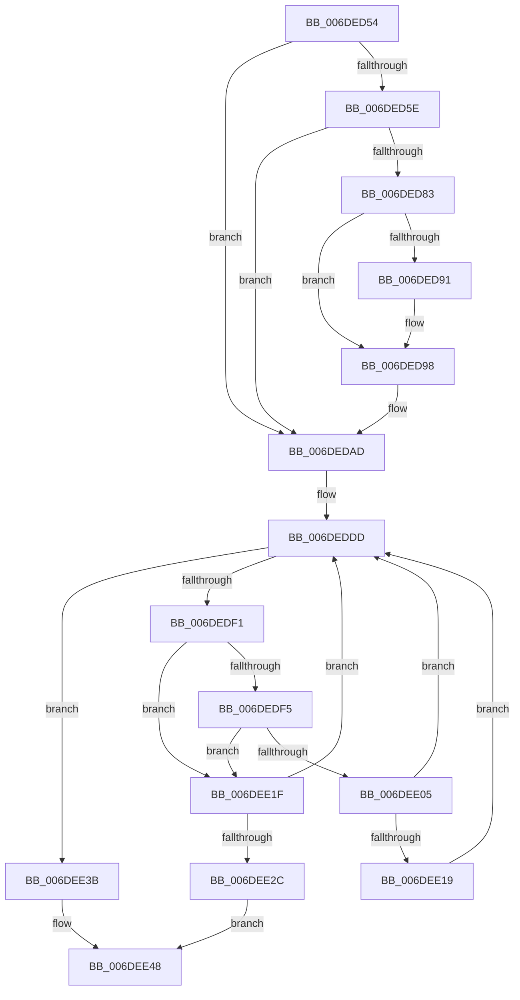

# sub_006DED54

- RVA: `0x006DED54`–`0x006DEE56` (길이 `258` bytes)
- VA: `0x00000001406DED54`
- 실행 섹션: `.text`
- PDB 이름 있음: `아니요`; PDB Function 태그: `아니요`
- unwind 정보 RVA: `0x00071AC8`
- 디코드: `69`개 명령, `258/258` bytes 표시
- 미해석 바이트: `0` (있으면 어셈블리에 `.byte`로 보존)

> 이 문서는 커널 이미지의 기계어와 PDB 기호를 분석해 생성했습니다. 4번과 5번은 함수 원형과 자료형을 바이너리 사용 방식에서 추정한 C 해석이며 원본 소스 복구 결과는 아닙니다.

## 1. Dependencies

- 직접 호출 지점: **5**; 고유 호출 대상: **5**
- 직접 호출자로 확인된 함수: **0**
- RIP 상대 이미지 참조: **4**

### Outgoing calls
- `0x006DED7A` → [ExpPoolFlagsToPoolType](../../poolcode/B8/ExpPoolFlagsToPoolType_function_00B84080.md) (function, `0x00B84080`)
- `0x006DEDA8` → [EtwTracePool](../2E/EtwTracePool_function_002ECEEC.md) (function, `0x002ECEEC`)
- `0x006DEE34` → [ExpRemovePoolTrackerExpansion](../36/ExpRemovePoolTrackerExpansion_function_00361300.md) (function, `0x00361300`)
- `0x006DEE43` → [ExpPoolTrackerReturnLimit](../36/ExpPoolTrackerReturnLimit_function_00361570.md) (function, `0x00361570`)
- `0x006DEE4B` → [ExpCleanupBigTag](../65/ExpCleanupBigTag_function_006567D4.md) (function, `0x006567D4`)

### Direct callers
- 이 함수 시작 RVA로 연결되는 직접 call은 확인되지 않았습니다. 간접 호출은 완전히 역산할 수 없습니다.

### Static image references
- `0x006DED54` → RVA `0x00FC6B04` (`ALMOSTRO`; read)
- `0x006DEDB5` → RVA `0x00EFAD20` (`.data`; read)
- `0x006DEDBC` → RVA `0x00EFED58` (`.data`; read)
- `0x006DEDF5` → RVA `0x00EFED60` (`.data`; read)

## 2. Other-region calls and transfers

- 다른 실행 섹션으로 향하는 call: **1**
  - `0x006DED7A` → [ExpPoolFlagsToPoolType](../../poolcode/B8/ExpPoolFlagsToPoolType_function_00B84080.md) (`.text` → `POOLCODE`)
- call이 아닌 외부 분기/꼬리 이동: **1**
  - `0x006DEE51` → [ExInsertPoolTag + 0x86](../2E/ExInsertPoolTag_function_002EF3AC.md) (`tail-transfer`)

## 3. Assembly (complete function range)

```asm
006DED54  8B 05 AA 7D 8E 00               mov eax, dword ptr [rip + 0x8e7daa]
006DED5A  A8 41                           test al, 0x41
006DED5C  74 4F                           je 0x1406dedad
006DED5E  48 8D 44 24 78                  lea rax, [rsp + 0x78]
006DED63  33 D2                           xor edx, edx
006DED65  4C 8D 8C 24 80 00 00 00         lea r9, [rsp + 0x80]
006DED6D  48 89 44 24 20                  mov qword ptr [rsp + 0x20], rax
006DED72  4C 8D 44 24 70                  lea r8, [rsp + 0x70]
006DED77  49 8B CE                        mov rcx, r14
006DED7A  E8 01 53 4A 00                  call 0x140b84080
006DED7F  85 C0                           test eax, eax
006DED81  78 2A                           js 0x1406dedad
006DED83  8B 54 24 70                     mov edx, dword ptr [rsp + 0x70]
006DED87  40 38 BC 24 80 00 00 00         cmp byte ptr [rsp + 0x80], dil
006DED8F  74 07                           je 0x1406ded98
006DED91  83 CA 08                        or edx, 8
006DED94  89 54 24 70                     mov dword ptr [rsp + 0x70], edx
006DED98  B9 22 0E 00 00                  mov ecx, 0xe22
006DED9D  48 89 74 24 20                  mov qword ptr [rsp + 0x20], rsi
006DEDA2  4D 8B CF                        mov r9, r15
006DEDA5  44 8B C5                        mov r8d, ebp
006DEDA8  E8 3F E1 C0 FF                  call 0x1402eceec
006DEDAD  65 8B 04 25 A4 01 00 00         mov eax, dword ptr gs:[0x1a4]
006DEDB5  48 8D 1D 64 BF 81 00            lea rbx, [rip + 0x81bf64]
006DEDBC  4C 8B 15 95 FF 81 00            mov r10, qword ptr [rip + 0x81ff95]
006DEDC3  48 69 CD 5F 9E 00 00            imul rcx, rbp, 0x9e5f
006DEDCA  48 8B 1C C3                     mov rbx, qword ptr [rbx + rax*8]
006DEDCE  48 8B D1                        mov rdx, rcx
006DEDD1  48 C1 EA 20                     shr rdx, 0x20
006DEDD5  33 D1                           xor edx, ecx
006DEDD7  41 23 D2                        and edx, r10d
006DEDDA  44 8B DA                        mov r11d, edx
006DEDDD  8B C2                           mov eax, edx
006DEDDF  48 8D 0C 80                     lea rcx, [rax + rax*4]
006DEDE3  48 03 C9                        add rcx, rcx
006DEDE6  4C 8D 04 CB                     lea r8, [rbx + rcx*8]
006DEDEA  41 8B 00                        mov eax, dword ptr [r8]
006DEDED  3B C5                           cmp eax, ebp
006DEDEF  74 4A                           je 0x1406dee3b
006DEDF1  85 C0                           test eax, eax
006DEDF3  75 2A                           jne 0x1406dee1f
006DEDF5  48 8B 05 64 FF 81 00            mov rax, qword ptr [rip + 0x81ff64]
006DEDFC  44 8B 0C C8                     mov r9d, dword ptr [rax + rcx*8]
006DEE00  45 85 C9                        test r9d, r9d
006DEE03  74 1A                           je 0x1406dee1f
006DEE05  45 89 08                        mov dword ptr [r8], r9d
006DEE08  48 8B 05 51 FF 81 00            mov rax, qword ptr [rip + 0x81ff51]
006DEE0F  4C 8B 4C C8 48                  mov r9, qword ptr [rax + rcx*8 + 0x48]
006DEE14  4D 85 C9                        test r9, r9
006DEE17  74 C4                           je 0x1406deddd
006DEE19  4D 89 48 48                     mov qword ptr [r8 + 0x48], r9
006DEE1D  EB BE                           jmp 0x1406deddd
006DEE1F  8D 42 01                        lea eax, [rdx + 1]
006DEE22  41 23 C2                        and eax, r10d
006DEE25  8B D0                           mov edx, eax
006DEE27  41 3B C3                        cmp eax, r11d
006DEE2A  75 B1                           jne 0x1406deddd
006DEE2C  4D 8B C6                        mov r8, r14
006DEE2F  48 8B D6                        mov rdx, rsi
006DEE32  8B CD                           mov ecx, ebp
006DEE34  E8 C7 24 C8 FF                  call 0x140361300
006DEE39  EB 0D                           jmp 0x1406dee48
006DEE3B  48 8B D6                        mov rdx, rsi
006DEE3E  B9 01 00 00 00                  mov ecx, 1
006DEE43  E8 28 27 C8 FF                  call 0x140361570
006DEE48  49 8B CF                        mov rcx, r15
006DEE4B  E8 84 79 F7 FF                  call 0x1406567d4
006DEE50  90                              nop
006DEE51  E9 DC 05 C1 FF                  jmp 0x1402ef432
```

## 4. C-style interpretation (structured pseudocode)

```c
__int64 __fastcall sub_006DED54(__int64 a1, int a2, __int64 a3, __int64 a4, __int64 a5, __int64 a6, __int64 a7, __int64 a8, __int64 a9, __int64 a10, __int64 a11, __int64 a12, __int64 a13, unsigned int a14, __int64 a15, unsigned __int8 a16)
{
    __int64 result;
    unsigned __int64 v_stack_p20;
    unsigned int v_stack_p70;

    if ((((unsigned __int8)((unsigned int)(*(unsigned int *)(v_rip + 9338282)))) & (65)) == 0) goto loc_006DEDAD;
    a2 = 0;
    v_stack_p20 = a15;
    result = ExpPoolFlagsToPoolType(v_r14, a2, a14, a16);
    if (sign_flag) goto loc_006DEDAD;
    if (a16 != ((unsigned __int8)(v_rdi))) {
        a2 = (unsigned int)(((unsigned int)(a14)) | (8));
        v_stack_p70 = a2;
    }
    v_stack_p20 = v_rsi;
    result = EtwTracePool((unsigned int)(0xE22ULL), a2, (unsigned int)((unsigned int)(v_rbp)), v_r15);
loc_006DEDAD:
    a1 = ((unsigned int)(0xE22ULL)) * (v_rbp);
    a2 = (a1) >> (32);
    a2 = (unsigned int)((a2) ^ ((unsigned int)(a1)));
    a2 = (unsigned int)((a2) & ((unsigned int)(*(unsigned __int64 *)(v_rip + 8519573))));
loc_006DEDDD:
    a1 = ((unsigned int)(a2) + (unsigned int)(a2) * 4) + ((unsigned int)(a2) + (unsigned int)(a2) * 4);
    if (((unsigned int)((unsigned int)(*(unsigned int *)(*(unsigned __int64 *)(v_rip + 8503140 + (unsigned int)(*(unsigned int *)(gs_base + (0 + 420))) * 8) + a1 * 8)))) == ((unsigned int)(v_rbp))) goto loc_006DEE3B;
    if ((unsigned int)((unsigned int)(*(unsigned int *)(*(unsigned __int64 *)(v_rip + 8503140 + (unsigned int)(*(unsigned int *)(gs_base + (0 + 420))) * 8) + a1 * 8))) != 0) goto loc_006DEE1F;
    if ((unsigned int)((unsigned int)(*(unsigned int *)(*(unsigned __int64 *)(v_rip + 8519524) + a1 * 8))) == 0) goto loc_006DEE1F;
    *(unsigned int *)(*(unsigned __int64 *)(v_rip + 8503140 + (unsigned int)(*(unsigned int *)(gs_base + (0 + 420))) * 8) + a1 * 8) = (unsigned int)((unsigned int)(*(unsigned int *)(*(unsigned __int64 *)(v_rip + 8519524) + a1 * 8)));
    if (*(unsigned __int64 *)(*(unsigned __int64 *)(v_rip + 8519505) + a1 * 8 + 72) == 0) goto loc_006DEDDD;
    *(unsigned __int64 *)(*(unsigned __int64 *)(v_rip + 8503140 + (unsigned int)(*(unsigned int *)(gs_base + (0 + 420))) * 8) + a1 * 8 + 72) = *(unsigned __int64 *)(*(unsigned __int64 *)(v_rip + 8519505) + a1 * 8 + 72);
    goto loc_006DEDDD;
loc_006DEE1F:
    result = (unsigned int)((a2 + 1) & ((unsigned int)(*(unsigned __int64 *)(v_rip + 8519573))));
    if (((unsigned int)(result)) != ((unsigned int)((unsigned int)(a2)))) goto loc_006DEDDD;
    result = ExpRemovePoolTrackerExpansion((unsigned int)((unsigned int)(v_rbp)), v_rsi, v_r14, *(unsigned __int64 *)(*(unsigned __int64 *)(v_rip + 8519505) + a1 * 8 + 72));
    goto loc_006DEE48;
loc_006DEE3B:
    result = ExpPoolTrackerReturnLimit(1, v_rsi, v_r14, *(unsigned __int64 *)(*(unsigned __int64 *)(v_rip + 8519505) + a1 * 8 + 72));
loc_006DEE48:
    result = ExpCleanupBigTag(v_r15, v_rsi, v_r14, *(unsigned __int64 *)(*(unsigned __int64 *)(v_rip + 8519505) + a1 * 8 + 72));
}
```

## 5. (Beta) C Style

```c
int64_t sub_006DED54(int64_t Arg1, int32_t Arg2, int64_t Arg3, int64_t Arg4, uint64_t Arg5, uint64_t Arg6, uint64_t Arg7, uint64_t Arg8, uint64_t Arg9, uint64_t Arg10, uint64_t Arg11, uint64_t Arg12, uint64_t Arg13, uint32_t Arg14, int64_t Arg15, uint8_t Arg16)
{
    int64_t result;
    uint64_t v_stack_p20;
    uint32_t v_stack_p70;

    if ((((uint8_t)((uint32_t)(*(uint32_t *)(v_rip + 0x8E7DAA)))) & (65)) == 0) goto loc_006DEDAD;
    Arg2 = 0;
    v_stack_p20 = Arg15;
    result = ExpPoolFlagsToPoolType(local_r14, Arg2, Arg14, Arg16);
    if (sign_flag) goto loc_006DEDAD;
    if (Arg16 != ((uint8_t)(local_rdi))) {
        Arg2 = (uint32_t)(((uint32_t)(Arg14)) | (8));
        v_stack_p70 = Arg2;
    }
    v_stack_p20 = local_rsi;
    result = EtwTracePool((uint32_t)(0xE22ULL), Arg2, (uint32_t)((uint32_t)(local_rbp)), local_r15);
loc_006DEDAD:
    Arg1 = ((uint32_t)(0xE22ULL)) * (local_rbp);
    Arg2 = (Arg1) >> (32);
    Arg2 = (uint32_t)((Arg2) ^ ((uint32_t)(Arg1)));
    Arg2 = (uint32_t)((Arg2) & ((uint32_t)(*(uint64_t *)(v_rip + 0x81FF95))));
loc_006DEDDD:
    Arg1 = ((uint32_t)(Arg2) + (uint32_t)(Arg2) * 4) + ((uint32_t)(Arg2) + (uint32_t)(Arg2) * 4);
    if (((uint32_t)((uint32_t)(*(uint32_t *)(*(uint64_t *)(v_rip + 0x81BF64 + (uint32_t)(*(uint32_t *)(gs_base + (0 + 0x1A4))) * 8) + Arg1 * 8)))) == ((uint32_t)(local_rbp))) goto loc_006DEE3B;
    if ((uint32_t)((uint32_t)(*(uint32_t *)(*(uint64_t *)(v_rip + 0x81BF64 + (uint32_t)(*(uint32_t *)(gs_base + (0 + 0x1A4))) * 8) + Arg1 * 8))) != 0) goto loc_006DEE1F;
    if ((uint32_t)((uint32_t)(*(uint32_t *)(*(uint64_t *)(v_rip + 0x81FF64) + Arg1 * 8))) == 0) goto loc_006DEE1F;
    *(uint32_t *)(*(uint64_t *)(v_rip + 0x81BF64 + (uint32_t)(*(uint32_t *)(gs_base + (0 + 0x1A4))) * 8) + Arg1 * 8) = (uint32_t)((uint32_t)(*(uint32_t *)(*(uint64_t *)(v_rip + 0x81FF64) + Arg1 * 8)));
    if (*(uint64_t *)(*(uint64_t *)(v_rip + 0x81FF51) + Arg1 * 8 + 0x48) == 0) goto loc_006DEDDD;
    *(uint64_t *)(*(uint64_t *)(v_rip + 0x81BF64 + (uint32_t)(*(uint32_t *)(gs_base + (0 + 0x1A4))) * 8) + Arg1 * 8 + 0x48) = *(uint64_t *)(*(uint64_t *)(v_rip + 0x81FF51) + Arg1 * 8 + 0x48);
    goto loc_006DEDDD;
loc_006DEE1F:
    result = (uint32_t)((Arg2 + 1) & ((uint32_t)(*(uint64_t *)(v_rip + 0x81FF95))));
    if (((uint32_t)(result)) != ((uint32_t)((uint32_t)(Arg2)))) goto loc_006DEDDD;
    result = ExpRemovePoolTrackerExpansion((uint32_t)((uint32_t)(local_rbp)), local_rsi, local_r14, *(uint64_t *)(*(uint64_t *)(v_rip + 0x81FF51) + Arg1 * 8 + 0x48));
    goto loc_006DEE48;
loc_006DEE3B:
    result = ExpPoolTrackerReturnLimit(1, local_rsi, local_r14, *(uint64_t *)(*(uint64_t *)(v_rip + 0x81FF51) + Arg1 * 8 + 0x48));
loc_006DEE48:
    result = ExpCleanupBigTag(local_r15, local_rsi, local_r14, *(uint64_t *)(*(uint64_t *)(v_rip + 0x81FF51) + Arg1 * 8 + 0x48));
}
```

## 6. Execution-region graph

[열기: 2D/3D 그래프와 함수 탐색 컨트롤 패널](../../../control-panel.html?section=text&rva=0x006DED54&view=graph)

- 2D 그래프는 위에서 아래로 흐르고, 3D 그래프는 빈 공간을 드래그해 회전합니다. Shift+드래그는 이동, 휠은 확대·축소, 함수 노드 선택은 대상 보고서 이동입니다.

### Static fallback


