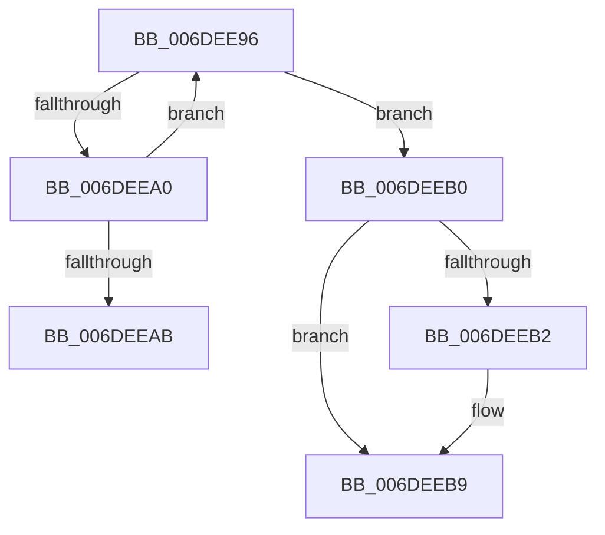

# sub_006DEE96

- RVA: `0x006DEE96`–`0x006DEEC1` (길이 `43` bytes)
- VA: `0x00000001406DEE96`
- 실행 섹션: `.text`
- PDB 이름 있음: `아니요`; PDB Function 태그: `아니요`
- unwind 정보 RVA: `0x00071D10`
- 디코드: `11`개 명령, `43/43` bytes 표시
- 미해석 바이트: `0` (있으면 어셈블리에 `.byte`로 보존)

> 이 문서는 커널 이미지의 기계어와 PDB 기호를 분석해 생성했습니다. 4번과 5번은 함수 원형과 자료형을 바이너리 사용 방식에서 추정한 C 해석이며 원본 소스 복구 결과는 아닙니다.

## 1. Dependencies

- 직접 호출 지점: **0**; 고유 호출 대상: **0**
- 직접 호출자로 확인된 함수: **0**
- RIP 상대 이미지 참조: **0**

### Outgoing calls
- 직접 디코드된 call 명령이 없습니다.

### Direct callers
- 이 함수 시작 RVA로 연결되는 직접 call은 확인되지 않았습니다. 간접 호출은 완전히 역산할 수 없습니다.

### Static image references
- 디코드된 RIP-relative 메모리 참조가 없습니다.

## 2. Other-region calls and transfers

- 다른 실행 섹션으로 향하는 call: **0**
- call이 아닌 외부 분기/꼬리 이동: **2**
  - `0x006DEEAB` → [CcForEachPartition + 0x7E](../2F/CcForEachPartition_function_002F0828.md) (`tail-transfer`)
  - `0x006DEEBC` → [CcForEachPartition + 0x81](../2F/CcForEachPartition_function_002F0828.md) (`tail-transfer`)

## 3. Assembly (complete function range)

```asm
006DEE96  48 8D 48 01                     lea rcx, [rax + 1]
006DEE9A  48 83 F9 01                     cmp rcx, 1
006DEE9E  76 10                           jbe 0x1406deeb0
006DEEA0  F0 48 0F B1 8B 10 05 00 00      lock cmpxchg qword ptr [rbx + 0x510], rcx
006DEEA9  75 EB                           jne 0x1406dee96
006DEEAB  E9 F6 19 C1 FF                  jmp 0x1402f08a6
006DEEB0  74 07                           je 0x1406deeb9
006DEEB2  B9 0E 00 00 00                  mov ecx, 0xe
006DEEB7  CD 29                           int 0x29
006DEEB9  40 32 FF                        xor dil, dil
006DEEBC  E9 E8 19 C1 FF                  jmp 0x1402f08a9
```

## 4. C-style interpretation (structured pseudocode)

```c
void __fastcall sub_006DEE96(void)
{
    __int64 v_rdi;

    if ((result + 1) <= 1) goto loc_006DEEB0;
    if ((result + 1) != 1) goto loc_006DEE96;
loc_006DEEB0:
    if ((result + 1) != 1) {
        a1 = 14;
    }
    v_rdi = 0;
}
```

## 5. (Beta) C Style

```c
void sub_006DEE96(void)
{
    int64_t local_rdi;

    if ((result + 1) <= 1) goto loc_006DEEB0;
    if ((result + 1) != 1) goto loc_006DEE96;
loc_006DEEB0:
    if ((result + 1) != 1) {
        a1 = 14;
    }
    local_rdi = 0;
}
```

## 6. Execution-region graph

[열기: 2D/3D 그래프와 함수 탐색 컨트롤 패널](../../../control-panel.html?section=text&rva=0x006DEE96&view=graph)

- 2D 그래프는 위에서 아래로 흐르고, 3D 그래프는 빈 공간을 드래그해 회전합니다. Shift+드래그는 이동, 휠은 확대·축소, 함수 노드 선택은 대상 보고서 이동입니다.

### Static fallback


