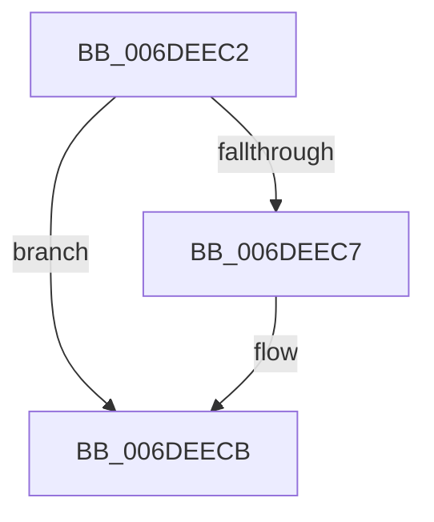

# sub_006DEEC2

- RVA: `0x006DEEC2`–`0x006DEED6` (길이 `20` bytes)
- VA: `0x00000001406DEEC2`
- 실행 섹션: `.text`
- PDB 이름 있음: `아니요`; PDB Function 태그: `아니요`
- unwind 정보 RVA: `0x00071D68`
- 디코드: `6`개 명령, `20/20` bytes 표시
- 미해석 바이트: `0` (있으면 어셈블리에 `.byte`로 보존)

> 이 문서는 커널 이미지의 기계어와 PDB 기호를 분석해 생성했습니다. 4번과 5번은 함수 원형과 자료형을 바이너리 사용 방식에서 추정한 C 해석이며 원본 소스 복구 결과는 아닙니다.

## 1. Dependencies

- 직접 호출 지점: **0**; 고유 호출 대상: **0**
- 직접 호출자로 확인된 함수: **0**
- RIP 상대 이미지 참조: **0**

### Outgoing calls
- 직접 디코드된 call 명령이 없습니다.

### Direct callers
- 이 함수 시작 RVA로 연결되는 직접 call은 확인되지 않았습니다. 간접 호출은 완전히 역산할 수 없습니다.

### Static image references
- 디코드된 RIP-relative 메모리 참조가 없습니다.

## 2. Other-region calls and transfers

- 다른 실행 섹션으로 향하는 call: **0**
- call이 아닌 외부 분기/꼬리 이동: **1**
  - `0x006DEED1` → [RtlpCSparseBitmapPageCommit + 0x91](../2F/RtlpCSparseBitmapPageCommit_function_002F0B98.md) (`tail-transfer`)

## 3. Assembly (complete function range)

```asm
006DEEC2  48 85 FF                        test rdi, rdi
006DEEC5  74 04                           je 0x1406deecb
006DEEC7  C6 47 0A 01                     mov byte ptr [rdi + 0xa], 1
006DEECB  48 8B 7D 38                     mov rdi, qword ptr [rbp + 0x38]
006DEECF  B0 FF                           mov al, 0xff
006DEED1  E9 53 1D C1 FF                  jmp 0x1402f0c29
```

## 4. C-style interpretation (structured pseudocode)

```c
__int64 __fastcall sub_006DEEC2(void)
{
    if (v_rdi != 0) {
        *(unsigned __int8 *)(v_rdi + 10) = 1;
    }
}
```

## 5. (Beta) C Style

```c
void sub_006DEEC2(void)
{
    if (local_rdi != 0) {
        *(uint8_t *)(local_rdi + 0xA) = 1;
    }
}
```

## 6. Execution-region graph

[열기: 2D/3D 그래프와 함수 탐색 컨트롤 패널](../../../control-panel.html?section=text&rva=0x006DEEC2&view=graph)

- 2D 그래프는 위에서 아래로 흐르고, 3D 그래프는 빈 공간을 드래그해 회전합니다. Shift+드래그는 이동, 휠은 확대·축소, 함수 노드 선택은 대상 보고서 이동입니다.

### Static fallback


