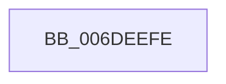

# sub_006DEEFE

- RVA: `0x006DEEFE`–`0x006DEF59` (길이 `91` bytes)
- VA: `0x00000001406DEEFE`
- 실행 섹션: `.text`
- PDB 이름 있음: `아니요`; PDB Function 태그: `아니요`
- unwind 정보 RVA: `0x00071DE4`
- 디코드: `19`개 명령, `91/91` bytes 표시
- 미해석 바이트: `0` (있으면 어셈블리에 `.byte`로 보존)

> 이 문서는 커널 이미지의 기계어와 PDB 기호를 분석해 생성했습니다. 4번과 5번은 함수 원형과 자료형을 바이너리 사용 방식에서 추정한 C 해석이며 원본 소스 복구 결과는 아닙니다.

## 1. Dependencies

- 직접 호출 지점: **1**; 고유 호출 대상: **1**
- 직접 호출자로 확인된 함수: **0**
- RIP 상대 이미지 참조: **1**

### Outgoing calls
- `0x006DEF4E` → [tlgWriteEx_EtwWriteEx](../4A/tlgWriteEx_EtwWriteEx_function_004AA348.md) (function, `0x004AA348`)

### Direct callers
- 이 함수 시작 RVA로 연결되는 직접 call은 확인되지 않았습니다. 간접 호출은 완전히 역산할 수 없습니다.

### Static image references
- `0x006DEF0B` → RVA `0x00057F2F` (`.rdata`; read)

## 2. Other-region calls and transfers

- 다른 실행 섹션으로 향하는 call: **0**
- call이 아닌 외부 분기/꼬리 이동: **1**
  - `0x006DEF54` → [MiLogBadMapper + 0x70](../2F/MiLogBadMapper_function_002F1140.md) (`tail-transfer`)

## 3. Assembly (complete function range)

```asm
006DEEFE  83 65 AC 00                     and dword ptr [rbp - 0x54], 0
006DEF02  48 8D 44 24 48                  lea rax, [rsp + 0x48]
006DEF07  83 65 BC 00                     and dword ptr [rbp - 0x44], 0
006DEF0B  48 8D 15 1D 90 97 FF            lea rdx, [rip - 0x686fe3]
006DEF12  48 89 45 A0                     mov qword ptr [rbp - 0x60], rax
006DEF16  41 B9 01 00 00 00               mov r9d, 1
006DEF1C  48 8D 44 24 40                  lea rax, [rsp + 0x40]
006DEF21  48 89 74 24 48                  mov qword ptr [rsp + 0x48], rsi
006DEF26  48 89 45 B0                     mov qword ptr [rbp - 0x50], rax
006DEF2A  49 8B C8                        mov rcx, r8
006DEF2D  48 8D 45 80                     lea rax, [rbp - 0x80]
006DEF31  44 89 65 A8                     mov dword ptr [rbp - 0x58], r12d
006DEF35  48 89 44 24 38                  mov qword ptr [rsp + 0x38], rax
006DEF3A  C7 44 24 30 04 00 00 00         mov dword ptr [rsp + 0x30], 4
006DEF42  44 89 74 24 40                  mov dword ptr [rsp + 0x40], r14d
006DEF47  C7 45 B8 04 00 00 00            mov dword ptr [rbp - 0x48], 4
006DEF4E  E8 F5 B3 DC FF                  call 0x1404aa348
006DEF53  90                              nop
006DEF54  E9 57 22 C1 FF                  jmp 0x1402f11b0
```

## 4. C-style interpretation (structured pseudocode)

```c
__int64 __fastcall sub_006DEEFE(__int64 a1, __int64 a2, __int64 a3, __int64 a4, __int64 a5, __int64 a6, __int64 a7, __int64 a8, __int64 a9)
{
    __int64 result;
    unsigned int v_stack_p30;
    unsigned __int64 v_stack_p38;
    unsigned int v_stack_p40;
    unsigned __int64 v_stack_p48;

    *(unsigned __int64 *)(v_rbp - 96) = a9;
    v_stack_p48 = v_rsi;
    *(unsigned __int64 *)(v_rbp - 80) = a8;
    *(unsigned int *)(v_rbp - 88) = (unsigned int)(v_r12);
    v_stack_p38 = v_rbp - 128;
    v_stack_p30 = 4;
    v_stack_p40 = (unsigned int)(v_r14);
    *(unsigned int *)(v_rbp - 72) = 4;
    result = tlgWriteEx_EtwWriteEx(a3, v_rip - 6844387, a3, 1);
}
```

## 5. (Beta) C Style

```c
int64_t sub_006DEEFE(int64_t Arg1, int64_t Arg2, int64_t Arg3, int64_t Arg4, uint64_t Arg5, uint64_t Arg6, uint64_t Arg7, int64_t Arg8, int64_t Arg9)
{
    int64_t result;
    uint32_t v_stack_p30;
    uint64_t v_stack_p38;
    uint32_t v_stack_p40;
    uint64_t v_stack_p48;

    *(uint64_t *)(local_rbp - 0x60) = Arg9;
    v_stack_p48 = local_rsi;
    *(uint64_t *)(local_rbp - 0x50) = Arg8;
    *(uint32_t *)(local_rbp - 0x58) = (uint32_t)(local_r12);
    v_stack_p38 = local_rbp - 128;
    v_stack_p30 = 4;
    v_stack_p40 = (uint32_t)(local_r14);
    *(uint32_t *)(local_rbp - 0x48) = 4;
    result = tlgWriteEx_EtwWriteEx(Arg3, v_rip - 6844387, Arg3, 1);
}
```

## 6. Execution-region graph

[열기: 2D/3D 그래프와 함수 탐색 컨트롤 패널](../../../control-panel.html?section=text&rva=0x006DEEFE&view=graph)

- 2D 그래프는 위에서 아래로 흐르고, 3D 그래프는 빈 공간을 드래그해 회전합니다. Shift+드래그는 이동, 휠은 확대·축소, 함수 노드 선택은 대상 보고서 이동입니다.

### Static fallback


