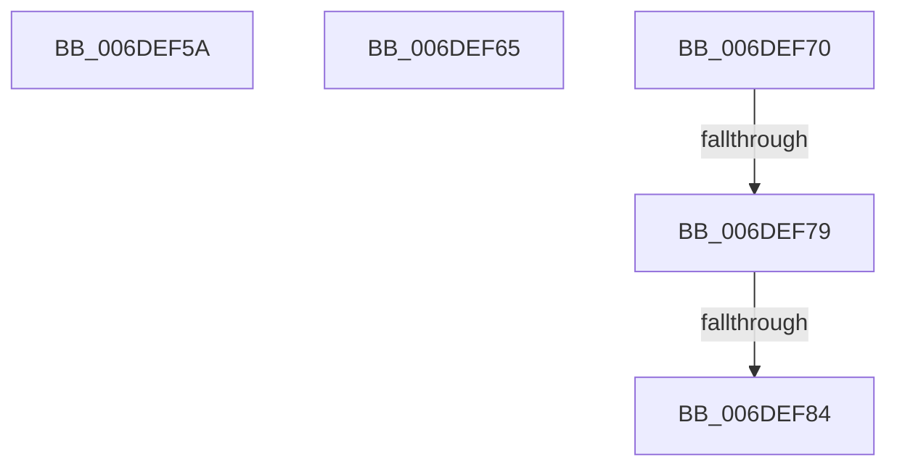

# sub_006DEF5A

- RVA: `0x006DEF5A`–`0x006DEF89` (길이 `47` bytes)
- VA: `0x00000001406DEF5A`
- 실행 섹션: `.text`
- PDB 이름 있음: `아니요`; PDB Function 태그: `아니요`
- unwind 정보 RVA: `0x00071E10`
- 디코드: `10`개 명령, `47/47` bytes 표시
- 미해석 바이트: `0` (있으면 어셈블리에 `.byte`로 보존)

> 이 문서는 커널 이미지의 기계어와 PDB 기호를 분석해 생성했습니다. 4번과 5번은 함수 원형과 자료형을 바이너리 사용 방식에서 추정한 C 해석이며 원본 소스 복구 결과는 아닙니다.

## 1. Dependencies

- 직접 호출 지점: **1**; 고유 호출 대상: **1**
- 직접 호출자로 확인된 함수: **0**
- RIP 상대 이미지 참조: **0**

### Outgoing calls
- `0x006DEF5A` → [ExAcquireSpinLockShared](../24/ExAcquireSpinLockShared_function_0024DCE0.md) (function, `0x0024DCE0`)

### Direct callers
- 이 함수 시작 RVA로 연결되는 직접 call은 확인되지 않았습니다. 간접 호출은 완전히 역산할 수 없습니다.

### Static image references
- 디코드된 RIP-relative 메모리 참조가 없습니다.

## 2. Other-region calls and transfers

- 다른 실행 섹션으로 향하는 call: **0**
- call이 아닌 외부 분기/꼬리 이동: **5**
  - `0x006DEF60` → [InsertEventEntryInLookUpTable + 0x7C](../2F/InsertEventEntryInLookUpTable_function_002F1424.md) (`tail-transfer`)
  - `0x006DEF6B` → [InsertEventEntryInLookUpTable + 0x128](../2F/InsertEventEntryInLookUpTable_function_002F1424.md) (`tail-transfer`)
  - `0x006DEF73` → [InsertEventEntryInLookUpTable + 0x117](../2F/InsertEventEntryInLookUpTable_function_002F1424.md) (`tail-transfer`)
  - `0x006DEF7E` → [InsertEventEntryInLookUpTable + 0x35B](../2F/InsertEventEntryInLookUpTable_function_002F1424.md) (`tail-transfer`)
  - `0x006DEF84` → [InsertEventEntryInLookUpTable + 0x117](../2F/InsertEventEntryInLookUpTable_function_002F1424.md) (`tail-transfer`)

## 3. Assembly (complete function range)

```asm
006DEF5A  E8 81 ED B6 FF                  call 0x14024dce0
006DEF5F  90                              nop
006DEF60  E9 3B 25 C1 FF                  jmp 0x1402f14a0
006DEF65  FF 83 44 01 00 00               inc dword ptr [rbx + 0x144]
006DEF6B  E9 DC 25 C1 FF                  jmp 0x1402f154c
006DEF70  4C 3B C8                        cmp r9, rax
006DEF73  0F 8E C2 25 C1 FF               jle 0x1402f153b
006DEF79  F0 4C 0F B1 0A                  lock cmpxchg qword ptr [rdx], r9
006DEF7E  0F 85 FB 27 C1 FF               jne 0x1402f177f
006DEF84  E9 B2 25 C1 FF                  jmp 0x1402f153b
```

## 4. C-style interpretation (structured pseudocode)

```c
__int64 __fastcall sub_006DEF5A(__int64 a1, __int64 a2, __int64 a3, __int64 a4)
{
    __int64 result;

    result = ExAcquireSpinLockShared(a1, a2, a3, a4);
}
```

## 5. (Beta) C Style

```c
int64_t sub_006DEF5A(int64_t Arg1, int64_t Arg2, int64_t Arg3, int64_t Arg4)
{
    int64_t result;

    result = ExAcquireSpinLockShared(Arg1, Arg2, Arg3, Arg4);
}
```

## 6. Execution-region graph

[열기: 2D/3D 그래프와 함수 탐색 컨트롤 패널](../../../control-panel.html?section=text&rva=0x006DEF5A&view=graph)

- 2D 그래프는 위에서 아래로 흐르고, 3D 그래프는 빈 공간을 드래그해 회전합니다. Shift+드래그는 이동, 휠은 확대·축소, 함수 노드 선택은 대상 보고서 이동입니다.

### Static fallback


