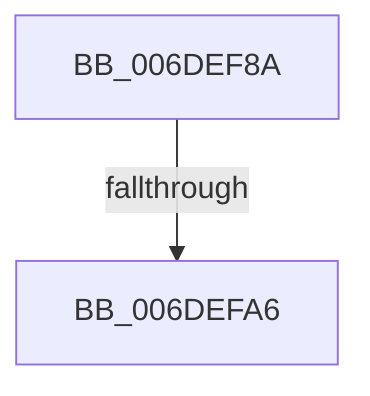

# sub_006DEF8A

- RVA: `0x006DEF8A`–`0x006DF0C7` (길이 `317` bytes)
- VA: `0x00000001406DEF8A`
- 실행 섹션: `.text`
- PDB 이름 있음: `아니요`; PDB Function 태그: `아니요`
- unwind 정보 RVA: `0x00071F1C`
- 디코드: `88`개 명령, `317/317` bytes 표시
- 미해석 바이트: `0` (있으면 어셈블리에 `.byte`로 보존)

> 이 문서는 커널 이미지의 기계어와 PDB 기호를 분석해 생성했습니다. 4번과 5번은 함수 원형과 자료형을 바이너리 사용 방식에서 추정한 C 해석이며 원본 소스 복구 결과는 아닙니다.

## 1. Dependencies

- 직접 호출 지점: **1**; 고유 호출 대상: **1**
- 직접 호출자로 확인된 함수: **0**
- RIP 상대 이미지 참조: **2**

### Outgoing calls
- `0x006DEF99` → [VslpEnterIumSecureMode](../23/VslpEnterIumSecureMode_function_00235E50.md) (function, `0x00235E50`)

### Direct callers
- 이 함수 시작 RVA로 연결되는 직접 call은 확인되지 않았습니다. 간접 호출은 완전히 역산할 수 없습니다.

### Static image references
- `0x006DF056` → RVA `0x01201868` (`CFGRO`; write)
- `0x006DF0BC` → RVA `0x0120184C` (`CFGRO`; write)

## 2. Other-region calls and transfers

- 다른 실행 섹션으로 향하는 call: **0**
- call이 아닌 외부 분기/꼬리 이동: **2**
  - `0x006DEFA0` → [VslGetNestedPageProtectionFlags + 0x38](../2F/VslGetNestedPageProtectionFlags_function_002F2164.md) (`tail-transfer`)
  - `0x006DF0C2` → [VslGetNestedPageProtectionFlags + 0x38](../2F/VslGetNestedPageProtectionFlags_function_002F2164.md) (`tail-transfer`)

## 3. Assembly (complete function range)

```asm
006DEF8A  BA FB 00 00 00                  mov edx, 0xfb
006DEF8F  4C 8D 4C 24 20                  lea r9, [rsp + 0x20]
006DEF94  45 33 C0                        xor r8d, r8d
006DEF97  B1 02                           mov cl, 2
006DEF99  E8 B2 6E B5 FF                  call 0x140235e50
006DEF9E  85 C0                           test eax, eax
006DEFA0  0F 88 F6 31 C1 FF               js 0x1402f219c
006DEFA6  44 8B 4C 24 30                  mov r9d, dword ptr [rsp + 0x30]
006DEFAB  41 B8 00 01 00 00               mov r8d, 0x100
006DEFB1  41 8B C1                        mov eax, r9d
006DEFB4  41 BA 00 02 00 00               mov r10d, 0x200
006DEFBA  83 E0 01                        and eax, 1
006DEFBD  41 BB 00 04 00 00               mov r11d, 0x400
006DEFC3  8D 0C 45 04 00 00 00            lea ecx, [rax*2 + 4]
006DEFCA  41 8B C1                        mov eax, r9d
006DEFCD  8B D1                           mov edx, ecx
006DEFCF  83 CA 20                        or edx, 0x20
006DEFD2  41 F6 C1 02                     test r9b, 2
006DEFD6  0F 44 D1                        cmove edx, ecx
006DEFD9  8B CA                           mov ecx, edx
006DEFDB  83 C9 10                        or ecx, 0x10
006DEFDE  41 F6 C1 04                     test r9b, 4
006DEFE2  0F 45 CA                        cmovne ecx, edx
006DEFE5  8B D1                           mov edx, ecx
006DEFE7  83 CA 40                        or edx, 0x40
006DEFEA  41 F6 C1 08                     test r9b, 8
006DEFEE  0F 44 D1                        cmove edx, ecx
006DEFF1  8B CA                           mov ecx, edx
006DEFF3  0F BA E9 07                     bts ecx, 7
006DEFF7  41 F6 C1 10                     test r9b, 0x10
006DEFFB  0F 44 CA                        cmove ecx, edx
006DEFFE  8B D1                           mov edx, ecx
006DF000  41 0B D0                        or edx, r8d
006DF003  41 F6 C1 20                     test r9b, 0x20
006DF007  0F 44 D1                        cmove edx, ecx
006DF00A  8B CA                           mov ecx, edx
006DF00C  41 0B CA                        or ecx, r10d
006DF00F  41 F6 C1 40                     test r9b, 0x40
006DF013  0F 44 CA                        cmove ecx, edx
006DF016  8B D1                           mov edx, ecx
006DF018  41 0B D3                        or edx, r11d
006DF01B  41 F6 C1 80                     test r9b, 0x80
006DF01F  0F 44 D1                        cmove edx, ecx
006DF022  8B CA                           mov ecx, edx
006DF024  0F BA E9 0B                     bts ecx, 0xb
006DF028  45 85 C8                        test r8d, r9d
006DF02B  0F 44 CA                        cmove ecx, edx
006DF02E  8B D1                           mov edx, ecx
006DF030  0F BA EA 0C                     bts edx, 0xc
006DF034  45 85 CA                        test r10d, r9d
006DF037  41 BA 00 40 00 00               mov r10d, 0x4000
006DF03D  0F 44 D1                        cmove edx, ecx
006DF040  41 23 C3                        and eax, r11d
006DF043  44 8B C2                        mov r8d, edx
006DF046  41 BB 00 20 00 00               mov r11d, 0x2000
006DF04C  45 0B C3                        or r8d, r11d
006DF04F  85 C0                           test eax, eax
006DF051  48 8B 44 24 38                  mov rax, qword ptr [rsp + 0x38]
006DF056  48 89 05 0B 28 B2 00            mov qword ptr [rip + 0xb2280b], rax
006DF05D  44 0F 44 C2                     cmove r8d, edx
006DF061  41 8B C8                        mov ecx, r8d
006DF064  0F BA E9 11                     bts ecx, 0x11
006DF068  45 85 CA                        test r10d, r9d
006DF06B  41 0F 44 C8                     cmove ecx, r8d
006DF06F  8B D1                           mov edx, ecx
006DF071  41 0B D2                        or edx, r10d
006DF074  41 BA 00 80 00 00               mov r10d, 0x8000
006DF07A  41 0F BA E1 0B                  bt r9d, 0xb
006DF07F  0F 43 D1                        cmovae edx, ecx
006DF082  44 8B C2                        mov r8d, edx
006DF085  45 0B C2                        or r8d, r10d
006DF088  41 0F BA E1 0C                  bt r9d, 0xc
006DF08D  44 0F 43 C2                     cmovae r8d, edx
006DF091  41 8B C8                        mov ecx, r8d
006DF094  0F BA E9 10                     bts ecx, 0x10
006DF098  45 85 CB                        test r11d, r9d
006DF09B  41 0F 44 C8                     cmove ecx, r8d
006DF09F  8B D1                           mov edx, ecx
006DF0A1  0F BA EA 12                     bts edx, 0x12
006DF0A5  45 85 CA                        test r10d, r9d
006DF0A8  0F 44 D1                        cmove edx, ecx
006DF0AB  41 C1 E9 10                     shr r9d, 0x10
006DF0AF  8B C2                           mov eax, edx
006DF0B1  0F BA E8 13                     bts eax, 0x13
006DF0B5  41 F6 C1 01                     test r9b, 1
006DF0B9  0F 44 C2                        cmove eax, edx
006DF0BC  89 05 8A 27 B2 00               mov dword ptr [rip + 0xb2278a], eax
006DF0C2  E9 D5 30 C1 FF                  jmp 0x1402f219c
```

## 4. C-style interpretation (structured pseudocode)

```c
__int64 __fastcall sub_006DEF8A(__int64 a1, __int64 a2, int a3, __int64 a4, __int64 a5, unsigned int a6, __int64 a7)
{
    __int64 result;
    unsigned __int64 v_stack_p20;

    a3 = 0;
    result = VslpEnterIumSecureMode(2, 251, a3, v_stack_p20);
    result = (unsigned int)(((unsigned int)((unsigned int)((unsigned int)(a6)))) & (1));
    a2 = (unsigned int)(((unsigned int)((unsigned int)(result * 2 + 4))) | (32));
    if ((((unsigned __int8)((unsigned int)(a6))) & (2)) == 0) { a2 = (unsigned int)(result * 2 + 4); }
    a1 = (unsigned int)(((unsigned int)((unsigned int)(a2))) | (16));
    if ((((unsigned __int8)((unsigned int)(a6))) & (4)) != 0) { a1 = (unsigned int)(a2); }
    a2 = (unsigned int)(((unsigned int)((unsigned int)(a1))) | (64));
    if ((((unsigned __int8)((unsigned int)(a6))) & (8)) == 0) { a2 = (unsigned int)(a1); }
    a1 = (unsigned int)((unsigned int)(a2));
    if ((((unsigned __int8)((unsigned int)(a6))) & (16)) == 0) { a1 = (unsigned int)(a2); }
    a2 = (unsigned int)(((unsigned int)((unsigned int)(a1))) | (256));
    if ((((unsigned __int8)((unsigned int)(a6))) & (32)) == 0) { a2 = (unsigned int)(a1); }
    a1 = (unsigned int)(((unsigned int)((unsigned int)(a2))) | (512));
    if ((((unsigned __int8)((unsigned int)(a6))) & (64)) == 0) { a1 = (unsigned int)(a2); }
    a2 = (unsigned int)(((unsigned int)((unsigned int)(a1))) | ((unsigned int)((unsigned int)(0x400ULL))));
    if ((((unsigned __int8)((unsigned int)(a6))) & (128)) == 0) { a2 = (unsigned int)(a1); }
    a1 = (unsigned int)((unsigned int)(a2));
    if (((256) & ((unsigned int)((unsigned int)(a6)))) == 0) { a1 = (unsigned int)(a2); }
    a2 = (unsigned int)((unsigned int)(a1));
    if (((512) & ((unsigned int)((unsigned int)(a6)))) == 0) { a2 = (unsigned int)(a1); }
    result = (unsigned int)(((unsigned int)((unsigned int)((unsigned int)(a6)))) & ((unsigned int)((unsigned int)(0x400ULL))));
    a3 = (unsigned int)(((unsigned int)((unsigned int)(a2))) | ((unsigned int)((unsigned int)(0x2000ULL))));
    *(unsigned __int64 *)(v_rip + 11675659) = a7;
    if ((unsigned int)(result) == 0) { a3 = (unsigned int)(a2); }
    a1 = (unsigned int)(a3);
    if ((((unsigned int)((unsigned int)(0x4000ULL))) & ((unsigned int)((unsigned int)(a6)))) == 0) { a1 = a3; }
    a2 = (unsigned int)(((unsigned int)((unsigned int)(a1))) | ((unsigned int)((unsigned int)(0x4000ULL))));
    if (condition_is_above_or_equal) { a2 = (unsigned int)(a1); }
    a3 = (unsigned int)(((unsigned int)((unsigned int)(a2))) | ((unsigned int)((unsigned int)(0x8000ULL))));
    if (condition_is_above_or_equal) { a3 = (unsigned int)(a2); }
    a1 = (unsigned int)(a3);
    if ((((unsigned int)((unsigned int)(0x2000ULL))) & ((unsigned int)((unsigned int)(a6)))) == 0) { a1 = a3; }
    a2 = (unsigned int)((unsigned int)(a1));
    if ((((unsigned int)((unsigned int)(0x8000ULL))) & ((unsigned int)((unsigned int)(a6)))) == 0) { a2 = (unsigned int)(a1); }
    a4 = (unsigned int)(((unsigned int)(a6)) >> (16));
    result = (unsigned int)((unsigned int)(a2));
    if ((((unsigned __int8)(a4)) & (1)) == 0) { result = (unsigned int)(a2); }
    *(unsigned int *)(v_rip + 11675530) = (unsigned int)(result);
}
```

## 5. (Beta) C Style

```c
int64_t sub_006DEF8A(int64_t Arg1, int64_t Arg2, int32_t Arg3, int64_t Arg4, uint64_t Arg5, uint32_t Arg6, int64_t Arg7)
{
    int64_t result;
    uint64_t v_stack_p20;

    Arg3 = 0;
    result = VslpEnterIumSecureMode(2, 251, Arg3, v_stack_p20);
    result = (uint32_t)(((uint32_t)((uint32_t)((uint32_t)(Arg6)))) & (1));
    Arg2 = (uint32_t)(((uint32_t)((uint32_t)(result * 2 + 4))) | (32));
    if ((((uint8_t)((uint32_t)(Arg6))) & (2)) == 0) { Arg2 = (uint32_t)(result * 2 + 4); }
    Arg1 = (uint32_t)(((uint32_t)((uint32_t)(Arg2))) | (16));
    if ((((uint8_t)((uint32_t)(Arg6))) & (4)) != 0) { Arg1 = (uint32_t)(Arg2); }
    Arg2 = (uint32_t)(((uint32_t)((uint32_t)(Arg1))) | (64));
    if ((((uint8_t)((uint32_t)(Arg6))) & (8)) == 0) { Arg2 = (uint32_t)(Arg1); }
    Arg1 = (uint32_t)((uint32_t)(Arg2));
    if ((((uint8_t)((uint32_t)(Arg6))) & (16)) == 0) { Arg1 = (uint32_t)(Arg2); }
    Arg2 = (uint32_t)(((uint32_t)((uint32_t)(Arg1))) | (256));
    if ((((uint8_t)((uint32_t)(Arg6))) & (32)) == 0) { Arg2 = (uint32_t)(Arg1); }
    Arg1 = (uint32_t)(((uint32_t)((uint32_t)(Arg2))) | (512));
    if ((((uint8_t)((uint32_t)(Arg6))) & (64)) == 0) { Arg1 = (uint32_t)(Arg2); }
    Arg2 = (uint32_t)(((uint32_t)((uint32_t)(Arg1))) | ((uint32_t)((uint32_t)(0x400ULL))));
    if ((((uint8_t)((uint32_t)(Arg6))) & (128)) == 0) { Arg2 = (uint32_t)(Arg1); }
    Arg1 = (uint32_t)((uint32_t)(Arg2));
    if (((256) & ((uint32_t)((uint32_t)(Arg6)))) == 0) { Arg1 = (uint32_t)(Arg2); }
    Arg2 = (uint32_t)((uint32_t)(Arg1));
    if (((512) & ((uint32_t)((uint32_t)(Arg6)))) == 0) { Arg2 = (uint32_t)(Arg1); }
    result = (uint32_t)(((uint32_t)((uint32_t)((uint32_t)(Arg6)))) & ((uint32_t)((uint32_t)(0x400ULL))));
    Arg3 = (uint32_t)(((uint32_t)((uint32_t)(Arg2))) | ((uint32_t)((uint32_t)(0x2000ULL))));
    *(uint64_t *)(v_rip + 0xB2280B) = Arg7;
    if ((uint32_t)(result) == 0) { Arg3 = (uint32_t)(Arg2); }
    Arg1 = (uint32_t)(Arg3);
    if ((((uint32_t)((uint32_t)(0x4000ULL))) & ((uint32_t)((uint32_t)(Arg6)))) == 0) { Arg1 = Arg3; }
    Arg2 = (uint32_t)(((uint32_t)((uint32_t)(Arg1))) | ((uint32_t)((uint32_t)(0x4000ULL))));
    if (condition_is_above_or_equal) { Arg2 = (uint32_t)(Arg1); }
    Arg3 = (uint32_t)(((uint32_t)((uint32_t)(Arg2))) | ((uint32_t)((uint32_t)(0x8000ULL))));
    if (condition_is_above_or_equal) { Arg3 = (uint32_t)(Arg2); }
    Arg1 = (uint32_t)(Arg3);
    if ((((uint32_t)((uint32_t)(0x2000ULL))) & ((uint32_t)((uint32_t)(Arg6)))) == 0) { Arg1 = Arg3; }
    Arg2 = (uint32_t)((uint32_t)(Arg1));
    if ((((uint32_t)((uint32_t)(0x8000ULL))) & ((uint32_t)((uint32_t)(Arg6)))) == 0) { Arg2 = (uint32_t)(Arg1); }
    Arg4 = (uint32_t)(((uint32_t)(Arg6)) >> (16));
    result = (uint32_t)((uint32_t)(Arg2));
    if ((((uint8_t)(Arg4)) & (1)) == 0) { result = (uint32_t)(Arg2); }
    *(uint32_t *)(v_rip + 0xB2278A) = (uint32_t)(result);
}
```

## 6. Execution-region graph

[열기: 2D/3D 그래프와 함수 탐색 컨트롤 패널](../../../control-panel.html?section=text&rva=0x006DEF8A&view=graph)

- 2D 그래프는 위에서 아래로 흐르고, 3D 그래프는 빈 공간을 드래그해 회전합니다. Shift+드래그는 이동, 휠은 확대·축소, 함수 노드 선택은 대상 보고서 이동입니다.

### Static fallback


