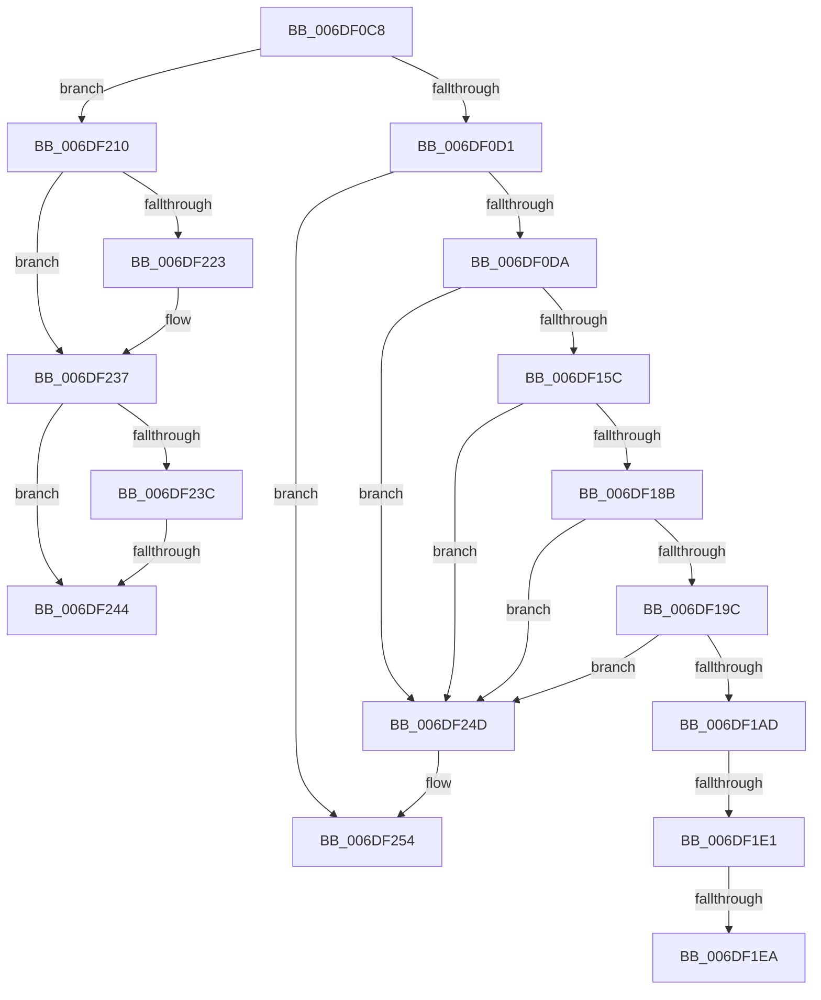

# sub_006DF0C8

- RVA: `0x006DF0C8`–`0x006DF25F` (길이 `407` bytes)
- VA: `0x00000001406DF0C8`
- 실행 섹션: `.text`
- PDB 이름 있음: `아니요`; PDB Function 태그: `아니요`
- unwind 정보 RVA: `0x00071F54`
- 디코드: `92`개 명령, `407/407` bytes 표시
- 미해석 바이트: `0` (있으면 어셈블리에 `.byte`로 보존)

> 이 문서는 커널 이미지의 기계어와 PDB 기호를 분석해 생성했습니다. 4번과 5번은 함수 원형과 자료형을 바이너리 사용 방식에서 추정한 C 해석이며 원본 소스 복구 결과는 아닙니다.

## 1. Dependencies

- 직접 호출 지점: **8**; 고유 호출 대상: **7**
- 직접 호출자로 확인된 함수: **0**
- RIP 상대 이미지 참조: **0**

### Outgoing calls
- `0x006DF0F7` → [RtlpCopyContext](../2F/RtlpCopyContext_function_002F1E00.md) (function, `0x002F1E00`)
- `0x006DF127` → [RtlVirtualUnwind](../47/RtlVirtualUnwind_function_0047D210.md) (function, `0x0047D210`)
- `0x006DF146` → [RtlLookupFunctionEntry](../2F/RtlLookupFunctionEntry_function_002F2F30.md) (function, `0x002F2F30`)
- `0x006DF17E` → [RtlLookupExceptionHandler](../5E/RtlLookupExceptionHandler_function_005E6A48.md) (function, `0x005E6A48`)
- `0x006DF1D1` → [RtlpIsFrameInBounds](../43/RtlpIsFrameInBounds_function_004349B0.md) (function, `0x004349B0`)
- `0x006DF202` → [RtlpGetStackLimitsEx](../45/RtlpGetStackLimitsEx_function_0045D2E0.md) (function, `0x0045D2E0`)
- `0x006DF22E` → [RtlpIsFrameInBounds](../43/RtlpIsFrameInBounds_function_004349B0.md) (function, `0x004349B0`)
- `0x006DF259` → [RtlRaiseStatus](../2F/RtlRaiseStatus_function_002F6A50.md) (function, `0x002F6A50`)

### Direct callers
- 이 함수 시작 RVA로 연결되는 직접 call은 확인되지 않았습니다. 간접 호출은 완전히 역산할 수 없습니다.

### Static image references
- 디코드된 RIP-relative 메모리 참조가 없습니다.

## 2. Other-region calls and transfers

- 다른 실행 섹션으로 향하는 call: **0**
- call이 아닌 외부 분기/꼬리 이동: **5**
  - `0x006DF1DB` → [RtlDispatchException + 0x3B6](../2F/RtlDispatchException_function_002F22A0.md) (`tail-transfer`)
  - `0x006DF1E4` → [RtlDispatchException + 0x3B6](../2F/RtlDispatchException_function_002F22A0.md) (`tail-transfer`)
  - `0x006DF20B` → [RtlDispatchException + 0x490](../2F/RtlDispatchException_function_002F22A0.md) (`tail-transfer`)
  - `0x006DF23E` → [RtlDispatchException + 0x3AF](../2F/RtlDispatchException_function_002F22A0.md) (`tail-transfer`)
  - `0x006DF248` → [RtlDispatchException + 0x3AF](../2F/RtlDispatchException_function_002F22A0.md) (`tail-transfer`)

## 3. Assembly (complete function range)

```asm
006DF0C8  83 EA 01                        sub edx, 1
006DF0CB  0F 84 3F 01 00 00               je 0x1406df210
006DF0D1  83 FA 01                        cmp edx, 1
006DF0D4  0F 85 7A 01 00 00               jne 0x1406df254
006DF0DA  4C 8B 55 78                     mov r10, qword ptr [rbp + 0x78]
006DF0DE  48 8B CE                        mov rcx, rsi
006DF0E1  48 8B 95 98 00 00 00            mov rdx, qword ptr [rbp + 0x98]
006DF0E8  4C 8B 7D 70                     mov r15, qword ptr [rbp + 0x70]
006DF0EC  4C 8B 8D 80 00 00 00            mov r9, qword ptr [rbp + 0x80]
006DF0F3  4C 89 55 28                     mov qword ptr [rbp + 0x28], r10
006DF0F7  E8 04 2D C1 FF                  call 0x1402f1e00
006DF0FC  48 C7 44 24 38 00 00 00 00      mov qword ptr [rsp + 0x38], 0
006DF105  48 8D 45 08                     lea rax, [rbp + 8]
006DF109  48 89 44 24 30                  mov qword ptr [rsp + 0x30], rax
006DF10E  4D 8B C7                        mov r8, r15
006DF111  48 8D 45 48                     lea rax, [rbp + 0x48]
006DF115  49 8B D2                        mov rdx, r10
006DF118  48 89 44 24 28                  mov qword ptr [rsp + 0x28], rax
006DF11D  B9 01 00 00 00                  mov ecx, 1
006DF122  48 89 74 24 20                  mov qword ptr [rsp + 0x20], rsi
006DF127  E8 E4 E0 D9 FF                  call 0x14047d210
006DF12C  4C 8B 45 20                     mov r8, qword ptr [rbp + 0x20]
006DF130  48 8D 55 28                     lea rdx, [rbp + 0x28]
006DF134  48 89 45 40                     mov qword ptr [rbp + 0x40], rax
006DF138  49 8B CF                        mov rcx, r15
006DF13B  48 8B 85 88 00 00 00            mov rax, qword ptr [rbp + 0x88]
006DF142  48 89 45 08                     mov qword ptr [rbp + 8], rax
006DF146  E8 E5 3D C1 FF                  call 0x1402f2f30
006DF14B  48 89 45 60                     mov qword ptr [rbp + 0x60], rax
006DF14F  48 3B 85 80 00 00 00            cmp rax, qword ptr [rbp + 0x80]
006DF156  0F 85 F1 00 00 00               jne 0x1406df24d
006DF15C  48 8B 7D 28                     mov rdi, qword ptr [rbp + 0x28]
006DF160  48 8D 4D 48                     lea rcx, [rbp + 0x48]
006DF164  48 89 4C 24 28                  mov qword ptr [rsp + 0x28], rcx
006DF169  41 B8 02 00 00 00               mov r8d, 2
006DF16F  48 8D 4D 40                     lea rcx, [rbp + 0x40]
006DF173  48 8B D7                        mov rdx, rdi
006DF176  48 89 4C 24 20                  mov qword ptr [rsp + 0x20], rcx
006DF17B  48 8B C8                        mov rcx, rax
006DF17E  E8 C5 78 F0 FF                  call 0x1405e6a48
006DF183  85 C0                           test eax, eax
006DF185  0F 88 C2 00 00 00               js 0x1406df24d
006DF18B  48 8B 85 A0 00 00 00            mov rax, qword ptr [rbp + 0xa0]
006DF192  48 39 45 40                     cmp qword ptr [rbp + 0x40], rax
006DF196  0F 85 B1 00 00 00               jne 0x1406df24d
006DF19C  48 8B 85 A8 00 00 00            mov rax, qword ptr [rbp + 0xa8]
006DF1A3  48 39 45 48                     cmp qword ptr [rbp + 0x48], rax
006DF1A7  0F 85 A0 00 00 00               jne 0x1406df24d
006DF1AD  48 8B 85 B0 00 00 00            mov rax, qword ptr [rbp + 0xb0]
006DF1B4  4C 8D 45 10                     lea r8, [rbp + 0x10]
006DF1B8  48 8B 5D 08                     mov rbx, qword ptr [rbp + 8]
006DF1BC  48 8D 4D 18                     lea rcx, [rbp + 0x18]
006DF1C0  44 8B A5 B8 00 00 00            mov r12d, dword ptr [rbp + 0xb8]
006DF1C7  48 8B D3                        mov rdx, rbx
006DF1CA  48 89 45 20                     mov qword ptr [rbp + 0x20], rax
006DF1CE  41 B5 01                        mov r13b, 1
006DF1D1  E8 DA 57 D5 FF                  call 0x1404349b0
006DF1D6  84 C0                           test al, al
006DF1D8  8B 45 00                        mov eax, dword ptr [rbp]
006DF1DB  0F 85 75 34 C1 FF               jne 0x1402f2656
006DF1E1  41 3A C5                        cmp al, r13b
006DF1E4  0F 85 6C 34 C1 FF               jne 0x1402f2656
006DF1EA  48 8B 45 50                     mov rax, qword ptr [rbp + 0x50]
006DF1EE  4C 8D 45 10                     lea r8, [rbp + 0x10]
006DF1F2  4C 8B 4D 58                     mov r9, qword ptr [rbp + 0x58]
006DF1F6  48 8D 55 18                     lea rdx, [rbp + 0x18]
006DF1FA  48 8B CB                        mov rcx, rbx
006DF1FD  48 89 44 24 20                  mov qword ptr [rsp + 0x20], rax
006DF202  E8 D9 E0 D7 FF                  call 0x14045d2e0
006DF207  48 8B 5D 08                     mov rbx, qword ptr [rbp + 8]
006DF20B  E9 20 35 C1 FF                  jmp 0x1402f2730
006DF210  48 8B BD 88 00 00 00            mov rdi, qword ptr [rbp + 0x88]
006DF217  41 83 CE 10                     or r14d, 0x10
006DF21B  B0 01                           mov al, 1
006DF21D  44 38 6D 00                     cmp byte ptr [rbp], r13b
006DF221  74 14                           je 0x1406df237
006DF223  4C 8D 45 10                     lea r8, [rbp + 0x10]
006DF227  48 8B D7                        mov rdx, rdi
006DF22A  48 8D 4D 18                     lea rcx, [rbp + 0x18]
006DF22E  E8 7D 57 D5 FF                  call 0x1404349b0
006DF233  48 8B 4D 38                     mov rcx, qword ptr [rbp + 0x38]
006DF237  48 3B F9                        cmp rdi, rcx
006DF23A  77 08                           ja 0x1406df244
006DF23C  84 C0                           test al, al
006DF23E  0F 85 0B 34 C1 FF               jne 0x1402f264f
006DF244  48 89 7D 38                     mov qword ptr [rbp + 0x38], rdi
006DF248  E9 02 34 C1 FF                  jmp 0x1402f264f
006DF24D  B9 27 00 00 00                  mov ecx, 0x27
006DF252  CD 29                           int 0x29
006DF254  B9 26 00 00 C0                  mov ecx, 0xc0000026
006DF259  E8 F2 77 C1 FF                  call 0x1402f6a50
006DF25E  CC                              int3
```

## 4. C-style interpretation (structured pseudocode)

```c
__int64 __fastcall sub_006DF0C8(__int64 a1, int a2)
{
    __int64 result;
    __int64 v_r14;
    unsigned __int64 v_stack_p20;
    unsigned __int64 v_stack_p28;
    unsigned __int64 v_stack_p30;
    unsigned __int64 v_stack_p38;

    a2 = (unsigned int)((a2) - (1));
    if (condition_is_equal) goto loc_006DF210;
    if (a2 != 1) goto loc_006DF254;
    *(unsigned __int64 *)(v_rbp + 40) = *(unsigned __int64 *)(v_rbp + 120);
    result = RtlpCopyContext(v_rsi, *(unsigned __int64 *)(v_rbp + 152), a3, *(unsigned __int64 *)(v_rbp + 128));
    v_stack_p38 = 0;
    v_stack_p30 = v_rbp + 8;
    v_stack_p28 = v_rbp + 72;
    v_stack_p20 = v_rsi;
    result = RtlVirtualUnwind(1, *(unsigned __int64 *)(v_rbp + 120), *(unsigned __int64 *)(v_rbp + 112), *(unsigned __int64 *)(v_rbp + 128));
    *(unsigned __int64 *)(v_rbp + 64) = result;
    *(unsigned __int64 *)(v_rbp + 8) = *(unsigned __int64 *)(v_rbp + 136);
    result = RtlLookupFunctionEntry(*(unsigned __int64 *)(v_rbp + 112), v_rbp + 40, *(unsigned __int64 *)(v_rbp + 32), *(unsigned __int64 *)(v_rbp + 128));
    *(unsigned __int64 *)(v_rbp + 96) = result;
    if (result != (*(unsigned __int64 *)(v_rbp + 128))) goto loc_006DF24D;
    v_stack_p28 = v_rbp + 72;
    v_stack_p20 = v_rbp + 64;
    result = RtlLookupExceptionHandler(result, *(unsigned __int64 *)(v_rbp + 40), 2, *(unsigned __int64 *)(v_rbp + 128));
    if (sign_flag) goto loc_006DF24D;
    if ((*(unsigned __int64 *)(v_rbp + 64)) != (*(unsigned __int64 *)(v_rbp + 160))) goto loc_006DF24D;
    if ((*(unsigned __int64 *)(v_rbp + 72)) != (*(unsigned __int64 *)(v_rbp + 168))) goto loc_006DF24D;
    *(unsigned __int64 *)(v_rbp + 32) = *(unsigned __int64 *)(v_rbp + 176);
    result = RtlpIsFrameInBounds(v_rbp + 24, *(unsigned __int64 *)(v_rbp + 8), v_rbp + 16, *(unsigned __int64 *)(v_rbp + 128));
    v_stack_p20 = *(unsigned __int64 *)(v_rbp + 80);
    result = RtlpGetStackLimitsEx(*(unsigned __int64 *)(v_rbp + 8), v_rbp + 24, v_rbp + 16, *(unsigned __int64 *)(v_rbp + 88));
loc_006DF210:
    v_r14 = (unsigned int)((v_r14) | (16));
    result = 1;
    if ((*(unsigned __int8 *)(v_rbp)) != 1) {
        a3 = v_rbp + 16;
        a2 = *(unsigned __int64 *)(v_rbp + 136);
        a1 = v_rbp + 24;
        result = RtlpIsFrameInBounds(a1, a2, a3, *(unsigned __int64 *)(v_rbp + 88));
        a1 = *(unsigned __int64 *)(v_rbp + 56);
    }
    if ((*(unsigned __int64 *)(v_rbp + 136)) > a1) goto loc_006DF244;
loc_006DF244:
    *(unsigned __int64 *)(v_rbp + 56) = *(unsigned __int64 *)(v_rbp + 136);
loc_006DF24D:
loc_006DF254:
    result = RtlRaiseStatus((unsigned int)(0xC0000026ULL), a2, a3, *(unsigned __int64 *)(v_rbp + 88));
    return result;
}
```

## 5. (Beta) C Style

```c
int64_t sub_006DF0C8(int64_t Arg1, int32_t Arg2)
{
    int64_t result;
    int64_t local_r14;
    uint64_t v_stack_p20;
    uint64_t v_stack_p28;
    uint64_t v_stack_p30;
    uint64_t v_stack_p38;

    Arg2 = (uint32_t)((Arg2) - (1));
    if (condition_is_equal) goto loc_006DF210;
    if (Arg2 != 1) goto loc_006DF254;
    *(uint64_t *)(local_rbp + 0x28) = *(uint64_t *)(local_rbp + 0x78);
    result = RtlpCopyContext(local_rsi, *(uint64_t *)(local_rbp + 0x98), a3, *(uint64_t *)(local_rbp + 0x80));
    v_stack_p38 = 0;
    v_stack_p30 = local_rbp + 8;
    v_stack_p28 = local_rbp + 72;
    v_stack_p20 = local_rsi;
    result = RtlVirtualUnwind(1, *(uint64_t *)(local_rbp + 0x78), *(uint64_t *)(local_rbp + 0x70), *(uint64_t *)(local_rbp + 0x80));
    *(uint64_t *)(local_rbp + 0x40) = result;
    *(uint64_t *)(local_rbp + 0x8) = *(uint64_t *)(local_rbp + 0x88);
    result = RtlLookupFunctionEntry(*(uint64_t *)(local_rbp + 0x70), local_rbp + 40, *(uint64_t *)(local_rbp + 0x20), *(uint64_t *)(local_rbp + 0x80));
    *(uint64_t *)(local_rbp + 0x60) = result;
    if (result != (*(uint64_t *)(local_rbp + 0x80))) goto loc_006DF24D;
    v_stack_p28 = local_rbp + 72;
    v_stack_p20 = local_rbp + 64;
    result = RtlLookupExceptionHandler(result, *(uint64_t *)(local_rbp + 0x28), 2, *(uint64_t *)(local_rbp + 0x80));
    if (sign_flag) goto loc_006DF24D;
    if ((*(uint64_t *)(local_rbp + 0x40)) != (*(uint64_t *)(local_rbp + 0xA0))) goto loc_006DF24D;
    if ((*(uint64_t *)(local_rbp + 0x48)) != (*(uint64_t *)(local_rbp + 0xA8))) goto loc_006DF24D;
    *(uint64_t *)(local_rbp + 0x20) = *(uint64_t *)(local_rbp + 0xB0);
    result = RtlpIsFrameInBounds(local_rbp + 24, *(uint64_t *)(local_rbp + 0x8), local_rbp + 16, *(uint64_t *)(local_rbp + 0x80));
    v_stack_p20 = *(uint64_t *)(local_rbp + 0x50);
    result = RtlpGetStackLimitsEx(*(uint64_t *)(local_rbp + 0x8), local_rbp + 24, local_rbp + 16, *(uint64_t *)(local_rbp + 0x58));
loc_006DF210:
    local_r14 = (uint32_t)((local_r14) | (16));
    result = 1;
    if ((*(uint8_t *)(local_rbp)) != 1) {
        a3 = local_rbp + 16;
        Arg2 = *(uint64_t *)(local_rbp + 0x88);
        Arg1 = local_rbp + 24;
        result = RtlpIsFrameInBounds(Arg1, Arg2, a3, *(uint64_t *)(local_rbp + 0x58));
        Arg1 = *(uint64_t *)(local_rbp + 0x38);
    }
    if ((*(uint64_t *)(local_rbp + 0x88)) > Arg1) goto loc_006DF244;
loc_006DF244:
    *(uint64_t *)(local_rbp + 0x38) = *(uint64_t *)(local_rbp + 0x88);
loc_006DF24D:
loc_006DF254:
    result = RtlRaiseStatus((uint32_t)(0xC0000026ULL), Arg2, a3, *(uint64_t *)(local_rbp + 0x58));
    return result;
}
```

## 6. Execution-region graph

[열기: 2D/3D 그래프와 함수 탐색 컨트롤 패널](../../../control-panel.html?section=text&rva=0x006DF0C8&view=graph)

- 2D 그래프는 위에서 아래로 흐르고, 3D 그래프는 빈 공간을 드래그해 회전합니다. Shift+드래그는 이동, 휠은 확대·축소, 함수 노드 선택은 대상 보고서 이동입니다.

### Static fallback


