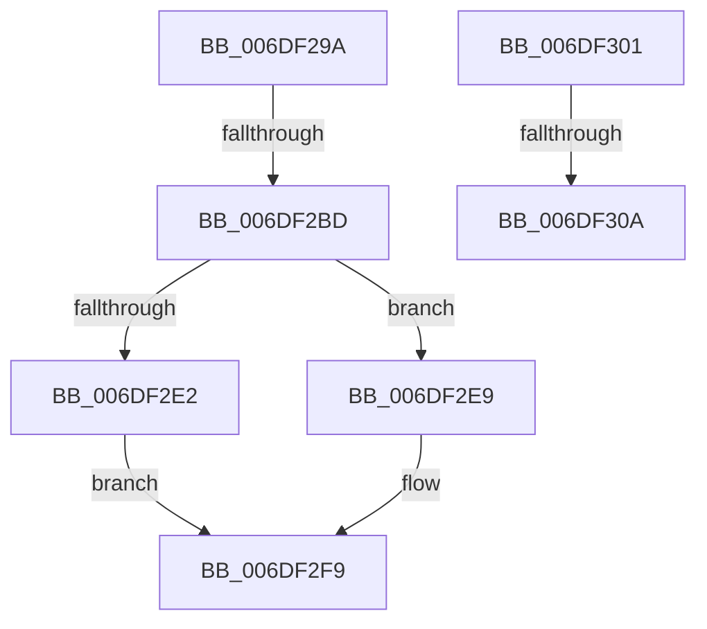

# sub_006DF29A

- RVA: `0x006DF29A`–`0x006DF313` (길이 `121` bytes)
- VA: `0x00000001406DF29A`
- 실행 섹션: `.text`
- PDB 이름 있음: `아니요`; PDB Function 태그: `아니요`
- unwind 정보 RVA: `0x000723C4`
- 디코드: `30`개 명령, `121/121` bytes 표시
- 미해석 바이트: `0` (있으면 어셈블리에 `.byte`로 보존)

> 이 문서는 커널 이미지의 기계어와 PDB 기호를 분석해 생성했습니다. 4번과 5번은 함수 원형과 자료형을 바이너리 사용 방식에서 추정한 C 해석이며 원본 소스 복구 결과는 아닙니다.

## 1. Dependencies

- 직접 호출 지점: **5**; 고유 호출 대상: **5**
- 직접 호출자로 확인된 함수: **0**
- RIP 상대 이미지 참조: **0**

### Outgoing calls
- `0x006DF2AC` → [MiMakeTransitionHeatBatch](../40/MiMakeTransitionHeatBatch_function_00409A94.md) (function, `0x00409A94`)
- `0x006DF2D4` → [MiUnlockProtoPoolPage](../24/MiUnlockProtoPoolPage_function_00246090.md) (function, `0x00246090`)
- `0x006DF2E2` → [MiReplenishTransitionPageHeatList](../4E/MiReplenishTransitionPageHeatList_function_004E131C.md) (function, `0x004E131C`)
- `0x006DF2EC` → [MiIssuePageHeatList](../44/MiIssuePageHeatList_function_0044615C.md) (function, `0x0044615C`)
- `0x006DF2F4` → [MiFreeTransitionPageHeatList](../4E/MiFreeTransitionPageHeatList_function_004E2B08.md) (function, `0x004E2B08`)

### Direct callers
- 이 함수 시작 RVA로 연결되는 직접 call은 확인되지 않았습니다. 간접 호출은 완전히 역산할 수 없습니다.

### Static image references
- 디코드된 RIP-relative 메모리 참조가 없습니다.

## 2. Other-region calls and transfers

- 다른 실행 섹션으로 향하는 call: **0**
- call이 아닌 외부 분기/꼬리 이동: **4**
  - `0x006DF2B7` → [sub_002F6E32 + 0x249](../2F/Unknown_function_002F6E32.md) (`tail-transfer`)
  - `0x006DF2FC` → [sub_002F6D91 + 0x2E](../2F/Unknown_function_002F6D91.md) (`tail-transfer`)
  - `0x006DF304` → [sub_002F6E32 + 0x2C1](../2F/Unknown_function_002F6E32.md) (`tail-transfer`)
  - `0x006DF30E` → [sub_002F6E32 + 0x2C1](../2F/Unknown_function_002F6E32.md) (`tail-transfer`)

## 3. Assembly (complete function range)

```asm
006DF29A  4D 8B C6                        mov r8, r14
006DF29D  33 D2                           xor edx, edx
006DF29F  4C 2B C7                        sub r8, rdi
006DF2A2  48 8B CE                        mov rcx, rsi
006DF2A5  49 C1 F8 03                     sar r8, 3
006DF2A9  49 FF C0                        inc r8
006DF2AC  E8 E3 A7 D2 FF                  call 0x140409a94
006DF2B1  48 8B D8                        mov rbx, rax
006DF2B4  48 85 C0                        test rax, rax
006DF2B7  0F 84 BE 7D C1 FF               je 0x1402f707b
006DF2BD  48 B8 FF FF FF FF FF FF FF 7F   movabs rax, 0x7fffffffffffffff
006DF2C7  F0 48 21 46 18                  lock and qword ptr [rsi + 0x18], rax
006DF2CC  0F B6 54 24 20                  movzx edx, byte ptr [rsp + 0x20]
006DF2D1  49 8B CD                        mov rcx, r13
006DF2D4  E8 B7 6D B6 FF                  call 0x140246090
006DF2D9  45 33 ED                        xor r13d, r13d
006DF2DC  48 83 FB FF                     cmp rbx, -1
006DF2E0  75 07                           jne 0x1406df2e9
006DF2E2  E8 35 20 E0 FF                  call 0x1404e131c
006DF2E7  EB 10                           jmp 0x1406df2f9
006DF2E9  48 8B CB                        mov rcx, rbx
006DF2EC  E8 6B 6E D6 FF                  call 0x14044615c
006DF2F1  48 8B CB                        mov rcx, rbx
006DF2F4  E8 0F 38 E0 FF                  call 0x1404e2b08
006DF2F9  45 33 FF                        xor r15d, r15d
006DF2FC  E9 BE 7A C1 FF                  jmp 0x1402f6dbf
006DF301  83 F9 02                        cmp ecx, 2
006DF304  0F 85 E9 7D C1 FF               jne 0x1402f70f3
006DF30A  41 83 C8 18                     or r8d, 0x18
006DF30E  E9 E0 7D C1 FF                  jmp 0x1402f70f3
```

## 4. C-style interpretation (structured pseudocode)

```c
__int64 __fastcall sub_006DF29A(__int64 a1, int a2)
{
    __int64 result;
    __int64 v_r13;
    __int64 v_r15;
    unsigned __int8 v_stack_p20;

    a2 = 0;
    a3 = (v_r14) - (v_rdi);
    a3 = (a3) >> (3);
    a3 = (a3) + 1;
    result = MiMakeTransitionHeatBatch(v_rsi, a2, a3, a4);
    result = MiUnlockProtoPoolPage(v_r13, v_stack_p20, a3, a4);
    v_r13 = 0;
    if (result != -1) goto loc_006DF2E9;
    result = MiReplenishTransitionPageHeatList(v_r13, v_stack_p20, a3, a4);
    goto loc_006DF2F9;
loc_006DF2E9:
    result = MiIssuePageHeatList(result, v_stack_p20, a3, a4);
    result = MiFreeTransitionPageHeatList(result, v_stack_p20, a3, a4);
loc_006DF2F9:
    v_r15 = 0;
}
```

## 5. (Beta) C Style

```c
int64_t sub_006DF29A(int64_t Arg1, int32_t Arg2)
{
    int64_t result;
    int64_t local_r13;
    int64_t local_r15;
    uint8_t v_stack_p20;

    Arg2 = 0;
    a3 = (local_r14) - (local_rdi);
    a3 = (a3) >> (3);
    a3 = (a3) + 1;
    result = MiMakeTransitionHeatBatch(local_rsi, Arg2, a3, a4);
    result = MiUnlockProtoPoolPage(local_r13, v_stack_p20, a3, a4);
    local_r13 = 0;
    if (result != -1) goto loc_006DF2E9;
    result = MiReplenishTransitionPageHeatList(local_r13, v_stack_p20, a3, a4);
    goto loc_006DF2F9;
loc_006DF2E9:
    result = MiIssuePageHeatList(result, v_stack_p20, a3, a4);
    result = MiFreeTransitionPageHeatList(result, v_stack_p20, a3, a4);
loc_006DF2F9:
    local_r15 = 0;
}
```

## 6. Execution-region graph

[열기: 2D/3D 그래프와 함수 탐색 컨트롤 패널](../../../control-panel.html?section=text&rva=0x006DF29A&view=graph)

- 2D 그래프는 위에서 아래로 흐르고, 3D 그래프는 빈 공간을 드래그해 회전합니다. Shift+드래그는 이동, 휠은 확대·축소, 함수 노드 선택은 대상 보고서 이동입니다.

### Static fallback


