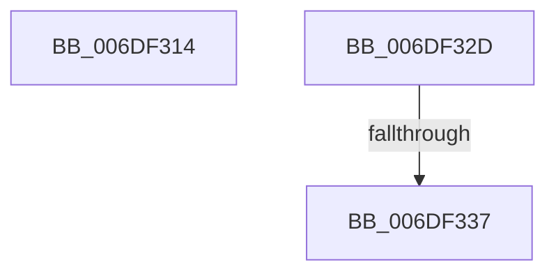

# sub_006DF314

- RVA: `0x006DF314`–`0x006DF3B5` (길이 `161` bytes)
- VA: `0x00000001406DF314`
- 실행 섹션: `.text`
- PDB 이름 있음: `아니요`; PDB Function 태그: `아니요`
- unwind 정보 RVA: `0x0007242C`
- 디코드: `35`개 명령, `161/161` bytes 표시
- 미해석 바이트: `0` (있으면 어셈블리에 `.byte`로 보존)

> 이 문서는 커널 이미지의 기계어와 PDB 기호를 분석해 생성했습니다. 4번과 5번은 함수 원형과 자료형을 바이너리 사용 방식에서 추정한 C 해석이며 원본 소스 복구 결과는 아닙니다.

## 1. Dependencies

- 직접 호출 지점: **2**; 고유 호출 대상: **2**
- 직접 호출자로 확인된 함수: **0**
- RIP 상대 이미지 참조: **0**

### Outgoing calls
- `0x006DF318` → [_chkstk](../6B/_chkstk_function_006BA960.md) (function, `0x006BA960`)
- `0x006DF3AA` → [EtwpLogKernelEvent](../25/EtwpLogKernelEvent_function_0025CC00.md) (function, `0x0025CC00`)

### Direct callers
- 이 함수 시작 RVA로 연결되는 직접 call은 확인되지 않았습니다. 간접 호출은 완전히 역산할 수 없습니다.

### Static image references
- 디코드된 RIP-relative 메모리 참조가 없습니다.

## 2. Other-region calls and transfers

- 다른 실행 섹션으로 향하는 call: **0**
- call이 아닌 외부 분기/꼬리 이동: **3**
  - `0x006DF328` → [EtwpTraceLastBranchRecord + 0xE0](../2F/EtwpTraceLastBranchRecord_function_002F7B00.md) (`tail-transfer`)
  - `0x006DF331` → [EtwpTraceLastBranchRecord + 0xFD](../2F/EtwpTraceLastBranchRecord_function_002F7B00.md) (`tail-transfer`)
  - `0x006DF3B0` → [EtwpTraceLastBranchRecord + 0xFD](../2F/EtwpTraceLastBranchRecord_function_002F7B00.md) (`tail-transfer`)

## 3. Assembly (complete function range)

```asm
006DF314  48 83 E0 F0                     and rax, 0xfffffffffffffff0
006DF318  E8 43 B6 FD FF                  call 0x1406ba960
006DF31D  48 2B E0                        sub rsp, rax
006DF320  41 B6 01                        mov r14b, 1
006DF323  4C 8D 7C 24 30                  lea r15, [rsp + 0x30]
006DF328  E9 B3 88 C1 FF                  jmp 0x1402f7be0
006DF32D  83 7D 00 00                     cmp dword ptr [rbp], 0
006DF331  0F 84 C6 88 C1 FF               je 0x1402f7bfd
006DF337  8B 87 08 05 00 00               mov eax, dword ptr [rdi + 0x508]
006DF33D  81 E6 02 E6 FF FF               and esi, 0xffffe602
006DF343  89 45 20                        mov dword ptr [rbp + 0x20], eax
006DF346  83 CE 02                        or esi, 2
006DF349  8B 87 10 05 00 00               mov eax, dword ptr [rdi + 0x510]
006DF34F  41 B9 02 00 00 00               mov r9d, 2
006DF355  89 45 24                        mov dword ptr [rbp + 0x24], eax
006DF358  49 8B 45 00                     mov rax, qword ptr [r13]
006DF35C  48 89 45 18                     mov qword ptr [rbp + 0x18], rax
006DF360  49 8B 84 24 30 04 00 00         mov rax, qword ptr [r12 + 0x430]
006DF368  89 74 24 28                     mov dword ptr [rsp + 0x28], esi
006DF36C  66 C7 44 24 20 20 0C            mov word ptr [rsp + 0x20], 0xc20
006DF373  8B 48 04                        mov ecx, dword ptr [rax + 4]
006DF376  48 8D 45 18                     lea rax, [rbp + 0x18]
006DF37A  45 8B 04 24                     mov r8d, dword ptr [r12]
006DF37E  49 8B 94 24 50 05 00 00         mov rdx, qword ptr [r12 + 0x550]
006DF386  48 89 45 48                     mov qword ptr [rbp + 0x48], rax
006DF38A  8B 45 00                        mov eax, dword ptr [rbp]
006DF38D  89 4D 28                        mov dword ptr [rbp + 0x28], ecx
006DF390  48 8D 4D 48                     lea rcx, [rbp + 0x48]
006DF394  89 45 60                        mov dword ptr [rbp + 0x60], eax
006DF397  48 C7 45 50 18 00 00 00         mov qword ptr [rbp + 0x50], 0x18
006DF39F  4C 89 7D 58                     mov qword ptr [rbp + 0x58], r15
006DF3A3  C7 45 64 00 00 00 00            mov dword ptr [rbp + 0x64], 0
006DF3AA  E8 51 D8 B7 FF                  call 0x14025cc00
006DF3AF  90                              nop
006DF3B0  E9 48 88 C1 FF                  jmp 0x1402f7bfd
```

## 4. C-style interpretation (structured pseudocode)

```c
__int64 __fastcall sub_006DF314(__int64 a1, __int64 a2, __int64 a3, __int64 a4, __int64 a5, __int64 a6)
{
    __int64 result;
    __int64 v_rsp;
    unsigned __int16 v_stack_p20;
    unsigned int v_stack_p28;

    result = (result) & (-16);
    result = _chkstk(a1, a2, a3, a4);
    v_rsp = (v_rsp) - (result);
}
```

## 5. (Beta) C Style

```c
int64_t sub_006DF314(int64_t Arg1, int64_t Arg2, int64_t Arg3, int64_t Arg4, uint64_t Arg5, int64_t Arg6)
{
    int64_t result;
    int64_t local_rsp;
    uint16_t v_stack_p20;
    uint32_t v_stack_p28;

    result = (result) & (-16);
    result = _chkstk(Arg1, Arg2, Arg3, Arg4);
    local_rsp = (local_rsp) - (result);
}
```

## 6. Execution-region graph

[열기: 2D/3D 그래프와 함수 탐색 컨트롤 패널](../../../control-panel.html?section=text&rva=0x006DF314&view=graph)

- 2D 그래프는 위에서 아래로 흐르고, 3D 그래프는 빈 공간을 드래그해 회전합니다. Shift+드래그는 이동, 휠은 확대·축소, 함수 노드 선택은 대상 보고서 이동입니다.

### Static fallback


