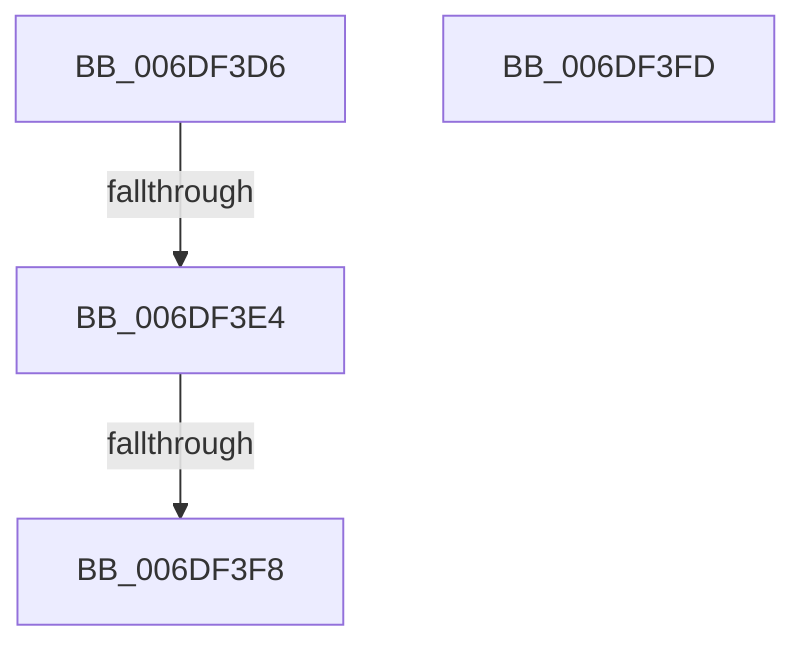

# sub_006DF3D6

- RVA: `0x006DF3D6`–`0x006DF40D` (길이 `55` bytes)
- VA: `0x00000001406DF3D6`
- 실행 섹션: `.text`
- PDB 이름 있음: `아니요`; PDB Function 태그: `아니요`
- unwind 정보 RVA: `0x00072908`
- 디코드: `13`개 명령, `55/55` bytes 표시
- 미해석 바이트: `0` (있으면 어셈블리에 `.byte`로 보존)

> 이 문서는 커널 이미지의 기계어와 PDB 기호를 분석해 생성했습니다. 4번과 5번은 함수 원형과 자료형을 바이너리 사용 방식에서 추정한 C 해석이며 원본 소스 복구 결과는 아닙니다.

## 1. Dependencies

- 직접 호출 지점: **2**; 고유 호출 대상: **2**
- 직접 호출자로 확인된 함수: **0**
- RIP 상대 이미지 참조: **0**

### Outgoing calls
- `0x006DF3EB` → [RtlGuardIsValidWow64StackPointer](../../page/A5/RtlGuardIsValidWow64StackPointer_function_00A57124.md) (function, `0x00A57124`)
- `0x006DF402` → [KiLogUserCetSetContextIpValidationFailure](../5C/KiLogUserCetSetContextIpValidationFailure_function_005C830C.md) (function, `0x005C830C`)

### Direct callers
- 이 함수 시작 RVA로 연결되는 직접 call은 확인되지 않았습니다. 간접 호출은 완전히 역산할 수 없습니다.

### Static image references
- 디코드된 RIP-relative 메모리 참조가 없습니다.

## 2. Other-region calls and transfers

- 다른 실행 섹션으로 향하는 call: **1**
  - `0x006DF3EB` → [RtlGuardIsValidWow64StackPointer](../../page/A5/RtlGuardIsValidWow64StackPointer_function_00A57124.md) (`.text` → `PAGE`)
- call이 아닌 외부 분기/꼬리 이동: **4**
  - `0x006DF3DE` → [KiContinuePreviousModeUser + 0x2BB](../2F/KiContinuePreviousModeUser_function_002F9B10.md) (`tail-transfer`)
  - `0x006DF3F2` → [KiContinuePreviousModeUser + 0x25D](../2F/KiContinuePreviousModeUser_function_002F9B10.md) (`tail-transfer`)
  - `0x006DF3F8` → [KiContinuePreviousModeUser + 0x2BB](../2F/KiContinuePreviousModeUser_function_002F9B10.md) (`tail-transfer`)
  - `0x006DF408` → [KiContinuePreviousModeUser + 0x2B0](../2F/KiContinuePreviousModeUser_function_002F9B10.md) (`tail-transfer`)

## 3. Assembly (complete function range)

```asm
006DF3D6  B8 FF FF FF FF                  mov eax, 0xffffffff
006DF3DB  4C 3B E8                        cmp r13, rax
006DF3DE  0F 83 E7 A9 C1 FF               jae 0x1402f9dcb
006DF3E4  48 8B 55 10                     mov rdx, qword ptr [rbp + 0x10]
006DF3E8  41 8B CD                        mov ecx, r13d
006DF3EB  E8 34 7D 37 00                  call 0x140a57124
006DF3F0  85 C0                           test eax, eax
006DF3F2  0F 85 75 A9 C1 FF               jne 0x1402f9d6d
006DF3F8  E9 CE A9 C1 FF                  jmp 0x1402f9dcb
006DF3FD  B9 02 00 00 00                  mov ecx, 2
006DF402  E8 05 8F EE FF                  call 0x1405c830c
006DF407  90                              nop
006DF408  E9 B3 A9 C1 FF                  jmp 0x1402f9dc0
```

## 4. C-style interpretation (structured pseudocode)

```c
__int64 __fastcall sub_006DF3D6(void)
{
    __int64 result;

    result = RtlGuardIsValidWow64StackPointer((unsigned int)((unsigned int)(v_r13)), *(unsigned __int64 *)(v_rbp + 16), a3, a4);
}
```

## 5. (Beta) C Style

```c
void sub_006DF3D6(void)
{
    int64_t result;

    result = RtlGuardIsValidWow64StackPointer((uint32_t)((uint32_t)(local_r13)), *(uint64_t *)(local_rbp + 0x10), a3, a4);
}
```

## 6. Execution-region graph

[열기: 2D/3D 그래프와 함수 탐색 컨트롤 패널](../../../control-panel.html?section=text&rva=0x006DF3D6&view=graph)

- 2D 그래프는 위에서 아래로 흐르고, 3D 그래프는 빈 공간을 드래그해 회전합니다. Shift+드래그는 이동, 휠은 확대·축소, 함수 노드 선택은 대상 보고서 이동입니다.

### Static fallback


