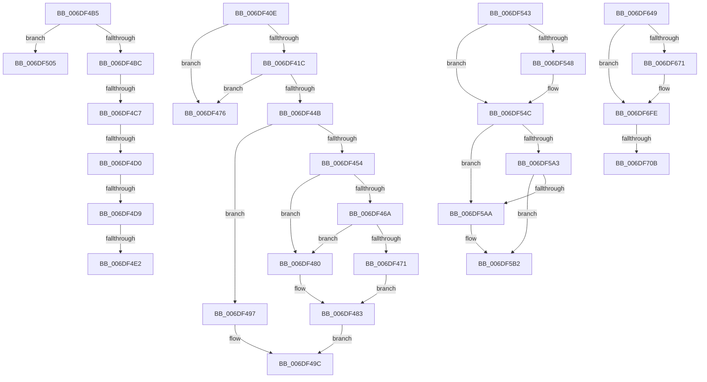

# sub_006DF40E

- RVA: `0x006DF40E`–`0x006DF7AC` (길이 `926` bytes)
- VA: `0x00000001406DF40E`
- 실행 섹션: `.text`
- PDB 이름 있음: `아니요`; PDB Function 태그: `아니요`
- unwind 정보 RVA: `0x00072A98`
- 디코드: `187`개 명령, `926/926` bytes 표시
- 미해석 바이트: `0` (있으면 어셈블리에 `.byte`로 보존)

> 이 문서는 커널 이미지의 기계어와 PDB 기호를 분석해 생성했습니다. 4번과 5번은 함수 원형과 자료형을 바이너리 사용 방식에서 추정한 C 해석이며 원본 소스 복구 결과는 아닙니다.

## 1. Dependencies

- 직접 호출 지점: **12**; 고유 호출 대상: **10**
- 직접 호출자로 확인된 함수: **0**
- RIP 상대 이미지 참조: **0**

### Outgoing calls
- `0x006DF43E` → [EtwpOpenLogger](../2F/EtwpOpenLogger_function_002F77F0.md) (function, `0x002F77F0`)
- `0x006DF48E` → [EtwpSetMark](../../page/7B/EtwpSetMark_function_007B878C.md) (function, `0x007B878C`)
- `0x006DF4AA` → [EtwpCloseLogger](../41/EtwpCloseLogger_function_00418060.md) (function, `0x00418060`)
- `0x006DF4F9` → [EtwTraceRaw](../65/EtwTraceRaw_function_006516CC.md) (function, `0x006516CC`)
- `0x006DF537` → [EtwTraceEvent](../2F/EtwTraceEvent_function_002FD290.md) (function, `0x002FD290`)
- `0x006DF579` → [EtwpUpdateEnableMask](../../page/8C/EtwpUpdateEnableMask_function_008C0948.md) (function, `0x008C0948`)
- `0x006DF5AD` → [ExfReleasePushLock](../26/ExfReleasePushLock_function_002638D0.md) (function, `0x002638D0`)
- `0x006DF5B5` → [KeAbPostRelease](../2E/KeAbPostRelease_function_002E1600.md) (function, `0x002E1600`)
- `0x006DF5C3` → [KeLeaveCriticalRegionThread](../25/KeLeaveCriticalRegionThread_function_0025EFF0.md) (function, `0x0025EFF0`)
- `0x006DF63D` → [EtwpWriteUserEvent](../../page/AF/EtwpWriteUserEvent_function_00AF2FEC.md) (function, `0x00AF2FEC`)
- `0x006DF6F2` → [EtwpWriteUserEvent](../../page/AF/EtwpWriteUserEvent_function_00AF2FEC.md) (function, `0x00AF2FEC`)
- `0x006DF79B` → [EtwpWriteUserEvent](../../page/AF/EtwpWriteUserEvent_function_00AF2FEC.md) (function, `0x00AF2FEC`)

### Direct callers
- 이 함수 시작 RVA로 연결되는 직접 call은 확인되지 않았습니다. 간접 호출은 완전히 역산할 수 없습니다.

### Static image references
- 디코드된 RIP-relative 메모리 참조가 없습니다.

## 2. Other-region calls and transfers

- 다른 실행 섹션으로 향하는 call: **5**
  - `0x006DF48E` → [EtwpSetMark](../../page/7B/EtwpSetMark_function_007B878C.md) (`.text` → `PAGE`)
  - `0x006DF579` → [EtwpUpdateEnableMask](../../page/8C/EtwpUpdateEnableMask_function_008C0948.md) (`.text` → `PAGE`)
  - `0x006DF63D` → [EtwpWriteUserEvent](../../page/AF/EtwpWriteUserEvent_function_00AF2FEC.md) (`.text` → `PAGE`)
  - `0x006DF6F2` → [EtwpWriteUserEvent](../../page/AF/EtwpWriteUserEvent_function_00AF2FEC.md) (`.text` → `PAGE`)
  - `0x006DF79B` → [EtwpWriteUserEvent](../../page/AF/EtwpWriteUserEvent_function_00AF2FEC.md) (`.text` → `PAGE`)
- call이 아닌 외부 분기/꼬리 이동: **11**
  - `0x006DF47B` → [NtTraceEvent + 0x346](../2F/NtTraceEvent_function_002FA6C0.md) (`tail-transfer`)
  - `0x006DF4B0` → [NtTraceEvent + 0x346](../2F/NtTraceEvent_function_002FA6C0.md) (`tail-transfer`)
  - `0x006DF4C1` → [NtTraceEvent + 0xB91](../2F/NtTraceEvent_function_002FA6C0.md) (`tail-transfer`)
  - `0x006DF4CA` → [NtTraceEvent + 0x687](../2F/NtTraceEvent_function_002FA6C0.md) (`tail-transfer`)
  - `0x006DF4D3` → [NtTraceEvent + 0x687](../2F/NtTraceEvent_function_002FA6C0.md) (`tail-transfer`)
  - `0x006DF4DC` → [NtTraceEvent + 0x687](../2F/NtTraceEvent_function_002FA6C0.md) (`tail-transfer`)
  - `0x006DF500` → [NtTraceEvent + 0x346](../2F/NtTraceEvent_function_002FA6C0.md) (`tail-transfer`)
  - `0x006DF53E` → [NtTraceEvent + 0x346](../2F/NtTraceEvent_function_002FA6C0.md) (`tail-transfer`)
  - `0x006DF644` → [NtTraceEvent + 0xAAF](../2F/NtTraceEvent_function_002FA6C0.md) (`tail-transfer`)
  - `0x006DF705` → [NtTraceEvent + 0x306](../2F/NtTraceEvent_function_002FA6C0.md) (`tail-transfer`)
  - `0x006DF7A7` → [NtTraceEvent + 0x306](../2F/NtTraceEvent_function_002FA6C0.md) (`tail-transfer`)

## 3. Assembly (complete function range)

```asm
006DF40E  41 0F B6 BE 98 11 00 00         movzx edi, byte ptr [r14 + 0x1198]
006DF416  41 3B 7E 10                     cmp edi, dword ptr [r14 + 0x10]
006DF41A  73 5A                           jae 0x1406df476
006DF41C  65 48 8B 04 25 88 01 00 00      mov rax, qword ptr gs:[0x188]
006DF425  44 0F B6 B8 32 02 00 00         movzx r15d, byte ptr [rax + 0x232]
006DF42D  4C 8D 8C 24 81 00 00 00         lea r9, [rsp + 0x81]
006DF435  45 0F B6 C7                     movzx r8d, r15b
006DF439  49 8B D6                        mov rdx, r14
006DF43C  8B CF                           mov ecx, edi
006DF43E  E8 AD 83 C1 FF                  call 0x1402f77f0
006DF443  48 8B C8                        mov rcx, rax
006DF446  48 85 C0                        test rax, rax
006DF449  74 2B                           je 0x1406df476
006DF44B  F7 40 0C 00 00 00 02            test dword ptr [rax + 0xc], 0x2000000
006DF452  74 43                           je 0x1406df497
006DF454  0F B6 80 32 03 00 00            movzx eax, byte ptr [rax + 0x332]
006DF45B  48 C1 E0 05                     shl rax, 5
006DF45F  48 05 CC 11 00 00               add rax, 0x11cc
006DF465  49 03 C6                        add rax, r14
006DF468  74 16                           je 0x1406df480
006DF46A  8B 40 04                        mov eax, dword ptr [rax + 4]
006DF46D  A8 28                           test al, 0x28
006DF46F  74 0F                           je 0x1406df480
006DF471  41 B1 01                        mov r9b, 1
006DF474  EB 0D                           jmp 0x1406df483
006DF476  BE 08 00 00 C0                  mov esi, 0xc0000008
006DF47B  E9 86 B5 C1 FF                  jmp 0x1402faa06
006DF480  45 33 C9                        xor r9d, r9d
006DF483  44 88 7C 24 20                  mov byte ptr [rsp + 0x20], r15b
006DF488  44 8B C6                        mov r8d, esi
006DF48B  48 8B D3                        mov rdx, rbx
006DF48E  E8 F9 92 0D 00                  call 0x1407b878c
006DF493  8B F0                           mov esi, eax
006DF495  EB 05                           jmp 0x1406df49c
006DF497  BE 0D 00 00 C0                  mov esi, 0xc000000d
006DF49C  44 0F B6 84 24 81 00 00 00      movzx r8d, byte ptr [rsp + 0x81]
006DF4A5  49 8B D6                        mov rdx, r14
006DF4A8  8B CF                           mov ecx, edi
006DF4AA  E8 B1 8B D3 FF                  call 0x140418060
006DF4AF  90                              nop
006DF4B0  E9 51 B5 C1 FF                  jmp 0x1402faa06
006DF4B5  3D 00 08 00 00                  cmp eax, 0x800
006DF4BA  74 49                           je 0x1406df505
006DF4BC  3D 00 09 00 00                  cmp eax, 0x900
006DF4C1  0F 85 8A BD C1 FF               jne 0x1402fb251
006DF4C7  44 3B F8                        cmp r15d, eax
006DF4CA  0F 85 77 B8 C1 FF               jne 0x1402fad47
006DF4D0  45 85 C0                        test r8d, r8d
006DF4D3  0F 84 6E B8 C1 FF               je 0x1402fad47
006DF4D9  48 85 DB                        test rbx, rbx
006DF4DC  0F 84 65 B8 C1 FF               je 0x1402fad47
006DF4E2  65 48 8B 04 25 88 01 00 00      mov rax, qword ptr gs:[0x188]
006DF4EB  44 0F B6 88 32 02 00 00         movzx r9d, byte ptr [rax + 0x232]
006DF4F3  44 8B C6                        mov r8d, esi
006DF4F6  48 8B D3                        mov rdx, rbx
006DF4F9  E8 CE 21 F7 FF                  call 0x1406516cc
006DF4FE  8B F0                           mov esi, eax
006DF500  E9 01 B5 C1 FF                  jmp 0x1402faa06
006DF505  65 48 8B 04 25 88 01 00 00      mov rax, qword ptr gs:[0x188]
006DF50E  0F B6 88 32 02 00 00            movzx ecx, byte ptr [rax + 0x232]
006DF515  41 C1 FF 1F                     sar r15d, 0x1f
006DF519  41 81 E7 00 00 F6 FF            and r15d, 0xfff60000
006DF520  45 8D 8F 00 00 15 C0            lea r9d, [r15 - 0x3feb0000]
006DF527  88 4C 24 20                     mov byte ptr [rsp + 0x20], cl
006DF52B  41 B8 48 00 00 00               mov r8d, 0x48
006DF531  48 8B D3                        mov rdx, rbx
006DF534  49 8B CA                        mov rcx, r10
006DF537  E8 54 DD C1 FF                  call 0x1402fd290
006DF53C  8B F0                           mov esi, eax
006DF53E  E9 C3 B4 C1 FF                  jmp 0x1402faa06
006DF543  48 85 F6                        test rsi, rsi
006DF546  74 04                           je 0x1406df54c
006DF548  C6 46 0A 01                     mov byte ptr [rsi + 0xa], 1
006DF54C  65 48 8B 04 25 88 01 00 00      mov rax, qword ptr gs:[0x188]
006DF555  49 89 85 A0 02 00 00            mov qword ptr [r13 + 0x2a0], rax
006DF55C  48 8D 84 24 84 00 00 00         lea rax, [rsp + 0x84]
006DF564  48 89 44 24 20                  mov qword ptr [rsp + 0x20], rax
006DF569  41 B1 01                        mov r9b, 1
006DF56C  45 0F B6 C1                     movzx r8d, r9b
006DF570  33 D2                           xor edx, edx
006DF572  49 8B 8D 90 02 00 00            mov rcx, qword ptr [r13 + 0x290]
006DF579  E8 CA 13 1E 00                  call 0x1408c0948
006DF57E  49 89 BD A0 02 00 00            mov qword ptr [r13 + 0x2a0], rdi
006DF585  41 0F 0D 0E                     prefetchw byte ptr [r14]
006DF589  49 8B 06                        mov rax, qword ptr [r14]
006DF58C  48 8B C8                        mov rcx, rax
006DF58F  48 83 E1 F0                     and rcx, 0xfffffffffffffff0
006DF593  48 8D 50 F0                     lea rdx, [rax - 0x10]
006DF597  48 83 F9 10                     cmp rcx, 0x10
006DF59B  48 0F 46 D7                     cmovbe rdx, rdi
006DF59F  A8 02                           test al, 2
006DF5A1  75 07                           jne 0x1406df5aa
006DF5A3  F0 49 0F B1 16                  lock cmpxchg qword ptr [r14], rdx
006DF5A8  74 08                           je 0x1406df5b2
006DF5AA  49 8B CE                        mov rcx, r14
006DF5AD  E8 1E 43 B8 FF                  call 0x1402638d0
006DF5B2  49 8B CE                        mov rcx, r14
006DF5B5  E8 46 20 C0 FF                  call 0x1402e1600
006DF5BA  65 48 8B 0C 25 88 01 00 00      mov rcx, qword ptr gs:[0x188]
006DF5C3  E8 28 FA B7 FF                  call 0x14025eff0
006DF5C8  48 89 7C 24 78                  mov qword ptr [rsp + 0x78], rdi
006DF5CD  48 89 7C 24 70                  mov qword ptr [rsp + 0x70], rdi
006DF5D2  66 89 7C 24 68                  mov word ptr [rsp + 0x68], di
006DF5D7  48 89 7C 24 60                  mov qword ptr [rsp + 0x60], rdi
006DF5DC  48 89 7C 24 58                  mov qword ptr [rsp + 0x58], rdi
006DF5E1  48 8B 84 24 E8 00 00 00         mov rax, qword ptr [rsp + 0xe8]
006DF5E9  48 89 44 24 50                  mov qword ptr [rsp + 0x50], rax
006DF5EE  8B 84 24 A8 00 00 00            mov eax, dword ptr [rsp + 0xa8]
006DF5F5  89 44 24 48                     mov dword ptr [rsp + 0x48], eax
006DF5F9  48 8B 84 24 F0 00 00 00         mov rax, qword ptr [rsp + 0xf0]
006DF601  48 89 44 24 40                  mov qword ptr [rsp + 0x40], rax
006DF606  0F B6 84 24 82 00 00 00         movzx eax, byte ptr [rsp + 0x82]
006DF60E  88 44 24 38                     mov byte ptr [rsp + 0x38], al
006DF612  48 89 7C 24 30                  mov qword ptr [rsp + 0x30], rdi
006DF617  48 89 5C 24 28                  mov qword ptr [rsp + 0x28], rbx
006DF61C  8B 84 24 AC 00 00 00            mov eax, dword ptr [rsp + 0xac]
006DF623  89 44 24 20                     mov dword ptr [rsp + 0x20], eax
006DF627  45 33 C9                        xor r9d, r9d
006DF62A  45 0F B7 C7                     movzx r8d, r15w
006DF62E  0F B7 94 24 84 00 00 00         movzx edx, word ptr [rsp + 0x84]
006DF636  49 8B 8D 90 02 00 00            mov rcx, qword ptr [r13 + 0x290]
006DF63D  E8 AA 39 41 00                  call 0x140af2fec
006DF642  8B F0                           mov esi, eax
006DF644  E9 26 BB C1 FF                  jmp 0x1402fb16f
006DF649  0F 57 C0                        xorps xmm0, xmm0
006DF64C  0F 11 84 24 70 01 00 00         movups xmmword ptr [rsp + 0x170], xmm0
006DF654  0F 11 84 24 80 01 00 00         movups xmmword ptr [rsp + 0x180], xmm0
006DF65C  0F B7 56 68                     movzx edx, word ptr [rsi + 0x68]
006DF660  4C 8B A4 24 B8 00 00 00         mov r12, qword ptr [rsp + 0xb8]
006DF668  66 85 D2                        test dx, dx
006DF66B  0F 84 8D 00 00 00               je 0x1406df6fe
006DF671  48 8D 84 24 C0 00 00 00         lea rax, [rsp + 0xc0]
006DF679  48 89 44 24 78                  mov qword ptr [rsp + 0x78], rax
006DF67E  48 8B 84 24 E0 00 00 00         mov rax, qword ptr [rsp + 0xe0]
006DF686  48 89 44 24 70                  mov qword ptr [rsp + 0x70], rax
006DF68B  0F B7 46 62                     movzx eax, word ptr [rsi + 0x62]
006DF68F  66 89 44 24 68                  mov word ptr [rsp + 0x68], ax
006DF694  48 89 7C 24 60                  mov qword ptr [rsp + 0x60], rdi
006DF699  48 8D 84 24 70 01 00 00         lea rax, [rsp + 0x170]
006DF6A1  48 89 44 24 58                  mov qword ptr [rsp + 0x58], rax
006DF6A6  4C 89 64 24 50                  mov qword ptr [rsp + 0x50], r12
006DF6AB  8B 84 24 9C 00 00 00            mov eax, dword ptr [rsp + 0x9c]
006DF6B2  89 44 24 48                     mov dword ptr [rsp + 0x48], eax
006DF6B6  48 8B 84 24 C8 00 00 00         mov rax, qword ptr [rsp + 0xc8]
006DF6BE  48 89 44 24 40                  mov qword ptr [rsp + 0x40], rax
006DF6C3  0F B6 84 24 80 00 00 00         movzx eax, byte ptr [rsp + 0x80]
006DF6CB  88 44 24 38                     mov byte ptr [rsp + 0x38], al
006DF6CF  4C 89 74 24 30                  mov qword ptr [rsp + 0x30], r14
006DF6D4  48 89 5C 24 28                  mov qword ptr [rsp + 0x28], rbx
006DF6D9  8B 84 24 90 00 00 00            mov eax, dword ptr [rsp + 0x90]
006DF6E0  89 44 24 20                     mov dword ptr [rsp + 0x20], eax
006DF6E4  45 33 C9                        xor r9d, r9d
006DF6E7  45 0F B7 C7                     movzx r8d, r15w
006DF6EB  49 8B 8D 90 02 00 00            mov rcx, qword ptr [r13 + 0x290]
006DF6F2  E8 F5 38 41 00                  call 0x140af2fec
006DF6F7  89 84 24 88 00 00 00            mov dword ptr [rsp + 0x88], eax
006DF6FE  0F B7 56 6A                     movzx edx, word ptr [rsi + 0x6a]
006DF702  66 85 D2                        test dx, dx
006DF705  0F 84 BB B2 C1 FF               je 0x1402fa9c6
006DF70B  48 8D 84 24 C0 00 00 00         lea rax, [rsp + 0xc0]
006DF713  48 89 44 24 78                  mov qword ptr [rsp + 0x78], rax
006DF718  48 8B 84 24 E0 00 00 00         mov rax, qword ptr [rsp + 0xe0]
006DF720  48 89 44 24 70                  mov qword ptr [rsp + 0x70], rax
006DF725  0F B7 46 62                     movzx eax, word ptr [rsi + 0x62]
006DF729  66 89 44 24 68                  mov word ptr [rsp + 0x68], ax
006DF72E  48 8B 84 24 F8 00 00 00         mov rax, qword ptr [rsp + 0xf8]
006DF736  48 8B 80 90 02 00 00            mov rax, qword ptr [rax + 0x290]
006DF73D  48 89 44 24 60                  mov qword ptr [rsp + 0x60], rax
006DF742  48 8D 84 24 70 01 00 00         lea rax, [rsp + 0x170]
006DF74A  48 89 44 24 58                  mov qword ptr [rsp + 0x58], rax
006DF74F  4C 89 64 24 50                  mov qword ptr [rsp + 0x50], r12
006DF754  8B 84 24 9C 00 00 00            mov eax, dword ptr [rsp + 0x9c]
006DF75B  89 44 24 48                     mov dword ptr [rsp + 0x48], eax
006DF75F  48 8B 84 24 C8 00 00 00         mov rax, qword ptr [rsp + 0xc8]
006DF767  48 89 44 24 40                  mov qword ptr [rsp + 0x40], rax
006DF76C  0F B6 84 24 80 00 00 00         movzx eax, byte ptr [rsp + 0x80]
006DF774  88 44 24 38                     mov byte ptr [rsp + 0x38], al
006DF778  4C 89 74 24 30                  mov qword ptr [rsp + 0x30], r14
006DF77D  48 89 5C 24 28                  mov qword ptr [rsp + 0x28], rbx
006DF782  8B 84 24 90 00 00 00            mov eax, dword ptr [rsp + 0x90]
006DF789  89 44 24 20                     mov dword ptr [rsp + 0x20], eax
006DF78D  45 33 C9                        xor r9d, r9d
006DF790  45 0F B7 C7                     movzx r8d, r15w
006DF794  49 8B 8D 90 02 00 00            mov rcx, qword ptr [r13 + 0x290]
006DF79B  E8 4C 38 41 00                  call 0x140af2fec
006DF7A0  89 84 24 88 00 00 00            mov dword ptr [rsp + 0x88], eax
006DF7A7  E9 1A B2 C1 FF                  jmp 0x1402fa9c6
```

## 4. C-style interpretation (structured pseudocode)

```c
__int64 __fastcall sub_006DF40E(void)
{
    __int64 result;
    unsigned __int64 v_stack_p170;
    unsigned __int64 v_stack_p180;
    unsigned __int8 v_stack_p20;
    unsigned __int64 v_stack_p28;
    unsigned __int64 v_stack_p30;
    unsigned __int8 v_stack_p38;
    unsigned __int64 v_stack_p40;
    unsigned int v_stack_p48;
    unsigned __int64 v_stack_p50;
    unsigned __int64 v_stack_p58;
    unsigned __int64 v_stack_p60;
    unsigned __int16 v_stack_p68;
    unsigned __int64 v_stack_p70;
    unsigned __int64 v_stack_p78;
    unsigned __int8 v_stack_p80;
    unsigned __int64 v_stack_p81;
    unsigned __int8 v_stack_p82;
    unsigned __int64 v_stack_p84;
    unsigned int v_stack_p88;
    unsigned int v_stack_p90;
    unsigned int v_stack_p9C;
    unsigned int v_stack_pA8;
    unsigned int v_stack_pAC;
    unsigned __int64 v_stack_pB8;
    unsigned __int64 v_stack_pC0;
    unsigned __int64 v_stack_pC8;
    unsigned __int64 v_stack_pE0;
    unsigned __int64 v_stack_pE8;
    unsigned __int64 v_stack_pF0;
    unsigned __int64 v_stack_pF8;

    if (((unsigned int)(*(unsigned __int8 *)(v_r14 + 4504))) >= (*(unsigned int *)(v_r14 + 16))) goto loc_006DF476;
    result = EtwpOpenLogger((unsigned int)((unsigned int)(*(unsigned __int8 *)(v_r14 + 4504))), v_r14, (unsigned __int8)(*(unsigned __int8 *)(*(unsigned __int64 *)(gs_base + (0 + 392)) + 562)), v_stack_p81);
    if (result == 0) goto loc_006DF476;
    if (((*(unsigned int *)(result + 12)) & (0x2000000ULL)) == 0) goto loc_006DF497;
    result = (*(unsigned __int8 *)(result + 818)) << (5);
    result = (result) + (0x11CCULL);
    result = (result) + (v_r14);
    if (condition_is_equal) goto loc_006DF480;
    if ((((unsigned __int8)((unsigned int)(*(unsigned int *)(result + 4)))) & (40)) == 0) goto loc_006DF480;
    goto loc_006DF483;
loc_006DF476:
loc_006DF480:
    a4 = 0;
loc_006DF483:
    v_stack_p20 = (unsigned __int8)(*(unsigned __int8 *)(*(unsigned __int64 *)(gs_base + (0 + 392)) + 562));
    result = EtwpSetMark(result, v_rbx, (unsigned int)((unsigned int)((unsigned int)(0xC0000008ULL))), a4);
    goto loc_006DF49C;
loc_006DF497:
loc_006DF49C:
    result = EtwpCloseLogger((unsigned int)((unsigned int)(*(unsigned __int8 *)(v_r14 + 4504))), v_r14, v_stack_p81, a4);
}
```

## 5. (Beta) C Style

```c
void sub_006DF40E(void)
{
    int64_t result;
    uint64_t v_stack_p170;
    uint64_t v_stack_p180;
    uint8_t v_stack_p20;
    uint64_t v_stack_p28;
    uint64_t v_stack_p30;
    uint8_t v_stack_p38;
    uint64_t v_stack_p40;
    uint32_t v_stack_p48;
    uint64_t v_stack_p50;
    uint64_t v_stack_p58;
    uint64_t v_stack_p60;
    uint16_t v_stack_p68;
    uint64_t v_stack_p70;
    uint64_t v_stack_p78;
    uint8_t v_stack_p80;
    uint64_t v_stack_p81;
    uint8_t v_stack_p82;
    uint64_t v_stack_p84;
    uint32_t v_stack_p88;
    uint32_t v_stack_p90;
    uint32_t v_stack_p9C;
    uint32_t v_stack_pA8;
    uint32_t v_stack_pAC;
    uint64_t v_stack_pB8;
    uint64_t v_stack_pC0;
    uint64_t v_stack_pC8;
    uint64_t v_stack_pE0;
    uint64_t v_stack_pE8;
    uint64_t v_stack_pF0;
    uint64_t v_stack_pF8;

    if (((uint32_t)(*(uint8_t *)(local_r14 + 0x1198))) >= (*(uint32_t *)(local_r14 + 0x10))) goto loc_006DF476;
    result = EtwpOpenLogger((uint32_t)((uint32_t)(*(uint8_t *)(local_r14 + 0x1198))), local_r14, (uint8_t)(*(uint8_t *)(*(uint64_t *)(gs_base + (0 + 0x188)) + 0x232)), v_stack_p81);
    if (result == 0) goto loc_006DF476;
    if (((*(uint32_t *)(result + 0xC)) & (0x2000000ULL)) == 0) goto loc_006DF497;
    result = (*(uint8_t *)(result + 0x332)) << (5);
    result = (result) + (0x11CCULL);
    result = (result) + (local_r14);
    if (condition_is_equal) goto loc_006DF480;
    if ((((uint8_t)((uint32_t)(*(uint32_t *)(result + 0x4)))) & (40)) == 0) goto loc_006DF480;
    goto loc_006DF483;
loc_006DF476:
loc_006DF480:
    a4 = 0;
loc_006DF483:
    v_stack_p20 = (uint8_t)(*(uint8_t *)(*(uint64_t *)(gs_base + (0 + 0x188)) + 0x232));
    result = EtwpSetMark(result, local_rbx, (uint32_t)((uint32_t)((uint32_t)(0xC0000008ULL))), a4);
    goto loc_006DF49C;
loc_006DF497:
loc_006DF49C:
    result = EtwpCloseLogger((uint32_t)((uint32_t)(*(uint8_t *)(local_r14 + 0x1198))), local_r14, v_stack_p81, a4);
}
```

## 6. Execution-region graph

[열기: 2D/3D 그래프와 함수 탐색 컨트롤 패널](../../../control-panel.html?section=text&rva=0x006DF40E&view=graph)

- 2D 그래프는 위에서 아래로 흐르고, 3D 그래프는 빈 공간을 드래그해 회전합니다. Shift+드래그는 이동, 휠은 확대·축소, 함수 노드 선택은 대상 보고서 이동입니다.

### Static fallback


