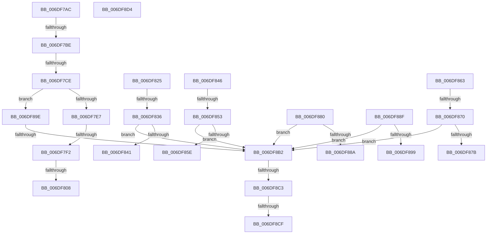

# sub_006DF7AC

- RVA: `0x006DF7AC`–`0x006DF901` (길이 `341` bytes)
- VA: `0x00000001406DF7AC`
- 실행 섹션: `.text`
- PDB 이름 있음: `아니요`; PDB Function 태그: `아니요`
- unwind 정보 RVA: `0x00072AF4`
- 디코드: `91`개 명령, `341/341` bytes 표시
- 미해석 바이트: `2` (있으면 어셈블리에 `.byte`로 보존)

> 이 문서는 커널 이미지의 기계어와 PDB 기호를 분석해 생성했습니다. 4번과 5번은 함수 원형과 자료형을 바이너리 사용 방식에서 추정한 C 해석이며 원본 소스 복구 결과는 아닙니다.

## 1. Dependencies

- 직접 호출 지점: **0**; 고유 호출 대상: **0**
- 직접 호출자로 확인된 함수: **0**
- RIP 상대 이미지 참조: **2**

### Outgoing calls
- 직접 디코드된 call 명령이 없습니다.

### Direct callers
- 이 함수 시작 RVA로 연결되는 직접 call은 확인되지 않았습니다. 간접 호출은 완전히 역산할 수 없습니다.

### Static image references
- `0x006DF808` → RVA `0x00000000` (`image boundary/outside`; read)
- `0x006DF8EF` → RVA `0x0572FDFA` (`image boundary/outside`; read/write)

## 2. Other-region calls and transfers

- 다른 실행 섹션으로 향하는 call: **0**
- call이 아닌 외부 분기/꼬리 이동: **16**
  - `0x006DF7B8` → [EtwpTraceMessageVa + 0x79D](../2F/EtwpTraceMessageVa_function_002FB2B0.md) (`tail-transfer`)
  - `0x006DF7C8` → [EtwpTraceMessageVa + 0x79D](../2F/EtwpTraceMessageVa_function_002FB2B0.md) (`tail-transfer`)
  - `0x006DF7EC` → [EtwpTraceMessageVa + 0x79D](../2F/EtwpTraceMessageVa_function_002FB2B0.md) (`tail-transfer`)
  - `0x006DF802` → [EtwpTraceMessageVa + 0x79D](../2F/EtwpTraceMessageVa_function_002FB2B0.md) (`tail-transfer`)
  - `0x006DF830` → [EtwpTraceMessageVa + 0x79D](../2F/EtwpTraceMessageVa_function_002FB2B0.md) (`tail-transfer`)
  - `0x006DF841` → [EtwpTraceMessageVa + 0x79D](../2F/EtwpTraceMessageVa_function_002FB2B0.md) (`tail-transfer`)
  - `0x006DF84D` → [EtwpTraceMessageVa + 0x79D](../2F/EtwpTraceMessageVa_function_002FB2B0.md) (`tail-transfer`)
  - `0x006DF85E` → [EtwpTraceMessageVa + 0x79D](../2F/EtwpTraceMessageVa_function_002FB2B0.md) (`tail-transfer`)
  - `0x006DF86A` → [EtwpTraceMessageVa + 0x79D](../2F/EtwpTraceMessageVa_function_002FB2B0.md) (`tail-transfer`)
  - `0x006DF87B` → [EtwpTraceMessageVa + 0x79D](../2F/EtwpTraceMessageVa_function_002FB2B0.md) (`tail-transfer`)
  - `0x006DF88A` → [EtwpTraceMessageVa + 0x79D](../2F/EtwpTraceMessageVa_function_002FB2B0.md) (`tail-transfer`)
  - `0x006DF899` → [EtwpTraceMessageVa + 0x79D](../2F/EtwpTraceMessageVa_function_002FB2B0.md) (`tail-transfer`)
  - `0x006DF8AC` → [EtwpTraceMessageVa + 0x79D](../2F/EtwpTraceMessageVa_function_002FB2B0.md) (`tail-transfer`)
  - `0x006DF8BD` → [EtwpTraceMessageVa + 0x79D](../2F/EtwpTraceMessageVa_function_002FB2B0.md) (`tail-transfer`)
  - `0x006DF8C9` → [EtwpTraceMessageVa + 0x79D](../2F/EtwpTraceMessageVa_function_002FB2B0.md) (`tail-transfer`)
  - `0x006DF8CF` → [EtwpTraceMessageVa + 0x764](../2F/EtwpTraceMessageVa_function_002FB2B0.md) (`tail-transfer`)

## 3. Assembly (complete function range)

```asm
006DF7AC  4C 8B BC 24 F8 00 00 00         mov r15, qword ptr [rsp + 0xf8]
006DF7B4  41 83 FF 48                     cmp r15d, 0x48
006DF7B8  0F 82 8F C2 C1 FF               jb 0x1402fba4d
006DF7BE  45 8B D7                        mov r10d, r15d
006DF7C1  48 8D 42 FC                     lea rax, [rdx - 4]
006DF7C5  4C 3B D0                        cmp r10, rax
006DF7C8  0F 83 7F C2 C1 FF               jae 0x1402fba4d
006DF7CE  4D 8D 1C 0A                     lea r11, [r10 + rcx]
006DF7D2  41 8B 3B                        mov edi, dword ptr [r11]
006DF7D5  8B C7                           mov eax, edi
006DF7D7  25 00 00 00 FF                  and eax, 0xff000000
006DF7DC  3D 00 00 00 90                  cmp eax, 0x90000000
006DF7E1  0F 84 B7 00 00 00               je 0x1406df89e
006DF7E7  3D 00 00 00 C0                  cmp eax, 0xc0000000
006DF7EC  0F 85 5B C2 C1 FF               jne 0x1402fba4d
006DF7F2  8B C7                           mov eax, edi
006DF7F4  C1 E8 10                        shr eax, 0x10
006DF7F7  44 0F B6 C0                     movzx r8d, al
006DF7FB  41 8D 40 FF                     lea eax, [r8 - 1]
006DF7FF  83 F8 14                        cmp eax, 0x14
006DF802  0F 87 45 C2 C1 FF               ja 0x1402fba4d
006DF808  4C 8D 2D F1 07 92 FF            lea r13, [rip - 0x6df80f]
006DF80F  42 0F B6 84 28 EC F8 6D 00      movzx eax, byte ptr [rax + r13 + 0x6df8ec]
006DF818  41 8B 8C 85 D4 F8 6D 00         mov ecx, dword ptr [r13 + rax*4 + 0x6df8d4]
006DF820  49 03 CD                        add rcx, r13
006DF823  FF E1                           jmp rcx
006DF825  CC                              int3
006DF826  CC                              int3
006DF827  CC                              int3
006DF828  CC                              int3
006DF829  48 8D 42 F8                     lea rax, [rdx - 8]
006DF82D  4C 3B D0                        cmp r10, rax
006DF830  0F 83 17 C2 C1 FF               jae 0x1402fba4d
006DF836  45 0F B7 53 04                  movzx r10d, word ptr [r11 + 4]
006DF83B  41 83 FA 10                     cmp r10d, 0x10
006DF83F  73 71                           jae 0x1406df8b2
006DF841  E9 07 C2 C1 FF                  jmp 0x1402fba4d
006DF846  48 8D 42 F8                     lea rax, [rdx - 8]
006DF84A  4C 3B D0                        cmp r10, rax
006DF84D  0F 83 FA C1 C1 FF               jae 0x1402fba4d
006DF853  45 0F B7 53 04                  movzx r10d, word ptr [r11 + 4]
006DF858  41 83 FA 20                     cmp r10d, 0x20
006DF85C  73 54                           jae 0x1406df8b2
006DF85E  E9 EA C1 C1 FF                  jmp 0x1402fba4d
006DF863  48 8D 42 F8                     lea rax, [rdx - 8]
006DF867  4C 3B D0                        cmp r10, rax
006DF86A  0F 83 DD C1 C1 FF               jae 0x1402fba4d
006DF870  45 0F B7 53 04                  movzx r10d, word ptr [r11 + 4]
006DF875  41 83 FA 18                     cmp r10d, 0x18
006DF879  73 37                           jae 0x1406df8b2
006DF87B  E9 CD C1 C1 FF                  jmp 0x1402fba4d
006DF880  44 0F B7 D7                     movzx r10d, di
006DF884  41 83 FA 30                     cmp r10d, 0x30
006DF888  73 28                           jae 0x1406df8b2
006DF88A  E9 BE C1 C1 FF                  jmp 0x1402fba4d
006DF88F  44 0F B7 D7                     movzx r10d, di
006DF893  41 83 FA 50                     cmp r10d, 0x50
006DF897  73 19                           jae 0x1406df8b2
006DF899  E9 AF C1 C1 FF                  jmp 0x1402fba4d
006DF89E  41 B8 0F 00 00 00               mov r8d, 0xf
006DF8A4  44 0F B7 D7                     movzx r10d, di
006DF8A8  41 83 FA 08                     cmp r10d, 8
006DF8AC  0F 82 9B C1 C1 FF               jb 0x1402fba4d
006DF8B2  41 83 C2 07                     add r10d, 7
006DF8B6  41 83 E2 F8                     and r10d, 0xfffffff8
006DF8BA  44 3B D2                        cmp r10d, edx
006DF8BD  0F 83 8A C1 C1 FF               jae 0x1402fba4d
006DF8C3  43 8D 04 17                     lea eax, [r15 + r10]
006DF8C7  3B C2                           cmp eax, edx
006DF8C9  0F 87 7E C1 C1 FF               ja 0x1402fba4d
006DF8CF  E9 40 C1 C1 FF                  jmp 0x1402fba14
006DF8D4  46 F8                           clc
006DF8D6  6D                              insd dword ptr [rdi], dx
006DF8D7  00 63 F8                        add byte ptr [rbx - 8], ah
006DF8DA  6D                              insd dword ptr [rdi], dx
006DF8DB  00 80 F8 6D 00 8F               add byte ptr [rax - 0x70ff9208], al
006DF8E1  F8                              clc
006DF8E2  6D                              insd dword ptr [rdi], dx
006DF8E3  00 29                           add byte ptr [rcx], ch
006DF8E5  F8                              clc
006DF8E6  6D                              insd dword ptr [rdi], dx
006DF8E7  00 4D BA                        add byte ptr [rbp - 0x46], cl
006DF8EA  2F                              .byte 0x2f
006DF8EB  00 00                           add byte ptr [rax], al
006DF8ED  00 01                           add byte ptr [rcx], al
006DF8EF  01 05 05 05 05 05               add dword ptr [rip + 0x5050505], eax
006DF8F5  02 02                           add al, byte ptr [rdx]
006DF8F7  05 03 05 05 04                  add eax, 0x4050503
006DF8FC  04 03                           add al, 3
006DF8FE  03 02                           add eax, dword ptr [rdx]
006DF900  02                              .byte 0x02
```

## 4. C-style interpretation (structured pseudocode)

```c
__int64 __fastcall sub_006DF7AC(__int64 a1, __int64 a2, __int64 a3, __int64 a4, __int64 a5, __int64 a6, __int64 a7, __int64 a8, __int64 a9, __int64 a10, __int64 a11, __int64 a12, __int64 a13, __int64 a14, __int64 a15, __int64 a16, __int64 a17, __int64 a18, __int64 a19, __int64 a20, __int64 a21, __int64 a22, __int64 a23, __int64 a24, __int64 a25, __int64 a26, __int64 a27, __int64 a28, __int64 a29, __int64 a30, __int64 a31)
{
    __int64 result;
    __int64 v_r10;

    result = (unsigned int)(((unsigned int)((unsigned int)((unsigned int)(*(unsigned int *)((unsigned int)((unsigned int)(a31)) + a1 * 1))))) & (0xFF000000ULL));
    if (((unsigned int)(result)) == 0x90000000ULL) goto loc_006DF89E;
    result = (unsigned int)(((unsigned int)((unsigned int)((unsigned int)(*(unsigned int *)((unsigned int)((unsigned int)(a31)) + a1 * 1))))) >> (16));
    a1 = ((unsigned int)(*(unsigned int *)(v_rip - 7206927 + *(unsigned __int8 *)((unsigned __int8)(result) - 1 + v_rip - 7206927 * 1 + 7207148) * 4 + 7207124))) + (v_rip - 7206927);
loc_006DF89E:
loc_006DF8B2:
    v_r10 = (unsigned int)(((unsigned __int16)((unsigned int)(*(unsigned int *)((unsigned int)((unsigned int)(a31)) + a1 * 1)))) + (7));
    v_r10 = (unsigned int)((v_r10) & (0xFFFFFFF8ULL));
}
```

## 5. (Beta) C Style

```c
int64_t sub_006DF7AC(int64_t Arg1, void *Arg2, int64_t Arg3, int64_t Arg4, uint64_t Arg5, uint64_t Arg6, uint64_t Arg7, uint64_t Arg8, uint64_t Arg9, uint64_t Arg10, uint64_t Arg11, uint64_t Arg12, uint64_t Arg13, uint64_t Arg14, uint64_t Arg15, uint64_t Arg16, uint64_t Arg17, uint64_t Arg18, uint64_t Arg19, uint64_t Arg20, uint64_t Arg21, uint64_t Arg22, uint64_t Arg23, uint64_t Arg24, uint64_t Arg25, uint64_t Arg26, uint64_t Arg27, uint64_t Arg28, uint64_t Arg29, uint64_t Arg30, int64_t Arg31)
{
    uint8_t *arg2 = (uint8_t *)Arg2;

    int64_t result;
    int64_t local_r10;

    result = (uint32_t)(((uint32_t)((uint32_t)((uint32_t)(*(uint32_t *)((uint32_t)((uint32_t)(Arg31)) + Arg1 * 1))))) & (0xFF000000ULL));
    if (((uint32_t)(result)) == 0x90000000ULL) goto loc_006DF89E;
    result = (uint32_t)(((uint32_t)((uint32_t)((uint32_t)(*(uint32_t *)((uint32_t)((uint32_t)(Arg31)) + Arg1 * 1))))) >> (16));
    Arg1 = ((uint32_t)(*(uint32_t *)(v_rip - 0x6DF80F + *(uint8_t *)((uint8_t)(result) - 0x1 + v_rip - 0x6DF80F * 1 + 0x6DF8EC) * 4 + 0x6DF8D4))) + (v_rip - 7206927);
loc_006DF89E:
loc_006DF8B2:
    local_r10 = (uint32_t)(((uint16_t)((uint32_t)(*(uint32_t *)((uint32_t)((uint32_t)(Arg31)) + Arg1 * 1)))) + (7));
    local_r10 = (uint32_t)((local_r10) & (0xFFFFFFF8ULL));
}
```

### 관측된 메모리 오프셋

구조체 형식이 확인되지 않은 접근은 인자 기준의 오프셋으로만 기록했습니다.

| 기준 인자 | 오프셋 표현 | 폭 (bit) | 접근 |
|---|---:|---:|---|
| `Arg2` | `- 0x4` | `64` | `R` |

## 6. Execution-region graph

[열기: 2D/3D 그래프와 함수 탐색 컨트롤 패널](../../../control-panel.html?section=text&rva=0x006DF7AC&view=graph)

- 2D 그래프는 위에서 아래로 흐르고, 3D 그래프는 빈 공간을 드래그해 회전합니다. Shift+드래그는 이동, 휠은 확대·축소, 함수 노드 선택은 대상 보고서 이동입니다.

### Static fallback


