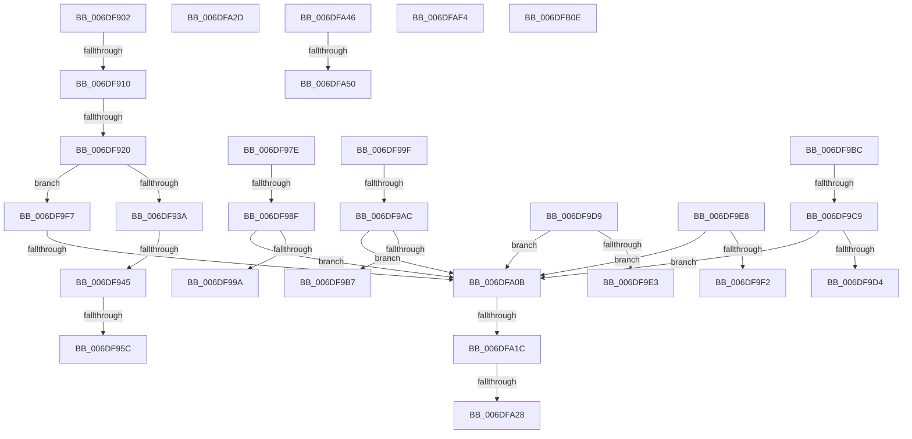

# sub_006DF902

- RVA: `0x006DF902`–`0x006DFB23` (길이 `545` bytes)
- VA: `0x00000001406DF902`
- 실행 섹션: `.text`
- PDB 이름 있음: `아니요`; PDB Function 태그: `아니요`
- unwind 정보 RVA: `0x00072B40`
- 디코드: `127`개 명령, `545/545` bytes 표시
- 미해석 바이트: `1` (있으면 어셈블리에 `.byte`로 보존)

> 이 문서는 커널 이미지의 기계어와 PDB 기호를 분석해 생성했습니다. 4번과 5번은 함수 원형과 자료형을 바이너리 사용 방식에서 추정한 C 해석이며 원본 소스 복구 결과는 아닙니다.

## 1. Dependencies

- 직접 호출 지점: **2**; 고유 호출 대상: **2**
- 직접 호출자로 확인된 함수: **0**
- RIP 상대 이미지 참조: **1**

### Outgoing calls
- `0x006DFA31` → [_chkstk](../6B/_chkstk_function_006BA960.md) (function, `0x006BA960`)
- `0x006DFAE9` → [EtwpLogKernelEvent](../25/EtwpLogKernelEvent_function_0025CC00.md) (function, `0x0025CC00`)

### Direct callers
- 이 함수 시작 RVA로 연결되는 직접 call은 확인되지 않았습니다. 간접 호출은 완전히 역산할 수 없습니다.

### Static image references
- `0x006DF95C` → RVA `0x00000000` (`image boundary/outside`; read)

## 2. Other-region calls and transfers

- 다른 실행 섹션으로 향하는 call: **0**
- call이 아닌 외부 분기/꼬리 이동: **19**
  - `0x006DF90A` → [EtwpLogSystemEventUnsafe + 0x3EC](../2F/EtwpLogSystemEventUnsafe_function_002FBF10.md) (`tail-transfer`)
  - `0x006DF91A` → [EtwpLogSystemEventUnsafe + 0x3EC](../2F/EtwpLogSystemEventUnsafe_function_002FBF10.md) (`tail-transfer`)
  - `0x006DF93F` → [EtwpLogSystemEventUnsafe + 0x3EC](../2F/EtwpLogSystemEventUnsafe_function_002FBF10.md) (`tail-transfer`)
  - `0x006DF956` → [EtwpLogSystemEventUnsafe + 0x3EC](../2F/EtwpLogSystemEventUnsafe_function_002FBF10.md) (`tail-transfer`)
  - `0x006DF989` → [EtwpLogSystemEventUnsafe + 0x3EC](../2F/EtwpLogSystemEventUnsafe_function_002FBF10.md) (`tail-transfer`)
  - `0x006DF99A` → [EtwpLogSystemEventUnsafe + 0x3EC](../2F/EtwpLogSystemEventUnsafe_function_002FBF10.md) (`tail-transfer`)
  - `0x006DF9A6` → [EtwpLogSystemEventUnsafe + 0x3EC](../2F/EtwpLogSystemEventUnsafe_function_002FBF10.md) (`tail-transfer`)
  - `0x006DF9B7` → [EtwpLogSystemEventUnsafe + 0x3EC](../2F/EtwpLogSystemEventUnsafe_function_002FBF10.md) (`tail-transfer`)
  - `0x006DF9C3` → [EtwpLogSystemEventUnsafe + 0x3EC](../2F/EtwpLogSystemEventUnsafe_function_002FBF10.md) (`tail-transfer`)
  - `0x006DF9D4` → [EtwpLogSystemEventUnsafe + 0x3EC](../2F/EtwpLogSystemEventUnsafe_function_002FBF10.md) (`tail-transfer`)
  - `0x006DF9E3` → [EtwpLogSystemEventUnsafe + 0x3EC](../2F/EtwpLogSystemEventUnsafe_function_002FBF10.md) (`tail-transfer`)
  - `0x006DF9F2` → [EtwpLogSystemEventUnsafe + 0x3EC](../2F/EtwpLogSystemEventUnsafe_function_002FBF10.md) (`tail-transfer`)
  - `0x006DFA05` → [EtwpLogSystemEventUnsafe + 0x3EC](../2F/EtwpLogSystemEventUnsafe_function_002FBF10.md) (`tail-transfer`)
  - `0x006DFA16` → [EtwpLogSystemEventUnsafe + 0x3EC](../2F/EtwpLogSystemEventUnsafe_function_002FBF10.md) (`tail-transfer`)
  - `0x006DFA22` → [EtwpLogSystemEventUnsafe + 0x3EC](../2F/EtwpLogSystemEventUnsafe_function_002FBF10.md) (`tail-transfer`)
  - `0x006DFA28` → [EtwpLogSystemEventUnsafe + 0x3B0](../2F/EtwpLogSystemEventUnsafe_function_002FBF10.md) (`tail-transfer`)
  - `0x006DFA41` → [EtwpLogSystemEventUnsafe + 0x8F2](../2F/EtwpLogSystemEventUnsafe_function_002FBF10.md) (`tail-transfer`)
  - `0x006DFA4A` → [EtwpLogSystemEventUnsafe + 0x90F](../2F/EtwpLogSystemEventUnsafe_function_002FBF10.md) (`tail-transfer`)
  - `0x006DFAEF` → [EtwpLogSystemEventUnsafe + 0x90F](../2F/EtwpLogSystemEventUnsafe_function_002FBF10.md) (`tail-transfer`)

## 3. Assembly (complete function range)

```asm
006DF902  4C 8B 6D 70                     mov r13, qword ptr [rbp + 0x70]
006DF906  41 83 FD 48                     cmp r13d, 0x48
006DF90A  0F 82 EC C9 C1 FF               jb 0x1402fc2fc
006DF910  45 8B DD                        mov r11d, r13d
006DF913  48 8D 42 FC                     lea rax, [rdx - 4]
006DF917  4C 3B D8                        cmp r11, rax
006DF91A  0F 83 DC C9 C1 FF               jae 0x1402fc2fc
006DF920  49 8D 34 0B                     lea rsi, [r11 + rcx]
006DF924  44 8B 16                        mov r10d, dword ptr [rsi]
006DF927  41 8B C2                        mov eax, r10d
006DF92A  25 00 00 00 FF                  and eax, 0xff000000
006DF92F  3D 00 00 00 90                  cmp eax, 0x90000000
006DF934  0F 84 BD 00 00 00               je 0x1406df9f7
006DF93A  3D 00 00 00 C0                  cmp eax, 0xc0000000
006DF93F  0F 85 B7 C9 C1 FF               jne 0x1402fc2fc
006DF945  41 8B C2                        mov eax, r10d
006DF948  C1 E8 10                        shr eax, 0x10
006DF94B  44 0F B6 C0                     movzx r8d, al
006DF94F  41 8D 40 FF                     lea eax, [r8 - 1]
006DF953  83 F8 14                        cmp eax, 0x14
006DF956  0F 87 A0 C9 C1 FF               ja 0x1402fc2fc
006DF95C  48 8D 0D 9D 06 92 FF            lea rcx, [rip - 0x6df963]
006DF963  0F B6 84 01 0E FB 6D 00         movzx eax, byte ptr [rcx + rax + 0x6dfb0e]
006DF96B  8B 8C 81 F6 FA 6D 00            mov ecx, dword ptr [rcx + rax*4 + 0x6dfaf6]
006DF972  48 8D 05 87 06 92 FF            lea rax, [rip - 0x6df979]
006DF979  48 03 C8                        add rcx, rax
006DF97C  FF E1                           jmp rcx
006DF97E  CC                              int3
006DF97F  CC                              int3
006DF980  CC                              int3
006DF981  CC                              int3
006DF982  48 8D 42 F8                     lea rax, [rdx - 8]
006DF986  4C 3B D8                        cmp r11, rax
006DF989  0F 83 6D C9 C1 FF               jae 0x1402fc2fc
006DF98F  44 0F B7 5E 04                  movzx r11d, word ptr [rsi + 4]
006DF994  41 83 FB 10                     cmp r11d, 0x10
006DF998  73 71                           jae 0x1406dfa0b
006DF99A  E9 5D C9 C1 FF                  jmp 0x1402fc2fc
006DF99F  48 8D 42 F8                     lea rax, [rdx - 8]
006DF9A3  4C 3B D8                        cmp r11, rax
006DF9A6  0F 83 50 C9 C1 FF               jae 0x1402fc2fc
006DF9AC  44 0F B7 5E 04                  movzx r11d, word ptr [rsi + 4]
006DF9B1  41 83 FB 20                     cmp r11d, 0x20
006DF9B5  73 54                           jae 0x1406dfa0b
006DF9B7  E9 40 C9 C1 FF                  jmp 0x1402fc2fc
006DF9BC  48 8D 42 F8                     lea rax, [rdx - 8]
006DF9C0  4C 3B D8                        cmp r11, rax
006DF9C3  0F 83 33 C9 C1 FF               jae 0x1402fc2fc
006DF9C9  44 0F B7 5E 04                  movzx r11d, word ptr [rsi + 4]
006DF9CE  41 83 FB 18                     cmp r11d, 0x18
006DF9D2  73 37                           jae 0x1406dfa0b
006DF9D4  E9 23 C9 C1 FF                  jmp 0x1402fc2fc
006DF9D9  45 0F B7 DA                     movzx r11d, r10w
006DF9DD  41 83 FB 30                     cmp r11d, 0x30
006DF9E1  73 28                           jae 0x1406dfa0b
006DF9E3  E9 14 C9 C1 FF                  jmp 0x1402fc2fc
006DF9E8  45 0F B7 DA                     movzx r11d, r10w
006DF9EC  41 83 FB 50                     cmp r11d, 0x50
006DF9F0  73 19                           jae 0x1406dfa0b
006DF9F2  E9 05 C9 C1 FF                  jmp 0x1402fc2fc
006DF9F7  41 B8 0F 00 00 00               mov r8d, 0xf
006DF9FD  45 0F B7 DA                     movzx r11d, r10w
006DFA01  41 83 FB 08                     cmp r11d, 8
006DFA05  0F 82 F1 C8 C1 FF               jb 0x1402fc2fc
006DFA0B  41 83 C3 07                     add r11d, 7
006DFA0F  41 83 E3 F8                     and r11d, 0xfffffff8
006DFA13  44 3B DA                        cmp r11d, edx
006DFA16  0F 83 E0 C8 C1 FF               jae 0x1402fc2fc
006DFA1C  43 8D 04 2B                     lea eax, [r11 + r13]
006DFA20  3B C2                           cmp eax, edx
006DFA22  0F 87 D4 C8 C1 FF               ja 0x1402fc2fc
006DFA28  E9 93 C8 C1 FF                  jmp 0x1402fc2c0
006DFA2D  48 83 E0 F0                     and rax, 0xfffffffffffffff0
006DFA31  E8 2A AF FD FF                  call 0x1406ba960
006DFA36  48 2B E0                        sub rsp, rax
006DFA39  4C 8D 74 24 40                  lea r14, [rsp + 0x40]
006DFA3E  41 B5 01                        mov r13b, 1
006DFA41  E9 BC CD C1 FF                  jmp 0x1402fc802
006DFA46  83 7D 10 00                     cmp dword ptr [rbp + 0x10], 0
006DFA4A  0F 84 CF CD C1 FF               je 0x1402fc81f
006DFA50  8B 55 08                        mov edx, dword ptr [rbp + 8]
006DFA53  81 E2 02 E6 FF FF               and edx, 0xffffe602
006DFA59  83 CA 02                        or edx, 2
006DFA5C  41 8B 87 08 05 00 00            mov eax, dword ptr [r15 + 0x508]
006DFA63  89 85 C8 00 00 00               mov dword ptr [rbp + 0xc8], eax
006DFA69  41 8B 87 10 05 00 00            mov eax, dword ptr [r15 + 0x510]
006DFA70  89 85 CC 00 00 00               mov dword ptr [rbp + 0xcc], eax
006DFA76  48 8B 45 28                     mov rax, qword ptr [rbp + 0x28]
006DFA7A  48 89 85 C0 00 00 00            mov qword ptr [rbp + 0xc0], rax
006DFA81  49 8B 84 24 30 04 00 00         mov rax, qword ptr [r12 + 0x430]
006DFA89  8B 48 04                        mov ecx, dword ptr [rax + 4]
006DFA8C  89 8D D0 00 00 00               mov dword ptr [rbp + 0xd0], ecx
006DFA92  48 8D 85 C0 00 00 00            lea rax, [rbp + 0xc0]
006DFA99  48 89 85 00 01 00 00            mov qword ptr [rbp + 0x100], rax
006DFAA0  48 C7 85 08 01 00 00 18 00 00 00  mov qword ptr [rbp + 0x108], 0x18
006DFAAB  4C 89 B5 10 01 00 00            mov qword ptr [rbp + 0x110], r14
006DFAB2  8B 45 10                        mov eax, dword ptr [rbp + 0x10]
006DFAB5  89 85 18 01 00 00               mov dword ptr [rbp + 0x118], eax
006DFABB  C7 85 1C 01 00 00 00 00 00 00   mov dword ptr [rbp + 0x11c], 0
006DFAC5  89 54 24 28                     mov dword ptr [rsp + 0x28], edx
006DFAC9  66 C7 44 24 20 20 0C            mov word ptr [rsp + 0x20], 0xc20
006DFAD0  41 B9 02 00 00 00               mov r9d, 2
006DFAD6  45 8B 04 24                     mov r8d, dword ptr [r12]
006DFADA  49 8B 94 24 50 05 00 00         mov rdx, qword ptr [r12 + 0x550]
006DFAE2  48 8D 8D 00 01 00 00            lea rcx, [rbp + 0x100]
006DFAE9  E8 12 D1 B7 FF                  call 0x14025cc00
006DFAEE  90                              nop
006DFAEF  E9 2B CD C1 FF                  jmp 0x1402fc81f
006DFAF4  66 90                           nop
006DFAF6  9F                              lahf
006DFAF7  F9                              stc
006DFAF8  6D                              insd dword ptr [rdi], dx
006DFAF9  00 BC F9 6D 00 D9 F9            add byte ptr [rcx + rdi*8 - 0x626ff93], bh
006DFB00  6D                              insd dword ptr [rdi], dx
006DFB01  00 E8                           add al, ch
006DFB03  F9                              stc
006DFB04  6D                              insd dword ptr [rdi], dx
006DFB05  00 82 F9 6D 00 FC               add byte ptr [rdx - 0x3ff9207], al
006DFB0B  C2 2F 00                        ret 0x2f
006DFB0E  00 00                           add byte ptr [rax], al
006DFB10  01 01                           add dword ptr [rcx], eax
006DFB12  05 05 05 05 05                  add eax, 0x5050505
006DFB17  02 02                           add al, byte ptr [rdx]
006DFB19  05 03 05 05 04                  add eax, 0x4050503
006DFB1E  04 03                           add al, 3
006DFB20  03 02                           add eax, dword ptr [rdx]
006DFB22  02                              .byte 0x02
```

## 4. C-style interpretation (structured pseudocode)

```c
__int64 __fastcall sub_006DF902(__int64 a1, __int64 a2)
{
    __int64 result;
    __int64 v_r11;
    unsigned __int16 v_stack_p20;
    unsigned int v_stack_p28;
    unsigned __int64 v_stack_p40;

    result = (unsigned int)(((unsigned int)((unsigned int)((unsigned int)(*(unsigned int *)((unsigned int)((unsigned int)(*(unsigned __int64 *)(v_rbp + 112))) + a1 * 1))))) & (0xFF000000ULL));
    if (((unsigned int)(result)) == 0x90000000ULL) goto loc_006DF9F7;
    result = (unsigned int)(((unsigned int)((unsigned int)((unsigned int)(*(unsigned int *)((unsigned int)((unsigned int)(*(unsigned __int64 *)(v_rbp + 112))) + a1 * 1))))) >> (16));
    a1 = ((unsigned int)(*(unsigned int *)(v_rip - 7207267 + *(unsigned __int8 *)(v_rip - 7207267 + (unsigned __int8)(result) - 1 * 1 + 7207694) * 4 + 7207670))) + (v_rip - 7207289);
loc_006DF9F7:
loc_006DFA0B:
    v_r11 = (unsigned int)(((unsigned __int16)((unsigned int)(*(unsigned int *)((unsigned int)((unsigned int)(*(unsigned __int64 *)(v_rbp + 112))) + a1 * 1)))) + (7));
    v_r11 = (unsigned int)((v_r11) & (0xFFFFFFF8ULL));
}
```

## 5. (Beta) C Style

```c
int64_t sub_006DF902(int64_t Arg1, void *Arg2)
{
    uint8_t *arg2 = (uint8_t *)Arg2;

    int64_t result;
    int64_t local_r11;
    uint16_t v_stack_p20;
    uint32_t v_stack_p28;
    uint64_t v_stack_p40;

    result = (uint32_t)(((uint32_t)((uint32_t)((uint32_t)(*(uint32_t *)((uint32_t)((uint32_t)(*(uint64_t *)(local_rbp + 0x70))) + Arg1 * 1))))) & (0xFF000000ULL));
    if (((uint32_t)(result)) == 0x90000000ULL) goto loc_006DF9F7;
    result = (uint32_t)(((uint32_t)((uint32_t)((uint32_t)(*(uint32_t *)((uint32_t)((uint32_t)(*(uint64_t *)(local_rbp + 0x70))) + Arg1 * 1))))) >> (16));
    Arg1 = ((uint32_t)(*(uint32_t *)(v_rip - 0x6DF963 + *(uint8_t *)(v_rip - 0x6DF963 + (uint8_t)(result) - 0x1 * 1 + 0x6DFB0E) * 4 + 0x6DFAF6))) + (v_rip - 7207289);
loc_006DF9F7:
loc_006DFA0B:
    local_r11 = (uint32_t)(((uint16_t)((uint32_t)(*(uint32_t *)((uint32_t)((uint32_t)(*(uint64_t *)(local_rbp + 0x70))) + Arg1 * 1)))) + (7));
    local_r11 = (uint32_t)((local_r11) & (0xFFFFFFF8ULL));
}
```

### 관측된 메모리 오프셋

구조체 형식이 확인되지 않은 접근은 인자 기준의 오프셋으로만 기록했습니다.

| 기준 인자 | 오프셋 표현 | 폭 (bit) | 접근 |
|---|---:|---:|---|
| `Arg2` | `- 0x4` | `64` | `R` |

## 6. Execution-region graph

[열기: 2D/3D 그래프와 함수 탐색 컨트롤 패널](../../../control-panel.html?section=text&rva=0x006DF902&view=graph)

- 2D 그래프는 위에서 아래로 흐르고, 3D 그래프는 빈 공간을 드래그해 회전합니다. Shift+드래그는 이동, 휠은 확대·축소, 함수 노드 선택은 대상 보고서 이동입니다.

### Static fallback


