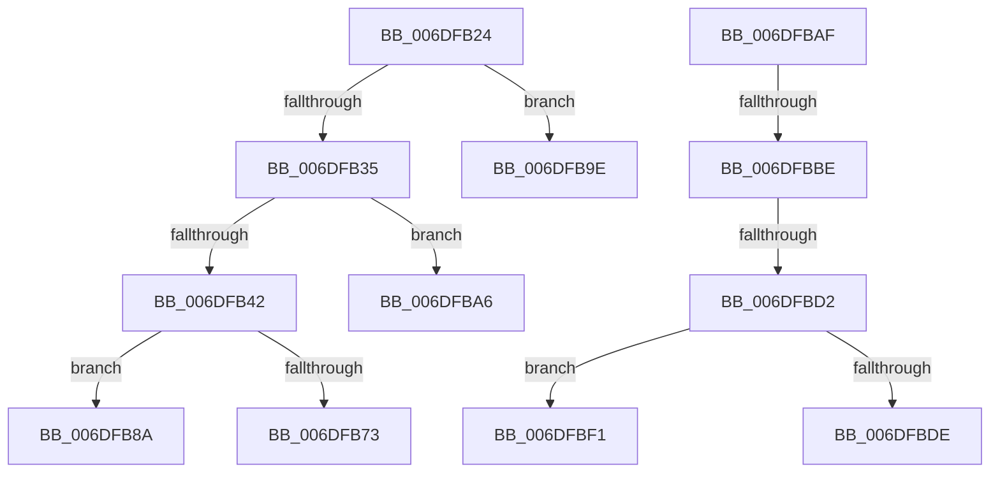

# sub_006DFB24

- RVA: `0x006DFB24`–`0x006DFC05` (길이 `225` bytes)
- VA: `0x00000001406DFB24`
- 실행 섹션: `.text`
- PDB 이름 있음: `아니요`; PDB Function 태그: `아니요`
- unwind 정보 RVA: `0x00072B70`
- 디코드: `55`개 명령, `225/225` bytes 표시
- 미해석 바이트: `0` (있으면 어셈블리에 `.byte`로 보존)

> 이 문서는 커널 이미지의 기계어와 PDB 기호를 분석해 생성했습니다. 4번과 5번은 함수 원형과 자료형을 바이너리 사용 방식에서 추정한 C 해석이며 원본 소스 복구 결과는 아닙니다.

## 1. Dependencies

- 직접 호출 지점: **3**; 고유 호출 대상: **3**
- 직접 호출자로 확인된 함수: **0**
- RIP 상대 이미지 참조: **0**

### Outgoing calls
- `0x006DFBD2` → [KeGetEffectiveIrql](../2F/KeGetEffectiveIrql_function_002F8030.md) (function, `0x002F8030`)
- `0x006DFBE6` → [EtwpCompressionDpc](../65/EtwpCompressionDpc_function_00653290.md) (function, `0x00653290`)
- `0x006DFBFA` → [KeInsertQueueDpc](../20/KeInsertQueueDpc_function_00207C50.md) (function, `0x00207C50`)

### Direct callers
- 이 함수 시작 RVA로 연결되는 직접 call은 확인되지 않았습니다. 간접 호출은 완전히 역산할 수 없습니다.

### Static image references
- 디코드된 RIP-relative 메모리 참조가 없습니다.

## 2. Other-region calls and transfers

- 다른 실행 섹션으로 향하는 call: **0**
- call이 아닌 외부 분기/꼬리 이동: **8**
  - `0x006DFB85` → [EtwpReserveTraceBuffer + 0x116](../2F/EtwpReserveTraceBuffer_function_002FC8C0.md) (`tail-transfer`)
  - `0x006DFB99` → [EtwpReserveTraceBuffer + 0x116](../2F/EtwpReserveTraceBuffer_function_002FC8C0.md) (`tail-transfer`)
  - `0x006DFBA1` → [EtwpReserveTraceBuffer + 0x116](../2F/EtwpReserveTraceBuffer_function_002FC8C0.md) (`tail-transfer`)
  - `0x006DFBAA` → [EtwpReserveTraceBuffer + 0x11E](../2F/EtwpReserveTraceBuffer_function_002FC8C0.md) (`tail-transfer`)
  - `0x006DFBB8` → [EtwpReserveTraceBuffer + 0x1C0](../2F/EtwpReserveTraceBuffer_function_002FC8C0.md) (`tail-transfer`)
  - `0x006DFBCC` → [EtwpReserveTraceBuffer + 0x1C0](../2F/EtwpReserveTraceBuffer_function_002FC8C0.md) (`tail-transfer`)
  - `0x006DFBEC` → [EtwpReserveTraceBuffer + 0x1C0](../2F/EtwpReserveTraceBuffer_function_002FC8C0.md) (`tail-transfer`)
  - `0x006DFC00` → [EtwpReserveTraceBuffer + 0x1C0](../2F/EtwpReserveTraceBuffer_function_002FC8C0.md) (`tail-transfer`)

## 3. Assembly (complete function range)

```asm
006DFB24  8D 4B 18                        lea ecx, [rbx + 0x18]
006DFB27  8B C3                           mov eax, ebx
006DFB29  F0 0F B1 4F 08                  lock cmpxchg dword ptr [rdi + 8], ecx
006DFB2E  44 8B C0                        mov r8d, eax
006DFB31  3B D8                           cmp ebx, eax
006DFB33  75 69                           jne 0x1406dfb9e
006DFB35  8B 4C 24 20                     mov ecx, dword ptr [rsp + 0x20]
006DFB39  49 8D 50 18                     lea rdx, [r8 + 0x18]
006DFB3D  48 3B D1                        cmp rdx, rcx
006DFB40  77 64                           ja 0x1406dfba6
006DFB42  49 8B 56 10                     mov rdx, qword ptr [r14 + 0x10]
006DFB46  49 8B C2                        mov rax, r10
006DFB49  48 8B 4C 24 30                  mov rcx, qword ptr [rsp + 0x30]
006DFB4E  F0 4A 0F B1 0C 1A               lock cmpxchg qword ptr [rdx + r11], rcx
006DFB54  8B 54 24 20                     mov edx, dword ptr [rsp + 0x20]
006DFB58  4C 3B D0                        cmp r10, rax
006DFB5B  48 8B 44 24 38                  mov rax, qword ptr [rsp + 0x38]
006DFB60  41 8B D8                        mov ebx, r8d
006DFB63  49 89 44 38 08                  mov qword ptr [r8 + rdi + 8], rax
006DFB68  41 C7 44 38 04 18 00 51 00      mov dword ptr [r8 + rdi + 4], 0x510018
006DFB71  75 17                           jne 0x1406dfb8a
006DFB73  48 8B 44 24 30                  mov rax, qword ptr [rsp + 0x30]
006DFB78  49 89 44 38 10                  mov qword ptr [r8 + rdi + 0x10], rax
006DFB7D  41 C7 04 38 02 00 11 C0         mov dword ptr [r8 + rdi], 0xc0110002
006DFB85  E9 4C CE C1 FF                  jmp 0x1402fc9d6
006DFB8A  33 C0                           xor eax, eax
006DFB8C  41 C7 04 38 01 00 11 C0         mov dword ptr [r8 + rdi], 0xc0110001
006DFB94  49 89 44 38 10                  mov qword ptr [r8 + rdi + 0x10], rax
006DFB99  E9 38 CE C1 FF                  jmp 0x1402fc9d6
006DFB9E  41 8B D8                        mov ebx, r8d
006DFBA1  E9 30 CE C1 FF                  jmp 0x1402fc9d6
006DFBA6  44 89 47 04                     mov dword ptr [rdi + 4], r8d
006DFBAA  E9 2F CE C1 FF                  jmp 0x1402fc9de
006DFBAF  41 8B 87 98 05 00 00            mov eax, dword ptr [r15 + 0x598]
006DFBB6  85 C0                           test eax, eax
006DFBB8  0F 84 C2 CE C1 FF               je 0x1402fca80
006DFBBE  B8 02 00 00 00                  mov eax, 2
006DFBC3  41 87 87 78 05 00 00            xchg dword ptr [r15 + 0x578], eax
006DFBCA  85 C0                           test eax, eax
006DFBCC  0F 85 AE CE C1 FF               jne 0x1402fca80
006DFBD2  E8 59 84 C1 FF                  call 0x1402f8030
006DFBD7  45 33 C0                        xor r8d, r8d
006DFBDA  3C 02                           cmp al, 2
006DFBDC  77 13                           ja 0x1406dfbf1
006DFBDE  45 33 C9                        xor r9d, r9d
006DFBE1  49 8B D7                        mov rdx, r15
006DFBE4  33 C9                           xor ecx, ecx
006DFBE6  E8 A5 36 F7 FF                  call 0x140653290
006DFBEB  90                              nop
006DFBEC  E9 8F CE C1 FF                  jmp 0x1402fca80
006DFBF1  49 8D 8F C0 05 00 00            lea rcx, [r15 + 0x5c0]
006DFBF8  33 D2                           xor edx, edx
006DFBFA  E8 51 80 B2 FF                  call 0x140207c50
006DFBFF  90                              nop
006DFC00  E9 7B CE C1 FF                  jmp 0x1402fca80
```

## 4. C-style interpretation (structured pseudocode)

```c
__int64 __fastcall sub_006DFB24(__int64 a1, __int64 a2, __int64 a3, int a4, __int64 a5, __int64 a6, __int64 a7)
{
    __int64 result;
    unsigned int v_stack_p20;

    if (((unsigned int)(v_rbx)) != ((unsigned int)((unsigned int)((unsigned int)(v_rbx))))) goto loc_006DFB9E;
    if (((unsigned int)((unsigned int)((unsigned int)((unsigned int)(v_rbx)))) + 24) > ((unsigned int)(v_stack_p20))) goto loc_006DFBA6;
    *(unsigned __int64 *)((unsigned int)((unsigned int)((unsigned int)((unsigned int)(v_rbx)))) + v_rdi * 1 + 8) = a7;
    *(unsigned int *)((unsigned int)((unsigned int)((unsigned int)((unsigned int)(v_rbx)))) + v_rdi * 1 + 4) = 0x510018ULL;
    if (v_r10 != v_r10) goto loc_006DFB8A;
    *(unsigned __int64 *)((unsigned int)((unsigned int)((unsigned int)((unsigned int)(v_rbx)))) + v_rdi * 1 + 16) = a6;
    *(unsigned int *)((unsigned int)((unsigned int)((unsigned int)((unsigned int)(v_rbx)))) + v_rdi * 1) = 0xC0110002ULL;
loc_006DFB8A:
    result = 0;
    *(unsigned int *)((unsigned int)((unsigned int)((unsigned int)((unsigned int)(v_rbx)))) + v_rdi * 1) = 0xC0110001ULL;
    *(unsigned __int64 *)((unsigned int)((unsigned int)((unsigned int)((unsigned int)(v_rbx)))) + v_rdi * 1 + 16) = 0;
loc_006DFB9E:
loc_006DFBA6:
    *(unsigned int *)(v_rdi + 4) = (unsigned int)((unsigned int)((unsigned int)((unsigned int)((unsigned int)(v_rbx)))));
}
```

## 5. (Beta) C Style

```c
int64_t sub_006DFB24(int64_t Arg1, int64_t Arg2, int64_t Arg3, int32_t Arg4, uint64_t Arg5, int64_t Arg6, int64_t Arg7)
{
    int64_t result;
    uint32_t v_stack_p20;

    if (((uint32_t)(local_rbx)) != ((uint32_t)((uint32_t)((uint32_t)(local_rbx))))) goto loc_006DFB9E;
    if (((uint32_t)((uint32_t)((uint32_t)((uint32_t)(local_rbx)))) + 24) > ((uint32_t)(v_stack_p20))) goto loc_006DFBA6;
    *(uint64_t *)((uint32_t)((uint32_t)((uint32_t)((uint32_t)(local_rbx)))) + local_rdi * 1 + 0x8) = Arg7;
    *(uint32_t *)((uint32_t)((uint32_t)((uint32_t)((uint32_t)(local_rbx)))) + local_rdi * 1 + 0x4) = 0x510018ULL;
    if (local_r10 != local_r10) goto loc_006DFB8A;
    *(uint64_t *)((uint32_t)((uint32_t)((uint32_t)((uint32_t)(local_rbx)))) + local_rdi * 1 + 0x10) = Arg6;
    *(uint32_t *)((uint32_t)((uint32_t)((uint32_t)((uint32_t)(local_rbx)))) + local_rdi * 1) = 0xC0110002ULL;
loc_006DFB8A:
    result = 0;
    *(uint32_t *)((uint32_t)((uint32_t)((uint32_t)((uint32_t)(local_rbx)))) + local_rdi * 1) = 0xC0110001ULL;
    *(uint64_t *)((uint32_t)((uint32_t)((uint32_t)((uint32_t)(local_rbx)))) + local_rdi * 1 + 0x10) = 0;
loc_006DFB9E:
loc_006DFBA6:
    *(uint32_t *)(local_rdi + 0x4) = (uint32_t)((uint32_t)((uint32_t)((uint32_t)((uint32_t)(local_rbx)))));
}
```

## 6. Execution-region graph

[열기: 2D/3D 그래프와 함수 탐색 컨트롤 패널](../../../control-panel.html?section=text&rva=0x006DFB24&view=graph)

- 2D 그래프는 위에서 아래로 흐르고, 3D 그래프는 빈 공간을 드래그해 회전합니다. Shift+드래그는 이동, 휠은 확대·축소, 함수 노드 선택은 대상 보고서 이동입니다.

### Static fallback


