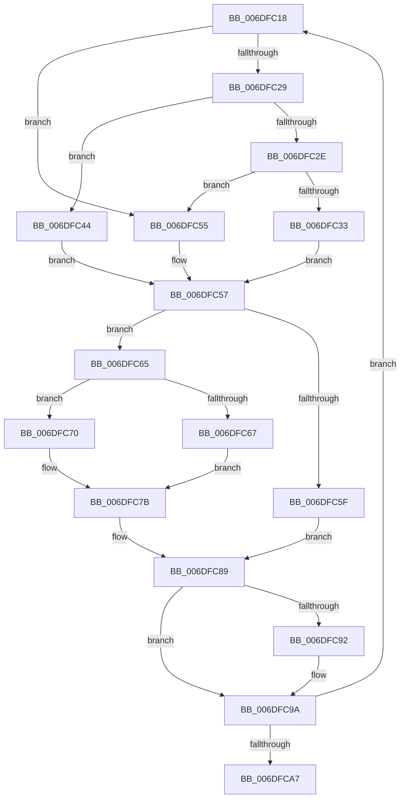

# sub_006DFC18

- RVA: `0x006DFC18`–`0x006DFCB1` (길이 `153` bytes)
- VA: `0x00000001406DFC18`
- 실행 섹션: `.text`
- PDB 이름 있음: `아니요`; PDB Function 태그: `아니요`
- unwind 정보 RVA: `0x00072BD0`
- 디코드: `47`개 명령, `153/153` bytes 표시
- 미해석 바이트: `0` (있으면 어셈블리에 `.byte`로 보존)

> 이 문서는 커널 이미지의 기계어와 PDB 기호를 분석해 생성했습니다. 4번과 5번은 함수 원형과 자료형을 바이너리 사용 방식에서 추정한 C 해석이며 원본 소스 복구 결과는 아닙니다.

## 1. Dependencies

- 직접 호출 지점: **0**; 고유 호출 대상: **0**
- 직접 호출자로 확인된 함수: **0**
- RIP 상대 이미지 참조: **0**

### Outgoing calls
- 직접 디코드된 call 명령이 없습니다.

### Direct callers
- 이 함수 시작 RVA로 연결되는 직접 call은 확인되지 않았습니다. 간접 호출은 완전히 역산할 수 없습니다.

### Static image references
- 디코드된 RIP-relative 메모리 참조가 없습니다.

## 2. Other-region calls and transfers

- 다른 실행 섹션으로 향하는 call: **0**
- call이 아닌 외부 분기/꼬리 이동: **1**
  - `0x006DFCAC` → [HalpCollectPmcCounters + 0x33](../2F/HalpCollectPmcCounters_function_002FD080.md) (`tail-transfer`)

## 3. Assembly (complete function range)

```asm
006DFC18  4B 8D 0C 9B                     lea rcx, [r11 + r11*4]
006DFC1C  49 8D 1C C8                     lea rbx, [r8 + rcx*8]
006DFC20  41 8B 4C C8 2C                  mov ecx, dword ptr [r8 + rcx*8 + 0x2c]
006DFC25  85 C9                           test ecx, ecx
006DFC27  74 2C                           je 0x1406dfc55
006DFC29  83 E9 01                        sub ecx, 1
006DFC2C  74 16                           je 0x1406dfc44
006DFC2E  83 F9 01                        cmp ecx, 1
006DFC31  75 22                           jne 0x1406dfc55
006DFC33  8B 4B 30                        mov ecx, dword ptr [rbx + 0x30]
006DFC36  0F 32                           rdmsr
006DFC38  48 C1 E2 20                     shl rdx, 0x20
006DFC3C  48 0B C2                        or rax, rdx
006DFC3F  48 8B F8                        mov rdi, rax
006DFC42  EB 13                           jmp 0x1406dfc57
006DFC44  8B 4B 30                        mov ecx, dword ptr [rbx + 0x30]
006DFC47  0F 33                           rdpmc
006DFC49  48 C1 E2 20                     shl rdx, 0x20
006DFC4D  48 0B C2                        or rax, rdx
006DFC50  48 8B F8                        mov rdi, rax
006DFC53  EB 02                           jmp 0x1406dfc57
006DFC55  33 FF                           xor edi, edi
006DFC57  8B 4B 3C                        mov ecx, dword ptr [rbx + 0x3c]
006DFC5A  83 F9 40                        cmp ecx, 0x40
006DFC5D  75 06                           jne 0x1406dfc65
006DFC5F  48 89 7B 20                     mov qword ptr [rbx + 0x20], rdi
006DFC63  EB 24                           jmp 0x1406dfc89
006DFC65  72 09                           jb 0x1406dfc70
006DFC67  48 C7 C2 FF FF FF FF            mov rdx, 0xffffffffffffffff
006DFC6E  EB 0B                           jmp 0x1406dfc7b
006DFC70  BA 01 00 00 00                  mov edx, 1
006DFC75  48 D3 E2                        shl rdx, cl
006DFC78  48 FF CA                        dec rdx
006DFC7B  48 8B C7                        mov rax, rdi
006DFC7E  48 2B 43 18                     sub rax, qword ptr [rbx + 0x18]
006DFC82  48 23 C2                        and rax, rdx
006DFC85  48 01 43 20                     add qword ptr [rbx + 0x20], rax
006DFC89  48 89 7B 18                     mov qword ptr [rbx + 0x18], rdi
006DFC8D  4D 85 C9                        test r9, r9
006DFC90  74 08                           je 0x1406dfc9a
006DFC92  48 8B 43 20                     mov rax, qword ptr [rbx + 0x20]
006DFC96  4B 89 04 D9                     mov qword ptr [r9 + r11*8], rax
006DFC9A  41 FF C3                        inc r11d
006DFC9D  45 3B 58 14                     cmp r11d, dword ptr [r8 + 0x14]
006DFCA1  0F 82 71 FF FF FF               jb 0x1406dfc18
006DFCA7  48 8B 74 24 30                  mov rsi, qword ptr [rsp + 0x30]
006DFCAC  E9 02 D4 C1 FF                  jmp 0x1402fd0b3
```

## 4. C-style interpretation (structured pseudocode)

```c
__int64 __fastcall sub_006DFC18(__int64 a1, __int64 a2, __int64 a3, __int64 a4, __int64 a5, __int64 a6)
{
    __int64 result;
    __int64 v_r11;
    __int64 v_rdi;

    if ((unsigned int)((unsigned int)(*(unsigned int *)(a3 + v_r11 + v_r11 * 4 * 8 + 44))) == 0) goto loc_006DFC55;
    a1 = (unsigned int)(((unsigned int)(*(unsigned int *)(a3 + v_r11 + v_r11 * 4 * 8 + 44))) - (1));
    if (condition_is_equal) goto loc_006DFC44;
    if (((unsigned int)(a1)) != 1) goto loc_006DFC55;
    a2 = (a2) << (32);
    result = (result) | (a2);
    goto loc_006DFC57;
loc_006DFC44:
    a2 = (a2) << (32);
    result = (result) | (a2);
    goto loc_006DFC57;
loc_006DFC55:
    v_rdi = 0;
loc_006DFC57:
    if (((unsigned int)((unsigned int)(*(unsigned int *)(a3 + v_r11 + v_r11 * 4 * 8 + 60)))) != 64) goto loc_006DFC65;
    *(unsigned __int64 *)(a3 + v_r11 + v_r11 * 4 * 8 + 32) = 0;
    goto loc_006DFC89;
loc_006DFC65:
    if (((unsigned int)((unsigned int)(*(unsigned int *)(a3 + v_r11 + v_r11 * 4 * 8 + 60)))) < 64) goto loc_006DFC70;
    goto loc_006DFC7B;
loc_006DFC70:
    a2 = (1) << ((unsigned __int8)((unsigned int)(*(unsigned int *)(a3 + v_r11 + v_r11 * 4 * 8 + 60))));
    a2 = (a2) - 1;
loc_006DFC7B:
    result = (0) - (*(unsigned __int64 *)(a3 + v_r11 + v_r11 * 4 * 8 + 24));
    result = (result) & (a2);
loc_006DFC89:
    *(unsigned __int64 *)(a3 + v_r11 + v_r11 * 4 * 8 + 24) = 0;
    if (a4 != 0) {
        result = *(unsigned __int64 *)(a3 + v_r11 + v_r11 * 4 * 8 + 32);
        *(unsigned __int64 *)(a4 + v_r11 * 8) = result;
    }
    v_r11 = (unsigned int)((v_r11) + 1);
    if (((unsigned int)(v_r11)) < (*(unsigned int *)(a3 + 20))) goto loc_006DFC18;
}
```

## 5. (Beta) C Style

```c
int64_t sub_006DFC18(int64_t Arg1, int64_t Arg2, void *Arg3, int64_t Arg4, uint64_t Arg5, int64_t Arg6)
{
    uint8_t *arg3 = (uint8_t *)Arg3;

    int64_t result;
    int64_t local_r11;
    int64_t local_rdi;

    if ((uint32_t)((uint32_t)(*(uint32_t *)(arg3 + local_r11 + local_r11 * 4 * 8 + 0x2C))) == 0) goto loc_006DFC55;
    Arg1 = (uint32_t)(((uint32_t)(*(uint32_t *)(arg3 + local_r11 + local_r11 * 4 * 8 + 0x2C))) - (1));
    if (condition_is_equal) goto loc_006DFC44;
    if (((uint32_t)(Arg1)) != 1) goto loc_006DFC55;
    Arg2 = (Arg2) << (32);
    result = (result) | (Arg2);
    goto loc_006DFC57;
loc_006DFC44:
    Arg2 = (Arg2) << (32);
    result = (result) | (Arg2);
    goto loc_006DFC57;
loc_006DFC55:
    local_rdi = 0;
loc_006DFC57:
    if (((uint32_t)((uint32_t)(*(uint32_t *)(arg3 + local_r11 + local_r11 * 4 * 8 + 0x3C)))) != 64) goto loc_006DFC65;
    *(uint64_t *)(arg3 + local_r11 + local_r11 * 4 * 8 + 0x20) = 0;
    goto loc_006DFC89;
loc_006DFC65:
    if (((uint32_t)((uint32_t)(*(uint32_t *)(arg3 + local_r11 + local_r11 * 4 * 8 + 0x3C)))) < 64) goto loc_006DFC70;
    goto loc_006DFC7B;
loc_006DFC70:
    Arg2 = (1) << ((uint8_t)((uint32_t)(*(uint32_t *)(arg3 + local_r11 + local_r11 * 4 * 8 + 0x3C))));
    Arg2 = (Arg2) - 1;
loc_006DFC7B:
    result = (0) - (*(uint64_t *)(arg3 + local_r11 + local_r11 * 4 * 8 + 0x18));
    result = (result) & (Arg2);
loc_006DFC89:
    *(uint64_t *)(arg3 + local_r11 + local_r11 * 4 * 8 + 0x18) = 0;
    if (Arg4 != 0) {
        result = *(uint64_t *)(arg3 + local_r11 + local_r11 * 4 * 8 + 0x20);
        *(uint64_t *)(Arg4 + local_r11 * 8) = result;
    }
    local_r11 = (uint32_t)((local_r11) + 1);
    if (((uint32_t)(local_r11)) < (*(uint32_t *)(arg3 + 0x14))) goto loc_006DFC18;
}
```

### 관측된 메모리 오프셋

구조체 형식이 확인되지 않은 접근은 인자 기준의 오프셋으로만 기록했습니다.

| 기준 인자 | 오프셋 표현 | 폭 (bit) | 접근 |
|---|---:|---:|---|
| `Arg3` | `+ 0x0 + rcx*8` | `64` | `R` |
| `Arg3` | `+ 0x14` | `32` | `R` |
| `Arg3` | `+ 0x18` | `64` | `R` |
| `Arg3` | `+ 0x18` | `64` | `W` |
| `Arg3` | `+ 0x20` | `64` | `R` |
| `Arg3` | `+ 0x20` | `64` | `R/W` |
| `Arg3` | `+ 0x20` | `64` | `W` |
| `Arg3` | `+ 0x2C + rcx*8` | `32` | `R` |
| `Arg3` | `+ 0x30` | `32` | `R` |
| `Arg3` | `+ 0x3C` | `32` | `R` |

## 6. Execution-region graph

[열기: 2D/3D 그래프와 함수 탐색 컨트롤 패널](../../../control-panel.html?section=text&rva=0x006DFC18&view=graph)

- 2D 그래프는 위에서 아래로 흐르고, 3D 그래프는 빈 공간을 드래그해 회전합니다. Shift+드래그는 이동, 휠은 확대·축소, 함수 노드 선택은 대상 보고서 이동입니다.

### Static fallback


