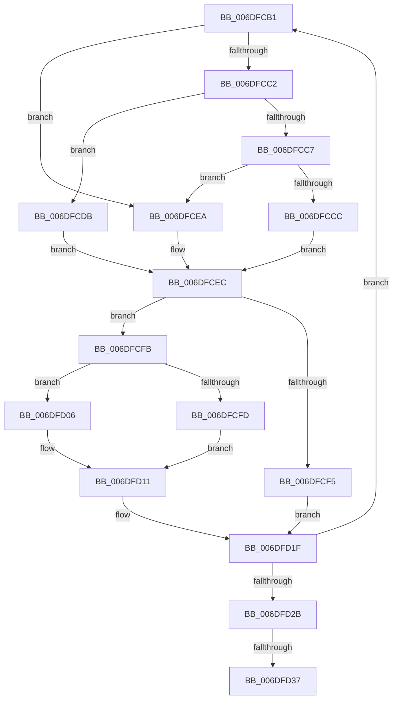

# sub_006DFCB1

- RVA: `0x006DFCB1`–`0x006DFD3C` (길이 `139` bytes)
- VA: `0x00000001406DFCB1`
- 실행 섹션: `.text`
- PDB 이름 있음: `아니요`; PDB Function 태그: `아니요`
- unwind 정보 RVA: `0x00072BE4`
- 디코드: `43`개 명령, `139/139` bytes 표시
- 미해석 바이트: `0` (있으면 어셈블리에 `.byte`로 보존)

> 이 문서는 커널 이미지의 기계어와 PDB 기호를 분석해 생성했습니다. 4번과 5번은 함수 원형과 자료형을 바이너리 사용 방식에서 추정한 C 해석이며 원본 소스 복구 결과는 아닙니다.

## 1. Dependencies

- 직접 호출 지점: **0**; 고유 호출 대상: **0**
- 직접 호출자로 확인된 함수: **0**
- RIP 상대 이미지 참조: **0**

### Outgoing calls
- 직접 디코드된 call 명령이 없습니다.

### Direct callers
- 이 함수 시작 RVA로 연결되는 직접 call은 확인되지 않았습니다. 간접 호출은 완전히 역산할 수 없습니다.

### Static image references
- 디코드된 RIP-relative 메모리 참조가 없습니다.

## 2. Other-region calls and transfers

- 다른 실행 섹션으로 향하는 call: **0**
- call이 아닌 외부 분기/꼬리 이동: **2**
  - `0x006DFD31` → [HalpCollectPmcCounters + 0x6D](../2F/HalpCollectPmcCounters_function_002FD080.md) (`tail-transfer`)
  - `0x006DFD37` → [HalpCollectPmcCounters + 0x33](../2F/HalpCollectPmcCounters_function_002FD080.md) (`tail-transfer`)

## 3. Assembly (complete function range)

```asm
006DFCB1  48 8D 0C BF                     lea rcx, [rdi + rdi*4]
006DFCB5  4D 8D 1C C8                     lea r11, [r8 + rcx*8]
006DFCB9  41 8B 4C C8 2C                  mov ecx, dword ptr [r8 + rcx*8 + 0x2c]
006DFCBE  85 C9                           test ecx, ecx
006DFCC0  74 28                           je 0x1406dfcea
006DFCC2  83 E9 01                        sub ecx, 1
006DFCC5  74 14                           je 0x1406dfcdb
006DFCC7  83 F9 01                        cmp ecx, 1
006DFCCA  75 1E                           jne 0x1406dfcea
006DFCCC  41 8B 4B 30                     mov ecx, dword ptr [r11 + 0x30]
006DFCD0  0F 32                           rdmsr
006DFCD2  48 C1 E2 20                     shl rdx, 0x20
006DFCD6  48 0B D0                        or rdx, rax
006DFCD9  EB 11                           jmp 0x1406dfcec
006DFCDB  41 8B 4B 30                     mov ecx, dword ptr [r11 + 0x30]
006DFCDF  0F 33                           rdpmc
006DFCE1  48 C1 E2 20                     shl rdx, 0x20
006DFCE5  48 0B D0                        or rdx, rax
006DFCE8  EB 02                           jmp 0x1406dfcec
006DFCEA  33 D2                           xor edx, edx
006DFCEC  41 8B 4B 3C                     mov ecx, dword ptr [r11 + 0x3c]
006DFCF0  83 F9 40                        cmp ecx, 0x40
006DFCF3  75 06                           jne 0x1406dfcfb
006DFCF5  49 89 53 20                     mov qword ptr [r11 + 0x20], rdx
006DFCF9  EB 24                           jmp 0x1406dfd1f
006DFCFB  72 09                           jb 0x1406dfd06
006DFCFD  48 C7 C3 FF FF FF FF            mov rbx, 0xffffffffffffffff
006DFD04  EB 0B                           jmp 0x1406dfd11
006DFD06  BB 01 00 00 00                  mov ebx, 1
006DFD0B  48 D3 E3                        shl rbx, cl
006DFD0E  48 FF CB                        dec rbx
006DFD11  48 8B C2                        mov rax, rdx
006DFD14  49 2B 43 18                     sub rax, qword ptr [r11 + 0x18]
006DFD18  48 23 C3                        and rax, rbx
006DFD1B  49 01 43 20                     add qword ptr [r11 + 0x20], rax
006DFD1F  FF C7                           inc edi
006DFD21  49 89 53 18                     mov qword ptr [r11 + 0x18], rdx
006DFD25  41 3B 78 14                     cmp edi, dword ptr [r8 + 0x14]
006DFD29  72 86                           jb 0x1406dfcb1
006DFD2B  4D 8B 00                        mov r8, qword ptr [r8]
006DFD2E  4D 3B C1                        cmp r8, r9
006DFD31  0F 85 B6 D3 C1 FF               jne 0x1402fd0ed
006DFD37  E9 77 D3 C1 FF                  jmp 0x1402fd0b3
```

## 4. C-style interpretation (structured pseudocode)

```c
__int64 __fastcall sub_006DFCB1(__int64 a1, __int64 a2, __int64 a3, __int64 a4)
{
    __int64 result;
    __int64 v_rbx;
    __int64 v_rdi;

    if ((unsigned int)((unsigned int)(*(unsigned int *)(a3 + v_rdi + v_rdi * 4 * 8 + 44))) == 0) goto loc_006DFCEA;
    a1 = (unsigned int)(((unsigned int)(*(unsigned int *)(a3 + v_rdi + v_rdi * 4 * 8 + 44))) - (1));
    if (condition_is_equal) goto loc_006DFCDB;
    if (((unsigned int)(a1)) != 1) goto loc_006DFCEA;
    a2 = (a2) << (32);
    a2 = (a2) | (result);
    goto loc_006DFCEC;
loc_006DFCDB:
    a2 = (a2) << (32);
    a2 = (a2) | (result);
    goto loc_006DFCEC;
loc_006DFCEA:
    a2 = 0;
loc_006DFCEC:
    if (((unsigned int)((unsigned int)(*(unsigned int *)(a3 + v_rdi + v_rdi * 4 * 8 + 60)))) != 64) goto loc_006DFCFB;
    *(unsigned __int64 *)(a3 + v_rdi + v_rdi * 4 * 8 + 32) = 0;
    goto loc_006DFD1F;
loc_006DFCFB:
    if (((unsigned int)((unsigned int)(*(unsigned int *)(a3 + v_rdi + v_rdi * 4 * 8 + 60)))) < 64) goto loc_006DFD06;
    goto loc_006DFD11;
loc_006DFD06:
    v_rbx = (1) << ((unsigned __int8)((unsigned int)(*(unsigned int *)(a3 + v_rdi + v_rdi * 4 * 8 + 60))));
    v_rbx = (v_rbx) - 1;
loc_006DFD11:
    result = (0) - (*(unsigned __int64 *)(a3 + v_rdi + v_rdi * 4 * 8 + 24));
    result = (result) & (v_rbx);
loc_006DFD1F:
    v_rdi = (unsigned int)((v_rdi) + 1);
    *(unsigned __int64 *)(a3 + v_rdi + v_rdi * 4 * 8 + 24) = 0;
    if (((unsigned int)(v_rdi)) < (*(unsigned int *)(a3 + 20))) goto loc_006DFCB1;
}
```

## 5. (Beta) C Style

```c
int64_t sub_006DFCB1(int64_t Arg1, int64_t Arg2, void *Arg3, int64_t Arg4)
{
    uint8_t *arg3 = (uint8_t *)Arg3;

    int64_t result;
    int64_t local_rbx;
    int64_t local_rdi;

    if ((uint32_t)((uint32_t)(*(uint32_t *)(arg3 + local_rdi + local_rdi * 4 * 8 + 0x2C))) == 0) goto loc_006DFCEA;
    Arg1 = (uint32_t)(((uint32_t)(*(uint32_t *)(arg3 + local_rdi + local_rdi * 4 * 8 + 0x2C))) - (1));
    if (condition_is_equal) goto loc_006DFCDB;
    if (((uint32_t)(Arg1)) != 1) goto loc_006DFCEA;
    Arg2 = (Arg2) << (32);
    Arg2 = (Arg2) | (result);
    goto loc_006DFCEC;
loc_006DFCDB:
    Arg2 = (Arg2) << (32);
    Arg2 = (Arg2) | (result);
    goto loc_006DFCEC;
loc_006DFCEA:
    Arg2 = 0;
loc_006DFCEC:
    if (((uint32_t)((uint32_t)(*(uint32_t *)(arg3 + local_rdi + local_rdi * 4 * 8 + 0x3C)))) != 64) goto loc_006DFCFB;
    *(uint64_t *)(arg3 + local_rdi + local_rdi * 4 * 8 + 0x20) = 0;
    goto loc_006DFD1F;
loc_006DFCFB:
    if (((uint32_t)((uint32_t)(*(uint32_t *)(arg3 + local_rdi + local_rdi * 4 * 8 + 0x3C)))) < 64) goto loc_006DFD06;
    goto loc_006DFD11;
loc_006DFD06:
    local_rbx = (1) << ((uint8_t)((uint32_t)(*(uint32_t *)(arg3 + local_rdi + local_rdi * 4 * 8 + 0x3C))));
    local_rbx = (local_rbx) - 1;
loc_006DFD11:
    result = (0) - (*(uint64_t *)(arg3 + local_rdi + local_rdi * 4 * 8 + 0x18));
    result = (result) & (local_rbx);
loc_006DFD1F:
    local_rdi = (uint32_t)((local_rdi) + 1);
    *(uint64_t *)(arg3 + local_rdi + local_rdi * 4 * 8 + 0x18) = 0;
    if (((uint32_t)(local_rdi)) < (*(uint32_t *)(arg3 + 0x14))) goto loc_006DFCB1;
}
```

### 관측된 메모리 오프셋

구조체 형식이 확인되지 않은 접근은 인자 기준의 오프셋으로만 기록했습니다.

| 기준 인자 | 오프셋 표현 | 폭 (bit) | 접근 |
|---|---:|---:|---|
| `Arg3` | `+ 0x0` | `64` | `R` |
| `Arg3` | `+ 0x0 + rcx*8` | `64` | `R` |
| `Arg3` | `+ 0x14` | `32` | `R` |
| `Arg3` | `+ 0x18` | `64` | `R` |
| `Arg3` | `+ 0x18` | `64` | `W` |
| `Arg3` | `+ 0x20` | `64` | `R/W` |
| `Arg3` | `+ 0x20` | `64` | `W` |
| `Arg3` | `+ 0x2C + rcx*8` | `32` | `R` |
| `Arg3` | `+ 0x30` | `32` | `R` |
| `Arg3` | `+ 0x3C` | `32` | `R` |

## 6. Execution-region graph

[열기: 2D/3D 그래프와 함수 탐색 컨트롤 패널](../../../control-panel.html?section=text&rva=0x006DFCB1&view=graph)

- 2D 그래프는 위에서 아래로 흐르고, 3D 그래프는 빈 공간을 드래그해 회전합니다. Shift+드래그는 이동, 휠은 확대·축소, 함수 노드 선택은 대상 보고서 이동입니다.

### Static fallback


