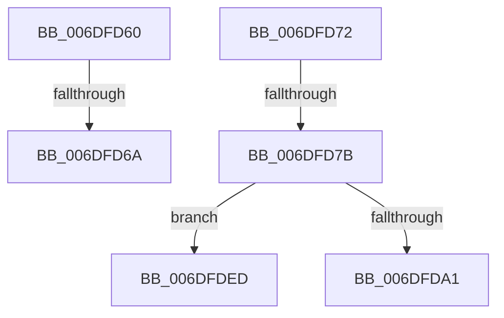

# sub_006DFD60

- RVA: `0x006DFD60`–`0x006DFDF8` (길이 `152` bytes)
- VA: `0x00000001406DFD60`
- 실행 섹션: `.text`
- PDB 이름 있음: `아니요`; PDB Function 태그: `아니요`
- unwind 정보 RVA: `0x00072D1C`
- 디코드: `38`개 명령, `152/152` bytes 표시
- 미해석 바이트: `0` (있으면 어셈블리에 `.byte`로 보존)

> 이 문서는 커널 이미지의 기계어와 PDB 기호를 분석해 생성했습니다. 4번과 5번은 함수 원형과 자료형을 바이너리 사용 방식에서 추정한 C 해석이며 원본 소스 복구 결과는 아닙니다.

## 1. Dependencies

- 직접 호출 지점: **2**; 고유 호출 대상: **2**
- 직접 호출자로 확인된 함수: **0**
- RIP 상대 이미지 참조: **0**

### Outgoing calls
- `0x006DFD94` → [ExAllocatePool2](../../poolcode/B8/ExAllocatePool2_function_00B820F0.md) (function, `0x00B820F0`)
- `0x006DFDF2` → [RtlRaiseStatus](../2F/RtlRaiseStatus_function_002F6A50.md) (function, `0x002F6A50`)

### Direct callers
- 이 함수 시작 RVA로 연결되는 직접 call은 확인되지 않았습니다. 간접 호출은 완전히 역산할 수 없습니다.

### Static image references
- 디코드된 RIP-relative 메모리 참조가 없습니다.

## 2. Other-region calls and transfers

- 다른 실행 섹션으로 향하는 call: **1**
  - `0x006DFD94` → [ExAllocatePool2](../../poolcode/B8/ExAllocatePool2_function_00B820F0.md) (`.text` → `POOLCODE`)
- call이 아닌 외부 분기/꼬리 이동: **4**
  - `0x006DFD64` → [RtlpIsNameInExpressionPrivate + 0x342](../2F/RtlpIsNameInExpressionPrivate_function_002FDBAC.md) (`tail-transfer`)
  - `0x006DFD6D` → [RtlpIsNameInExpressionPrivate + 0x3EE](../2F/RtlpIsNameInExpressionPrivate_function_002FDBAC.md) (`tail-transfer`)
  - `0x006DFD75` → [RtlpIsNameInExpressionPrivate + 0x17D](../2F/RtlpIsNameInExpressionPrivate_function_002FDBAC.md) (`tail-transfer`)
  - `0x006DFDE8` → [RtlpIsNameInExpressionPrivate + 0x17D](../2F/RtlpIsNameInExpressionPrivate_function_002FDBAC.md) (`tail-transfer`)

## 3. Assembly (complete function range)

```asm
006DFD60  66 44 3B D1                     cmp r10w, cx
006DFD64  0F 85 84 E1 C1 FF               jne 0x1402fdeee
006DFD6A  66 03 D7                        add dx, di
006DFD6D  E9 28 E2 C1 FF                  jmp 0x1402fdf9a
006DFD72  4D 85 C0                        test r8, r8
006DFD75  0F 85 AE DF C1 FF               jne 0x1402fdd29
006DFD7B  8B C2                           mov eax, edx
006DFD7D  41 8D 48 40                     lea ecx, [r8 + 0x40]
006DFD81  D1 E8                           shr eax, 1
006DFD83  41 B8 46 53 72 6E               mov r8d, 0x6e725346
006DFD89  89 44 24 50                     mov dword ptr [rsp + 0x50], eax
006DFD8D  8D 50 01                        lea edx, [rax + 1]
006DFD90  48 C1 E2 03                     shl rdx, 3
006DFD94  E8 57 23 4A 00                  call 0x140b820f0
006DFD99  4C 8B C0                        mov r8, rax
006DFD9C  48 85 C0                        test rax, rax
006DFD9F  74 4C                           je 0x1406dfded
006DFDA1  41 0F 10 07                     movups xmm0, xmmword ptr [r15]
006DFDA5  8B 4C 24 50                     mov ecx, dword ptr [rsp + 0x50]
006DFDA9  4C 8B 4C 24 48                  mov r9, qword ptr [rsp + 0x48]
006DFDAE  4C 8B 54 24 40                  mov r10, qword ptr [rsp + 0x40]
006DFDB3  0F 11 00                        movups xmmword ptr [rax], xmm0
006DFDB6  8D 0C 4D 02 00 00 00            lea ecx, [rcx*2 + 2]
006DFDBD  41 0F 10 4F 10                  movups xmm1, xmmword ptr [r15 + 0x10]
006DFDC2  48 8D 0C 48                     lea rcx, [rax + rcx*2]
006DFDC6  4C 8B F8                        mov r15, rax
006DFDC9  4C 8B D9                        mov r11, rcx
006DFDCC  0F 11 48 10                     movups xmmword ptr [rax + 0x10], xmm1
006DFDD0  48 8B 44 24 38                  mov rax, qword ptr [rsp + 0x38]
006DFDD5  48 89 4C 24 38                  mov qword ptr [rsp + 0x38], rcx
006DFDDA  0F 10 00                        movups xmm0, xmmword ptr [rax]
006DFDDD  0F 11 01                        movups xmmword ptr [rcx], xmm0
006DFDE0  0F 10 48 10                     movups xmm1, xmmword ptr [rax + 0x10]
006DFDE4  0F 11 49 10                     movups xmmword ptr [rcx + 0x10], xmm1
006DFDE8  E9 3C DF C1 FF                  jmp 0x1402fdd29
006DFDED  B9 17 00 00 C0                  mov ecx, 0xc0000017
006DFDF2  E8 59 6C C1 FF                  call 0x1402f6a50
006DFDF7  CC                              int3
```

## 4. C-style interpretation (structured pseudocode)

```c
__int64 __fastcall sub_006DFD60(unsigned __int16 a1, unsigned __int16 a2, __int64 a3)
{
    unsigned __int64 v_stack_p38;
    unsigned __int64 v_stack_p40;
    unsigned __int64 v_stack_p48;
    unsigned int v_stack_p50;

    a2 = (unsigned __int16)((a2) + ((unsigned __int16)(v_rdi)));
}
```

## 5. (Beta) C Style

```c
int64_t sub_006DFD60(uint16_t Arg1, uint16_t Arg2, int64_t Arg3)
{
    uint64_t v_stack_p38;
    uint64_t v_stack_p40;
    uint64_t v_stack_p48;
    uint32_t v_stack_p50;

    Arg2 = (uint16_t)((Arg2) + ((uint16_t)(local_rdi)));
}
```

## 6. Execution-region graph

[열기: 2D/3D 그래프와 함수 탐색 컨트롤 패널](../../../control-panel.html?section=text&rva=0x006DFD60&view=graph)

- 2D 그래프는 위에서 아래로 흐르고, 3D 그래프는 빈 공간을 드래그해 회전합니다. Shift+드래그는 이동, 휠은 확대·축소, 함수 노드 선택은 대상 보고서 이동입니다.

### Static fallback


