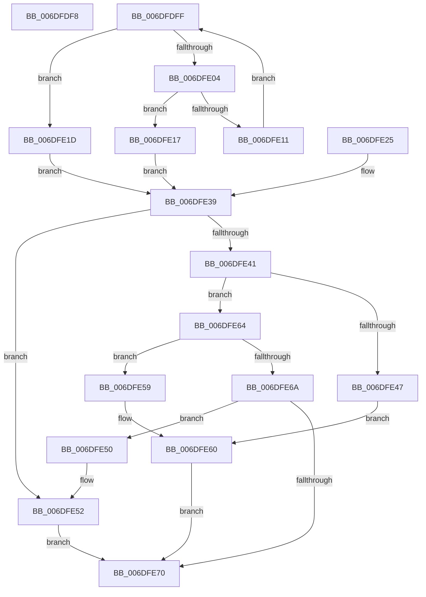

# sub_006DFDF8

- RVA: `0x006DFDF8`–`0x006DFE7D` (길이 `133` bytes)
- VA: `0x00000001406DFDF8`
- 실행 섹션: `.text`
- PDB 이름 있음: `아니요`; PDB Function 태그: `아니요`
- unwind 정보 RVA: `0x00072DAC`
- 디코드: `45`개 명령, `133/133` bytes 표시
- 미해석 바이트: `0` (있으면 어셈블리에 `.byte`로 보존)

> 이 문서는 커널 이미지의 기계어와 PDB 기호를 분석해 생성했습니다. 4번과 5번은 함수 원형과 자료형을 바이너리 사용 방식에서 추정한 C 해석이며 원본 소스 복구 결과는 아닙니다.

## 1. Dependencies

- 직접 호출 지점: **1**; 고유 호출 대상: **1**
- 직접 호출자로 확인된 함수: **0**
- RIP 상대 이미지 참조: **0**

### Outgoing calls
- `0x006DFE32` → [RtlCompareUnicodeString](../../page/93/RtlCompareUnicodeString_function_00937F90.md) (function, `0x00937F90`)

### Direct callers
- 이 함수 시작 RVA로 연결되는 직접 call은 확인되지 않았습니다. 간접 호출은 완전히 역산할 수 없습니다.

### Static image references
- 디코드된 RIP-relative 메모리 참조가 없습니다.

## 2. Other-region calls and transfers

- 다른 실행 섹션으로 향하는 call: **1**
  - `0x006DFE32` → [RtlCompareUnicodeString](../../page/93/RtlCompareUnicodeString_function_00937F90.md) (`.text` → `PAGE`)
- call이 아닌 외부 분기/꼬리 이동: **2**
  - `0x006DFDFA` → [AuthzBasepCompareUnicodeStringOperands + 0x59](../2F/AuthzBasepCompareUnicodeStringOperands_function_002FE26C.md) (`tail-transfer`)
  - `0x006DFE78` → [AuthzBasepCompareUnicodeStringOperands + 0x161](../2F/AuthzBasepCompareUnicodeStringOperands_function_002FE26C.md) (`tail-transfer`)

## 3. Assembly (complete function range)

```asm
006DFDF8  B1 01                           mov cl, 1
006DFDFA  E9 C6 E4 C1 FF                  jmp 0x1402fe2c5
006DFDFF  49 3B C8                        cmp rcx, r8
006DFE02  73 19                           jae 0x1406dfe1d
006DFE04  0F B7 11                        movzx edx, word ptr [rcx]
006DFE07  41 0F B7 04 0B                  movzx eax, word ptr [r11 + rcx]
006DFE0C  66 3B D0                        cmp dx, ax
006DFE0F  75 06                           jne 0x1406dfe17
006DFE11  48 83 C1 02                     add rcx, 2
006DFE15  EB E8                           jmp 0x1406dfdff
006DFE17  8B CA                           mov ecx, edx
006DFE19  2B C8                           sub ecx, eax
006DFE1B  EB 1C                           jmp 0x1406dfe39
006DFE1D  41 8B C9                        mov ecx, r9d
006DFE20  41 2B CA                        sub ecx, r10d
006DFE23  EB 14                           jmp 0x1406dfe39
006DFE25  41 B0 01                        mov r8b, 1
006DFE28  48 8D 54 24 38                  lea rdx, [rsp + 0x38]
006DFE2D  48 8D 4C 24 28                  lea rcx, [rsp + 0x28]
006DFE32  E8 59 81 25 00                  call 0x140937f90
006DFE37  8B C8                           mov ecx, eax
006DFE39  89 0F                           mov dword ptr [rdi], ecx
006DFE3B  41 80 FC 82                     cmp r12b, 0x82
006DFE3F  74 11                           je 0x1406dfe52
006DFE41  41 80 FC 83                     cmp r12b, 0x83
006DFE45  75 1D                           jne 0x1406dfe64
006DFE47  33 C0                           xor eax, eax
006DFE49  85 C9                           test ecx, ecx
006DFE4B  0F 9E C0                        setle al
006DFE4E  EB 10                           jmp 0x1406dfe60
006DFE50  F7 D1                           not ecx
006DFE52  C1 E9 1F                        shr ecx, 0x1f
006DFE55  89 0F                           mov dword ptr [rdi], ecx
006DFE57  EB 17                           jmp 0x1406dfe70
006DFE59  33 C0                           xor eax, eax
006DFE5B  85 C9                           test ecx, ecx
006DFE5D  0F 9F C0                        setg al
006DFE60  89 07                           mov dword ptr [rdi], eax
006DFE62  EB 0C                           jmp 0x1406dfe70
006DFE64  41 80 FC 84                     cmp r12b, 0x84
006DFE68  74 EF                           je 0x1406dfe59
006DFE6A  41 80 FC 85                     cmp r12b, 0x85
006DFE6E  74 E0                           je 0x1406dfe50
006DFE70  44 8B AC 24 98 00 00 00         mov r13d, dword ptr [rsp + 0x98]
006DFE78  E9 50 E5 C1 FF                  jmp 0x1402fe3cd
```

## 4. C-style interpretation (structured pseudocode)

```c
__int64 __fastcall sub_006DFDF8(__int64 a1, __int64 a2, __int64 a3, int a4)
{
    unsigned __int64 v_stack_p28;
    unsigned __int64 v_stack_p38;
    unsigned int v_stack_p98;
}
```

## 5. (Beta) C Style

```c
int64_t sub_006DFDF8(int64_t Arg1, int64_t Arg2, int64_t Arg3, int32_t Arg4)
{
    uint64_t v_stack_p28;
    uint64_t v_stack_p38;
    uint32_t v_stack_p98;
}
```

## 6. Execution-region graph

[열기: 2D/3D 그래프와 함수 탐색 컨트롤 패널](../../../control-panel.html?section=text&rva=0x006DFDF8&view=graph)

- 2D 그래프는 위에서 아래로 흐르고, 3D 그래프는 빈 공간을 드래그해 회전합니다. Shift+드래그는 이동, 휠은 확대·축소, 함수 노드 선택은 대상 보고서 이동입니다.

### Static fallback


