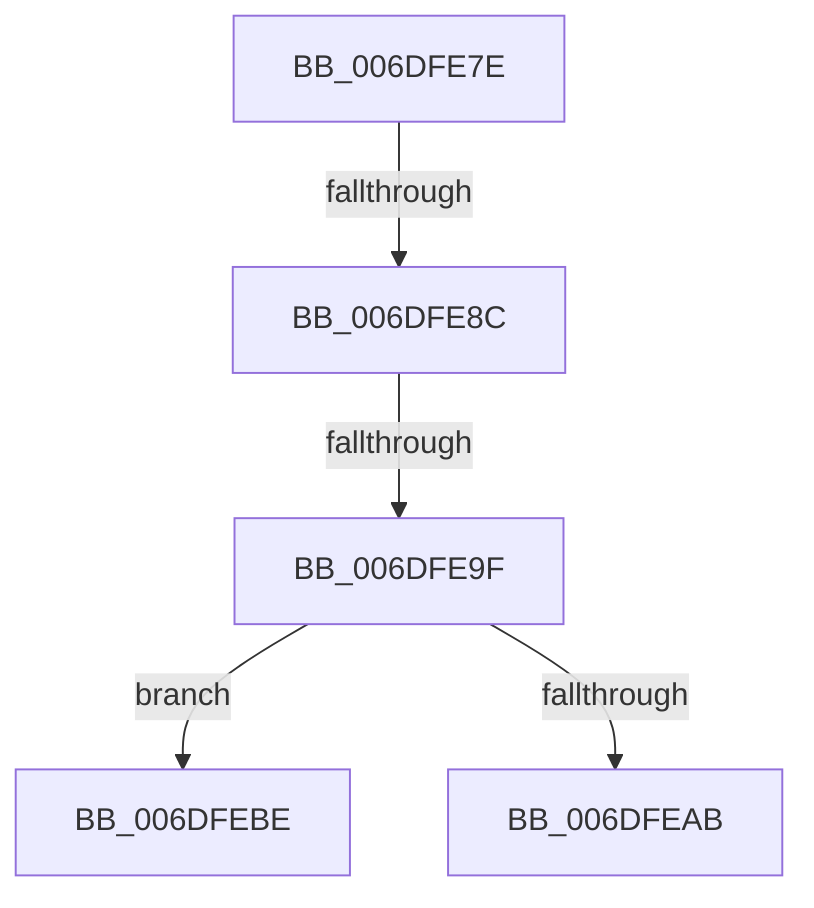

# sub_006DFE7E

- RVA: `0x006DFE7E`–`0x006DFED2` (길이 `84` bytes)
- VA: `0x00000001406DFE7E`
- 실행 섹션: `.text`
- PDB 이름 있음: `아니요`; PDB Function 태그: `아니요`
- unwind 정보 RVA: `0x00072DF4`
- 디코드: `22`개 명령, `84/84` bytes 표시
- 미해석 바이트: `0` (있으면 어셈블리에 `.byte`로 보존)

> 이 문서는 커널 이미지의 기계어와 PDB 기호를 분석해 생성했습니다. 4번과 5번은 함수 원형과 자료형을 바이너리 사용 방식에서 추정한 C 해석이며 원본 소스 복구 결과는 아닙니다.

## 1. Dependencies

- 직접 호출 지점: **3**; 고유 호출 대상: **3**
- 직접 호출자로 확인된 함수: **0**
- RIP 상대 이미지 참조: **0**

### Outgoing calls
- `0x006DFE9F` → [KeGetEffectiveIrql](../2F/KeGetEffectiveIrql_function_002F8030.md) (function, `0x002F8030`)
- `0x006DFEB3` → [EtwpCompressionDpc](../65/EtwpCompressionDpc_function_00653290.md) (function, `0x00653290`)
- `0x006DFEC7` → [KeInsertQueueDpc](../20/KeInsertQueueDpc_function_00207C50.md) (function, `0x00207C50`)

### Direct callers
- 이 함수 시작 RVA로 연결되는 직접 call은 확인되지 않았습니다. 간접 호출은 완전히 역산할 수 없습니다.

### Static image references
- 디코드된 RIP-relative 메모리 참조가 없습니다.

## 2. Other-region calls and transfers

- 다른 실행 섹션으로 향하는 call: **0**
- call이 아닌 외부 분기/꼬리 이동: **4**
  - `0x006DFE86` → [EtwpPrepareDirtyBuffer + 0x29](../2F/EtwpPrepareDirtyBuffer_function_002FE750.md) (`tail-transfer`)
  - `0x006DFE99` → [EtwpPrepareDirtyBuffer + 0x29](../2F/EtwpPrepareDirtyBuffer_function_002FE750.md) (`tail-transfer`)
  - `0x006DFEB9` → [EtwpPrepareDirtyBuffer + 0x29](../2F/EtwpPrepareDirtyBuffer_function_002FE750.md) (`tail-transfer`)
  - `0x006DFECD` → [EtwpPrepareDirtyBuffer + 0x29](../2F/EtwpPrepareDirtyBuffer_function_002FE750.md) (`tail-transfer`)

## 3. Assembly (complete function range)

```asm
006DFE7E  8B 83 98 05 00 00               mov eax, dword ptr [rbx + 0x598]
006DFE84  85 C0                           test eax, eax
006DFE86  0F 84 ED E8 C1 FF               je 0x1402fe779
006DFE8C  B8 02 00 00 00                  mov eax, 2
006DFE91  87 83 78 05 00 00               xchg dword ptr [rbx + 0x578], eax
006DFE97  85 C0                           test eax, eax
006DFE99  0F 85 DA E8 C1 FF               jne 0x1402fe779
006DFE9F  E8 8C 81 C1 FF                  call 0x1402f8030
006DFEA4  45 33 C0                        xor r8d, r8d
006DFEA7  3C 02                           cmp al, 2
006DFEA9  77 13                           ja 0x1406dfebe
006DFEAB  45 33 C9                        xor r9d, r9d
006DFEAE  48 8B D3                        mov rdx, rbx
006DFEB1  33 C9                           xor ecx, ecx
006DFEB3  E8 D8 33 F7 FF                  call 0x140653290
006DFEB8  90                              nop
006DFEB9  E9 BB E8 C1 FF                  jmp 0x1402fe779
006DFEBE  48 8D 8B C0 05 00 00            lea rcx, [rbx + 0x5c0]
006DFEC5  33 D2                           xor edx, edx
006DFEC7  E8 84 7D B2 FF                  call 0x140207c50
006DFECC  90                              nop
006DFECD  E9 A7 E8 C1 FF                  jmp 0x1402fe779
```

## 4. C-style interpretation (structured pseudocode)

```c
__int64 __fastcall sub_006DFE7E(int a1, __int64 a2, int a3, int a4)
{
    __int64 result;

    result = KeGetEffectiveIrql(a1, a2, a3, a4);
    a3 = 0;
    if (((unsigned __int8)(result)) > 2) goto loc_006DFEBE;
    a4 = 0;
    a1 = 0;
    result = EtwpCompressionDpc(a1, v_rbx, a3, a4);
loc_006DFEBE:
    a2 = 0;
    result = KeInsertQueueDpc(v_rbx + 1472, a2, a3, a4);
}
```

## 5. (Beta) C Style

```c
int64_t sub_006DFE7E(int32_t Arg1, int64_t Arg2, int32_t Arg3, int32_t Arg4)
{
    int64_t result;

    result = KeGetEffectiveIrql(Arg1, Arg2, Arg3, Arg4);
    Arg3 = 0;
    if (((uint8_t)(result)) > 2) goto loc_006DFEBE;
    Arg4 = 0;
    Arg1 = 0;
    result = EtwpCompressionDpc(Arg1, local_rbx, Arg3, Arg4);
loc_006DFEBE:
    Arg2 = 0;
    result = KeInsertQueueDpc(local_rbx + 1472, Arg2, Arg3, Arg4);
}
```

## 6. Execution-region graph

[열기: 2D/3D 그래프와 함수 탐색 컨트롤 패널](../../../control-panel.html?section=text&rva=0x006DFE7E&view=graph)

- 2D 그래프는 위에서 아래로 흐르고, 3D 그래프는 빈 공간을 드래그해 회전합니다. Shift+드래그는 이동, 휠은 확대·축소, 함수 노드 선택은 대상 보고서 이동입니다.

### Static fallback


