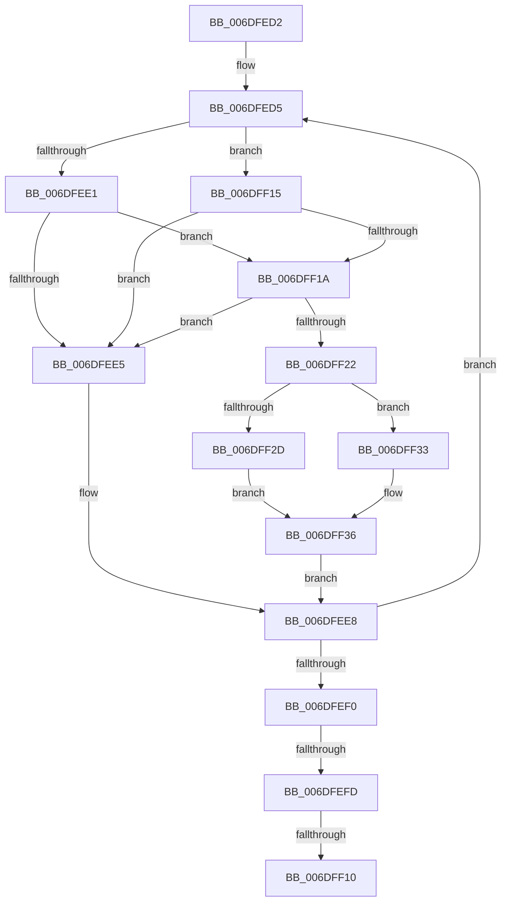

# sub_006DFED2

- RVA: `0x006DFED2`–`0x006DFF40` (길이 `110` bytes)
- VA: `0x00000001406DFED2`
- 실행 섹션: `.text`
- PDB 이름 있음: `아니요`; PDB Function 태그: `아니요`
- unwind 정보 RVA: `0x00072E24`
- 디코드: `35`개 명령, `110/110` bytes 표시
- 미해석 바이트: `0` (있으면 어셈블리에 `.byte`로 보존)

> 이 문서는 커널 이미지의 기계어와 PDB 기호를 분석해 생성했습니다. 4번과 5번은 함수 원형과 자료형을 바이너리 사용 방식에서 추정한 C 해석이며 원본 소스 복구 결과는 아닙니다.

## 1. Dependencies

- 직접 호출 지점: **1**; 고유 호출 대상: **1**
- 직접 호출자로 확인된 함수: **0**
- RIP 상대 이미지 참조: **0**

### Outgoing calls
- `0x006DFF39` → [EtwpInsertPlaceholderBuffer](../65/EtwpInsertPlaceholderBuffer_function_00653718.md) (function, `0x00653718`)

### Direct callers
- 이 함수 시작 RVA로 연결되는 직접 call은 확인되지 않았습니다. 간접 호출은 완전히 역산할 수 없습니다.

### Static image references
- 디코드된 RIP-relative 메모리 참조가 없습니다.

## 2. Other-region calls and transfers

- 다른 실행 섹션으로 향하는 call: **0**
- call이 아닌 외부 분기/꼬리 이동: **3**
  - `0x006DFEF7` → [EtwpEnqueueAvailableBuffer + 0x96](../2F/EtwpEnqueueAvailableBuffer_function_002FE7DC.md) (`tail-transfer`)
  - `0x006DFF0A` → [EtwpEnqueueAvailableBuffer + 0xA4](../2F/EtwpEnqueueAvailableBuffer_function_002FE7DC.md) (`tail-transfer`)
  - `0x006DFF10` → [EtwpEnqueueAvailableBuffer + 0xA0](../2F/EtwpEnqueueAvailableBuffer_function_002FE7DC.md) (`tail-transfer`)

## 3. Assembly (complete function range)

```asm
006DFED2  4D 8B F4                        mov r14, r12
006DFED5  48 8D 51 E0                     lea rdx, [rcx - 0x20]
006DFED9  8B 42 2C                        mov eax, dword ptr [rdx + 0x2c]
006DFEDC  4D 85 F6                        test r14, r14
006DFEDF  75 34                           jne 0x1406dff15
006DFEE1  85 C0                           test eax, eax
006DFEE3  75 35                           jne 0x1406dff1a
006DFEE5  48 8B F9                        mov rdi, rcx
006DFEE8  48 8B 0F                        mov rcx, qword ptr [rdi]
006DFEEB  48 85 C9                        test rcx, rcx
006DFEEE  75 E5                           jne 0x1406dfed5
006DFEF0  48 8D 4E 20                     lea rcx, [rsi + 0x20]
006DFEF4  4D 85 F6                        test r14, r14
006DFEF7  0F 84 75 E9 C1 FF               je 0x1402fe872
006DFEFD  49 8B 06                        mov rax, qword ptr [r14]
006DFF00  48 89 01                        mov qword ptr [rcx], rax
006DFF03  49 89 0E                        mov qword ptr [r14], rcx
006DFF06  4C 3B 73 30                     cmp r14, qword ptr [rbx + 0x30]
006DFF0A  0F 85 70 E9 C1 FF               jne 0x1402fe880
006DFF10  E9 67 E9 C1 FF                  jmp 0x1402fe87c
006DFF15  83 F8 06                        cmp eax, 6
006DFF18  75 CB                           jne 0x1406dfee5
006DFF1A  4C 8B F7                        mov r14, rdi
006DFF1D  83 F8 06                        cmp eax, 6
006DFF20  75 C3                           jne 0x1406dfee5
006DFF22  48 8B 01                        mov rax, qword ptr [rcx]
006DFF25  48 89 07                        mov qword ptr [rdi], rax
006DFF28  4C 39 21                        cmp qword ptr [rcx], r12
006DFF2B  75 06                           jne 0x1406dff33
006DFF2D  48 89 7B 30                     mov qword ptr [rbx + 0x30], rdi
006DFF31  EB 03                           jmp 0x1406dff36
006DFF33  4C 89 21                        mov qword ptr [rcx], r12
006DFF36  48 8B CB                        mov rcx, rbx
006DFF39  E8 DA 37 F7 FF                  call 0x140653718
006DFF3E  EB A8                           jmp 0x1406dfee8
```

## 4. C-style interpretation (structured pseudocode)

```c
__int64 __fastcall sub_006DFED2(__int64 a1)
{
    __int64 result;

loc_006DFED5:
    if (v_r12 != 0) goto loc_006DFF15;
    if ((unsigned int)((unsigned int)(*(unsigned int *)(a1 - 32 + 44))) != 0) goto loc_006DFF1A;
loc_006DFEE5:
loc_006DFEE8:
    if (*(unsigned __int64 *)(a1) != 0) goto loc_006DFED5;
    *(unsigned __int64 *)(v_rsi + 32) = *(unsigned __int64 *)(v_r12);
    *(unsigned __int64 *)(v_r12) = v_rsi + 32;
loc_006DFF15:
    if (((unsigned int)(*(unsigned __int64 *)(v_r12))) != 6) goto loc_006DFEE5;
loc_006DFF1A:
    if (((unsigned int)(*(unsigned __int64 *)(v_r12))) != 6) goto loc_006DFEE5;
    *(unsigned __int64 *)(a1) = *(unsigned __int64 *)(v_rsi + 32);
    if ((*(unsigned __int64 *)(v_rsi + 32)) != v_r12) goto loc_006DFF33;
    *(unsigned __int64 *)(v_rbx + 48) = a1;
    goto loc_006DFF36;
loc_006DFF33:
    *(unsigned __int64 *)(v_rsi + 32) = v_r12;
loc_006DFF36:
    result = EtwpInsertPlaceholderBuffer(v_rbx, a1 - 32, a3, a4);
    goto loc_006DFEE8;
}
```

## 5. (Beta) C Style

```c
int64_t sub_006DFED2(int64_t Arg1)
{
    int64_t result;

loc_006DFED5:
    if (local_r12 != 0) goto loc_006DFF15;
    if ((uint32_t)((uint32_t)(*(uint32_t *)(Arg1 - 0x20 + 0x2C))) != 0) goto loc_006DFF1A;
loc_006DFEE5:
loc_006DFEE8:
    if (*(uint64_t *)(Arg1) != 0) goto loc_006DFED5;
    *(uint64_t *)(local_rsi + 0x20) = *(uint64_t *)(local_r12);
    *(uint64_t *)(local_r12) = local_rsi + 32;
loc_006DFF15:
    if (((uint32_t)(*(uint64_t *)(local_r12))) != 6) goto loc_006DFEE5;
loc_006DFF1A:
    if (((uint32_t)(*(uint64_t *)(local_r12))) != 6) goto loc_006DFEE5;
    *(uint64_t *)(Arg1) = *(uint64_t *)(local_rsi + 0x20);
    if ((*(uint64_t *)(local_rsi + 0x20)) != local_r12) goto loc_006DFF33;
    *(uint64_t *)(local_rbx + 0x30) = Arg1;
    goto loc_006DFF36;
loc_006DFF33:
    *(uint64_t *)(local_rsi + 0x20) = local_r12;
loc_006DFF36:
    result = EtwpInsertPlaceholderBuffer(local_rbx, Arg1 - 32, a3, a4);
    goto loc_006DFEE8;
}
```

## 6. Execution-region graph

[열기: 2D/3D 그래프와 함수 탐색 컨트롤 패널](../../../control-panel.html?section=text&rva=0x006DFED2&view=graph)

- 2D 그래프는 위에서 아래로 흐르고, 3D 그래프는 빈 공간을 드래그해 회전합니다. Shift+드래그는 이동, 휠은 확대·축소, 함수 노드 선택은 대상 보고서 이동입니다.

### Static fallback


