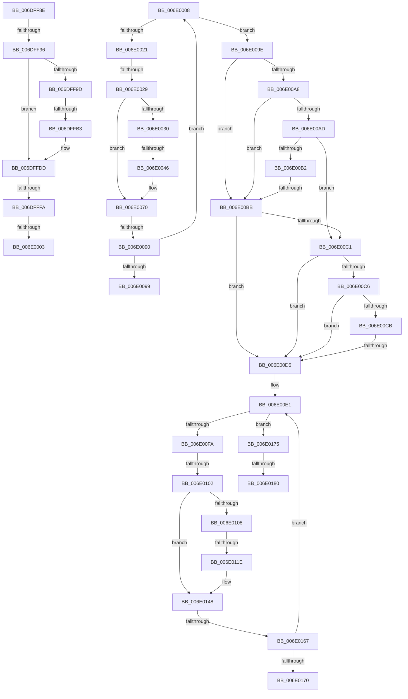

# sub_006DFF8E

- RVA: `0x006DFF8E`–`0x006E0187` (길이 `505` bytes)
- VA: `0x00000001406DFF8E`
- 실행 섹션: `.text`
- PDB 이름 있음: `아니요`; PDB Function 태그: `아니요`
- unwind 정보 RVA: `0x00073098`
- 디코드: `141`개 명령, `505/505` bytes 표시
- 미해석 바이트: `0` (있으면 어셈블리에 `.byte`로 보존)

> 이 문서는 커널 이미지의 기계어와 PDB 기호를 분석해 생성했습니다. 4번과 5번은 함수 원형과 자료형을 바이너리 사용 방식에서 추정한 C 해석이며 원본 소스 복구 결과는 아닙니다.

## 1. Dependencies

- 직접 호출 지점: **9**; 고유 호출 대상: **3**
- 직접 호출자로 확인된 함수: **0**
- RIP 상대 이미지 참조: **0**

### Outgoing calls
- `0x006DFFA4` → [AuthzBasepGetNextValue](../30/AuthzBasepGetNextValue_function_003007E0.md) (function, `0x003007E0`)
- `0x006DFFEB` → [AuthzBasepValueInSet](../2F/AuthzBasepValueInSet_function_002FE9B0.md) (function, `0x002FE9B0`)
- `0x006E0013` → [AuthzBasepGetNextValue](../30/AuthzBasepGetNextValue_function_003007E0.md) (function, `0x003007E0`)
- `0x006E0037` → [AuthzBasepGetNextValue](../30/AuthzBasepGetNextValue_function_003007E0.md) (function, `0x003007E0`)
- `0x006E0081` → [AuthzBasepValueInSet](../2F/AuthzBasepValueInSet_function_002FE9B0.md) (function, `0x002FE9B0`)
- `0x006E00D8` → [AuthzBasepRestartOperandValueEnumeration](../2F/AuthzBasepRestartOperandValueEnumeration_function_002FEB8C.md) (function, `0x002FEB8C`)
- `0x006E00EC` → [AuthzBasepGetNextValue](../30/AuthzBasepGetNextValue_function_003007E0.md) (function, `0x003007E0`)
- `0x006E010F` → [AuthzBasepGetNextValue](../30/AuthzBasepGetNextValue_function_003007E0.md) (function, `0x003007E0`)
- `0x006E0158` → [AuthzBasepValueInSet](../2F/AuthzBasepValueInSet_function_002FE9B0.md) (function, `0x002FE9B0`)

### Direct callers
- 이 함수 시작 RVA로 연결되는 직접 call은 확인되지 않았습니다. 간접 호출은 완전히 역산할 수 없습니다.

### Static image references
- 디코드된 RIP-relative 메모리 참조가 없습니다.

## 2. Other-region calls and transfers

- 다른 실행 섹션으로 향하는 call: **0**
- call이 아닌 외부 분기/꼬리 이동: **17**
  - `0x006DFF90` → [AuthzBasepEvaluateSetRelationship + 0xAF](../30/AuthzBasepEvaluateSetRelationship_function_003008F4.md) (`tail-transfer`)
  - `0x006DFFAD` → [AuthzBasepEvaluateSetRelationship + 0xAF](../30/AuthzBasepEvaluateSetRelationship_function_003008F4.md) (`tail-transfer`)
  - `0x006DFFF4` → [AuthzBasepEvaluateSetRelationship + 0xAF](../30/AuthzBasepEvaluateSetRelationship_function_003008F4.md) (`tail-transfer`)
  - `0x006DFFFD` → [AuthzBasepEvaluateSetRelationship + 0xD8](../30/AuthzBasepEvaluateSetRelationship_function_003008F4.md) (`tail-transfer`)
  - `0x006E0003` → [AuthzBasepEvaluateSetRelationship + 0xB2](../30/AuthzBasepEvaluateSetRelationship_function_003008F4.md) (`tail-transfer`)
  - `0x006E0023` → [AuthzBasepEvaluateSetRelationship + 0xAF](../30/AuthzBasepEvaluateSetRelationship_function_003008F4.md) (`tail-transfer`)
  - `0x006E0040` → [AuthzBasepEvaluateSetRelationship + 0xAF](../30/AuthzBasepEvaluateSetRelationship_function_003008F4.md) (`tail-transfer`)
  - `0x006E008A` → [AuthzBasepEvaluateSetRelationship + 0xAF](../30/AuthzBasepEvaluateSetRelationship_function_003008F4.md) (`tail-transfer`)
  - `0x006E0099` → [AuthzBasepEvaluateSetRelationship + 0xB2](../30/AuthzBasepEvaluateSetRelationship_function_003008F4.md) (`tail-transfer`)
  - `0x006E00B5` → [AuthzBasepEvaluateSetRelationship + 0xB2](../30/AuthzBasepEvaluateSetRelationship_function_003008F4.md) (`tail-transfer`)
  - `0x006E00CF` → [AuthzBasepEvaluateSetRelationship + 0xB2](../30/AuthzBasepEvaluateSetRelationship_function_003008F4.md) (`tail-transfer`)
  - `0x006E00FC` → [AuthzBasepEvaluateSetRelationship + 0xAF](../30/AuthzBasepEvaluateSetRelationship_function_003008F4.md) (`tail-transfer`)
  - `0x006E0118` → [AuthzBasepEvaluateSetRelationship + 0xAF](../30/AuthzBasepEvaluateSetRelationship_function_003008F4.md) (`tail-transfer`)
  - `0x006E0161` → [AuthzBasepEvaluateSetRelationship + 0xAF](../30/AuthzBasepEvaluateSetRelationship_function_003008F4.md) (`tail-transfer`)
  - `0x006E0170` → [AuthzBasepEvaluateSetRelationship + 0xB2](../30/AuthzBasepEvaluateSetRelationship_function_003008F4.md) (`tail-transfer`)
  - `0x006E017A` → [AuthzBasepEvaluateSetRelationship + 0xB2](../30/AuthzBasepEvaluateSetRelationship_function_003008F4.md) (`tail-transfer`)
  - `0x006E0182` → [AuthzBasepEvaluateSetRelationship + 0xB2](../30/AuthzBasepEvaluateSetRelationship_function_003008F4.md) (`tail-transfer`)

## 3. Assembly (complete function range)

```asm
006DFF8E  85 C0                           test eax, eax
006DFF90  0F 88 0D 0A C2 FF               js 0x1403009a3
006DFF96  66 83 7B 28 04                  cmp word ptr [rbx + 0x28], 4
006DFF9B  75 40                           jne 0x1406dffdd
006DFF9D  48 8D 55 D8                     lea rdx, [rbp - 0x28]
006DFFA1  48 8B CB                        mov rcx, rbx
006DFFA4  E8 37 08 C2 FF                  call 0x1403007e0
006DFFA9  8B D0                           mov edx, eax
006DFFAB  85 C0                           test eax, eax
006DFFAD  0F 88 F0 09 C2 FF               js 0x1403009a3
006DFFB3  8A 43 04                        mov al, byte ptr [rbx + 4]
006DFFB6  44 21 65 B8                     and dword ptr [rbp - 0x48], r12d
006DFFBA  88 45 B4                        mov byte ptr [rbp - 0x4c], al
006DFFBD  0F B7 03                        movzx eax, word ptr [rbx]
006DFFC0  66 89 45 B0                     mov word ptr [rbp - 0x50], ax
006DFFC4  48 8B 43 10                     mov rax, qword ptr [rbx + 0x10]
006DFFC8  48 89 45 C0                     mov qword ptr [rbp - 0x40], rax
006DFFCC  8B 43 08                        mov eax, dword ptr [rbx + 8]
006DFFCF  89 45 C8                        mov dword ptr [rbp - 0x38], eax
006DFFD2  49 8B C7                        mov rax, r15
006DFFD5  48 03 43 20                     add rax, qword ptr [rbx + 0x20]
006DFFD9  48 89 45 D0                     mov qword ptr [rbp - 0x30], rax
006DFFDD  41 B1 01                        mov r9b, 1
006DFFE0  48 8D 53 28                     lea rdx, [rbx + 0x28]
006DFFE4  4C 8B C7                        mov r8, rdi
006DFFE7  48 8D 4D B0                     lea rcx, [rbp - 0x50]
006DFFEB  E8 C0 E9 C1 FF                  call 0x1402fe9b0
006DFFF0  8B D0                           mov edx, eax
006DFFF2  85 C0                           test eax, eax
006DFFF4  0F 88 A9 09 C2 FF               js 0x1403009a3
006DFFFA  44 39 27                        cmp dword ptr [rdi], r12d
006DFFFD  0F 84 C9 09 C2 FF               je 0x1403009cc
006E0003  E9 9E 09 C2 FF                  jmp 0x1403009a6
006E0008  44 8B 7B 08                     mov r15d, dword ptr [rbx + 8]
006E000C  48 8D 55 B0                     lea rdx, [rbp - 0x50]
006E0010  48 8B CB                        mov rcx, rbx
006E0013  E8 C8 07 C2 FF                  call 0x1403007e0
006E0018  8B D0                           mov edx, eax
006E001A  3D 1A 00 00 80                  cmp eax, 0x8000001a
006E001F  74 7D                           je 0x1406e009e
006E0021  85 C0                           test eax, eax
006E0023  0F 88 7A 09 C2 FF               js 0x1403009a3
006E0029  66 83 7B 28 04                  cmp word ptr [rbx + 0x28], 4
006E002E  75 40                           jne 0x1406e0070
006E0030  48 8D 55 D8                     lea rdx, [rbp - 0x28]
006E0034  48 8B CB                        mov rcx, rbx
006E0037  E8 A4 07 C2 FF                  call 0x1403007e0
006E003C  8B D0                           mov edx, eax
006E003E  85 C0                           test eax, eax
006E0040  0F 88 5D 09 C2 FF               js 0x1403009a3
006E0046  8A 43 04                        mov al, byte ptr [rbx + 4]
006E0049  44 21 6D B8                     and dword ptr [rbp - 0x48], r13d
006E004D  88 45 B4                        mov byte ptr [rbp - 0x4c], al
006E0050  0F B7 03                        movzx eax, word ptr [rbx]
006E0053  66 89 45 B0                     mov word ptr [rbp - 0x50], ax
006E0057  48 8B 43 10                     mov rax, qword ptr [rbx + 0x10]
006E005B  48 89 45 C0                     mov qword ptr [rbp - 0x40], rax
006E005F  8B 43 08                        mov eax, dword ptr [rbx + 8]
006E0062  89 45 C8                        mov dword ptr [rbp - 0x38], eax
006E0065  41 8B C7                        mov eax, r15d
006E0068  48 03 43 20                     add rax, qword ptr [rbx + 0x20]
006E006C  48 89 45 D0                     mov qword ptr [rbp - 0x30], rax
006E0070  45 33 C9                        xor r9d, r9d
006E0073  48 8D 53 28                     lea rdx, [rbx + 0x28]
006E0077  4C 8B C7                        mov r8, rdi
006E007A  48 8D 4D B0                     lea rcx, [rbp - 0x50]
006E007E  41 FF C4                        inc r12d
006E0081  E8 2A E9 C1 FF                  call 0x1402fe9b0
006E0086  8B D0                           mov edx, eax
006E0088  85 C0                           test eax, eax
006E008A  0F 88 13 09 C2 FF               js 0x1403009a3
006E0090  83 3F 01                        cmp dword ptr [rdi], 1
006E0093  0F 84 6F FF FF FF               je 0x1406e0008
006E0099  E9 08 09 C2 FF                  jmp 0x1403009a6
006E009E  8B 43 0C                        mov eax, dword ptr [rbx + 0xc]
006E00A1  33 D2                           xor edx, edx
006E00A3  83 F8 01                        cmp eax, 1
006E00A6  75 13                           jne 0x1406e00bb
006E00A8  38 53 04                        cmp byte ptr [rbx + 4], dl
006E00AB  75 0E                           jne 0x1406e00bb
006E00AD  39 43 34                        cmp dword ptr [rbx + 0x34], eax
006E00B0  74 0F                           je 0x1406e00c1
006E00B2  39 43 2C                        cmp dword ptr [rbx + 0x2c], eax
006E00B5  0F 84 EB 08 C2 FF               je 0x1403009a6
006E00BB  83 7B 34 01                     cmp dword ptr [rbx + 0x34], 1
006E00BF  75 14                           jne 0x1406e00d5
006E00C1  38 53 2C                        cmp byte ptr [rbx + 0x2c], dl
006E00C4  75 0F                           jne 0x1406e00d5
006E00C6  83 F8 01                        cmp eax, 1
006E00C9  74 0A                           je 0x1406e00d5
006E00CB  83 7B 04 01                     cmp dword ptr [rbx + 4], 1
006E00CF  0F 84 D1 08 C2 FF               je 0x1403009a6
006E00D5  48 8B CB                        mov rcx, rbx
006E00D8  E8 AF EA C1 FF                  call 0x1402feb8c
006E00DD  48 8D 73 28                     lea rsi, [rbx + 0x28]
006E00E1  44 8B 7B 30                     mov r15d, dword ptr [rbx + 0x30]
006E00E5  48 8D 55 B0                     lea rdx, [rbp - 0x50]
006E00E9  48 8B CE                        mov rcx, rsi
006E00EC  E8 EF 06 C2 FF                  call 0x1403007e0
006E00F1  8B D0                           mov edx, eax
006E00F3  3D 1A 00 00 80                  cmp eax, 0x8000001a
006E00F8  74 7B                           je 0x1406e0175
006E00FA  85 C0                           test eax, eax
006E00FC  0F 88 A1 08 C2 FF               js 0x1403009a3
006E0102  66 83 3B 04                     cmp word ptr [rbx], 4
006E0106  75 40                           jne 0x1406e0148
006E0108  48 8D 55 D8                     lea rdx, [rbp - 0x28]
006E010C  48 8B CE                        mov rcx, rsi
006E010F  E8 CC 06 C2 FF                  call 0x1403007e0
006E0114  8B D0                           mov edx, eax
006E0116  85 C0                           test eax, eax
006E0118  0F 88 85 08 C2 FF               js 0x1403009a3
006E011E  8A 43 2C                        mov al, byte ptr [rbx + 0x2c]
006E0121  83 65 B8 00                     and dword ptr [rbp - 0x48], 0
006E0125  88 45 B4                        mov byte ptr [rbp - 0x4c], al
006E0128  0F B7 06                        movzx eax, word ptr [rsi]
006E012B  66 89 45 B0                     mov word ptr [rbp - 0x50], ax
006E012F  48 8B 43 38                     mov rax, qword ptr [rbx + 0x38]
006E0133  48 89 45 C0                     mov qword ptr [rbp - 0x40], rax
006E0137  8B 43 30                        mov eax, dword ptr [rbx + 0x30]
006E013A  89 45 C8                        mov dword ptr [rbp - 0x38], eax
006E013D  41 8B C7                        mov eax, r15d
006E0140  48 03 43 48                     add rax, qword ptr [rbx + 0x48]
006E0144  48 89 45 D0                     mov qword ptr [rbp - 0x30], rax
006E0148  45 33 C9                        xor r9d, r9d
006E014B  48 8D 4D B0                     lea rcx, [rbp - 0x50]
006E014F  4C 8B C7                        mov r8, rdi
006E0152  48 8B D3                        mov rdx, rbx
006E0155  41 FF C5                        inc r13d
006E0158  E8 53 E8 C1 FF                  call 0x1402fe9b0
006E015D  8B D0                           mov edx, eax
006E015F  85 C0                           test eax, eax
006E0161  0F 88 3C 08 C2 FF               js 0x1403009a3
006E0167  83 3F 01                        cmp dword ptr [rdi], 1
006E016A  0F 84 71 FF FF FF               je 0x1406e00e1
006E0170  E9 31 08 C2 FF                  jmp 0x1403009a6
006E0175  33 D2                           xor edx, edx
006E0177  45 3B E5                        cmp r12d, r13d
006E017A  0F 84 26 08 C2 FF               je 0x1403009a6
006E0180  21 17                           and dword ptr [rdi], edx
006E0182  E9 1F 08 C2 FF                  jmp 0x1403009a6
```

## 4. C-style interpretation (structured pseudocode)

```c
__int64 __fastcall sub_006DFF8E(void)
{
    __int64 result;

    if ((*(unsigned __int16 *)(v_rbx + 40)) != 4) goto loc_006DFFDD;
    result = AuthzBasepGetNextValue(v_rbx, v_rbp - 40, a3, a4);
    *(unsigned __int8 *)(v_rbp - 76) = (unsigned __int8)(*(unsigned __int8 *)(v_rbx + 4));
    *(unsigned __int16 *)(v_rbp - 80) = (unsigned __int16)(*(unsigned __int16 *)(v_rbx));
    *(unsigned __int64 *)(v_rbp - 64) = *(unsigned __int64 *)(v_rbx + 16);
    *(unsigned int *)(v_rbp - 56) = (unsigned int)((unsigned int)(*(unsigned int *)(v_rbx + 8)));
    result = (v_r15) + (*(unsigned __int64 *)(v_rbx + 32));
    *(unsigned __int64 *)(v_rbp - 48) = result;
loc_006DFFDD:
    result = AuthzBasepValueInSet(v_rbp - 80, v_rbx + 40, v_rdi, 1);
}
```

## 5. (Beta) C Style

```c
void sub_006DFF8E(void)
{
    int64_t result;

    if ((*(uint16_t *)(local_rbx + 0x28)) != 4) goto loc_006DFFDD;
    result = AuthzBasepGetNextValue(local_rbx, local_rbp - 40, a3, a4);
    *(uint8_t *)(local_rbp - 0x4C) = (uint8_t)(*(uint8_t *)(local_rbx + 0x4));
    *(uint16_t *)(local_rbp - 0x50) = (uint16_t)(*(uint16_t *)(local_rbx));
    *(uint64_t *)(local_rbp - 0x40) = *(uint64_t *)(local_rbx + 0x10);
    *(uint32_t *)(local_rbp - 0x38) = (uint32_t)((uint32_t)(*(uint32_t *)(local_rbx + 0x8)));
    result = (local_r15) + (*(uint64_t *)(local_rbx + 0x20));
    *(uint64_t *)(local_rbp - 0x30) = result;
loc_006DFFDD:
    result = AuthzBasepValueInSet(local_rbp - 80, local_rbx + 40, local_rdi, 1);
}
```

## 6. Execution-region graph

[열기: 2D/3D 그래프와 함수 탐색 컨트롤 패널](../../../control-panel.html?section=text&rva=0x006DFF8E&view=graph)

- 2D 그래프는 위에서 아래로 흐르고, 3D 그래프는 빈 공간을 드래그해 회전합니다. Shift+드래그는 이동, 휠은 확대·축소, 함수 노드 선택은 대상 보고서 이동입니다.

### Static fallback


