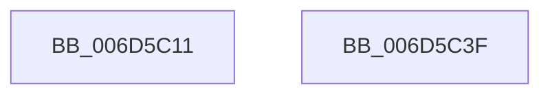

# `ST_STORE&lt;SM_TRAITS&gt;::StDmHandleDecompressionFailure&#x27;::`1&#x27;::filt$0

- RVA: `0x006D5C11`–`0x006D5C40` (길이 `47` bytes)
- VA: `0x00000001406D5C11`
- 실행 섹션: `.text`
- PDB 이름 있음: `예`; PDB Function 태그: `예`
- unwind 정보 RVA: `0x000C5CF8`
- 디코드: `13`개 명령, `47/47` bytes 표시
- 미해석 바이트: `0` (있으면 어셈블리에 `.byte`로 보존)

> 이 문서는 커널 이미지의 기계어와 PDB 기호를 분석해 생성했습니다. 4번과 5번은 함수 원형과 자료형을 바이너리 사용 방식에서 추정한 C 해석이며 원본 소스 복구 결과는 아닙니다.

## 1. Dependencies

- 직접 호출 지점: **1**; 고유 호출 대상: **1**
- 직접 호출자로 확인된 함수: **0**
- RIP 상대 이미지 참조: **0**

### Outgoing calls
- `0x006D5C33` → [ST_STORE<SM_TRAITS>::StRegionAccessExceptionFilter](../60/ST_STORE_SM_TRAITS_StRegionAccessExceptionFilter_function_0060E798.md) (function, `0x0060E798`)

### Direct callers
- 이 함수 시작 RVA로 연결되는 직접 call은 확인되지 않았습니다. 간접 호출은 완전히 역산할 수 없습니다.

### Static image references
- 디코드된 RIP-relative 메모리 참조가 없습니다.

## 2. Other-region calls and transfers

- 다른 실행 섹션으로 향하는 call: **0**
- 별도 외부 분기/꼬리 이동을 확인하지 못했습니다.

## 3. Assembly (complete function range)

```asm
006D5C11  40 55                           push rbp
006D5C13  48 83 EC 50                     sub rsp, 0x50
006D5C17  48 8B EA                        mov rbp, rdx
006D5C1A  48 89 8D 98 00 00 00            mov qword ptr [rbp + 0x98], rcx
006D5C21  4C 8D 4D 50                     lea r9, [rbp + 0x50]
006D5C25  4C 8B 85 F8 00 00 00            mov r8, qword ptr [rbp + 0xf8]
006D5C2C  48 8B 95 E0 00 00 00            mov rdx, qword ptr [rbp + 0xe0]
006D5C33  E8 60 8B F3 FF                  call 0x14060e798
006D5C38  90                              nop
006D5C39  48 83 C4 50                     add rsp, 0x50
006D5C3D  5D                              pop rbp
006D5C3E  C3                              ret
006D5C3F  CC                              int3
```

## 4. C-style interpretation (structured pseudocode)

```c
__int64 __fastcall _ST_STORE_SM_TRAITS___StDmHandleDecompressionFailure____1___filt_0(__int64 a1, __int64 a2)
{
    __int64 result;
    __int64 v_rsp;

    v_rsp = (v_rsp) - (80);
    *(unsigned __int64 *)(a2 + 152) = a1;
    result = ST_STORE_SM_TRAITS___StRegionAccessExceptionFilter(a1, *(unsigned __int64 *)(a2 + 224), *(unsigned __int64 *)(a2 + 248), a2 + 80);
    v_rsp = (v_rsp) + (80);
    return result;
}
```

## 5. (Beta) C Style

```c
int64_t _ST_STORE_SM_TRAITS___StDmHandleDecompressionFailure____1___filt_0(int64_t Arg1, void *Arg2)
{
    uint8_t *arg2 = (uint8_t *)Arg2;

    int64_t result;
    int64_t local_rsp;

    local_rsp = (local_rsp) - (80);
    *(uint64_t *)(arg2 + 0x98) = Arg1;
    result = ST_STORE_SM_TRAITS___StRegionAccessExceptionFilter(Arg1, *(uint64_t *)(arg2 + 0xE0), *(uint64_t *)(arg2 + 0xF8), Arg2 + 80);
    local_rsp = (local_rsp) + (80);
    return result;
}
```

### 관측된 메모리 오프셋

구조체 형식이 확인되지 않은 접근은 인자 기준의 오프셋으로만 기록했습니다.

| 기준 인자 | 오프셋 표현 | 폭 (bit) | 접근 |
|---|---:|---:|---|
| `Arg2` | `+ 0x50` | `64` | `R` |
| `Arg2` | `+ 0x98` | `64` | `W` |
| `Arg2` | `+ 0xE0` | `64` | `R` |
| `Arg2` | `+ 0xF8` | `64` | `R` |

## 6. Execution-region graph

[열기: 2D/3D 그래프와 함수 탐색 컨트롤 패널](../../../control-panel.html?section=text&rva=0x006D5C11&view=graph)

- 2D 그래프는 위에서 아래로 흐르고, 3D 그래프는 빈 공간을 드래그해 회전합니다. Shift+드래그는 이동, 휠은 확대·축소, 함수 노드 선택은 대상 보고서 이동입니다.

### Static fallback


