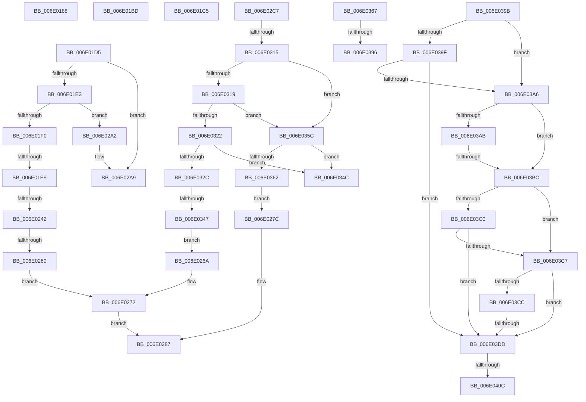

# sub_006E0188

- RVA: `0x006E0188`–`0x006E0411` (길이 `649` bytes)
- VA: `0x00000001406E0188`
- 실행 섹션: `.text`
- PDB 이름 있음: `아니요`; PDB Function 태그: `아니요`
- unwind 정보 RVA: `0x000730DC`
- 디코드: `157`개 명령, `649/649` bytes 표시
- 미해석 바이트: `0` (있으면 어셈블리에 `.byte`로 보존)

> 이 문서는 커널 이미지의 기계어와 PDB 기호를 분석해 생성했습니다. 4번과 5번은 함수 원형과 자료형을 바이너리 사용 방식에서 추정한 C 해석이며 원본 소스 복구 결과는 아닙니다.

## 1. Dependencies

- 직접 호출 지점: **9**; 고유 호출 대상: **5**
- 직접 호출자로 확인된 함수: **0**
- RIP 상대 이미지 참조: **0**

### Outgoing calls
- `0x006E0235` → [SepSidInToken](../3D/SepSidInToken_function_003D0430.md) (function, `0x003D0430`)
- `0x006E0253` → [AuthzBasepObjectInTypeList](../4B/AuthzBasepObjectInTypeList_function_004B8FF4.md) (function, `0x004B8FF4`)
- `0x006E0297` → [AuthzBasepAddAccessTypeList](../3D/AuthzBasepAddAccessTypeList_function_003D196C.md) (function, `0x003D196C`)
- `0x006E0308` → [SepSidInToken](../3D/SepSidInToken_function_003D0430.md) (function, `0x003D0430`)
- `0x006E033A` → [AuthzBasepObjectInTypeList](../4B/AuthzBasepObjectInTypeList_function_004B8FF4.md) (function, `0x004B8FF4`)
- `0x006E0389` → [SepSidInToken](../3D/SepSidInToken_function_003D0430.md) (function, `0x003D0430`)
- `0x006E03AF` → [SepIsPackageSid](../30/SepIsPackageSid_function_00301120.md) (function, `0x00301120`)
- `0x006E03D0` → [SepIsCapabilitySid](../3D/SepIsCapabilitySid_function_003D0DF0.md) (function, `0x003D0DF0`)
- `0x006E03FF` → [SepSidInToken](../3D/SepSidInToken_function_003D0430.md) (function, `0x003D0430`)

### Direct callers
- 이 함수 시작 RVA로 연결되는 직접 call은 확인되지 않았습니다. 간접 호출은 완전히 역산할 수 없습니다.

### Static image references
- 디코드된 RIP-relative 메모리 참조가 없습니다.

## 2. Other-region calls and transfers

- 다른 실행 섹션으로 향하는 call: **0**
- call이 아닌 외부 분기/꼬리 이동: **17**
  - `0x006E01B8` → [SepMaximumAccessCheck + 0x102](../30/SepMaximumAccessCheck_function_00300BF0.md) (`tail-transfer`)
  - `0x006E01C0` → [SepMaximumAccessCheck + 0x456](../30/SepMaximumAccessCheck_function_00300BF0.md) (`tail-transfer`)
  - `0x006E01D0` → [SepMaximumAccessCheck + 0x4C6](../30/SepMaximumAccessCheck_function_00300BF0.md) (`tail-transfer`)
  - `0x006E01F8` → [SepMaximumAccessCheck + 0x512](../30/SepMaximumAccessCheck_function_00300BF0.md) (`tail-transfer`)
  - `0x006E023C` → [SepMaximumAccessCheck + 0x118](../30/SepMaximumAccessCheck_function_00300BF0.md) (`tail-transfer`)
  - `0x006E025A` → [SepMaximumAccessCheck + 0x118](../30/SepMaximumAccessCheck_function_00300BF0.md) (`tail-transfer`)
  - `0x006E029D` → [SepMaximumAccessCheck + 0x118](../30/SepMaximumAccessCheck_function_00300BF0.md) (`tail-transfer`)
  - `0x006E02C2` → [SepMaximumAccessCheck + 0x16F](../30/SepMaximumAccessCheck_function_00300BF0.md) (`tail-transfer`)
  - `0x006E030F` → [SepMaximumAccessCheck + 0x118](../30/SepMaximumAccessCheck_function_00300BF0.md) (`tail-transfer`)
  - `0x006E0341` → [SepMaximumAccessCheck + 0x118](../30/SepMaximumAccessCheck_function_00300BF0.md) (`tail-transfer`)
  - `0x006E0357` → [SepMaximumAccessCheck + 0x118](../30/SepMaximumAccessCheck_function_00300BF0.md) (`tail-transfer`)
  - `0x006E0390` → [SepMaximumAccessCheck + 0x11F](../30/SepMaximumAccessCheck_function_00300BF0.md) (`tail-transfer`)
  - `0x006E0396` → [SepMaximumAccessCheck + 0x19C](../30/SepMaximumAccessCheck_function_00300BF0.md) (`tail-transfer`)
  - `0x006E03B6` → [SepMaximumAccessCheck + 0xD1](../30/SepMaximumAccessCheck_function_00300BF0.md) (`tail-transfer`)
  - `0x006E03D7` → [SepMaximumAccessCheck + 0x452](../30/SepMaximumAccessCheck_function_00300BF0.md) (`tail-transfer`)
  - `0x006E0406` → [SepMaximumAccessCheck + 0x11F](../30/SepMaximumAccessCheck_function_00300BF0.md) (`tail-transfer`)
  - `0x006E040C` → [SepMaximumAccessCheck + 0x4B6](../30/SepMaximumAccessCheck_function_00300BF0.md) (`tail-transfer`)

## 3. Assembly (complete function range)

```asm
006E0188  4C 8D 45 15                     lea r8, [rbp + 0x15]
006E018C  48 8D 45 18                     lea rax, [rbp + 0x18]
006E0190  48 89 44 24 40                  mov qword ptr [rsp + 0x40], rax
006E0195  48 8D 4D 10                     lea rcx, [rbp + 0x10]
006E0199  48 89 4C 24 38                  mov qword ptr [rsp + 0x38], rcx
006E019E  48 8D 55 14                     lea rdx, [rbp + 0x14]
006E01A2  48 89 54 24 30                  mov qword ptr [rsp + 0x30], rdx
006E01A7  48 8D 5D 04                     lea rbx, [rbp + 4]
006E01AB  48 89 5C 24 28                  mov qword ptr [rsp + 0x28], rbx
006E01B0  4C 89 44 24 20                  mov qword ptr [rsp + 0x20], r8
006E01B5  4D 8B C7                        mov r8, r15
006E01B8  E9 35 0B C2 FF                  jmp 0x140300cf2
006E01BD  4D 8B C7                        mov r8, r15
006E01C0  E9 81 0E C2 FF                  jmp 0x140301046
006E01C5  C7 44 24 28 02 00 00 00         mov dword ptr [rsp + 0x28], 2
006E01CD  45 8B CF                        mov r9d, r15d
006E01D0  E9 E1 0E C2 FF                  jmp 0x1403010b6
006E01D5  8B 4F 08                        mov ecx, dword ptr [rdi + 8]
006E01D8  8B C1                           mov eax, ecx
006E01DA  83 E0 01                        and eax, 1
006E01DD  0F 84 C6 00 00 00               je 0x1406e02a9
006E01E3  48 8D 5F 0C                     lea rbx, [rdi + 0xc]
006E01E7  48 85 DB                        test rbx, rbx
006E01EA  0F 84 B2 00 00 00               je 0x1406e02a2
006E01F0  83 BC 24 00 01 00 00 00         cmp dword ptr [rsp + 0x100], 0
006E01F8  0F 84 04 0F C2 FF               je 0x140301102
006E01FE  48 8B 94 24 E8 00 00 00         mov rdx, qword ptr [rsp + 0xe8]
006E0206  83 E1 02                        and ecx, 2
006E0209  44 8B C0                        mov r8d, eax
006E020C  45 33 C9                        xor r9d, r9d
006E020F  48 C1 E1 03                     shl rcx, 3
006E0213  48 83 C9 0C                     or rcx, 0xc
006E0217  49 C1 E0 04                     shl r8, 4
006E021B  48 8D 04 0F                     lea rax, [rdi + rcx]
006E021F  49 8B CD                        mov rcx, r13
006E0222  4C 03 C0                        add r8, rax
006E0225  8A 84 24 18 01 00 00            mov al, byte ptr [rsp + 0x118]
006E022C  88 44 24 28                     mov byte ptr [rsp + 0x28], al
006E0230  44 88 64 24 20                  mov byte ptr [rsp + 0x20], r12b
006E0235  E8 F6 01 CF FF                  call 0x1403d0430
006E023A  84 C0                           test al, al
006E023C  0F 84 C6 0A C2 FF               je 0x140300d08
006E0242  4C 8D 8C 24 D0 00 00 00         lea r9, [rsp + 0xd0]
006E024A  45 8B C6                        mov r8d, r14d
006E024D  48 8B D6                        mov rdx, rsi
006E0250  48 8B CB                        mov rcx, rbx
006E0253  E8 9C 8D DD FF                  call 0x1404b8ff4
006E0258  84 C0                           test al, al
006E025A  0F 84 A8 0A C2 FF               je 0x140300d08
006E0260  C7 44 24 28 01 00 00 00         mov dword ptr [rsp + 0x28], 1
006E0268  EB 08                           jmp 0x1406e0272
006E026A  C7 44 24 28 02 00 00 00         mov dword ptr [rsp + 0x28], 2
006E0272  44 8B 84 24 D0 00 00 00         mov r8d, dword ptr [rsp + 0xd0]
006E027A  EB 0B                           jmp 0x1406e0287
006E027C  C7 44 24 28 02 00 00 00         mov dword ptr [rsp + 0x28], 2
006E0284  45 33 C0                        xor r8d, r8d
006E0287  8B 47 04                        mov eax, dword ptr [rdi + 4]
006E028A  45 8B CF                        mov r9d, r15d
006E028D  41 8B D6                        mov edx, r14d
006E0290  89 44 24 20                     mov dword ptr [rsp + 0x20], eax
006E0294  48 8B CE                        mov rcx, rsi
006E0297  E8 D0 16 CF FF                  call 0x1403d196c
006E029C  90                              nop
006E029D  E9 66 0A C2 FF                  jmp 0x140300d08
006E02A2  8B 9C 24 C0 00 00 00            mov ebx, dword ptr [rsp + 0xc0]
006E02A9  83 E1 02                        and ecx, 2
006E02AC  44 8B C0                        mov r8d, eax
006E02AF  48 C1 E1 03                     shl rcx, 3
006E02B3  48 83 C9 0C                     or rcx, 0xc
006E02B7  49 C1 E0 04                     shl r8, 4
006E02BB  48 8D 04 0F                     lea rax, [rdi + rcx]
006E02BF  4C 03 C0                        add r8, rax
006E02C2  E9 98 0A C2 FF                  jmp 0x140300d5f
006E02C7  8B 4F 08                        mov ecx, dword ptr [rdi + 8]
006E02CA  41 B1 01                        mov r9b, 1
006E02CD  48 8B 94 24 E8 00 00 00         mov rdx, qword ptr [rsp + 0xe8]
006E02D5  8B C1                           mov eax, ecx
006E02D7  83 E0 01                        and eax, 1
006E02DA  83 E1 02                        and ecx, 2
006E02DD  44 8B C0                        mov r8d, eax
006E02E0  48 C1 E1 03                     shl rcx, 3
006E02E4  48 83 C9 0C                     or rcx, 0xc
006E02E8  8B D8                           mov ebx, eax
006E02EA  49 C1 E0 04                     shl r8, 4
006E02EE  48 8D 04 0F                     lea rax, [rdi + rcx]
006E02F2  49 8B CD                        mov rcx, r13
006E02F5  4C 03 C0                        add r8, rax
006E02F8  8A 84 24 18 01 00 00            mov al, byte ptr [rsp + 0x118]
006E02FF  88 44 24 28                     mov byte ptr [rsp + 0x28], al
006E0303  44 88 64 24 20                  mov byte ptr [rsp + 0x20], r12b
006E0308  E8 23 01 CF FF                  call 0x1403d0430
006E030D  84 C0                           test al, al
006E030F  0F 84 F3 09 C2 FF               je 0x140300d08
006E0315  85 DB                           test ebx, ebx
006E0317  74 43                           je 0x1406e035c
006E0319  48 8D 4F 0C                     lea rcx, [rdi + 0xc]
006E031D  48 85 C9                        test rcx, rcx
006E0320  74 3A                           je 0x1406e035c
006E0322  83 BC 24 00 01 00 00 00         cmp dword ptr [rsp + 0x100], 0
006E032A  74 20                           je 0x1406e034c
006E032C  4C 8D 8C 24 D0 00 00 00         lea r9, [rsp + 0xd0]
006E0334  45 8B C6                        mov r8d, r14d
006E0337  48 8B D6                        mov rdx, rsi
006E033A  E8 B5 8C DD FF                  call 0x1404b8ff4
006E033F  84 C0                           test al, al
006E0341  0F 84 C1 09 C2 FF               je 0x140300d08
006E0347  E9 1E FF FF FF                  jmp 0x1406e026a
006E034C  8B 46 1C                        mov eax, dword ptr [rsi + 0x1c]
006E034F  F7 D0                           not eax
006E0351  23 47 04                        and eax, dword ptr [rdi + 4]
006E0354  09 46 20                        or dword ptr [rsi + 0x20], eax
006E0357  E9 AC 09 C2 FF                  jmp 0x140300d08
006E035C  41 83 FE 01                     cmp r14d, 1
006E0360  74 EA                           je 0x1406e034c
006E0362  E9 15 FF FF FF                  jmp 0x1406e027c
006E0367  8A 84 24 18 01 00 00            mov al, byte ptr [rsp + 0x118]
006E036E  4C 8D 47 08                     lea r8, [rdi + 8]
006E0372  48 8B 94 24 E8 00 00 00         mov rdx, qword ptr [rsp + 0xe8]
006E037A  45 33 C9                        xor r9d, r9d
006E037D  88 44 24 28                     mov byte ptr [rsp + 0x28], al
006E0381  49 8B CD                        mov rcx, r13
006E0384  44 88 64 24 20                  mov byte ptr [rsp + 0x20], r12b
006E0389  E8 A2 00 CF FF                  call 0x1403d0430
006E038E  84 C0                           test al, al
006E0390  0F 84 79 09 C2 FF               je 0x140300d0f
006E0396  E9 F1 09 C2 FF                  jmp 0x140300d8c
006E039B  85 DB                           test ebx, ebx
006E039D  74 07                           je 0x1406e03a6
006E039F  83 7C 24 60 00                  cmp dword ptr [rsp + 0x60], 0
006E03A4  74 37                           je 0x1406e03dd
006E03A6  45 84 E4                        test r12b, r12b
006E03A9  75 11                           jne 0x1406e03bc
006E03AB  48 8D 4F 08                     lea rcx, [rdi + 8]
006E03AF  E8 6C 0D C2 FF                  call 0x140301120
006E03B4  84 C0                           test al, al
006E03B6  0F 85 05 09 C2 FF               jne 0x140300cc1
006E03BC  85 DB                           test ebx, ebx
006E03BE  74 07                           je 0x1406e03c7
006E03C0  83 7C 24 60 00                  cmp dword ptr [rsp + 0x60], 0
006E03C5  74 16                           je 0x1406e03dd
006E03C7  45 84 E4                        test r12b, r12b
006E03CA  75 11                           jne 0x1406e03dd
006E03CC  48 8D 4F 08                     lea rcx, [rdi + 8]
006E03D0  E8 1B 0A CF FF                  call 0x1403d0df0
006E03D5  84 C0                           test al, al
006E03D7  0F 85 65 0C C2 FF               jne 0x140301042
006E03DD  8A 84 24 18 01 00 00            mov al, byte ptr [rsp + 0x118]
006E03E4  4C 8D 47 08                     lea r8, [rdi + 8]
006E03E8  48 8B 94 24 E8 00 00 00         mov rdx, qword ptr [rsp + 0xe8]
006E03F0  45 33 C9                        xor r9d, r9d
006E03F3  88 44 24 28                     mov byte ptr [rsp + 0x28], al
006E03F7  49 8B CD                        mov rcx, r13
006E03FA  44 88 64 24 20                  mov byte ptr [rsp + 0x20], r12b
006E03FF  E8 2C 00 CF FF                  call 0x1403d0430
006E0404  84 C0                           test al, al
006E0406  0F 84 03 09 C2 FF               je 0x140300d0f
006E040C  E9 95 0C C2 FF                  jmp 0x1403010a6
```

## 4. C-style interpretation (structured pseudocode)

```c
__int64 __fastcall sub_006E0188(void)
{
    unsigned int v_stack_p100;
    unsigned __int8 v_stack_p118;
    unsigned __int64 v_stack_p20;
    unsigned __int64 v_stack_p28;
    unsigned __int64 v_stack_p30;
    unsigned __int64 v_stack_p38;
    unsigned __int64 v_stack_p40;
    unsigned int v_stack_p60;
    unsigned int v_stack_pC0;
    unsigned __int64 v_stack_pD0;
    unsigned __int64 v_stack_pE8;

    v_stack_p40 = v_rbp + 24;
    v_stack_p38 = v_rbp + 16;
    v_stack_p30 = v_rbp + 20;
    v_stack_p28 = v_rbp + 4;
    v_stack_p20 = v_rbp + 21;
}
```

## 5. (Beta) C Style

```c
void sub_006E0188(void)
{
    uint32_t v_stack_p100;
    uint8_t v_stack_p118;
    uint64_t v_stack_p20;
    uint64_t v_stack_p28;
    uint64_t v_stack_p30;
    uint64_t v_stack_p38;
    uint64_t v_stack_p40;
    uint32_t v_stack_p60;
    uint32_t v_stack_pC0;
    uint64_t v_stack_pD0;
    uint64_t v_stack_pE8;

    v_stack_p40 = local_rbp + 24;
    v_stack_p38 = local_rbp + 16;
    v_stack_p30 = local_rbp + 20;
    v_stack_p28 = local_rbp + 4;
    v_stack_p20 = local_rbp + 21;
}
```

## 6. Execution-region graph

[열기: 2D/3D 그래프와 함수 탐색 컨트롤 패널](../../../control-panel.html?section=text&rva=0x006E0188&view=graph)

- 2D 그래프는 위에서 아래로 흐르고, 3D 그래프는 빈 공간을 드래그해 회전합니다. Shift+드래그는 이동, 휠은 확대·축소, 함수 노드 선택은 대상 보고서 이동입니다.

### Static fallback


