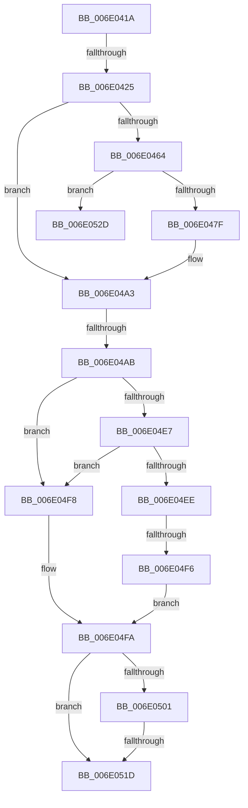

# sub_006E041A

- RVA: `0x006E041A`–`0x006E0537` (길이 `285` bytes)
- VA: `0x00000001406E041A`
- 실행 섹션: `.text`
- PDB 이름 있음: `아니요`; PDB Function 태그: `아니요`
- unwind 정보 RVA: `0x000733BC`
- 디코드: `67`개 명령, `285/285` bytes 표시
- 미해석 바이트: `0` (있으면 어셈블리에 `.byte`로 보존)

> 이 문서는 커널 이미지의 기계어와 PDB 기호를 분석해 생성했습니다. 4번과 5번은 함수 원형과 자료형을 바이너리 사용 방식에서 추정한 C 해석이며 원본 소스 복구 결과는 아닙니다.

## 1. Dependencies

- 직접 호출 지점: **5**; 고유 호출 대상: **4**
- 직접 호출자로 확인된 함수: **0**
- RIP 상대 이미지 참조: **0**

### Outgoing calls
- `0x006E0456` → [AuthzBasepConvertRelativeToAbsoluteTokenAttribute](../4B/AuthzBasepConvertRelativeToAbsoluteTokenAttribute_function_004B97BC.md) (function, `0x004B97BC`)
- `0x006E046E` → [AuthzBasepMemAlloc](../2F/AuthzBasepMemAlloc_function_002FFD90.md) (function, `0x002FFD90`)
- `0x006E049C` → [AuthzBasepConvertRelativeToAbsoluteTokenAttribute](../4B/AuthzBasepConvertRelativeToAbsoluteTokenAttribute_function_004B97BC.md) (function, `0x004B97BC`)
- `0x006E04D9` → [AuthzBasepQuerySecurityAttributesToken](../3A/AuthzBasepQuerySecurityAttributesToken_function_003A7D80.md) (function, `0x003A7D80`)
- `0x006E050E` → [AuthzBasepSetSecurityAttributesToken](../3A/AuthzBasepSetSecurityAttributesToken_function_003A8D1C.md) (function, `0x003A8D1C`)

### Direct callers
- 이 함수 시작 RVA로 연결되는 직접 call은 확인되지 않았습니다. 간접 호출은 완전히 역산할 수 없습니다.

### Static image references
- 디코드된 RIP-relative 메모리 참조가 없습니다.

## 2. Other-region calls and transfers

- 다른 실행 섹션으로 향하는 call: **0**
- call이 아닌 외부 분기/꼬리 이동: **6**
  - `0x006E041F` → [AuthzBasepInitializeResourceClaimsFromSacl + 0xDD](../30/AuthzBasepInitializeResourceClaimsFromSacl_function_00302E84.md) (`tail-transfer`)
  - `0x006E04A5` → [AuthzBasepInitializeResourceClaimsFromSacl + 0xEA](../30/AuthzBasepInitializeResourceClaimsFromSacl_function_00302E84.md) (`tail-transfer`)
  - `0x006E04F0` → [AuthzBasepInitializeResourceClaimsFromSacl + 0xEA](../30/AuthzBasepInitializeResourceClaimsFromSacl_function_00302E84.md) (`tail-transfer`)
  - `0x006E0517` → [AuthzBasepInitializeResourceClaimsFromSacl + 0xEA](../30/AuthzBasepInitializeResourceClaimsFromSacl_function_00302E84.md) (`tail-transfer`)
  - `0x006E0528` → [AuthzBasepInitializeResourceClaimsFromSacl + 0xDD](../30/AuthzBasepInitializeResourceClaimsFromSacl_function_00302E84.md) (`tail-transfer`)
  - `0x006E0532` → [AuthzBasepInitializeResourceClaimsFromSacl + 0x14E](../30/AuthzBasepInitializeResourceClaimsFromSacl_function_00302E84.md) (`tail-transfer`)

## 3. Assembly (complete function range)

```asm
006E041A  41 F6 46 01 08                  test byte ptr [r14 + 1], 8
006E041F  0F 85 3C 2B C2 FF               jne 0x140302f61
006E0425  45 0F B7 66 02                  movzx r12d, word ptr [r14 + 2]
006E042A  4D 8D 6E 08                     lea r13, [r14 + 8]
006E042E  41 0F B6 4D 01                  movzx ecx, byte ptr [r13 + 1]
006E0433  4C 8D 4C 24 30                  lea r9, [rsp + 0x30]
006E0438  4C 8D 44 24 60                  lea r8, [rsp + 0x60]
006E043D  8D 04 8D 00 00 00 00            lea eax, [rcx*4]
006E0444  44 2B E0                        sub r12d, eax
006E0447  8D 0C 8D 08 00 00 00            lea ecx, [rcx*4 + 8]
006E044E  49 03 CD                        add rcx, r13
006E0451  41 8D 54 24 F0                  lea edx, [r12 - 0x10]
006E0456  E8 61 93 DD FF                  call 0x1404b97bc
006E045B  8B D8                           mov ebx, eax
006E045D  3D 23 00 00 C0                  cmp eax, 0xc0000023
006E0462  75 3F                           jne 0x1406e04a3
006E0464  8B 4C 24 30                     mov ecx, dword ptr [rsp + 0x30]
006E0468  41 B8 53 65 41 74               mov r8d, 0x74416553
006E046E  E8 1D F9 C1 FF                  call 0x1402ffd90
006E0473  48 8B F8                        mov rdi, rax
006E0476  48 85 C0                        test rax, rax
006E0479  0F 84 AE 00 00 00               je 0x1406e052d
006E047F  41 0F B6 45 01                  movzx eax, byte ptr [r13 + 1]
006E0484  4C 8D 4C 24 30                  lea r9, [rsp + 0x30]
006E0489  4C 8B C7                        mov r8, rdi
006E048C  41 8D 54 24 F0                  lea edx, [r12 - 0x10]
006E0491  48 8D 0C 85 08 00 00 00         lea rcx, [rax*4 + 8]
006E0499  49 03 CD                        add rcx, r13
006E049C  E8 1B 93 DD FF                  call 0x1404b97bc
006E04A1  8B D8                           mov ebx, eax
006E04A3  85 DB                           test ebx, ebx
006E04A5  0F 88 C3 2A C2 FF               js 0x140302f6e
006E04AB  B9 01 00 00 00                  mov ecx, 1
006E04B0  48 89 7C 24 50                  mov qword ptr [rsp + 0x50], rdi
006E04B5  48 8D 44 24 34                  lea rax, [rsp + 0x34]
006E04BA  66 89 4C 24 48                  mov word ptr [rsp + 0x48], cx
006E04BF  89 4C 24 4C                     mov dword ptr [rsp + 0x4c], ecx
006E04C3  44 8B C1                        mov r8d, ecx
006E04C6  48 89 44 24 28                  mov qword ptr [rsp + 0x28], rax
006E04CB  48 8B CE                        mov rcx, rsi
006E04CE  83 64 24 20 00                  and dword ptr [rsp + 0x20], 0
006E04D3  45 33 C9                        xor r9d, r9d
006E04D6  48 8B D7                        mov rdx, rdi
006E04D9  E8 A2 78 CC FF                  call 0x1403a7d80
006E04DE  8B D8                           mov ebx, eax
006E04E0  3D 23 00 00 C0                  cmp eax, 0xc0000023
006E04E5  74 11                           je 0x1406e04f8
006E04E7  3D 25 02 00 C0                  cmp eax, 0xc0000225
006E04EC  74 0A                           je 0x1406e04f8
006E04EE  85 C0                           test eax, eax
006E04F0  0F 88 78 2A C2 FF               js 0x140302f6e
006E04F6  EB 02                           jmp 0x1406e04fa
006E04F8  33 DB                           xor ebx, ebx
006E04FA  83 7C 24 34 10                  cmp dword ptr [rsp + 0x34], 0x10
006E04FF  77 1C                           ja 0x1406e051d
006E0501  4C 8D 44 24 48                  lea r8, [rsp + 0x48]
006E0506  48 8B CE                        mov rcx, rsi
006E0509  48 8D 54 24 38                  lea rdx, [rsp + 0x38]
006E050E  E8 09 88 CC FF                  call 0x1403a8d1c
006E0513  8B D8                           mov ebx, eax
006E0515  85 C0                           test eax, eax
006E0517  0F 88 51 2A C2 FF               js 0x140302f6e
006E051D  4C 8B 6C 24 40                  mov r13, qword ptr [rsp + 0x40]
006E0522  41 BC 01 00 00 00               mov r12d, 1
006E0528  E9 34 2A C2 FF                  jmp 0x140302f61
006E052D  BB 17 00 00 C0                  mov ebx, 0xc0000017
006E0532  E9 9B 2A C2 FF                  jmp 0x140302fd2
```

## 4. C-style interpretation (structured pseudocode)

```c
__int64 __fastcall sub_006E041A(__int64 a1, __int64 a2, __int64 a3, __int64 a4, __int64 a5, unsigned int a6, __int64 a7, __int64 a8, __int64 a9, __int64 a10, __int64 a11, __int64 a12)
{
    __int64 result;
    __int64 v_r12;
    __int64 v_rbx;
    unsigned int v_stack_p20;
    unsigned __int64 v_stack_p28;
    unsigned __int64 v_stack_p34;
    unsigned __int16 v_stack_p48;
    unsigned int v_stack_p4C;
    unsigned __int64 v_stack_p50;

    v_r12 = (unsigned int)((*(unsigned __int16 *)(v_r14 + 2)) - ((unsigned int)(*(unsigned __int8 *)(v_r14 + 8 + 1) * 4)));
    a1 = (*(unsigned __int8 *)(v_r14 + 8 + 1) * 4 + 8) + (v_r14 + 8);
    result = AuthzBasepConvertRelativeToAbsoluteTokenAttribute(a1, v_r12 - 16, a12, a6);
    if (((unsigned int)(result)) != 0xC0000023ULL) goto loc_006E04A3;
    result = AuthzBasepMemAlloc((unsigned int)(a6), v_r12 - 16, (unsigned int)(0x74416553ULL), a6);
    if (result == 0) goto loc_006E052D;
    a1 = (*(unsigned __int8 *)(v_r14 + 8 + 1) * 4 + 8) + (v_r14 + 8);
    result = AuthzBasepConvertRelativeToAbsoluteTokenAttribute(a1, v_r12 - 16, result, a6);
loc_006E04A3:
    v_stack_p50 = result;
    v_stack_p48 = 1;
    v_stack_p4C = 1;
    v_stack_p28 = v_stack_p34;
    a4 = 0;
    result = AuthzBasepQuerySecurityAttributesToken(v_rsi, result, 1, a4);
    if (((unsigned int)(result)) == 0xC0000023ULL) goto loc_006E04F8;
    if (((unsigned int)(result)) == 0xC0000225ULL) goto loc_006E04F8;
    goto loc_006E04FA;
loc_006E04F8:
    v_rbx = 0;
loc_006E04FA:
    if (v_stack_p34 > 16) goto loc_006E051D;
    result = AuthzBasepSetSecurityAttributesToken(v_rsi, a7, a9, a4);
loc_006E051D:
loc_006E052D:
}
```

## 5. (Beta) C Style

```c
int64_t sub_006E041A(int64_t Arg1, int64_t Arg2, int64_t Arg3, int64_t Arg4, uint64_t Arg5, uint32_t Arg6, int64_t Arg7, int64_t Arg8, int64_t Arg9, uint64_t Arg10, uint64_t Arg11, int64_t Arg12)
{
    int64_t result;
    int64_t local_r12;
    int64_t local_rbx;
    uint32_t v_stack_p20;
    uint64_t v_stack_p28;
    uint64_t v_stack_p34;
    uint16_t v_stack_p48;
    uint32_t v_stack_p4C;
    uint64_t v_stack_p50;

    local_r12 = (uint32_t)((*(uint16_t *)(local_r14 + 0x2)) - ((uint32_t)(*(uint8_t *)(local_r14 + 0x8 + 0x1) * 4)));
    Arg1 = (*(uint8_t *)(local_r14 + 0x8 + 0x1) * 4 + 8) + (local_r14 + 8);
    result = AuthzBasepConvertRelativeToAbsoluteTokenAttribute(Arg1, local_r12 - 16, Arg12, Arg6);
    if (((uint32_t)(result)) != 0xC0000023ULL) goto loc_006E04A3;
    result = AuthzBasepMemAlloc((uint32_t)(Arg6), local_r12 - 16, (uint32_t)(0x74416553ULL), Arg6);
    if (result == 0) goto loc_006E052D;
    Arg1 = (*(uint8_t *)(local_r14 + 0x8 + 0x1) * 4 + 8) + (local_r14 + 8);
    result = AuthzBasepConvertRelativeToAbsoluteTokenAttribute(Arg1, local_r12 - 16, result, Arg6);
loc_006E04A3:
    v_stack_p50 = result;
    v_stack_p48 = 1;
    v_stack_p4C = 1;
    v_stack_p28 = v_stack_p34;
    Arg4 = 0;
    result = AuthzBasepQuerySecurityAttributesToken(local_rsi, result, 1, Arg4);
    if (((uint32_t)(result)) == 0xC0000023ULL) goto loc_006E04F8;
    if (((uint32_t)(result)) == 0xC0000225ULL) goto loc_006E04F8;
    goto loc_006E04FA;
loc_006E04F8:
    local_rbx = 0;
loc_006E04FA:
    if (v_stack_p34 > 16) goto loc_006E051D;
    result = AuthzBasepSetSecurityAttributesToken(local_rsi, Arg7, Arg9, Arg4);
loc_006E051D:
loc_006E052D:
}
```

## 6. Execution-region graph

[열기: 2D/3D 그래프와 함수 탐색 컨트롤 패널](../../../control-panel.html?section=text&rva=0x006E041A&view=graph)

- 2D 그래프는 위에서 아래로 흐르고, 3D 그래프는 빈 공간을 드래그해 회전합니다. Shift+드래그는 이동, 휠은 확대·축소, 함수 노드 선택은 대상 보고서 이동입니다.

### Static fallback


