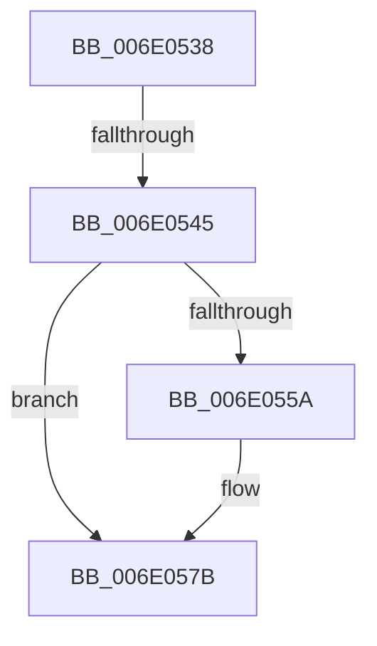

# sub_006E0538

- RVA: `0x006E0538`–`0x006E05FA` (길이 `194` bytes)
- VA: `0x00000001406E0538`
- 실행 섹션: `.text`
- PDB 이름 있음: `아니요`; PDB Function 태그: `아니요`
- unwind 정보 RVA: `0x00073484`
- 디코드: `41`개 명령, `194/194` bytes 표시
- 미해석 바이트: `0` (있으면 어셈블리에 `.byte`로 보존)

> 이 문서는 커널 이미지의 기계어와 PDB 기호를 분석해 생성했습니다. 4번과 5번은 함수 원형과 자료형을 바이너리 사용 방식에서 추정한 C 해석이며 원본 소스 복구 결과는 아닙니다.

## 1. Dependencies

- 직접 호출 지점: **6**; 고유 호출 대상: **6**
- 직접 호출자로 확인된 함수: **0**
- RIP 상대 이미지 참조: **0**

### Outgoing calls
- `0x006E054C` → [KiAcquireThreadLockRaiseToDpc](../39/KiAcquireThreadLockRaiseToDpc_function_00396280.md) (function, `0x00396280`)
- `0x006E056C` → [KiClearPriorityFloor](../39/KiClearPriorityFloor_function_00396314.md) (function, `0x00396314`)
- `0x006E059A` → [KiAcquireThreadStateLockForWrite](../30/KiAcquireThreadStateLockForWrite_function_0030E8C0.md) (function, `0x0030E8C0`)
- `0x006E05C6` → [KiReleaseThreadStateLock](../21/KiReleaseThreadStateLock_function_00217910.md) (function, `0x00217910`)
- `0x006E05E0` → [KiProcessDeferredReadyList](../25/KiProcessDeferredReadyList_function_00250800.md) (function, `0x00250800`)
- `0x006E05EF` → [KeSetPriorityThread](../2C/KeSetPriorityThread_function_002C76E0.md) (function, `0x002C76E0`)

### Direct callers
- 이 함수 시작 RVA로 연결되는 직접 call은 확인되지 않았습니다. 간접 호출은 완전히 역산할 수 없습니다.

### Static image references
- 디코드된 RIP-relative 메모리 참조가 없습니다.

## 2. Other-region calls and transfers

- 다른 실행 섹션으로 향하는 call: **0**
- call이 아닌 외부 분기/꼬리 이동: **2**
  - `0x006E053F` → [KeSetThreadSchedulerAssist + 0x8F](../30/KeSetThreadSchedulerAssist_function_003038F8.md) (`tail-transfer`)
  - `0x006E05F5` → [KeSetThreadSchedulerAssist + 0x8F](../30/KeSetThreadSchedulerAssist_function_003038F8.md) (`tail-transfer`)

## 3. Assembly (complete function range)

```asm
006E0538  F7 43 78 00 00 40 00            test dword ptr [rbx + 0x78], 0x400000
006E053F  0F 84 42 34 C2 FF               je 0x140303987
006E0545  48 8D 55 40                     lea rdx, [rbp + 0x40]
006E0549  48 8B CB                        mov rcx, rbx
006E054C  E8 2F 5D CB FF                  call 0x140396280
006E0551  83 BB 00 04 00 00 20            cmp dword ptr [rbx + 0x400], 0x20
006E0558  74 21                           je 0x1406e057b
006E055A  44 0F BE 83 00 04 00 00         movsx r8d, byte ptr [rbx + 0x400]
006E0562  48 8D 55 48                     lea rdx, [rbp + 0x48]
006E0566  41 B1 01                        mov r9b, 1
006E0569  48 8B CB                        mov rcx, rbx
006E056C  E8 A3 5D CB FF                  call 0x140396314
006E0571  C7 83 00 04 00 00 20 00 00 00   mov dword ptr [rbx + 0x400], 0x20
006E057B  0F 57 C0                        xorps xmm0, xmm0
006E057E  48 8D 45 E0                     lea rax, [rbp - 0x20]
006E0582  4C 8D 4D D0                     lea r9, [rbp - 0x30]
006E0586  48 89 44 24 20                  mov qword ptr [rsp + 0x20], rax
006E058B  4C 8D 45 C0                     lea r8, [rbp - 0x40]
006E058F  48 8B CB                        mov rcx, rbx
006E0592  48 8D 55 C8                     lea rdx, [rbp - 0x38]
006E0596  0F 11 45 E0                     movups xmmword ptr [rbp - 0x20], xmm0
006E059A  E8 21 E3 C2 FF                  call 0x14030e8c0
006E059F  F0 0F BA 73 78 16               lock btr dword ptr [rbx + 0x78], 0x16
006E05A5  4C 89 BB C8 03 00 00            mov qword ptr [rbx + 0x3c8], r15
006E05AC  48 8D 45 E0                     lea rax, [rbp - 0x20]
006E05B0  F0 0F BA 33 16                  lock btr dword ptr [rbx], 0x16
006E05B5  4C 8B 4D D0                     mov r9, qword ptr [rbp - 0x30]
006E05B9  4C 8D 45 C0                     lea r8, [rbp - 0x40]
006E05BD  48 8B 55 C8                     mov rdx, qword ptr [rbp - 0x38]
006E05C1  48 89 44 24 20                  mov qword ptr [rsp + 0x20], rax
006E05C6  E8 45 73 B3 FF                  call 0x140217910
006E05CB  4C 89 7B 40                     mov qword ptr [rbx + 0x40], r15
006E05CF  48 8D 55 48                     lea rdx, [rbp + 0x48]
006E05D3  65 48 8B 0C 25 20 00 00 00      mov rcx, qword ptr gs:[0x20]
006E05DC  44 8A 45 40                     mov r8b, byte ptr [rbp + 0x40]
006E05E0  E8 1B 02 B7 FF                  call 0x140250800
006E05E5  0F BE 93 33 02 00 00            movsx edx, byte ptr [rbx + 0x233]
006E05EC  48 8B CB                        mov rcx, rbx
006E05EF  E8 EC 70 BE FF                  call 0x1402c76e0
006E05F4  90                              nop
006E05F5  E9 8D 33 C2 FF                  jmp 0x140303987
```

## 4. C-style interpretation (structured pseudocode)

```c
__int64 __fastcall sub_006E0538(void)
{
    __int64 result;
    unsigned __int64 v_stack_p20;

    result = KiAcquireThreadLockRaiseToDpc(v_rbx, v_rbp + 64, a3, a4);
    if ((*(unsigned int *)(v_rbx + 1024)) != 32) {
        a3 = (__int8)(*(unsigned __int8 *)(v_rbx + 1024));
        a2 = v_rbp + 72;
        a4 = 1;
        a1 = v_rbx;
        result = KiClearPriorityFloor(a1, a2, a3, a4);
        *(unsigned int *)(v_rbx + 1024) = 32;
    }
    v_stack_p20 = v_rbp - 32;
    *(unsigned __int64 *)(v_rbp - 32) = v_xmm0;
    result = KiAcquireThreadStateLockForWrite(v_rbx, v_rbp - 56, v_rbp - 64, v_rbp - 48);
    *(unsigned __int64 *)(v_rbx + 968) = v_r15;
    v_stack_p20 = v_rbp - 32;
    result = KiReleaseThreadStateLock(v_rbx, *(unsigned __int64 *)(v_rbp - 56), v_rbp - 64, *(unsigned __int64 *)(v_rbp - 48));
    *(unsigned __int64 *)(v_rbx + 64) = v_r15;
    result = KiProcessDeferredReadyList(*(unsigned __int64 *)(gs_base + (0 + 32)), v_rbp + 72, *(unsigned __int8 *)(v_rbp + 64), *(unsigned __int64 *)(v_rbp - 48));
    result = KeSetPriorityThread(v_rbx, (__int8)(*(unsigned __int8 *)(v_rbx + 563)), *(unsigned __int8 *)(v_rbp + 64), *(unsigned __int64 *)(v_rbp - 48));
}
```

## 5. (Beta) C Style

```c
void sub_006E0538(void)
{
    int64_t result;
    uint64_t v_stack_p20;

    result = KiAcquireThreadLockRaiseToDpc(local_rbx, local_rbp + 64, a3, a4);
    if ((*(uint32_t *)(local_rbx + 0x400)) != 32) {
        a3 = (int8_t)(*(uint8_t *)(local_rbx + 0x400));
        a2 = local_rbp + 72;
        a4 = 1;
        a1 = local_rbx;
        result = KiClearPriorityFloor(a1, a2, a3, a4);
        *(uint32_t *)(local_rbx + 0x400) = 32;
    }
    v_stack_p20 = local_rbp - 32;
    *(uint64_t *)(local_rbp - 0x20) = v_xmm0;
    result = KiAcquireThreadStateLockForWrite(local_rbx, local_rbp - 56, local_rbp - 64, local_rbp - 48);
    *(uint64_t *)(local_rbx + 0x3C8) = local_r15;
    v_stack_p20 = local_rbp - 32;
    result = KiReleaseThreadStateLock(local_rbx, *(uint64_t *)(local_rbp - 0x38), local_rbp - 64, *(uint64_t *)(local_rbp - 0x30));
    *(uint64_t *)(local_rbx + 0x40) = local_r15;
    result = KiProcessDeferredReadyList(*(uint64_t *)(gs_base + (0 + 0x20)), local_rbp + 72, *(uint8_t *)(local_rbp + 0x40), *(uint64_t *)(local_rbp - 0x30));
    result = KeSetPriorityThread(local_rbx, (int8_t)(*(uint8_t *)(local_rbx + 0x233)), *(uint8_t *)(local_rbp + 0x40), *(uint64_t *)(local_rbp - 0x30));
}
```

## 6. Execution-region graph

[열기: 2D/3D 그래프와 함수 탐색 컨트롤 패널](../../../control-panel.html?section=text&rva=0x006E0538&view=graph)

- 2D 그래프는 위에서 아래로 흐르고, 3D 그래프는 빈 공간을 드래그해 회전합니다. Shift+드래그는 이동, 휠은 확대·축소, 함수 노드 선택은 대상 보고서 이동입니다.

### Static fallback


