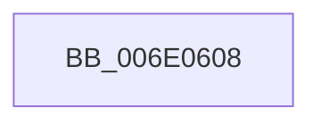

# sub_006E0608

- RVA: `0x006E0608`–`0x006E0667` (길이 `95` bytes)
- VA: `0x00000001406E0608`
- 실행 섹션: `.text`
- PDB 이름 있음: `아니요`; PDB Function 태그: `아니요`
- unwind 정보 RVA: `0x00073558`
- 디코드: `21`개 명령, `95/95` bytes 표시
- 미해석 바이트: `0` (있으면 어셈블리에 `.byte`로 보존)

> 이 문서는 커널 이미지의 기계어와 PDB 기호를 분석해 생성했습니다. 4번과 5번은 함수 원형과 자료형을 바이너리 사용 방식에서 추정한 C 해석이며 원본 소스 복구 결과는 아닙니다.

## 1. Dependencies

- 직접 호출 지점: **5**; 고유 호출 대상: **5**
- 직접 호출자로 확인된 함수: **0**
- RIP 상대 이미지 참조: **2**

### Outgoing calls
- `0x006E0612` → [KeReleaseSpinLock](../39/KeReleaseSpinLock_function_00392BA0.md) (function, `0x00392BA0`)
- `0x006E0631` → [memset](../6C/memset_function_006C6C40.md) (function, `0x006C6C40`)
- `0x006E0639` → [KeFindFirstSetLeftAffinityEx](../45/KeFindFirstSetLeftAffinityEx_function_004530E0.md) (function, `0x004530E0`)
- `0x006E0645` → [KeAddProcessorAffinityEx](../25/KeAddProcessorAffinityEx_function_0025B6F0.md) (function, `0x0025B6F0`)
- `0x006E065C` → [PopExecuteOnTargetProcessors](../2D/PopExecuteOnTargetProcessors_function_002DD834.md) (function, `0x002DD834`)

### Direct callers
- 이 함수 시작 RVA로 연결되는 직접 call은 확인되지 않았습니다. 간접 호출은 완전히 역산할 수 없습니다.

### Static image references
- `0x006E060B` → RVA `0x00F0CA68` (`.data`; read)
- `0x006E064D` → RVA `0x0048FDC0` (`HalAdjustResourceList`; read)

## 2. Other-region calls and transfers

- 다른 실행 섹션으로 향하는 call: **0**
- call이 아닌 외부 분기/꼬리 이동: **1**
  - `0x006E0662` → [PpmUpdatePlatformIdleVeto + 0xEA](../30/PpmUpdatePlatformIdleVeto_function_003047E0.md) (`tail-transfer`)

## 3. Assembly (complete function range)

```asm
006E0608  41 8A D6                        mov dl, r14b
006E060B  48 8D 0D 56 C4 82 00            lea rcx, [rip + 0x82c456]
006E0612  E8 89 25 CB FF                  call 0x140392ba0
006E0617  83 64 24 34 00                  and dword ptr [rsp + 0x34], 0
006E061C  48 8D 4C 24 38                  lea rcx, [rsp + 0x38]
006E0621  33 D2                           xor edx, edx
006E0623  C7 44 24 30 01 00 20 00         mov dword ptr [rsp + 0x30], 0x200001
006E062B  41 B8 00 01 00 00               mov r8d, 0x100
006E0631  E8 0A 66 FE FF                  call 0x1406c6c40
006E0636  48 8B CB                        mov rcx, rbx
006E0639  E8 A2 2A D7 FF                  call 0x1404530e0
006E063E  8B D0                           mov edx, eax
006E0640  48 8D 4C 24 30                  lea rcx, [rsp + 0x30]
006E0645  E8 A6 B0 B7 FF                  call 0x14025b6f0
006E064A  45 33 C9                        xor r9d, r9d
006E064D  48 8D 15 6C F7 DA FF            lea rdx, [rip - 0x250894]
006E0654  45 33 C0                        xor r8d, r8d
006E0657  48 8D 4C 24 30                  lea rcx, [rsp + 0x30]
006E065C  E8 D3 D1 BF FF                  call 0x1402dd834
006E0661  90                              nop
006E0662  E9 63 42 C2 FF                  jmp 0x1403048ca
```

## 4. C-style interpretation (structured pseudocode)

```c
__int64 __fastcall sub_006E0608(__int64 a1, __int64 a2, __int64 a3, int a4, __int64 a5, __int64 a6, __int64 a7)
{
    __int64 result;
    unsigned int v_stack_p30;
    unsigned int v_stack_p34;

    result = KeReleaseSpinLock(v_rip + 8569942, (unsigned __int8)(v_r14), a3, a4);
    a2 = 0;
    v_stack_p30 = 0x200001ULL;
    result = memset(a7, a2, 256, a4);
    result = KeFindFirstSetLeftAffinityEx(v_rbx, a2, 256, a4);
    result = KeAddProcessorAffinityEx(a6, (unsigned int)((unsigned int)(result)), 256, a4);
    a4 = 0;
    a3 = 0;
    result = PopExecuteOnTargetProcessors(a6, v_rip - 2427028, a3, a4);
}
```

## 5. (Beta) C Style

```c
int64_t sub_006E0608(int64_t Arg1, int64_t Arg2, int64_t Arg3, int32_t Arg4, uint64_t Arg5, int64_t Arg6, int64_t Arg7)
{
    int64_t result;
    uint32_t v_stack_p30;
    uint32_t v_stack_p34;

    result = KeReleaseSpinLock(v_rip + 8569942, (uint8_t)(local_r14), Arg3, Arg4);
    Arg2 = 0;
    v_stack_p30 = 0x200001ULL;
    result = memset(Arg7, Arg2, 256, Arg4);
    result = KeFindFirstSetLeftAffinityEx(local_rbx, Arg2, 256, Arg4);
    result = KeAddProcessorAffinityEx(Arg6, (uint32_t)((uint32_t)(result)), 256, Arg4);
    Arg4 = 0;
    Arg3 = 0;
    result = PopExecuteOnTargetProcessors(Arg6, v_rip - 2427028, Arg3, Arg4);
}
```

## 6. Execution-region graph

[열기: 2D/3D 그래프와 함수 탐색 컨트롤 패널](../../../control-panel.html?section=text&rva=0x006E0608&view=graph)

- 2D 그래프는 위에서 아래로 흐르고, 3D 그래프는 빈 공간을 드래그해 회전합니다. Shift+드래그는 이동, 휠은 확대·축소, 함수 노드 선택은 대상 보고서 이동입니다.

### Static fallback


