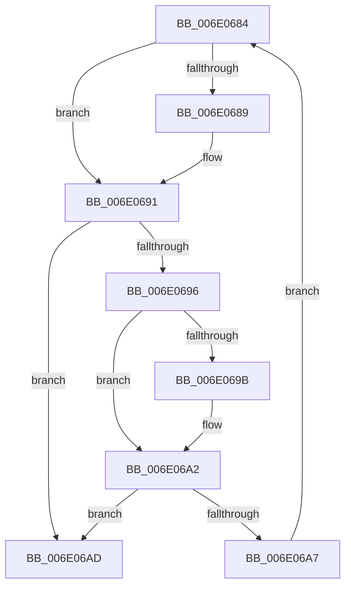

# sub_006E0684

- RVA: `0x006E0684`–`0x006E06B5` (길이 `49` bytes)
- VA: `0x00000001406E0684`
- 실행 섹션: `.text`
- PDB 이름 있음: `아니요`; PDB Function 태그: `아니요`
- unwind 정보 RVA: `0x000735F4`
- 디코드: `16`개 명령, `49/49` bytes 표시
- 미해석 바이트: `0` (있으면 어셈블리에 `.byte`로 보존)

> 이 문서는 커널 이미지의 기계어와 PDB 기호를 분석해 생성했습니다. 4번과 5번은 함수 원형과 자료형을 바이너리 사용 방식에서 추정한 C 해석이며 원본 소스 복구 결과는 아닙니다.

## 1. Dependencies

- 직접 호출 지점: **0**; 고유 호출 대상: **0**
- 직접 호출자로 확인된 함수: **0**
- RIP 상대 이미지 참조: **0**

### Outgoing calls
- 직접 디코드된 call 명령이 없습니다.

### Direct callers
- 이 함수 시작 RVA로 연결되는 직접 call은 확인되지 않았습니다. 간접 호출은 완전히 역산할 수 없습니다.

### Static image references
- 디코드된 RIP-relative 메모리 참조가 없습니다.

## 2. Other-region calls and transfers

- 다른 실행 섹션으로 향하는 call: **0**
- call이 아닌 외부 분기/꼬리 이동: **1**
  - `0x006E06B0` → [HvlSendSyntheticClusterIpi + 0x52](../30/HvlSendSyntheticClusterIpi_function_00304E50.md) (`tail-transfer`)

## 3. Assembly (complete function range)

```asm
006E0684  F6 C3 01                        test bl, 1
006E0687  74 08                           je 0x1406e0691
006E0689  0F B6 42 FE                     movzx eax, byte ptr [rdx - 2]
006E068D  48 0F AB C1                     bts rcx, rax
006E0691  48 D1 EB                        shr rbx, 1
006E0694  74 17                           je 0x1406e06ad
006E0696  F6 C3 01                        test bl, 1
006E0699  74 07                           je 0x1406e06a2
006E069B  0F B6 02                        movzx eax, byte ptr [rdx]
006E069E  48 0F AB C1                     bts rcx, rax
006E06A2  48 D1 EB                        shr rbx, 1
006E06A5  74 06                           je 0x1406e06ad
006E06A7  48 83 C2 04                     add rdx, 4
006E06AB  EB D7                           jmp 0x1406e0684
006E06AD  48 8B D9                        mov rbx, rcx
006E06B0  E9 ED 47 C2 FF                  jmp 0x140304ea2
```

## 4. C-style interpretation (structured pseudocode)

```c
__int64 __fastcall sub_006E0684(__int64 a1, __int64 a2)
{
    __int64 result;
    __int64 v_rbx;

    if ((((unsigned __int8)(v_rbx)) & (1)) != 0) {
        result = *(unsigned __int8 *)(a2 - 2);
    }
    v_rbx = (v_rbx) >> (1);
    if (condition_is_equal) goto loc_006E06AD;
    if ((((unsigned __int8)(v_rbx)) & (1)) != 0) {
        result = *(unsigned __int8 *)(a2);
    }
    v_rbx = (v_rbx) >> (1);
    if (condition_is_equal) goto loc_006E06AD;
    a2 = (a2) + (4);
    goto loc_006E0684;
loc_006E06AD:
}
```

## 5. (Beta) C Style

```c
int64_t sub_006E0684(int64_t Arg1, void *Arg2)
{
    uint8_t *arg2 = (uint8_t *)Arg2;

    int64_t result;
    int64_t local_rbx;

    if ((((uint8_t)(local_rbx)) & (1)) != 0) {
        result = *(uint8_t *)(arg2 - 0x2);
    }
    local_rbx = (local_rbx) >> (1);
    if (condition_is_equal) goto loc_006E06AD;
    if ((((uint8_t)(local_rbx)) & (1)) != 0) {
        result = *(uint8_t *)(arg2);
    }
    local_rbx = (local_rbx) >> (1);
    if (condition_is_equal) goto loc_006E06AD;
    Arg2 = (Arg2) + (4);
    goto loc_006E0684;
loc_006E06AD:
}
```

### 관측된 메모리 오프셋

구조체 형식이 확인되지 않은 접근은 인자 기준의 오프셋으로만 기록했습니다.

| 기준 인자 | 오프셋 표현 | 폭 (bit) | 접근 |
|---|---:|---:|---|
| `Arg2` | `- 0x2` | `8` | `R` |
| `Arg2` | `+ 0x0` | `8` | `R` |

## 6. Execution-region graph

[열기: 2D/3D 그래프와 함수 탐색 컨트롤 패널](../../../control-panel.html?section=text&rva=0x006E0684&view=graph)

- 2D 그래프는 위에서 아래로 흐르고, 3D 그래프는 빈 공간을 드래그해 회전합니다. Shift+드래그는 이동, 휠은 확대·축소, 함수 노드 선택은 대상 보고서 이동입니다.

### Static fallback


