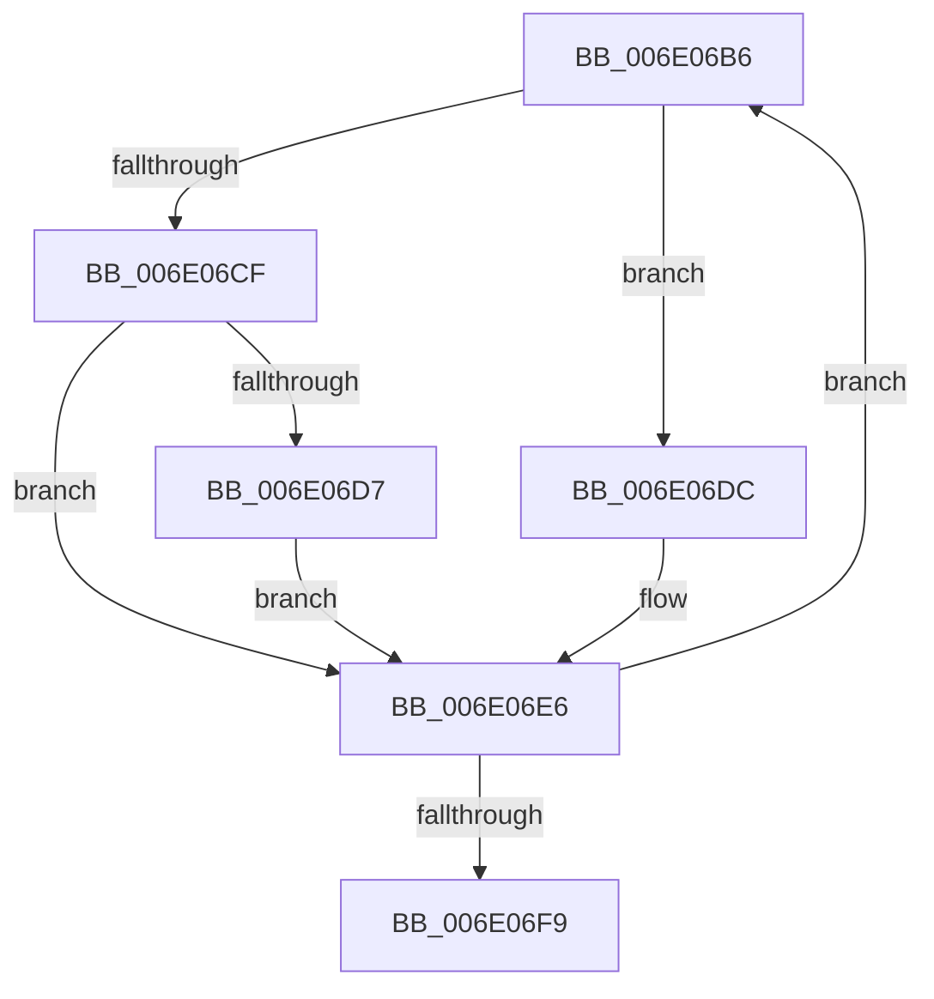

# sub_006E06B6

- RVA: `0x006E06B6`–`0x006E0708` (길이 `82` bytes)
- VA: `0x00000001406E06B6`
- 실행 섹션: `.text`
- PDB 이름 있음: `아니요`; PDB Function 태그: `아니요`
- unwind 정보 RVA: `0x00073674`
- 디코드: `24`개 명령, `82/82` bytes 표시
- 미해석 바이트: `0` (있으면 어셈블리에 `.byte`로 보존)

> 이 문서는 커널 이미지의 기계어와 PDB 기호를 분석해 생성했습니다. 4번과 5번은 함수 원형과 자료형을 바이너리 사용 방식에서 추정한 C 해석이며 원본 소스 복구 결과는 아닙니다.

## 1. Dependencies

- 직접 호출 지점: **0**; 고유 호출 대상: **0**
- 직접 호출자로 확인된 함수: **0**
- RIP 상대 이미지 참조: **1**

### Outgoing calls
- 직접 디코드된 call 명령이 없습니다.

### Direct callers
- 이 함수 시작 RVA로 연결되는 직접 call은 확인되지 않았습니다. 간접 호출은 완전히 역산할 수 없습니다.

### Static image references
- `0x006E06E6` → RVA `0x00FC6E20` (`ALMOSTRO`; read)

## 2. Other-region calls and transfers

- 다른 실행 섹션으로 향하는 call: **0**
- call이 아닌 외부 분기/꼬리 이동: **1**
  - `0x006E0703` → [KeCpuSetReportParkedProcessors + 0x325](../30/KeCpuSetReportParkedProcessors_function_003052B0.md) (`tail-transfer`)

## 3. Assembly (complete function range)

```asm
006E06B6  49 0F BC C8                     bsf rcx, r8
006E06BA  4C 8B DA                        mov r11, rdx
006E06BD  8B C1                           mov eax, ecx
006E06BF  49 0F B3 C0                     btr r8, rax
006E06C3  89 4C 24 34                     mov dword ptr [rsp + 0x34], ecx
006E06C7  8B C1                           mov eax, ecx
006E06C9  49 0F A3 C7                     bt r15, rax
006E06CD  73 0D                           jae 0x1406e06dc
006E06CF  49 8B C7                        mov rax, r15
006E06D2  48 23 C2                        and rax, rdx
006E06D5  74 0F                           je 0x1406e06e6
006E06D7  4C 8B D8                        mov r11, rax
006E06DA  EB 0A                           jmp 0x1406e06e6
006E06DC  49 8B C4                        mov rax, r12
006E06DF  48 23 C2                        and rax, rdx
006E06E2  4C 0F 45 D8                     cmovne r11, rax
006E06E6  48 8B 05 33 67 8E 00            mov rax, qword ptr [rip + 0x8e6733]
006E06ED  41 03 CD                        add ecx, r13d
006E06F0  4C 89 1C C8                     mov qword ptr [rax + rcx*8], r11
006E06F4  4D 85 C0                        test r8, r8
006E06F7  75 BD                           jne 0x1406e06b6
006E06F9  44 8B 64 24 24                  mov r12d, dword ptr [rsp + 0x24]
006E06FE  4C 8B 6C 24 40                  mov r13, qword ptr [rsp + 0x40]
006E0703  E9 CD 4E C2 FF                  jmp 0x1403055d5
```

## 4. C-style interpretation (structured pseudocode)

```c
__int64 __fastcall sub_006E06B6(__int64 a1, __int64 a2, __int64 a3, __int64 a4, __int64 a5, __int64 a6, __int64 a7, __int64 a8)
{
    __int64 result;
    __int64 v_r11;
    unsigned int v_stack_p24;
    unsigned int v_stack_p34;

    v_stack_p34 = (unsigned int)(a1);
    if (condition_is_above_or_equal) goto loc_006E06DC;
    result = (v_r15) & (a2);
    if (condition_is_equal) goto loc_006E06E6;
    goto loc_006E06E6;
loc_006E06DC:
    result = (v_r12) & (a2);
    v_r11 = result;
    if (condition_is_not_equal) { v_r11 = result; }
loc_006E06E6:
    a1 = (unsigned int)((a1) + ((unsigned int)(v_r13)));
    *(unsigned __int64 *)(*(unsigned __int64 *)(v_rip + 9332531) + a1 * 8) = v_r11;
    if (a3 != 0) goto loc_006E06B6;
}
```

## 5. (Beta) C Style

```c
int64_t sub_006E06B6(int64_t Arg1, int64_t Arg2, int64_t Arg3, int64_t Arg4, uint64_t Arg5, uint64_t Arg6, uint64_t Arg7, int64_t Arg8)
{
    int64_t result;
    int64_t local_r11;
    uint32_t v_stack_p24;
    uint32_t v_stack_p34;

    v_stack_p34 = (uint32_t)(Arg1);
    if (condition_is_above_or_equal) goto loc_006E06DC;
    result = (local_r15) & (Arg2);
    if (condition_is_equal) goto loc_006E06E6;
    goto loc_006E06E6;
loc_006E06DC:
    result = (local_r12) & (Arg2);
    local_r11 = result;
    if (condition_is_not_equal) { local_r11 = result; }
loc_006E06E6:
    Arg1 = (uint32_t)((Arg1) + ((uint32_t)(local_r13)));
    *(uint64_t *)(*(uint64_t *)(v_rip + 0x8E6733) + Arg1 * 8) = local_r11;
    if (Arg3 != 0) goto loc_006E06B6;
}
```

## 6. Execution-region graph

[열기: 2D/3D 그래프와 함수 탐색 컨트롤 패널](../../../control-panel.html?section=text&rva=0x006E06B6&view=graph)

- 2D 그래프는 위에서 아래로 흐르고, 3D 그래프는 빈 공간을 드래그해 회전합니다. Shift+드래그는 이동, 휠은 확대·축소, 함수 노드 선택은 대상 보고서 이동입니다.

### Static fallback


