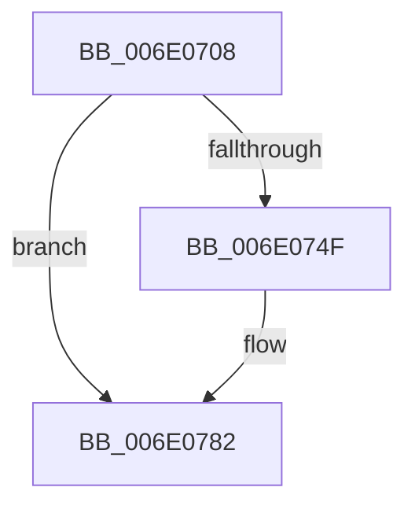

# sub_006E0708

- RVA: `0x006E0708`–`0x006E07BF` (길이 `183` bytes)
- VA: `0x00000001406E0708`
- 실행 섹션: `.text`
- PDB 이름 있음: `아니요`; PDB Function 태그: `아니요`
- unwind 정보 RVA: `0x0007369C`
- 디코드: `41`개 명령, `183/183` bytes 표시
- 미해석 바이트: `0` (있으면 어셈블리에 `.byte`로 보존)

> 이 문서는 커널 이미지의 기계어와 PDB 기호를 분석해 생성했습니다. 4번과 5번은 함수 원형과 자료형을 바이너리 사용 방식에서 추정한 C 해석이며 원본 소스 복구 결과는 아닙니다.

## 1. Dependencies

- 직접 호출 지점: **7**; 고유 호출 대상: **4**
- 직접 호출자로 확인된 함수: **0**
- RIP 상대 이미지 참조: **1**

### Outgoing calls
- `0x006E071C` → [HvlpAcquireHypercallPage](../47/HvlpAcquireHypercallPage_function_00471410.md) (function, `0x00471410`)
- `0x006E0745` → [HvlpAffinityToHvProcessorSet](../30/HvlpAffinityToHvProcessorSet_function_003068F4.md) (function, `0x003068F4`)
- `0x006E0754` → [HvlpReleaseHypercallPage](../31/HvlpReleaseHypercallPage_function_00313480.md) (function, `0x00313480`)
- `0x006E0768` → [HvlpAcquireHypercallPage](../47/HvlpAcquireHypercallPage_function_00471410.md) (function, `0x00471410`)
- `0x006E077D` → [HvlpAffinityToHvProcessorSet](../30/HvlpAffinityToHvProcessorSet_function_003068F4.md) (function, `0x003068F4`)
- `0x006E07AA` → [HvcallInitiateHypercall](../31/HvcallInitiateHypercall_function_00313630.md) (function, `0x00313630`)
- `0x006E07B4` → [HvlpReleaseHypercallPage](../31/HvlpReleaseHypercallPage_function_00313480.md) (function, `0x00313480`)

### Direct callers
- 이 함수 시작 RVA로 연결되는 직접 call은 확인되지 않았습니다. 간접 호출은 완전히 역산할 수 없습니다.

### Static image references
- `0x006E072D` → RVA `0x00E0C0F0` (`.data`; read)

## 2. Other-region calls and transfers

- 다른 실행 섹션으로 향하는 call: **0**
- call이 아닌 외부 분기/꼬리 이동: **1**
  - `0x006E07BA` → [HvlParkedVirtualProcessors + 0xCE](../30/HvlParkedVirtualProcessors_function_00305724.md) (`tail-transfer`)

## 3. Assembly (complete function range)

```asm
006E0708  41 B9 50 00 00 00               mov r9d, 0x50
006E070E  4C 8D 44 24 60                  lea r8, [rsp + 0x60]
006E0713  48 8D 4C 24 38                  lea rcx, [rsp + 0x38]
006E0718  41 8D 51 B1                     lea edx, [r9 - 0x4f]
006E071C  E8 EF 0C D9 FF                  call 0x140471410
006E0721  8B 4C 24 38                     mov ecx, dword ptr [rsp + 0x38]
006E0725  48 8B D0                        mov rdx, rax
006E0728  80 E1 02                        and cl, 2
006E072B  F6 D9                           neg cl
006E072D  48 8D 0D BC B9 72 00            lea rcx, [rip + 0x72b9bc]
006E0734  45 1B C0                        sbb r8d, r8d
006E0737  41 81 E0 50 F0 FF FF            and r8d, 0xfffff050
006E073E  41 81 C0 F0 0F 00 00            add r8d, 0xff0
006E0745  E8 AA 61 C2 FF                  call 0x1403068f4
006E074A  83 F8 FF                        cmp eax, -1
006E074D  75 33                           jne 0x1406e0782
006E074F  48 8D 4C 24 38                  lea rcx, [rsp + 0x38]
006E0754  E8 27 2D C3 FF                  call 0x140313480
006E0759  45 33 C9                        xor r9d, r9d
006E075C  48 8D 4C 24 38                  lea rcx, [rsp + 0x38]
006E0761  45 33 C0                        xor r8d, r8d
006E0764  41 8D 51 01                     lea edx, [r9 + 1]
006E0768  E8 A3 0C D9 FF                  call 0x140471410
006E076D  41 B8 F0 0F 00 00               mov r8d, 0xff0
006E0773  48 8D 0D 76 B9 72 00            lea rcx, [rip + 0x72b976]
006E077A  48 8B D0                        mov rdx, rax
006E077D  E8 72 61 C2 FF                  call 0x1403068f4
006E0782  48 8B 54 24 50                  mov rdx, qword ptr [rsp + 0x50]
006E0787  83 C0 07                        add eax, 7
006E078A  C1 E0 0E                        shl eax, 0xe
006E078D  45 33 C0                        xor r8d, r8d
006E0790  25 00 00 FE 03                  and eax, 0x3fe0000
006E0795  48 C7 44 24 30 09 00 00 00      mov qword ptr [rsp + 0x30], 9
006E079E  83 C8 09                        or eax, 9
006E07A1  89 44 24 30                     mov dword ptr [rsp + 0x30], eax
006E07A5  48 8B 4C 24 30                  mov rcx, qword ptr [rsp + 0x30]
006E07AA  E8 81 2E C3 FF                  call 0x140313630
006E07AF  48 8D 4C 24 38                  lea rcx, [rsp + 0x38]
006E07B4  E8 C7 2C C3 FF                  call 0x140313480
006E07B9  90                              nop
006E07BA  E9 33 50 C2 FF                  jmp 0x1403057f2
```

## 4. C-style interpretation (structured pseudocode)

```c
__int64 __fastcall sub_006E0708(__int64 a1, __int64 a2, __int64 a3, __int64 a4, __int64 a5, __int64 a6, unsigned int a7, __int64 a8, __int64 a9, __int64 a10, __int64 a11, __int64 a12)
{
    __int64 result;
    unsigned __int64 v_stack_p30;

    result = HvlpAcquireHypercallPage(a7, 80 - 79, a12, 80);
    a1 = (unsigned __int8)(((unsigned int)(a7)) & (2));
    a1 = (unsigned __int8)(-(a1));
    a3 = (unsigned int)((a12) & (0xFFFFF050ULL));
    a3 = (unsigned int)((a3) + (0xFF0ULL));
    result = HvlpAffinityToHvProcessorSet(v_rip + 7518652, result, a3, 80);
    if (((unsigned int)(result)) == -1) {
        a1 = a7;
        result = HvlpReleaseHypercallPage(a1, result, a3, 80);
        a4 = 0;
        a1 = a7;
        a3 = 0;
        a2 = a4 + 1;
        result = HvlpAcquireHypercallPage(a1, a2, a3, a4);
        a3 = 0xFF0ULL;
        a1 = v_rip + 7518582;
        a2 = result;
        result = HvlpAffinityToHvProcessorSet(a1, a2, a3, a4);
    }
    result = (unsigned int)((result) + (7));
    result = (unsigned int)((result) << (14));
    a3 = 0;
    result = (unsigned int)((result) & (0x3FE0000ULL));
    v_stack_p30 = 9;
    result = (unsigned int)((result) | (9));
    v_stack_p30 = (unsigned int)(result);
    result = HvcallInitiateHypercall(a6, a10, a3, a4);
    result = HvlpReleaseHypercallPage(a7, a10, a3, a4);
}
```

## 5. (Beta) C Style

```c
int64_t sub_006E0708(int64_t Arg1, int64_t Arg2, int64_t Arg3, int64_t Arg4, uint64_t Arg5, int64_t Arg6, uint32_t Arg7, uint64_t Arg8, uint64_t Arg9, int64_t Arg10, uint64_t Arg11, int64_t Arg12)
{
    int64_t result;
    uint64_t v_stack_p30;

    result = HvlpAcquireHypercallPage(Arg7, 80 - 79, Arg12, 80);
    Arg1 = (uint8_t)(((uint32_t)(Arg7)) & (2));
    Arg1 = (uint8_t)(-(Arg1));
    Arg3 = (uint32_t)((Arg12) & (0xFFFFF050ULL));
    Arg3 = (uint32_t)((Arg3) + (0xFF0ULL));
    result = HvlpAffinityToHvProcessorSet(v_rip + 7518652, result, Arg3, 80);
    if (((uint32_t)(result)) == -1) {
        Arg1 = Arg7;
        result = HvlpReleaseHypercallPage(Arg1, result, Arg3, 80);
        Arg4 = 0;
        Arg1 = Arg7;
        Arg3 = 0;
        Arg2 = Arg4 + 1;
        result = HvlpAcquireHypercallPage(Arg1, Arg2, Arg3, Arg4);
        Arg3 = 0xFF0ULL;
        Arg1 = v_rip + 7518582;
        Arg2 = result;
        result = HvlpAffinityToHvProcessorSet(Arg1, Arg2, Arg3, Arg4);
    }
    result = (uint32_t)((result) + (7));
    result = (uint32_t)((result) << (14));
    Arg3 = 0;
    result = (uint32_t)((result) & (0x3FE0000ULL));
    v_stack_p30 = 9;
    result = (uint32_t)((result) | (9));
    v_stack_p30 = (uint32_t)(result);
    result = HvcallInitiateHypercall(Arg6, Arg10, Arg3, Arg4);
    result = HvlpReleaseHypercallPage(Arg7, Arg10, Arg3, Arg4);
}
```

## 6. Execution-region graph

[열기: 2D/3D 그래프와 함수 탐색 컨트롤 패널](../../../control-panel.html?section=text&rva=0x006E0708&view=graph)

- 2D 그래프는 위에서 아래로 흐르고, 3D 그래프는 빈 공간을 드래그해 회전합니다. Shift+드래그는 이동, 휠은 확대·축소, 함수 노드 선택은 대상 보고서 이동입니다.

### Static fallback


