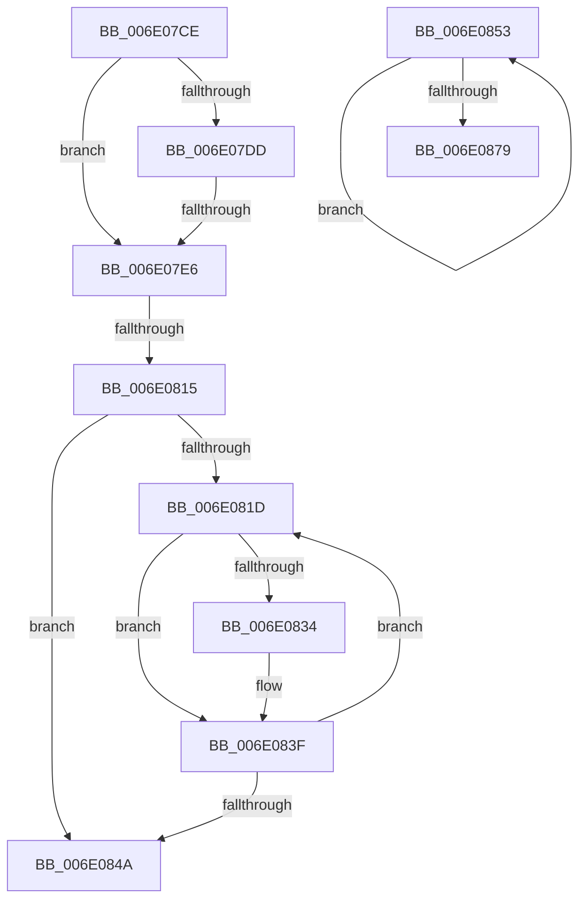

# sub_006E07CE

- RVA: `0x006E07CE`–`0x006E0886` (길이 `184` bytes)
- VA: `0x00000001406E07CE`
- 실행 섹션: `.text`
- PDB 이름 있음: `아니요`; PDB Function 태그: `아니요`
- unwind 정보 RVA: `0x000736F4`
- 디코드: `50`개 명령, `184/184` bytes 표시
- 미해석 바이트: `0` (있으면 어셈블리에 `.byte`로 보존)

> 이 문서는 커널 이미지의 기계어와 PDB 기호를 분석해 생성했습니다. 4번과 5번은 함수 원형과 자료형을 바이너리 사용 방식에서 추정한 C 해석이며 원본 소스 복구 결과는 아닙니다.

## 1. Dependencies

- 직접 호출 지점: **4**; 고유 호출 대상: **3**
- 직접 호출자로 확인된 함수: **0**
- RIP 상대 이미지 참조: **0**

### Outgoing calls
- `0x006E07EC` → [KiFindRescheduleContextEntryForPrcb](../35/KiFindRescheduleContextEntryForPrcb_function_00353060.md) (function, `0x00353060`)
- `0x006E0806` → [KiAdjustRescheduleContextEntryForThreadRemoval](../35/KiAdjustRescheduleContextEntryForThreadRemoval_function_00352340.md) (function, `0x00352340`)
- `0x006E083A` → [KiAdjustRescheduleContextEntryForThreadRemoval](../35/KiAdjustRescheduleContextEntryForThreadRemoval_function_00352340.md) (function, `0x00352340`)
- `0x006E086A` → [KiCompleteRescheduleContextEntry](../35/KiCompleteRescheduleContextEntry_function_00356330.md) (function, `0x00356330`)

### Direct callers
- 이 함수 시작 RVA로 연결되는 직접 call은 확인되지 않았습니다. 간접 호출은 완전히 역산할 수 없습니다.

### Static image references
- 디코드된 RIP-relative 메모리 참조가 없습니다.

## 2. Other-region calls and transfers

- 다른 실행 섹션으로 향하는 call: **0**
- call이 아닌 외부 분기/꼬리 이동: **4**
  - `0x006E07E0` → [KiUpdateGlobalCpuSetConfiguration + 0xDA](../30/KiUpdateGlobalCpuSetConfiguration_function_00305AB8.md) (`tail-transfer`)
  - `0x006E080F` → [KiUpdateGlobalCpuSetConfiguration + 0xDA](../30/KiUpdateGlobalCpuSetConfiguration_function_00305AB8.md) (`tail-transfer`)
  - `0x006E084E` → [KiUpdateGlobalCpuSetConfiguration + 0xDA](../30/KiUpdateGlobalCpuSetConfiguration_function_00305AB8.md) (`tail-transfer`)
  - `0x006E0881` → [KiUpdateGlobalCpuSetConfiguration + 0x13D](../30/KiUpdateGlobalCpuSetConfiguration_function_00305AB8.md) (`tail-transfer`)

## 3. Assembly (complete function range)

```asm
006E07CE  F0 0F BA 6B 78 0C               lock bts dword ptr [rbx + 0x78], 0xc
006E07D4  48 8B 46 10                     mov rax, qword ptr [rsi + 0x10]
006E07D8  48 85 C0                        test rax, rax
006E07DB  74 09                           je 0x1406e07e6
006E07DD  48 3B C3                        cmp rax, rbx
006E07E0  0F 85 AC 53 C2 FF               jne 0x140305b92
006E07E6  48 8B D6                        mov rdx, rsi
006E07E9  48 8B CF                        mov rcx, rdi
006E07EC  E8 6F 28 C7 FF                  call 0x140353060
006E07F1  BD 01 00 00 00                  mov ebp, 1
006E07F6  45 33 C0                        xor r8d, r8d
006E07F9  44 8A CD                        mov r9b, bpl
006E07FC  48 8B C8                        mov rcx, rax
006E07FF  4C 8B D8                        mov r11, rax
006E0802  44 8A 50 20                     mov r10b, byte ptr [rax + 0x20]
006E0806  E8 35 1B C7 FF                  call 0x140352340
006E080B  41 F6 C2 02                     test r10b, 2
006E080F  0F 84 7D 53 C2 FF               je 0x140305b92
006E0815  45 33 D2                        xor r10d, r10d
006E0818  44 38 07                        cmp byte ptr [rdi], r8b
006E081B  76 2D                           jbe 0x1406e084a
006E081D  41 8B C2                        mov eax, r10d
006E0820  4A 8D 0C 95 02 00 00 00         lea rcx, [r10*4 + 2]
006E0828  48 03 C8                        add rcx, rax
006E082B  48 8D 0C CF                     lea rcx, [rdi + rcx*8]
006E082F  49 3B CB                        cmp rcx, r11
006E0832  74 0B                           je 0x1406e083f
006E0834  44 8A CD                        mov r9b, bpl
006E0837  45 33 C0                        xor r8d, r8d
006E083A  E8 01 1B C7 FF                  call 0x140352340
006E083F  0F B6 07                        movzx eax, byte ptr [rdi]
006E0842  44 03 D5                        add r10d, ebp
006E0845  44 3B D0                        cmp r10d, eax
006E0848  72 D3                           jb 0x1406e081d
006E084A  83 67 04 00                     and dword ptr [rdi + 4], 0
006E084E  E9 3F 53 C2 FF                  jmp 0x140305b92
006E0853  8B CD                           mov ecx, ebp
006E0855  45 33 C9                        xor r9d, r9d
006E0858  48 83 C1 02                     add rcx, 2
006E085C  45 33 C0                        xor r8d, r8d
006E085F  49 8B D6                        mov rdx, r14
006E0862  48 8D 0C A9                     lea rcx, [rcx + rbp*4]
006E0866  48 8D 0C CF                     lea rcx, [rdi + rcx*8]
006E086A  E8 C1 5A C7 FF                  call 0x140356330
006E086F  0F B6 07                        movzx eax, byte ptr [rdi]
006E0872  41 03 ED                        add ebp, r13d
006E0875  3B E8                           cmp ebp, eax
006E0877  72 DA                           jb 0x1406e0853
006E0879  44 8B AC 24 90 00 00 00         mov r13d, dword ptr [rsp + 0x90]
006E0881  E9 6F 53 C2 FF                  jmp 0x140305bf5
```

## 4. C-style interpretation (structured pseudocode)

```c
__int64 __fastcall sub_006E07CE(__int64 a1, __int64 a2, int a3)
{
    __int64 result;
    __int64 v_r10;
    unsigned int v_stack_p90;

    if (*(unsigned __int64 *)(v_rsi + 16) == 0) goto loc_006E07E6;
loc_006E07E6:
    result = KiFindRescheduleContextEntryForPrcb(v_rdi, v_rsi, a3, a4);
    a3 = 0;
    result = KiAdjustRescheduleContextEntryForThreadRemoval(result, v_rsi, a3, 1);
    v_r10 = 0;
    if ((*(unsigned __int8 *)(v_rdi)) <= 0) goto loc_006E084A;
loc_006E081D:
    a1 = (v_r10 * 4 + 2) + (0);
    result = 0;
    if ((v_rdi + a1 * 8) != result) {
        a4 = 1;
        a3 = 0;
        result = KiAdjustRescheduleContextEntryForThreadRemoval(v_rdi + a1 * 8, v_rsi, a3, a4);
    }
    v_r10 = (unsigned int)((v_r10) + (1));
    if (((unsigned int)(v_r10)) < ((unsigned int)(*(unsigned __int8 *)(v_rdi)))) goto loc_006E081D;
loc_006E084A:
}
```

## 5. (Beta) C Style

```c
int64_t sub_006E07CE(int64_t Arg1, int64_t Arg2, int32_t Arg3)
{
    int64_t result;
    int64_t local_r10;
    uint32_t v_stack_p90;

    if (*(uint64_t *)(local_rsi + 0x10) == 0) goto loc_006E07E6;
loc_006E07E6:
    result = KiFindRescheduleContextEntryForPrcb(local_rdi, local_rsi, Arg3, a4);
    Arg3 = 0;
    result = KiAdjustRescheduleContextEntryForThreadRemoval(result, local_rsi, Arg3, 1);
    local_r10 = 0;
    if ((*(uint8_t *)(local_rdi)) <= 0) goto loc_006E084A;
loc_006E081D:
    Arg1 = (local_r10 * 4 + 2) + (0);
    result = 0;
    if ((local_rdi + Arg1 * 8) != result) {
        a4 = 1;
        Arg3 = 0;
        result = KiAdjustRescheduleContextEntryForThreadRemoval(local_rdi + Arg1 * 8, local_rsi, Arg3, a4);
    }
    local_r10 = (uint32_t)((local_r10) + (1));
    if (((uint32_t)(local_r10)) < ((uint32_t)(*(uint8_t *)(local_rdi)))) goto loc_006E081D;
loc_006E084A:
}
```

## 6. Execution-region graph

[열기: 2D/3D 그래프와 함수 탐색 컨트롤 패널](../../../control-panel.html?section=text&rva=0x006E07CE&view=graph)

- 2D 그래프는 위에서 아래로 흐르고, 3D 그래프는 빈 공간을 드래그해 회전합니다. Shift+드래그는 이동, 휠은 확대·축소, 함수 노드 선택은 대상 보고서 이동입니다.

### Static fallback


