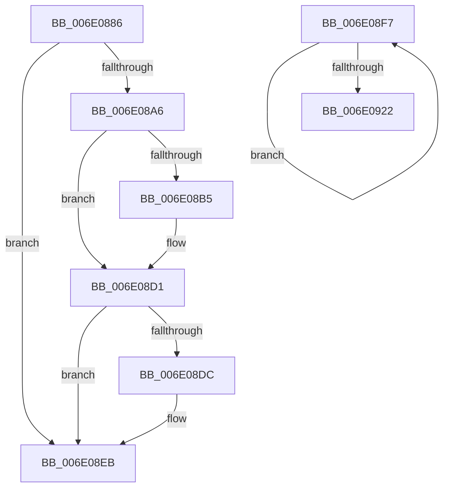

# sub_006E0886

- RVA: `0x006E0886`–`0x006E0927` (길이 `161` bytes)
- VA: `0x00000001406E0886`
- 실행 섹션: `.text`
- PDB 이름 있음: `아니요`; PDB Function 태그: `아니요`
- unwind 정보 RVA: `0x00073738`
- 디코드: `39`개 명령, `161/161` bytes 표시
- 미해석 바이트: `0` (있으면 어셈블리에 `.byte`로 보존)

> 이 문서는 커널 이미지의 기계어와 PDB 기호를 분석해 생성했습니다. 4번과 5번은 함수 원형과 자료형을 바이너리 사용 방식에서 추정한 C 해석이며 원본 소스 복구 결과는 아닙니다.

## 1. Dependencies

- 직접 호출 지점: **2**; 고유 호출 대상: **2**
- 직접 호출자로 확인된 함수: **0**
- RIP 상대 이미지 참조: **0**

### Outgoing calls
- `0x006E08CB` → [KeBugCheckEx](../4F/KeBugCheckEx_function_004FD660.md) (function, `0x004FD660`)
- `0x006E0913` → [KiUpdateThreadQosGroupingSummaries](../25/KiUpdateThreadQosGroupingSummaries_function_00257AEC.md) (function, `0x00257AEC`)

### Direct callers
- 이 함수 시작 RVA로 연결되는 직접 call은 확인되지 않았습니다. 간접 호출은 완전히 역산할 수 없습니다.

### Static image references
- 디코드된 RIP-relative 메모리 참조가 없습니다.

## 2. Other-region calls and transfers

- 다른 실행 섹션으로 향하는 call: **0**
- call이 아닌 외부 분기/꼬리 이동: **2**
  - `0x006E08F2` → [KiUpdateVPBackingThreadPriority + 0x6E](../30/KiUpdateVPBackingThreadPriority_function_00306040.md) (`tail-transfer`)
  - `0x006E0922` → [KiUpdateVPBackingThreadPriority + 0xAF](../30/KiUpdateVPBackingThreadPriority_function_00306040.md) (`tail-transfer`)

## 3. Assembly (complete function range)

```asm
006E0886  FE C2                           inc dl
006E0888  41 88 94 19 38 03 00 00         mov byte ptr [r9 + rbx + 0x338], dl
006E0890  8B 83 58 03 00 00               mov eax, dword ptr [rbx + 0x358]
006E0896  44 0F AB C8                     bts eax, r9d
006E089A  89 83 58 03 00 00               mov dword ptr [rbx + 0x358], eax
006E08A0  41 83 F8 20                     cmp r8d, 0x20
006E08A4  74 45                           je 0x1406e08eb
006E08A6  49 0F BE D0                     movsx rdx, r8b
006E08AA  8A 84 1A 38 03 00 00            mov al, byte ptr [rdx + rbx + 0x338]
006E08B1  84 C0                           test al, al
006E08B3  75 1C                           jne 0x1406e08d1
006E08B5  4C 8B C2                        mov r8, rdx
006E08B8  4C 89 74 24 20                  mov qword ptr [rsp + 0x20], r14
006E08BD  48 8B D3                        mov rdx, rbx
006E08C0  41 B9 02 00 00 00               mov r9d, 2
006E08C6  B9 57 01 00 00                  mov ecx, 0x157
006E08CB  E8 90 CD E1 FF                  call 0x1404fd660
006E08D0  CC                              int3
006E08D1  2C 01                           sub al, 1
006E08D3  88 84 1A 38 03 00 00            mov byte ptr [rdx + rbx + 0x338], al
006E08DA  75 0F                           jne 0x1406e08eb
006E08DC  8B 83 58 03 00 00               mov eax, dword ptr [rbx + 0x358]
006E08E2  0F BB D0                        btc eax, edx
006E08E5  89 83 58 03 00 00               mov dword ptr [rbx + 0x358], eax
006E08EB  44 89 BB 00 04 00 00            mov dword ptr [rbx + 0x400], r15d
006E08F2  E9 B7 57 C2 FF                  jmp 0x1403060ae
006E08F7  48 8B 0E                        mov rcx, qword ptr [rsi]
006E08FA  4C 8B 41 38                     mov r8, qword ptr [rcx + 0x38]
006E08FE  41 8A 40 40                     mov al, byte ptr [r8 + 0x40]
006E0902  8A D0                           mov dl, al
006E0904  32 93 04 02 00 00               xor dl, byte ptr [rbx + 0x204]
006E090A  80 E2 07                        and dl, 7
006E090D  32 C2                           xor al, dl
006E090F  41 88 40 40                     mov byte ptr [r8 + 0x40], al
006E0913  E8 D4 71 B7 FF                  call 0x140257aec
006E0918  48 8D 76 08                     lea rsi, [rsi + 8]
006E091C  49 83 EE 01                     sub r14, 1
006E0920  75 D5                           jne 0x1406e08f7
006E0922  E9 C8 57 C2 FF                  jmp 0x1403060ef
```

## 4. C-style interpretation (structured pseudocode)

```c
__int64 __fastcall sub_006E0886(__int64 a1, unsigned __int8 a2, int a3, __int64 a4)
{
    __int64 result;
    unsigned __int64 v_stack_p20;

    a2 = (unsigned __int8)((a2) + 1);
    *(unsigned __int8 *)(a4 + v_rbx * 1 + 824) = a2;
    *(unsigned int *)(v_rbx + 856) = (unsigned int)((unsigned int)(*(unsigned int *)(v_rbx + 856)));
    if (a3 == 32) goto loc_006E08EB;
    result = *(unsigned __int8 *)((__int8)((unsigned __int8)(a3)) + v_rbx * 1 + 824);
    if ((unsigned __int8)(*(unsigned __int8 *)((__int8)((unsigned __int8)(a3)) + v_rbx * 1 + 824)) == 0) {
        a3 = (__int8)((unsigned __int8)(a3));
        v_stack_p20 = v_r14;
        a2 = v_rbx;
        a4 = 2;
        a1 = 343;
        result = KeBugCheckEx(a1, a2, a3, a4);
    }
    result = (unsigned __int8)((result) - (1));
    *(unsigned __int8 *)(a2 + v_rbx * 1 + 824) = (unsigned __int8)(result);
    if (!(condition_is_not_equal)) {
        result = *(unsigned int *)(v_rbx + 856);
        *(unsigned int *)(v_rbx + 856) = (unsigned int)(result);
    }
    *(unsigned int *)(v_rbx + 1024) = (unsigned int)(v_r15);
}
```

## 5. (Beta) C Style

```c
int64_t sub_006E0886(int64_t Arg1, uint8_t Arg2, int32_t Arg3, void *Arg4)
{
    uint8_t *arg4 = (uint8_t *)Arg4;

    int64_t result;
    uint64_t v_stack_p20;

    Arg2 = (uint8_t)((Arg2) + 1);
    *(uint8_t *)(arg4 + local_rbx * 1 + 0x338) = Arg2;
    *(uint32_t *)(local_rbx + 0x358) = (uint32_t)((uint32_t)(*(uint32_t *)(local_rbx + 0x358)));
    if (Arg3 == 32) goto loc_006E08EB;
    result = *(uint8_t *)((int8_t)((uint8_t)(Arg3)) + local_rbx * 1 + 0x338);
    if ((uint8_t)(*(uint8_t *)((int8_t)((uint8_t)(Arg3)) + local_rbx * 1 + 0x338)) == 0) {
        Arg3 = (int8_t)((uint8_t)(Arg3));
        v_stack_p20 = local_r14;
        Arg2 = local_rbx;
        Arg4 = 2;
        Arg1 = 343;
        result = KeBugCheckEx(Arg1, Arg2, Arg3, Arg4);
    }
    result = (uint8_t)((result) - (1));
    *(uint8_t *)(Arg2 + local_rbx * 1 + 0x338) = (uint8_t)(result);
    if (!(condition_is_not_equal)) {
        result = *(uint32_t *)(local_rbx + 0x358);
        *(uint32_t *)(local_rbx + 0x358) = (uint32_t)(result);
    }
    *(uint32_t *)(local_rbx + 0x400) = (uint32_t)(local_r15);
}
```

### 관측된 메모리 오프셋

구조체 형식이 확인되지 않은 접근은 인자 기준의 오프셋으로만 기록했습니다.

| 기준 인자 | 오프셋 표현 | 폭 (bit) | 접근 |
|---|---:|---:|---|
| `Arg4` | `+ 0x338 + rbx*1` | `8` | `W` |

## 6. Execution-region graph

[열기: 2D/3D 그래프와 함수 탐색 컨트롤 패널](../../../control-panel.html?section=text&rva=0x006E0886&view=graph)

- 2D 그래프는 위에서 아래로 흐르고, 3D 그래프는 빈 공간을 드래그해 회전합니다. Shift+드래그는 이동, 휠은 확대·축소, 함수 노드 선택은 대상 보고서 이동입니다.

### Static fallback


