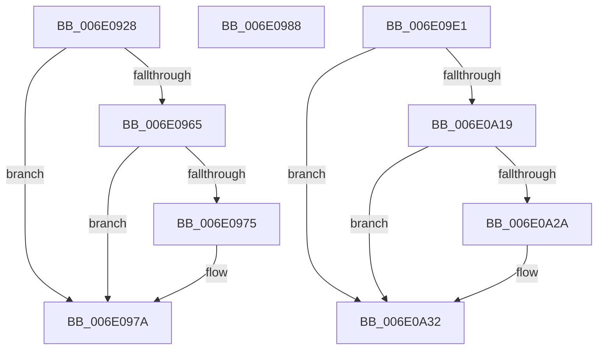

# sub_006E0928

- RVA: `0x006E0928`–`0x006E0A47` (길이 `287` bytes)
- VA: `0x00000001406E0928`
- 실행 섹션: `.text`
- PDB 이름 있음: `아니요`; PDB Function 태그: `아니요`
- unwind 정보 RVA: `0x00073774`
- 디코드: `73`개 명령, `287/287` bytes 표시
- 미해석 바이트: `0` (있으면 어셈블리에 `.byte`로 보존)

> 이 문서는 커널 이미지의 기계어와 PDB 기호를 분석해 생성했습니다. 4번과 5번은 함수 원형과 자료형을 바이너리 사용 방식에서 추정한 C 해석이며 원본 소스 복구 결과는 아닙니다.

## 1. Dependencies

- 직접 호출 지점: **7**; 고유 호출 대상: **5**
- 직접 호출자로 확인된 함수: **0**
- RIP 상대 이미지 참조: **1**

### Outgoing calls
- `0x006E0975` → [KiRaiseIrqlProcessIrqlFlags](../4F/KiRaiseIrqlProcessIrqlFlags_function_004F56FC.md) (function, `0x004F56FC`)
- `0x006E097D` → [MmGetPhysicalAddress](../23/MmGetPhysicalAddress_function_0023A500.md) (function, `0x0023A500`)
- `0x006E098D` → [HvlpReleaseHypercallPage](../31/HvlpReleaseHypercallPage_function_00313480.md) (function, `0x00313480`)
- `0x006E09A1` → [HvlpAcquireHypercallPage](../47/HvlpAcquireHypercallPage_function_00471410.md) (function, `0x00471410`)
- `0x006E09D6` → [HvlpAffinityToHvProcessorSet](../30/HvlpAffinityToHvProcessorSet_function_003068F4.md) (function, `0x003068F4`)
- `0x006E0A2D` → [KiRaiseIrqlProcessIrqlFlags](../4F/KiRaiseIrqlProcessIrqlFlags_function_004F56FC.md) (function, `0x004F56FC`)
- `0x006E0A35` → [MmGetPhysicalAddress](../23/MmGetPhysicalAddress_function_0023A500.md) (function, `0x0023A500`)

### Direct callers
- 이 함수 시작 RVA로 연결되는 직접 call은 확인되지 않았습니다. 간접 호출은 완전히 역산할 수 없습니다.

### Static image references
- `0x006E096D` → RVA `0x00FC6D20` (`ALMOSTRO`; read)

## 2. Other-region calls and transfers

- 다른 실행 섹션으로 향하는 call: **0**
- call이 아닌 외부 분기/꼬리 이동: **3**
  - `0x006E0983` → [HvlRetargetDeviceInterrupt + 0xC7](../30/HvlRetargetDeviceInterrupt_function_003062A0.md) (`tail-transfer`)
  - `0x006E09DC` → [HvlRetargetDeviceInterrupt + 0x15A](../30/HvlRetargetDeviceInterrupt_function_003062A0.md) (`tail-transfer`)
  - `0x006E0A42` → [HvlRetargetDeviceInterrupt + 0x282](../30/HvlRetargetDeviceInterrupt_function_003062A0.md) (`tail-transfer`)

## 3. Assembly (complete function range)

```asm
006E0928  48 C7 C2 00 F0 FF FF            mov rdx, 0xfffffffffffff000
006E092F  48 8D 8D A7 00 00 00            lea rcx, [rbp + 0xa7]
006E0936  48 83 E1 F8                     and rcx, 0xfffffffffffffff8
006E093A  48 8D 79 7F                     lea rdi, [rcx + 0x7f]
006E093E  48 8B C7                        mov rax, rdi
006E0941  48 23 FA                        and rdi, rdx
006E0944  48 33 C1                        xor rax, rcx
006E0947  48 85 C2                        test rdx, rax
006E094A  BA 02 00 00 00                  mov edx, 2
006E094F  8B F2                           mov esi, edx
006E0951  89 54 24 28                     mov dword ptr [rsp + 0x28], edx
006E0955  48 0F 44 F9                     cmove rdi, rcx
006E0959  44 0F 20 C0                     mov rax, cr8
006E095D  88 44 24 30                     mov byte ptr [rsp + 0x30], al
006E0961  3A C2                           cmp al, dl
006E0963  73 15                           jae 0x1406e097a
006E0965  44 0F 20 C1                     mov rcx, cr8
006E0969  44 0F 22 C2                     mov cr8, rdx
006E096D  39 1D AD 63 8E 00               cmp dword ptr [rip + 0x8e63ad], ebx
006E0973  74 05                           je 0x1406e097a
006E0975  E8 82 4D E1 FF                  call 0x1404f56fc
006E097A  48 8B CF                        mov rcx, rdi
006E097D  E8 7E 9B B5 FF                  call 0x14023a500
006E0982  90                              nop
006E0983  E9 DF 59 C2 FF                  jmp 0x140306367
006E0988  48 8D 4C 24 28                  lea rcx, [rsp + 0x28]
006E098D  E8 EE 2A C3 FF                  call 0x140313480
006E0992  45 33 C9                        xor r9d, r9d
006E0995  48 8D 4C 24 28                  lea rcx, [rsp + 0x28]
006E099A  45 33 C0                        xor r8d, r8d
006E099D  41 8D 51 01                     lea edx, [r9 + 1]
006E09A1  E8 6A 0A D9 FF                  call 0x140471410
006E09A6  48 8B F8                        mov rdi, rax
006E09A9  48 8D 4C 24 70                  lea rcx, [rsp + 0x70]
006E09AE  0F 57 C0                        xorps xmm0, xmm0
006E09B1  33 C0                           xor eax, eax
006E09B3  44 8B C6                        mov r8d, esi
006E09B6  0F 11 07                        movups xmmword ptr [rdi], xmm0
006E09B9  48 8D 57 30                     lea rdx, [rdi + 0x30]
006E09BD  0F 11 47 10                     movups xmmword ptr [rdi + 0x10], xmm0
006E09C1  0F 11 47 20                     movups xmmword ptr [rdi + 0x20], xmm0
006E09C5  48 89 47 30                     mov qword ptr [rdi + 0x30], rax
006E09C9  48 8B 44 24 20                  mov rax, qword ptr [rsp + 0x20]
006E09CE  0F 10 00                        movups xmm0, xmmword ptr [rax]
006E09D1  F3 0F 7F 47 28                  movdqu xmmword ptr [rdi + 0x28], xmm0
006E09D6  E8 19 5F C2 FF                  call 0x1403068f4
006E09DB  90                              nop
006E09DC  E9 19 5A C2 FF                  jmp 0x1403063fa
006E09E1  48 C7 C2 00 F0 FF FF            mov rdx, 0xfffffffffffff000
006E09E8  44 89 64 24 48                  mov dword ptr [rsp + 0x48], r12d
006E09ED  48 8D 8D 87 00 00 00            lea rcx, [rbp + 0x87]
006E09F4  48 83 E1 F8                     and rcx, 0xfffffffffffffff8
006E09F8  48 8D 59 0F                     lea rbx, [rcx + 0xf]
006E09FC  48 8B C3                        mov rax, rbx
006E09FF  48 23 DA                        and rbx, rdx
006E0A02  48 33 C1                        xor rax, rcx
006E0A05  48 85 C2                        test rdx, rax
006E0A08  48 0F 44 D9                     cmove rbx, rcx
006E0A0C  44 0F 20 C0                     mov rax, cr8
006E0A10  88 44 24 50                     mov byte ptr [rsp + 0x50], al
006E0A14  41 3A C4                        cmp al, r12b
006E0A17  73 19                           jae 0x1406e0a32
006E0A19  44 0F 20 C1                     mov rcx, cr8
006E0A1D  45 0F 22 C4                     mov cr8, r12
006E0A21  44 39 3D F8 62 8E 00            cmp dword ptr [rip + 0x8e62f8], r15d
006E0A28  74 08                           je 0x1406e0a32
006E0A2A  41 8A D4                        mov dl, r12b
006E0A2D  E8 CA 4C E1 FF                  call 0x1404f56fc
006E0A32  48 8B CB                        mov rcx, rbx
006E0A35  E8 C6 9A B5 FF                  call 0x14023a500
006E0A3A  4C 8B C0                        mov r8, rax
006E0A3D  48 89 44 24 60                  mov qword ptr [rsp + 0x60], rax
006E0A42  E9 DB 5A C2 FF                  jmp 0x140306522
```

## 4. C-style interpretation (structured pseudocode)

```c
__int64 __fastcall sub_006E0928(__int64 a1, __int64 a2, int a3, int a4)
{
    __int64 result;
    __int64 v_rdi;
    unsigned __int64 v_stack_p20;
    unsigned int v_stack_p28;
    unsigned __int8 v_stack_p30;
    unsigned int v_stack_p48;
    unsigned __int8 v_stack_p50;
    unsigned __int64 v_stack_p60;
    unsigned __int64 v_stack_p70;

    a1 = (v_rbp + 167) & (-8);
    v_rdi = (a1 + 127) & (0xFFFFFFFFFFFFF000ULL);
    result = (a1 + 127) ^ (a1);
    v_stack_p28 = 2;
    if (((0xFFFFFFFFFFFFF000ULL) & (result)) == 0) { v_rdi = a1; }
    v_stack_p30 = (unsigned __int8)(v_cr8);
    if (((unsigned __int8)(v_cr8)) >= 2) goto loc_006E097A;
    result = v_cr8;
    if ((*(unsigned int *)(v_rip + 9331629)) != ((unsigned int)(v_rbx))) {
        result = KiRaiseIrqlProcessIrqlFlags(v_cr8, 2, a3, a4);
    }
    result = MmGetPhysicalAddress(v_rdi, 2, a3, a4);
}
```

## 5. (Beta) C Style

```c
int64_t sub_006E0928(int64_t Arg1, int64_t Arg2, int32_t Arg3, int32_t Arg4)
{
    int64_t result;
    int64_t local_rdi;
    uint64_t v_stack_p20;
    uint32_t v_stack_p28;
    uint8_t v_stack_p30;
    uint32_t v_stack_p48;
    uint8_t v_stack_p50;
    uint64_t v_stack_p60;
    uint64_t v_stack_p70;

    Arg1 = (local_rbp + 167) & (-8);
    local_rdi = (Arg1 + 127) & (0xFFFFFFFFFFFFF000ULL);
    result = (Arg1 + 127) ^ (Arg1);
    v_stack_p28 = 2;
    if (((0xFFFFFFFFFFFFF000ULL) & (result)) == 0) { local_rdi = Arg1; }
    v_stack_p30 = (uint8_t)(v_cr8);
    if (((uint8_t)(v_cr8)) >= 2) goto loc_006E097A;
    result = v_cr8;
    if ((*(uint32_t *)(v_rip + 0x8E63AD)) != ((uint32_t)(local_rbx))) {
        result = KiRaiseIrqlProcessIrqlFlags(v_cr8, 2, Arg3, Arg4);
    }
    result = MmGetPhysicalAddress(local_rdi, 2, Arg3, Arg4);
}
```

## 6. Execution-region graph

[열기: 2D/3D 그래프와 함수 탐색 컨트롤 패널](../../../control-panel.html?section=text&rva=0x006E0928&view=graph)

- 2D 그래프는 위에서 아래로 흐르고, 3D 그래프는 빈 공간을 드래그해 회전합니다. Shift+드래그는 이동, 휠은 확대·축소, 함수 노드 선택은 대상 보고서 이동입니다.

### Static fallback


